# Business Logic and Billing Engine

> **Status:** Design only. Nothing here is implemented. This is the most important logic in the product: **an invoice must never be created twice for the same period, and a period must never be skipped.**
> Related: [Database Design](../database/database-design.md) · [State Machines](state-machines.md) · [Data Flows](data-flows.md) · [Security](security-and-rbac.md)

## 1. Big picture

```mermaid
flowchart LR
    S[Scheduler / Admin 'Run billing now'] --> R[Billing run<br/>as_of date]
    R --> Q[Find due subscriptions<br/>FOR UPDATE SKIP LOCKED]
    Q --> T{{One transaction<br/>per subscription}}
    T --> P[Compute period]
    P --> L[Load lines + snapshot prices]
    L --> D[Pick eligible discount]
    D --> X[Compute tax per line]
    X --> I[INSERT invoice + lines + tax details]
    I --> A[Advance next_billing_date]
    A --> C[COMMIT]
    C --> M[Email invoice after commit]
```



Principles: **one subscription = one short transaction**; the invoice insert and the "advance the cursor" update commit together or not at all; the database unique index is the final guard.

---

## 2. Billing cycle model

- A subscription has a **billing anchor** (`billing_anchor_date`, normally `start_date`) and a **period counter** (`period_index`, number of periods already billed).
- Billing is **in advance**: the period is billed on its first day.
- `next_billing_date` = start of the next unbilled period. It is a cached copy of `period_start(period_index)` so the scheduler can use an index.

### 2.1 Period dates

```
period_start(n) = anchor + n × frequency        -- always computed from the ANCHOR, never from the previous period
period_end(n)   = period_start(n + 1) − 1 day   -- inclusive
```

| Frequency | `period_start(n)` | Example (anchor in brackets) |
|---|---|---|
| daily | anchor + n days | (1 Mar) → 1 Mar, 2 Mar, 3 Mar… |
| weekly | anchor + 7n days | (3 Nov) → 3 Nov, 10 Nov, 17 Nov… |
| monthly | `add_months(anchor, n)`, clamped to the last day of the target month | (31 Jan) → 31 Jan, **28 Feb**, **31 Mar**, **30 Apr** |
| yearly | `add_months(anchor, 12n)`, clamped | (29 Feb 2028) → 29 Feb 2028, **28 Feb 2029**, 28 Feb 2030, 28 Feb 2031, **29 Feb 2032** |

Why from the anchor: computing "previous start + 1 month" would drift (31 Jan → 28 Feb → 28 Mar → 28 Apr). Computing from the anchor keeps the billing day stable.

Period boundaries are **calendar dates (no time zone)**: `DATE` columns, with "today" evaluated in one configured business time zone (`APP_TIMEZONE`, default `Asia/Kolkata`) so a run at 00:05 does not produce off-by-one days. OPEN QUESTION: confirm time zone.

### 2.2 Start, expiry and the last period

- Billing starts when the subscription becomes `active`: `billing_anchor_date = start_date`, `period_index = 0`, `next_billing_date = start_date`.
- A period is billed only if `period_start ≤ expiry_date`. After billing a period, if the *next* start is after `expiry_date`, `next_billing_date` is set to `NULL` (nothing more to bill).
- The last period is billed **in full** even if it extends beyond `expiry_date` (no proration). OPEN QUESTION: proration is not supported. Alternative: shorten `period_end` to `expiry_date` and bill proportionally.
- Starting in the past (backdated start): the catch-up logic in §9.3 bills every missed period one at a time. OPEN QUESTION: whether backdated starts should be allowed; assumed Admin only.
- Pause: no invoices while paused. On resume: `billing_anchor_date = resume_date`, `period_index = 0`, `next_billing_date = resume_date`; `expiry_date` is extended by the days paused.

### 2.3 Renewal

Renewal extends `expiry_date` by one term (same length as the existing term) without creating a new subscription or touching billing history. The anchor and `period_index` are unchanged, so billing continues without a gap or a duplicate. See [State Machines §2.3](state-machines.md).

---

## 3. Quantity, price and variants

1. **Minimum quantity** — each line quantity must be `≥ plans.min_quantity`. Checked when a line is added/edited and again before activation. The billing engine does not re-check, since the data was validated earlier; it only asserts `quantity > 0`.
2. **Variant price** — when a line is created: `unit_price = product.sales_price + variant.price_adjustment` (or the template/plan override). Example: base 1,000 + Odoo brand 560 = **1,560**. The result is stored on `subscription_items.unit_price`.
3. **Invoice price** — invoices copy `subscription_items.unit_price`. They do **not** re-read the product, so a catalogue price change affects only new/edited lines. OPEN QUESTION: should price changes propagate to existing subscriptions? Assumed no (contract price).
4. Effective price must be `≥ 0` (validated when the line is saved).

---

## 4. Discounts

### 4.1 Which discounts are considered
Only discounts **granted** to the subscription (`subscription_discounts`) are candidates. Evaluation date = the invoice's `period_start`, so a retry or a catch-up run gives the same answer as the original run.

A discount is **eligible** when all hold:

| Check | Rule |
|---|---|
| Active | `discounts.is_active` |
| Dates | `start_date ≤ period_start` and (`end_date IS NULL` or `period_start ≤ end_date`) |
| Usage limit | `max_uses IS NULL OR used_count < max_uses` |
| Scope | `subscription` scope → all lines are eligible; `products` scope → only lines whose product is in `discount_products` (none eligible ⇒ discount not eligible) |
| Minimum purchase | `Σ line_subtotal of eligible lines ≥ min_purchase_amount` (if set) |
| Minimum quantity | `Σ quantity of eligible lines ≥ min_quantity` (if set) |

### 4.2 Amount
```
base     = Σ line_subtotal of eligible lines
fixed:      amount = MIN(value, base)
percentage: amount = ROUND_HALF_UP(base × value / 100, 2)
```
The discount reduces the amount **before** tax, so tax is charged on the discounted price. OPEN QUESTION: confirm with the business.

### 4.3 One discount per invoice (assumption)
If several are eligible, apply the one with the **largest amount** (tie → lowest `id`). Stacking is not supported; this keeps results predictable and the schema simple (`UNIQUE(invoice_id)` on redemptions). OPEN QUESTION.

### 4.4 Allocation to lines
The discount is spread over the eligible lines in proportion to `line_subtotal`. Each share is rounded down to 2 decimals; the leftover cents go to the last eligible line. This way tax can be computed per line and the line shares sum exactly to the discount.

### 4.5 Usage limit (race-safe)
Inside the invoice transaction:
```sql
UPDATE discounts
   SET used_count = used_count + 1
 WHERE id = $1 AND is_active
   AND (max_uses IS NULL OR used_count < max_uses);
-- 0 rows updated ⇒ discount just ran out: invoice is generated WITHOUT it (not an error)
```
then `INSERT INTO discount_redemptions`. Two concurrent invoices cannot both take the last use: the `UPDATE` serializes on the discount row. If the invoice transaction rolls back, the counter rolls back too.
When a draft/confirmed-unpaid invoice is cancelled, its redemption row is deleted and `used_count` decremented (OPEN QUESTION: assumed the use is returned).

Expired or exhausted discounts stop applying automatically because the eligibility check fails; nothing needs to "turn them off".

---

## 5. Tax

- Each subscription line may reference one active `tax_rule`; its rate is looked up when invoicing and **copied** to the invoice line (`tax_rate`, `tax_name`).
- Prices are **tax-exclusive** (assumption).
- Per line: `tax_amount = ROUND_HALF_UP(taxable_amount × tax_rate / 100, 2)` where `taxable_amount = line_subtotal − discount_amount`.
- `invoice_tax_details` groups lines by `(tax_name, tax_rate)`; its `tax_amount` is the **sum of the already-rounded line taxes** (not a re-computation), so the printed tax summary always equals the sum of the lines.
- An inactive tax rule referenced by an existing line still applies to that subscription (so billing does not silently stop charging tax); the admin is warned in the UI. OPEN QUESTION.

## 6. Money handling

- Database: `NUMERIC(12,2)`. Application: handle values as **strings or integer paise** and compute with a decimal library (e.g. `decimal.js`) or integer arithmetic. **Never use JavaScript `Number` floating point for money.** API sends/receives money as strings: `"1560.00"`.
- Rounding: `ROUND_HALF_UP` at 2 decimals, once per line for tax and once per discount. No other intermediate rounding.
- Rate columns are `NUMERIC(6,3)`; percentages are not converted to floats.

## 7. Worked example

Subscription: 5 seats of "Platform – Brand: Odoo" → unit price 1,000 + 560 = **1,560**. Tax: GST 18%. Discount: 10% (percentage, subscription scope, min quantity 5).

| Step | Calculation | Result |
|---|---|---|
| line_subtotal | 5 × 1,560.00 | 7,800.00 |
| discount | 10% × 7,800.00 | 780.00 |
| taxable_amount | 7,800.00 − 780.00 | 7,020.00 |
| tax_amount | 7,020.00 × 18% | 1,263.60 |
| line_total | 7,020.00 + 1,263.60 | **8,283.60** |
| invoice | subtotal 7,800.00 − discount 780.00 + tax 1,263.60 | **8,283.60** |

Rounding example: taxable 33.33 × 5% = 1.6665 → **1.67** (half-up).

---

## 8. Invoice generation (one subscription, one period)

Inside a single transaction, for a subscription row already locked:

1. Compute `period_start/period_end` from `period_index` (§2.1). If `period_start > expiry_date` ⇒ set `next_billing_date = NULL`, stop.
2. Load subscription lines, customer, payment term, tax rules (snapshots are taken now).
3. Select the eligible discount (§4) and reserve its usage.
4. Compute line amounts, discounts, taxes, totals (§5–§6).
5. `INSERT` invoice (`status = 'draft'`) with `number = nextval('invoice_number_seq')`, snapshot fields, `issue_date = run date`, `due_date = issue_date + term.due_days`, `billing_run_id`; then lines and `invoice_tax_details`; then the redemption row.
6. `UPDATE subscriptions SET period_index = period_index + 1, next_billing_date = <next period start or NULL>, last_billing_error = NULL`.
7. `INSERT audit_logs`.
8. `COMMIT`. Only **after** commit is any email queued (never hold a transaction open while calling the mail server).

Generated invoices are `draft`; staff review and confirm (single or bulk "confirm all drafts of this run"). OPEN QUESTION: auto-confirm option (`BILLING_AUTO_CONFIRM`), default off.

---

## 9. Duplicate prevention and reliability

### 9.1 Defence in depth

| Layer | Mechanism | Protects against |
|---|---|---|
| 1. **Database constraint** | partial unique index `(subscription_id, period_start) WHERE status <> 'cancelled'` | any double insert, from any code path, including bugs |
| 2. **Transaction** | invoice insert and `next_billing_date` advance commit together | invoice created but cursor not advanced (⇒ duplicate next run) or cursor advanced but no invoice (⇒ skipped period) |
| 3. **Row lock** | `SELECT … FOR UPDATE SKIP LOCKED` on the subscription | two workers/runs processing the same subscription at once |
| 4. **Cursor** | billing is driven by `next_billing_date`, not by "today's date" | missed runs; running twice on the same day |
| 5. **Natural idempotency key** | `(subscription_id, period_start)` *is* the idempotency key; no random key is needed | retries |

Handling a unique-violation in step 5 of §8: treat as **"already billed"** — roll back that subscription's transaction, log `invoices_skipped++`, then re-read the subscription (another transaction has advanced the cursor). It is not an error.

### 9.2 The scan query (conceptually)

```sql
SELECT id FROM subscriptions
 WHERE status = 'active' AND paused_at IS NULL
   AND next_billing_date <= :as_of
   AND (last_billing_attempt_at IS NULL OR last_billing_attempt_at < :run_started_at)
 ORDER BY next_billing_date, id
 LIMIT 1
   FOR UPDATE SKIP LOCKED;     -- served by the partial index on next_billing_date
```
Loop: take one, bill one period, commit, repeat until none are returned. Hundreds or thousands of due subscriptions simply become a loop of short transactions; each can be processed by another worker in parallel without conflicts.

### 9.3 Failure scenarios

| Scenario | What happens | Why it is safe |
|---|---|---|
| **Scheduler fires twice** / two app instances | Second run finds locked rows (skipped) or advanced cursors (nothing due) | row locks + cursor + unique index |
| **Scheduler retries after a crash mid-run** | Committed subscriptions are already advanced; uncommitted ones rolled back and are picked up again | per-subscription atomic transaction |
| **Server down on billing day (missed job)** | On next start, a **startup catch-up run** executes with `as_of = today`; daily check also runs at start | billing is driven by `next_billing_date <= today`, not by the job having run |
| **Several periods missed** (e.g. server down 3 days, daily plan) | The loop re-selects the same subscription until `next_billing_date > as_of` ⇒ 3 invoices, one per period, none skipped | cursor advances one period per transaction. Safety cap: `MAX_CATCHUP_PERIODS` (e.g. 400) per subscription per run — OPEN QUESTION |
| **Failure for one subscription** (bad data, DB error) | That transaction rolls back; `last_billing_attempt_at` and `last_billing_error` are written in a separate small transaction; other subscriptions continue; the run ends `completed_with_errors` | `last_billing_attempt_at < run_started_at` filter stops infinite retry within the run; next run retries; staff see the error on the subscription |
| **Many subscriptions due at once** | Processed sequentially in short transactions (or by 2–4 parallel workers with `SKIP LOCKED`) | no long locks; progress is durable |
| **Email fails** | Invoice already exists; `sent_at` stays null; staff can resend; a retry job may resend unsent confirmed invoices | email is outside the billing transaction |
| **Manual "Run billing now" while scheduler runs** | Both proceed; locks/index prevent overlap | same as double-fire |
| **Admin cancels a generated invoice** | Cursor was already advanced, so the scheduler will **not** regenerate it. Staff re-issue it explicitly (allowed because the unique index ignores cancelled rows) | prevents surprise duplicates; avoids silent skipping because the cancellation is visible in audit logs and the subscription's billing history |

### 9.4 Run bookkeeping
Each run writes a `billing_runs` row (`running` → `completed` / `completed_with_errors`). A row stuck at `running` with an old `started_at` shows a crashed run. This table is **informational only**; correctness never depends on it.

### 9.5 Scheduler choice
`node-cron` inside the API process fires the run (e.g. daily 00:30 `APP_TIMEZONE`, and hourly as a safety net). Because the run is idempotent, firing too often is harmless. `pg-boss` or a separate worker is an upgrade path, not a requirement. See [System Architecture §11](system-architecture.md).

---

## 10. Payments, allocation and balances

### 10.1 Recording a payment
Inputs: invoice(s), `method`, `amount`, `payment_date`, `note`, optional `reference_number`. In one transaction:
1. Lock the invoice(s) `FOR UPDATE`.
2. Validate: invoice `confirmed`; `amount > 0`; each allocation `≤ amount_due`; `Σ allocations ≤ payment.amount`; `payment_date` not in the future.
3. Insert `payments` and `payment_allocations`.
4. `UPDATE invoices SET amount_paid = amount_paid + :alloc`; if the new `amount_due = 0` ⇒ `status = 'paid'`, `paid_at = now()`.
5. Audit log. Commit.

The common UI case ("record payment against this invoice") creates one payment and one allocation. Splitting one bank transfer over several invoices creates several allocations.

### 10.2 Partial payments
The invoice stays `confirmed` with `amount_paid > 0` and `amount_due > 0` (derived `payment_state = partially_paid`, or `overdue` if past due). It becomes `paid` only when `amount_due = 0`.

### 10.3 Over-payment (OPEN QUESTION)
v1 **rejects** an allocation larger than `amount_due` (HTTP 422). Customer credit balances are out of scope unless the team decides otherwise.

### 10.4 Duplicate payment entries
- Same `(method, reference_number)` cannot be recorded twice (unique index, non-void payments).
- Payments without a reference: the API accepts an optional `Idempotency-Key` header; the UI disables the submit button while saving. The server also rejects a payment with identical `(customer, invoice, amount, date, method)` created in the last 60 seconds unless `confirm_duplicate: true` is sent. OPEN QUESTION: keep or drop this heuristic.
- Concurrent submissions are serialized by the invoice row lock: the second sees the reduced `amount_due` and fails validation if it would overpay.

### 10.5 Voiding
Admin voids a wrong payment: `voided_at`, `void_reason`; allocations are removed (or marked), invoice `amount_paid` recomputed from remaining allocations, `paid → confirmed` if needed, audit logged. Payments are never hard-deleted.

### 10.6 Balances and overdue (derived)

```
amount_due(invoice)      = total − amount_paid                       (stored, generated)
customer outstanding     = Σ amount_due WHERE status='confirmed' AND customer_id = :c
company outstanding      = Σ amount_due WHERE status='confirmed'
overdue invoices         = status='confirmed' AND amount_due > 0 AND due_date < :today
overdue amount           = Σ amount_due of the above
revenue received (month) = Σ payment_allocations.amount JOIN payments
                           WHERE payments.voided_at IS NULL AND payment_date BETWEEN :from AND :to
```
Revenue is measured on **cash received** (payments), while billed amounts are measured on **invoices** — the dashboard labels them separately. Drafts and cancelled invoices are excluded from outstanding and billed totals. Because `amount_paid` is maintained inside the payment transaction, a reconciliation query (`amount_paid = Σ allocations`) can be run as a health check and in tests.

---

## 11. Test scenarios the billing engine must pass (for Phase 8)

1. Monthly anchor 31 Jan → periods 31 Jan, 28 Feb, 31 Mar, 30 Apr.
2. Running billing twice on the same day creates exactly one invoice per due period.
3. Two simultaneous runs (parallel) create no duplicates.
4. A run that crashes after the invoice insert but before commit leaves no invoice and an un-advanced cursor.
5. Server "down" for 3 days on a daily plan produces exactly 3 invoices with consecutive periods.
6. Paused subscription is not billed; resumed one bills from the resume date.
7. Subscription past expiry generates no new invoice; last period is billed once.
8. Discount: stops at `end_date`; stops at `max_uses`; last use is taken by exactly one of two concurrent invoices.
9. Variant price (+560) and tax (18%) produce `8,283.60` for the §7 example.
10. Partial payment leaves `confirmed`; final payment sets `paid`; over-payment rejected; duplicate reference rejected.
11. A cancelled invoice's period can be re-issued; a non-cancelled period cannot.
12. `invoice.total = Σ lines` and `amount_paid = Σ allocations` for every invoice in a generated 5,000-subscription dataset.
