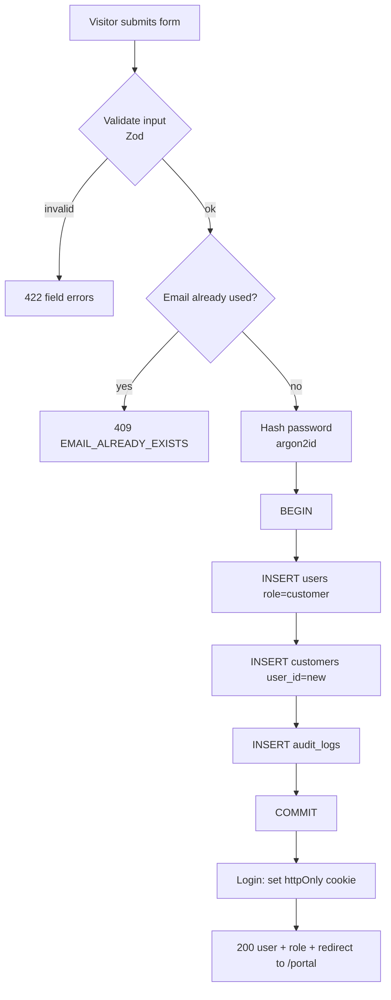
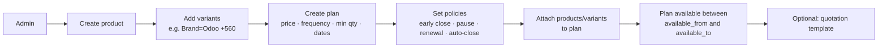
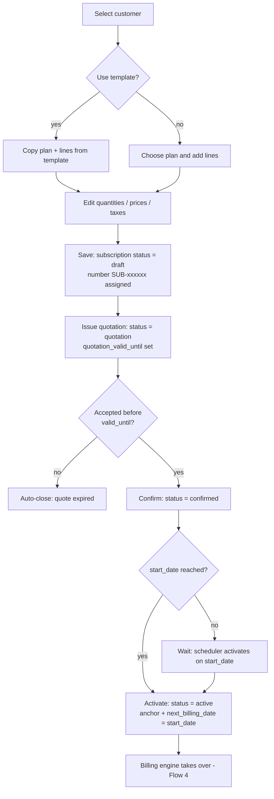
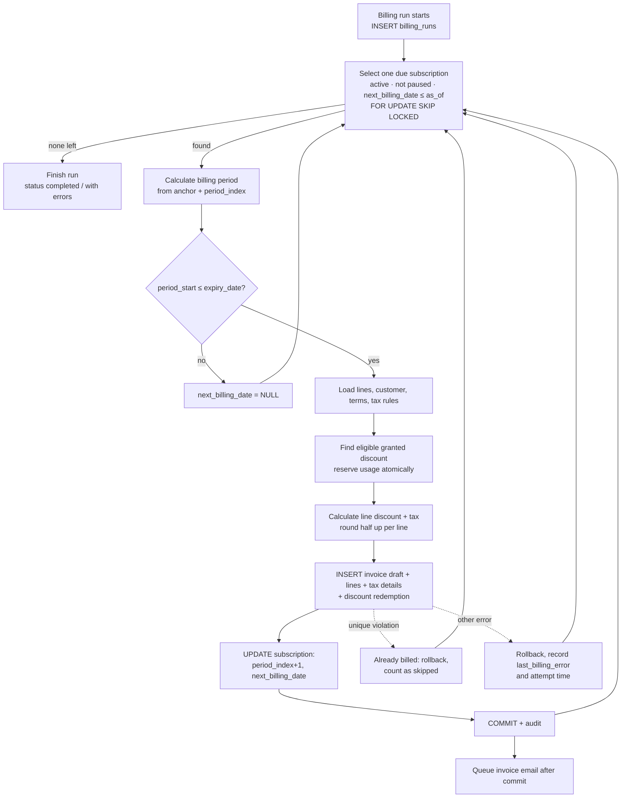
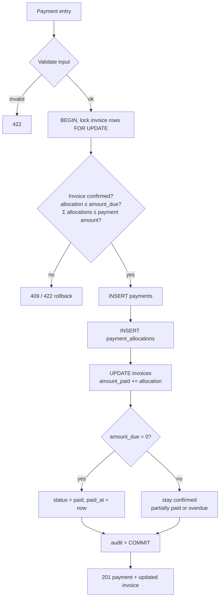
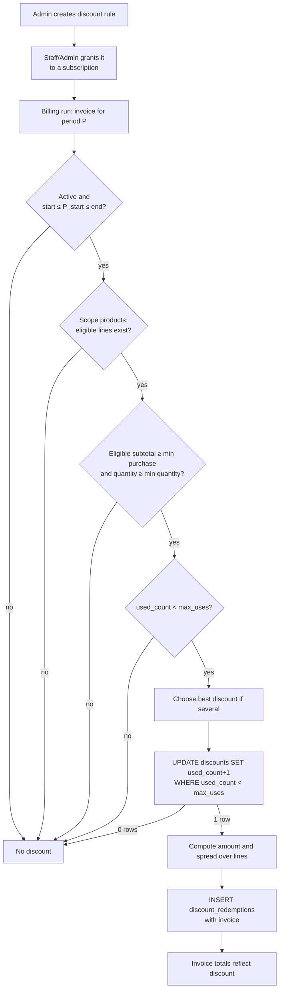
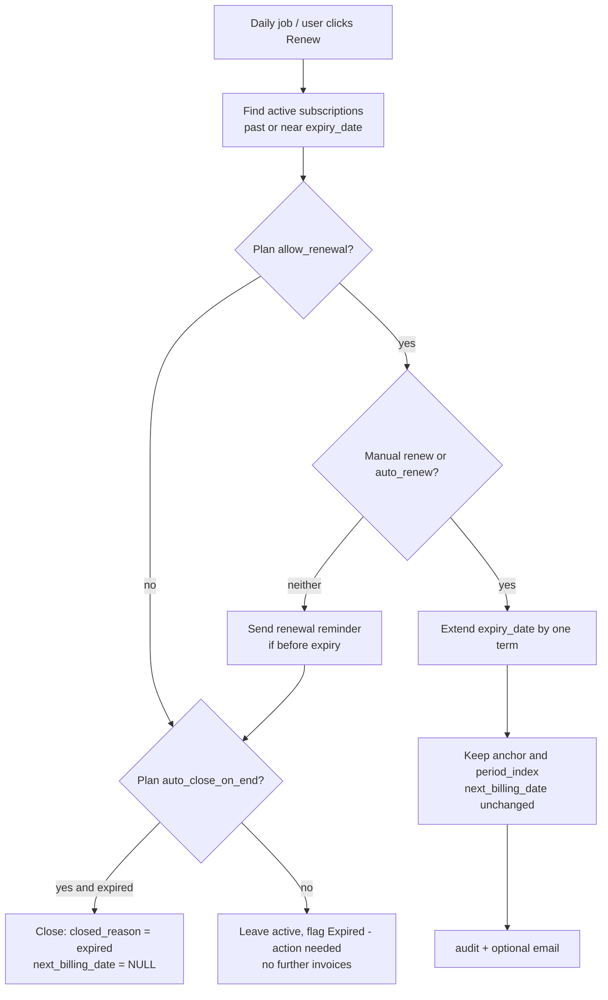
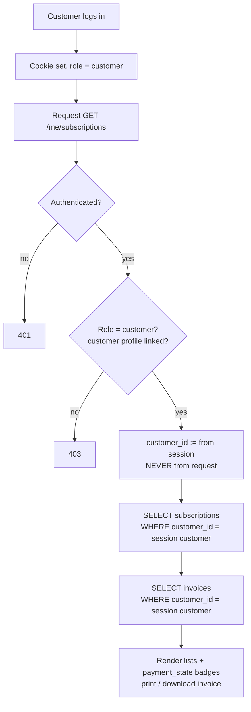

# Data Flows

> **Status:** Proposed designs; nothing is implemented. Table names refer to [Database Design](../database/database-design.md); endpoint names to the [API Spec](../api/api-specification.md); rules to the [Billing Engine](billing-engine.md) and [State Machines](state-machines.md).

Each flow lists: **Trigger · Input · Processing · Database operations · Output · Failure scenarios**. All multi-step writes happen in **one transaction** unless stated.

| # | Flow |
|---|---|
| 1 | [Customer registration](#flow-1-customer-registration) |
| 2 | [Product and plan creation](#flow-2-product-and-plan-creation) |
| 3 | [Quotation to subscription](#flow-3-quotation-to-subscription) |
| 4 | [Recurring billing](#flow-4-recurring-billing) |
| 5 | [Payment processing](#flow-5-payment-processing) |
| 6 | [Discount application](#flow-6-discount-application) |
| 7 | [Subscription renewal](#flow-7-subscription-renewal) |
| 8 | [Customer portal](#flow-8-customer-portal) |

---

## Flow 1: Customer registration

**Trigger:** a visitor submits the registration form.
**Input:** `full_name`, `email`, `password` (and optionally company, phone).

**Processing**
1. Validate: email format; password length **> 8**, ≥ 1 uppercase, ≥ 1 lowercase, ≥ 1 special character; name present. Normalize the email (trim, lowercase).
2. Check for an existing account (the unique index is the real guard; the pre-check only gives a friendlier error).
3. Hash the password. Never log or store the plain password.
4. Insert user (role `customer`) and linked customer profile in one transaction.
5. Log the user in (cookie) — or require a separate login step. OPEN QUESTION: auto-login after registration (assumed yes). Optional: email verification is **not** in the requirements and is not planned.

**Database operations:** `INSERT users`, `INSERT customers`, `INSERT audit_logs`.
**Output:** `201 Created` with the user's basic profile; auth cookie set.
**Failures**

| Failure | Result |
|---|---|
| Weak password / invalid email | 422 with per-field messages |
| Duplicate email (including a race between two submissions) | unique-violation caught ⇒ 409; no partial rows because of the transaction |
| DB down | 503; nothing stored |
| Brute-force registration spam | rate limit ⇒ 429 |

**Related login flow:** `POST /auth/login` → find user by email → verify hash (same generic error `INVALID_CREDENTIALS` for wrong email or password) → reject if `is_active = false` → set cookie → update `last_login_at`. **Password reset:** `POST /auth/forgot-password` (always responds 200, never reveals whether the email exists) → create `password_reset_tokens` (hashed token, 1-hour expiry) → email link → `POST /auth/reset-password` validates token + new password rules → updates hash, marks token used, invalidates other tokens.

---

## Flow 2: Product and plan creation

**Trigger:** Admin works in the catalogue screens.
**Input:** product (`name`, `product_type`, `sales_price`, `cost_price`, `notes`); variants (`attribute_name`, `attribute_value`, `price_adjustment`); plan (`name`, `price`, `billing_frequency`, `min_quantity`, availability dates, policy flags); plan products.

**Processing**
1. Authorize: role must be Admin.
2. Validate: price/cost `≥ 0`; name unique; variant unique per product; effective price (`sales_price + adjustment`) `≥ 0`; plan frequency in the allowed set; `min_quantity ≥ 1`; `available_to ≥ available_from`.
3. Insert rows; write audit entries.
4. "Availability" is evaluated whenever a subscription is created for the plan: `plan.is_active` and `available_from ≤ start_date ≤ available_to` (null `available_to` = open-ended).

**Database operations:** `INSERT products` → `INSERT product_variants` → `INSERT plans` → `INSERT plan_products` (→ `quotation_templates`, `quotation_template_items`) → `audit_logs`.
**Output:** created resources with IDs.
**Failures**

| Failure | Result |
|---|---|
| Not an Admin | 403 |
| Duplicate product/variant/plan name | 409 |
| Negative price or inconsistent dates | 422 |
| Deleting a product/plan already used by subscriptions | blocked (FK `RESTRICT`); API offers **deactivate** (`is_active = false`) instead |
| Changing a price later | affects only **new** subscription lines; existing lines and invoices keep their snapshots |

---

## Flow 3: Quotation to subscription

**Trigger:** a sales rep (Staff/Admin) prepares an offer for a customer.
**Input:** `customer_id`, optional `template_id`, `plan_id`, `start_date`, `expiry_date`, `payment_term_id`, lines (`product_id`, `variant_id`, `quantity`, `unit_price`, `tax_rule_id`).

**Processing**
1. Create `draft`: validate customer, plan availability on `start_date`, quantity `≥ plan.min_quantity`, `expiry_date ≥ start_date`. Lines are copied from the template/plan; each line **snapshots** `description` and `unit_price` (= product price + variant adjustment unless overridden).
2. `draft → quotation`: needs ≥ 1 line; sets `quotation_valid_until = today + template.validity_days` (or manual). The customer can be emailed the quote (optional) and may confirm it in the portal.
3. `quotation → confirmed`: only if today ≤ `quotation_valid_until`.
4. `confirmed → active`: on/after `start_date`; sets `billing_anchor_date`, `period_index = 0`, `next_billing_date = start_date`. The first invoice is produced by the next billing run (Flow 4), not by the activation code, so there is one path that creates invoices.
5. Each transition uses a conditional update (`WHERE status = :expected`) and writes an audit row.

**Database operations:** `SELECT quotation_templates/items` → `INSERT subscriptions` (number from `subscription_number_seq`) → `INSERT subscription_items` → `UPDATE subscriptions SET status…` ×3 → `INSERT audit_logs`.
**Output:** subscription with status and the full line list; totals are computed for display (`Σ line_amount` + estimated tax).
**Failures**

| Failure | Result |
|---|---|
| Plan not available on `start_date` / inactive | 422 `PLAN_NOT_AVAILABLE` |
| Quantity below plan minimum | 422 |
| Confirming an expired quotation | 409 `QUOTATION_EXPIRED` |
| Two people confirm at once | the second conditional update affects 0 rows ⇒ 409 `INVALID_STATE_TRANSITION` |
| Editing lines after confirmation | 409 (read-only outside draft/quotation) |
| Staff try to open someone else's quotation as a customer | 404 (ownership filter) |

---

## Flow 4: Recurring billing

**Trigger:** scheduler (daily, plus startup catch-up) or Admin "Run billing now".
**Input:** `as_of` date (default: today in `APP_TIMEZONE`).
Full rules: [Billing Engine](billing-engine.md).

**Processing** — as the diagram: identify due subscriptions → compute the period → apply discount → compute tax → generate the invoice → update billing history (the subscription cursor `period_index/next_billing_date` plus the invoice's own `period_start/period_end`).
**Database operations:** `INSERT billing_runs`; per subscription: `SELECT … FOR UPDATE SKIP LOCKED`, `SELECT` lines/discounts/taxes, `UPDATE discounts` (guarded counter), `INSERT invoices`, `invoice_items`, `invoice_tax_details`, `discount_redemptions`, `UPDATE subscriptions`, `INSERT audit_logs`; finally `UPDATE billing_runs`.
**Output:** draft invoices; a run summary (scanned, created, skipped, errors); staff then confirm and send.
**Failures**

| Failure | Result |
|---|---|
| Run twice / two instances | no duplicates (row locks, advanced cursor, partial unique index) |
| Crash mid-run | uncommitted subscription rolled back and retried next run; committed ones are not repeated |
| Missed days | catch-up bills each missed period once |
| One subscription fails | recorded on the subscription; others continue; run ends `completed_with_errors` |
| Discount just exhausted | invoice issued without discount |
| Email server down | invoice exists; `sent_at` null; retry/resend later |

---

## Flow 5: Payment processing

**Trigger:** Staff/Admin records a payment (from the invoice page or the payments screen).
**Input:** `customer_id` (derived from the invoice), `method`, `amount`, `payment_date`, `note`, optional `reference_number`, allocations `[{invoice_id, amount}]` (UI default: one allocation for the full or entered amount).

**Processing:** validate → lock invoices → check invariants → insert payment and allocations → update `amount_paid` → mark `paid` when `amount_due = 0` → audit. Duplicate protection: unique `(method, reference_number)`; optional `Idempotency-Key`; the invoice lock serializes simultaneous submissions.
**Database operations:** `SELECT invoices FOR UPDATE` → `INSERT payments` → `INSERT payment_allocations` → `UPDATE invoices` → `INSERT audit_logs`.
**Output:** the payment, its allocations, and the invoice's new `amount_paid`, `amount_due`, `status`, `payment_state`.
**Failures**

| Failure | Result |
|---|---|
| Invoice not confirmed (draft/cancelled/already paid) | 409 `INVALID_INVOICE_STATE` |
| Over-payment | 422 `ALLOCATION_EXCEEDS_AMOUNT_DUE` |
| Same bank/cheque reference twice | 409 `DUPLICATE_PAYMENT_REFERENCE` |
| Two staff pay the last amount simultaneously | second sees `amount_due = 0` ⇒ 409 |
| Wrong payment recorded | Admin voids it (Flow note in [Billing Engine §10.5](billing-engine.md)) |
| Staff recording against a different customer's invoice | allowed (staff operate on all customers); customers cannot record payments |

---

## Flow 6: Discount application

**Trigger A (configuration):** Admin creates a discount rule. **Trigger B (grant):** Admin/Staff attaches it to a subscription. **Trigger C (application):** billing run (Flow 4) evaluates it for each invoice.
**Input (A):** `name`, `discount_type`, `value`, `scope`, `min_purchase_amount`, `min_quantity`, `start_date`, `end_date`, `max_uses`, product list (if scope = products).

**Database operations:** `INSERT discounts` (+ `discount_products`) → `INSERT subscription_discounts` → during billing: `SELECT` eligible → `UPDATE discounts` (guarded) → `INSERT discount_redemptions`, set `invoice_items.discount_amount`.
**Output:** discounted invoice lines; `used_count` incremented; the discount's usage visible to Admin (`used_count / max_uses`).
**Failures**

| Failure | Result |
|---|---|
| Non-admin tries to create a discount | 403 |
| `percentage > 100`, `end_date < start_date`, `max_uses ≤ 0`, scope/product mismatch | 422 |
| Last use contended by two invoices | exactly one wins; the other invoice has no discount |
| Invoice cancelled before payment | redemption deleted, `used_count - 1` |
| Discount edited after use | past invoices unchanged (amounts snapshotted); only future applications change |

---

## Flow 7: Subscription renewal

**Trigger:** daily expiry job; also manual "Renew" by Staff/Admin/Customer (where the plan permits).
**Input:** `subscription_id` (job: every active subscription with `expiry_date < today`, and optionally those expiring within N days for reminders).

**Processing**
1. Select candidates; lock each row.
2. Check the **plan policy** (`allow_renewal`, `auto_close_on_end`, plan still active) and the **subscription state** (`active`, not already renewed).
3. Renew: `expiry_date += term length`. Because billing is driven by the existing cursor, **billing continues seamlessly**; if billing had stopped because the cursor passed the old expiry (`next_billing_date = NULL`), the renewal recomputes `next_billing_date = period_start(period_index)` if that is `≤` the new expiry.
4. Or close: set `status = 'closed'`, `closed_reason = 'expired'`, `closed_at`.
5. Audit all changes.

**Database operations:** `SELECT … FOR UPDATE` → `UPDATE subscriptions` (expiry/next billing or status) → `INSERT audit_logs`.
**Output:** updated subscription; optional email to the customer.
**Failures**

| Failure | Result |
|---|---|
| Plan disallows renewal | 403 `RENEWAL_NOT_ALLOWED`; subscription closes at expiry if the plan auto-closes |
| Subscription already closed | 409 |
| Plan deactivated | renewal blocked; staff must migrate to a new plan (OPEN QUESTION) |
| Customer renews a subscription that is not theirs | 404 |
| Job runs twice | second run finds nothing to change (conditional updates) |

---

## Flow 8: Customer portal

**Trigger:** a customer logs in and opens "My subscriptions" / "My invoices".
**Input:** auth cookie; optional filters (`status`, date range), pagination.

**Processing:** authentication → role check → resolve `customer_id` from the logged-in user → every query includes `WHERE customer_id = :me`. Detail pages use `WHERE id = :id AND customer_id = :me`; no match ⇒ **404** (not 403, so existence isn't leaked). Customers can perform plan-permitted actions on their own subscriptions (pause/resume, renew, close) and view/print their own invoices. They cannot see drafts (OPEN QUESTION: assumed customers see only `confirmed`, `paid` and `cancelled` invoices, never `draft`), internal notes, costs, other customers, or financial reports.
**Database operations:** read-only `SELECT`s on `subscriptions`, `subscription_items`, `invoices`, `invoice_items`, `invoice_tax_details`, `payments`/`payment_allocations` (for payment history) — all filtered by customer.
**Output:** subscription list (number, plan, status, next billing date, expiry), invoice list (number, period, total, `amount_due`, `payment_state`), invoice detail/print view.
**Failures**

| Failure | Result |
|---|---|
| Expired/missing cookie | 401, frontend redirects to login |
| Customer changes an ID in the URL to another customer's | 404 |
| Account disabled | 401/403 |
| Customer user has no linked `customers` row | 403 with clear message (should not occur after Flow 1) |
