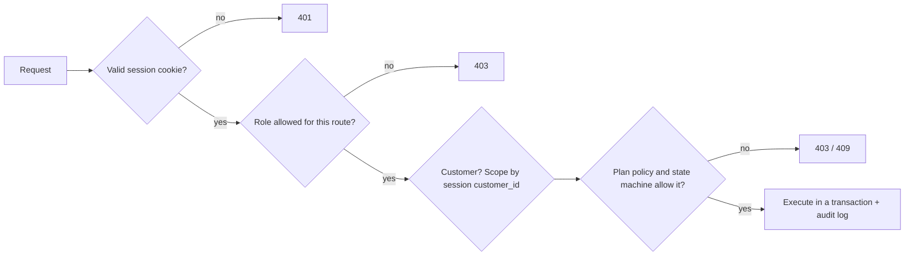

# Security and Access Control

> **Status:** Proposed design; not implemented. **Golden rule: the backend enforces every permission. Hiding a button in the UI is a convenience, never a security control.**
> Related: [System Architecture](system-architecture.md) · [API Spec](../api/api-specification.md) · [Database Design](../database/database-design.md) · [Data Flows](data-flows.md)

## 1. Roles **[Official]**

| Role | Definition |
|---|---|
| **Admin** | Full system access. Sets up products, plans, taxes, discounts; the **only** role that can create staff accounts and discount rules. |
| **Staff** | Internal team (sales reps, finance lead). Restricted operational access — no configuration of the catalogue, taxes, discounts or staff. |
| **Customer** | Registered external user. Sees and manages **only their own** subscriptions and invoices through the portal. |

The problem statement fixes three things: Admin has complete access; Staff has *limited* access; Customers see only their own data; only Admin adds staff. **Everything else in the matrix below is our proposal** (marked ◆ where it is a judgement call to be confirmed by the team).

## 2. Role–permission matrix

✔ allowed · ✘ denied · own = only records belonging to the logged-in customer · R read-only

| Permission | Admin | Staff | Customer | Notes |
|---|:-:|:-:|:-:|---|
| **Manage products** (create/edit/deactivate, variants) | ✔ | R ◆ | ✘ | Official: Admin manages products |
| **Manage plans** (incl. policy flags) | ✔ | R ◆ | ✘ | Official: Admin decides policies plan by plan |
| Manage quotation templates | ✔ | R ◆ | ✘ | Staff *use* templates to create quotations |
| **Create staff** | ✔ | ✘ | ✘ | **Official: Admin only** |
| **Manage customers** | ✔ | ✔ (no deactivate ◆) | own profile | Staff handle customers day to day |
| **Create quotations** | ✔ | ✔ | ✘ ◆ | Sales reps create quotes; customers may *confirm* their own |
| **Manage subscriptions** (create, edit, activate, close) | ✔ | ✔ | own actions only* | *Customer: pause/renew/close **only** if the plan permits |
| Override plan policy (e.g. close early when disallowed) | ✔ | ✘ | ✘ | audited |
| **Configure taxes** | ✔ | R ◆ | ✘ | Official: admin-configurable tax rules |
| **Create discounts** (rules) | ✔ | ✘ | ✘ | **Official: only administrators** |
| Grant a discount to a subscription | ✔ | ✔ ◆ | ✘ | OPEN QUESTION — Admin-only is the stricter alternative |
| **Generate invoices** (manual) | ✔ | ✔ | ✘ | automatic generation by the system |
| Confirm / cancel / send / print invoices | ✔ | ✔ (cancel a paid-partly invoice ✘) | print/view own | |
| Run billing manually | ✔ | ✘ (view runs R) ◆ | ✘ | |
| **Record payments** | ✔ | ✔ | ✘ | |
| Void payments | ✔ | ✘ | ✘ | corrections need accountability |
| **View financial reports** (dashboard, revenue, overdue) | ✔ | ✔ | ✘ | finance lead is a Staff account |
| **View personal subscriptions** | ✔ | ✔ | ✔ own | |
| **View personal invoices** | ✔ | ✔ | ✔ own (non-draft ◆) | |
| View audit logs | ✔ | ✘ | ✘ | |
| Change own password / profile | ✔ | ✔ | ✔ | |

OPEN QUESTION: Should the finance lead have a dedicated role (read-only reports + payments)? Assumption: no; Staff covers it, to match the three roles in the problem statement.

## 3. Authentication

| Topic | Design |
|---|---|
| **Password hashing** | **argon2id** (preferred) or **bcrypt** (cost ≥ 12). Per-password random salt (built into both). Plain passwords are never logged, stored, or returned. |
| **Password policy [Official]** | length **> 8** (i.e. at least 9 characters), ≥ 1 uppercase, ≥ 1 lowercase, ≥ 1 special character. Enforced by the **server** (Zod schema shared in tests), mirrored in the UI for friendly messages. Also reject passwords equal to the email. Max length 128 to avoid hashing abuse. |
| **Unique email [Official]** | `CITEXT UNIQUE` on `users.email`; email trimmed and lowercased on input. |
| **Session / token** | Signed JWT (or opaque session id) in an **`httpOnly`, `SameSite=Lax`, `Secure` (in production)** cookie; expiry ~8 h; user id and role inside. On each request the backend loads the user (`is_active`, role) from the database so a disabled user or changed role takes effect immediately. OPEN QUESTION: JWT vs server-side session table (the latter allows instant "log out everywhere"). |
| **Never** | store tokens in `localStorage`; put secrets or password hashes in tokens; trust a role sent by the client. |
| **Password reset [Official]** | `forgot-password` creates a random 32-byte token, stores only its SHA-256 hash with a 1-hour expiry, emails a link containing the raw token. Reset marks the token used. The endpoint always replies 200 (no account enumeration). Locally the email lands in Mailpit. |
| **Login protection** | rate limit per IP + per email (e.g. 10 attempts / 15 min → 429); identical error for unknown email or wrong password; optional short lockout. |
| **Logout** | clears the cookie (and revokes the session if a session table is used). |
| **Staff creation** | only `POST /users/staff` by Admin; there is no way to obtain a staff/admin role through registration. The first Admin comes from a seed/CLI step, not from a public endpoint. |

## 4. Authorization (enforced on the backend)

Two checks on every protected request, in this order:

1. **Role check** (what kind of user?) — route-level middleware, e.g. `requireRole('admin')`, `requireRole('admin','staff')`. Better still: a named permission map (`permissions.js`: `'discount:create' → ['admin']`) so the matrix above exists in exactly one place in code and in this document.
2. **Ownership / policy check** (which records, which actions?)
   - Customer endpoints derive `customer_id` from the **session**, never from the request body/URL, and add it to every query.
   - Plan policies (`allow_pause`, `allow_early_close`, `allow_renewal`) are checked in the service layer at the time of the action, for customers and staff alike (Admin may override and is audited).
   - State-machine checks make impossible actions fail even for Admin ([State Machines](state-machines.md)).

Not-found vs forbidden: for a customer asking for another customer's record, respond **404** (don't confirm that it exists).

### 4.1 Customer data isolation
- Every customer-facing query includes `WHERE customer_id = :sessionCustomerId` (put in one shared repository helper so nobody forgets it).
- IDs in URLs are never trusted on their own (**IDOR** protection): `WHERE id = :id AND customer_id = :me`.
- Customers can never see: other customers, cost prices, draft invoices (◆), internal notes, reports, audit logs, user lists.
- Test cases (Phase 8): a customer token calling every `/subscriptions/:id`, `/invoices/:id`, `/payments/:id` with another customer's id must get 404/403; staff/admin endpoints with a customer token must get 403.

## 5. Input validation

- **Every** endpoint validates `body`, `params` and `query` with a Zod schema before touching a service; unknown fields are stripped or rejected; strings are trimmed and length-limited; numbers/dates/enum values are checked.
- Money is accepted as a string matching `^\d{1,10}(\.\d{1,2})?$`; quantities are positive integers; dates are real calendar dates.
- Business validation lives in services (plan availability, minimum quantity, state transitions); data integrity is *also* enforced by DB constraints (`CHECK`, `UNIQUE`, FKs) as the last line of defence.
- Pagination: `page_size` capped (100); `sort` and filter fields whitelisted; `q` length-limited.
- Request body size limit (e.g. 100 kB).
- The frontend repeats checks for usability only.

## 6. Injection and web-attack prevention

| Threat | Mitigation |
|---|---|
| **SQL injection** | Only parameterized queries: ORM methods or bound parameters (`$1`) in raw SQL. **Never** build SQL by concatenating user input. Sort columns are chosen from a whitelist, not interpolated from the request. |
| **XSS** | React escapes by default; never use `dangerouslySetInnerHTML` on user data; invoice print view escapes all fields; `helmet` sets security headers (CSP in production). |
| **CSRF** | `SameSite=Lax` cookie, no state change on `GET`, `Origin`/`Referer` check on non-GET requests (or a CSRF token if the frontend and API are on different sites). |
| **IDOR / broken access control** | Section 4.1. |
| **Brute force / enumeration** | Rate limiting; uniform error messages; forgot-password always 200. |
| **Mass assignment** | Services pick allowed fields explicitly; clients can never set `role`, `status`, `amount_paid`, `used_count`, `number`, totals. |
| **Double submit / replay** | Idempotent billing; unique references on payments; button disabling; optional `Idempotency-Key`. |
| **Sensitive data exposure** | No password hashes or tokens in responses or logs; error messages generic; stack traces only in server logs. |
| **Dependency risk** | Few dependencies; lockfile committed; `npm audit` before the demo; only well-known packages. |

## 7. API protection checklist
- HTTPS in any shared deployment (cookies marked `Secure`).
- CORS: allow only the frontend origin, `credentials: true`.
- `helmet` headers; `x-powered-by` disabled.
- Rate limits: strict on `/auth/*` (login, register, forgot/reset), moderate globally.
- Central error handler → consistent error envelope, request id, no internals leaked.
- Every route is declared with its required role in one routing table (so a missing guard is visible in review). Default for a new route: **deny** unless a guard is declared.
- Audit logging for: staff creation, role/active changes, product/plan/tax/discount changes, subscription transitions, invoice confirm/cancel, payments recorded/voided, manual billing runs, failed-login bursts.
- Database account used by the app has no superuser rights; `audit_logs` is insert-only for that account.

## 8. Environment variables and secrets

- Config is read from environment variables, validated at startup (the app refuses to start with missing/invalid values).
- `.env` files are **git-ignored**; the repo contains only `.env.example` with fake values and comments. Never commit real passwords, JWT secrets or SMTP credentials; if a secret is committed by mistake, **rotate it** (deleting the commit is not enough).
- Planned variables (names are proposals): `NODE_ENV`, `PORT`, `DATABASE_URL`, `JWT_SECRET` (≥ 32 random bytes), `COOKIE_SECURE`, `CORS_ORIGIN`, `SMTP_HOST`, `SMTP_PORT`, `SMTP_USER`, `SMTP_PASS`, `MAIL_FROM`, `APP_BASE_URL` (for reset links), `APP_TIMEZONE`, `BILLING_CRON`, `BILLING_AUTO_CONFIRM`, `LOG_LEVEL`.
- Different values for development, test and demo environments. The hackathon demo secret is not the dev secret.
- Frontend env vars (Vite `VITE_*`) are **public** — only non-secret values (API URL) go there.

## 9. Security work by roadmap phase

| Phase | Security tasks |
|---|---|
| 1 | `.gitignore`, `.env.example`, config validation, helmet/CORS/rate-limit scaffolding |
| 2 | Registration, password policy, hashing, login, cookie, reset flow, RBAC middleware + permission map |
| 3–6 | Zod schema per endpoint; ownership scoping helper; audit logger |
| 8 | Authorization test suite (every endpoint × every role), IDOR tests, `npm audit`, manual review against this document |

## 10. OPEN QUESTIONs
1. JWT cookie vs server-side session table.
2. Should Staff see cost prices (`products.cost_price`)? Assumed yes (read-only) because margin awareness is useful to sales; customers never.
3. Should customers be able to confirm quotations online? Assumed yes (own quotation, before validity ends).
4. Dedicated finance-lead role? Assumed no.
5. Do customers see `draft` invoices? Assumed no.
6. Account lockout policy after repeated failed logins.
