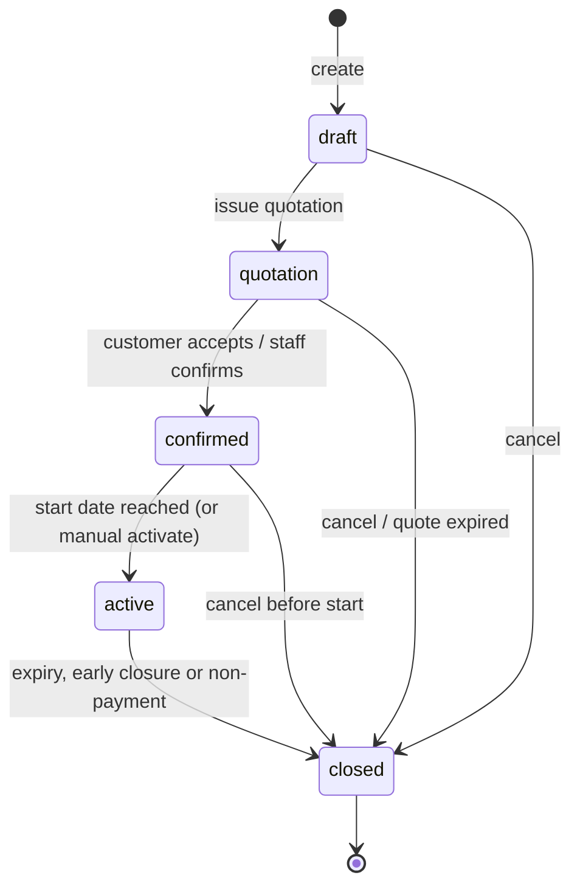
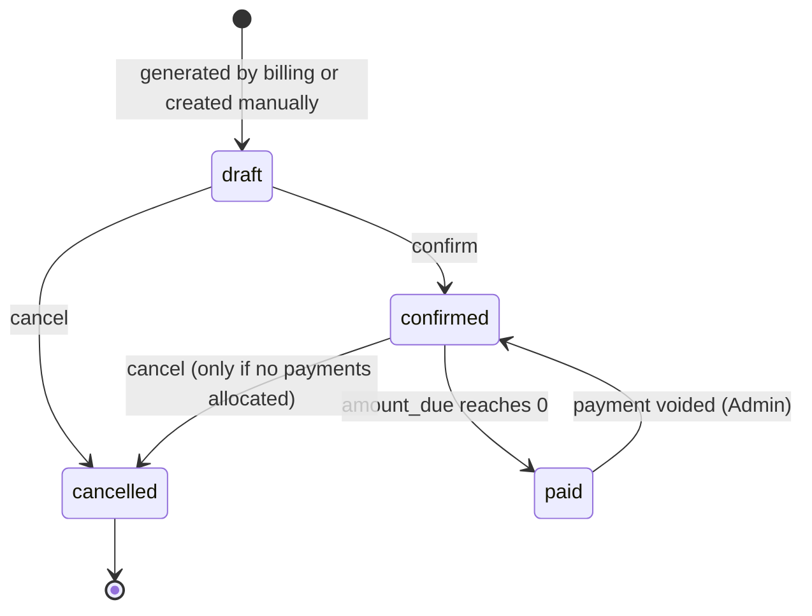

# Subscription and Invoice State Machines

> **Status:** Proposed. Official requirements are marked **[Official]**; our additions are marked **[Proposed]**.
> Related: [Database Design](../database/database-design.md) · [Billing Engine](billing-engine.md) · [Security & RBAC](security-and-rbac.md) · [API Spec](../api/api-specification.md)

## 1. Plan policy vs subscription state (read this first)

These are two different things and must never be mixed up.

| | **Plan policy** | **Subscription state** |
|---|---|---|
| Lives in | `plans` table | `subscriptions` table |
| Answers | "What *may* happen to subscriptions on this plan?" | "Where is *this* subscription right now?" |
| Example | `allow_pause = true` | `status = 'active'`, `paused_at = 2026-11-02` |
| Changed by | Admin only | Workflow actions (staff, customer, scheduler) |
| Changes over time? | Rarely | Constantly |

A transition that depends on a policy must check the plan **at the moment of the action** (e.g. pausing needs `plans.allow_pause = true`).

---

## 2. Subscription lifecycle

### 2.1 Official states **[Official]**

`Draft → Quotation → Confirmed → Active → Closed`

The five states in `subscriptions.status` are exactly the official ones; we add **no sixth state**.

### 2.2 Transition table

| From | To | Trigger | Who | Preconditions / validation |
|---|---|---|---|---|
| (new) | `draft` | Create subscription (optionally from a quotation template) | Admin, Staff | customer exists; plan active and **available on `start_date`** (`available_from ≤ start_date ≤ available_to`); `expiry_date ≥ start_date`; quantities ≥ plan `min_quantity` |
| `draft` | `quotation` | "Send/issue quotation" | Admin, Staff | ≥ 1 line; all lines have price and valid quantity; sets `quotation_valid_until` from the template `validity_days` (or a manual value) |
| `quotation` | `confirmed` | Customer accepts, or staff confirms on their behalf | Admin, Staff; Customer (own quote only) | today ≤ `quotation_valid_until`; plan still active; sets `confirmed_at` |
| `confirmed` | `active` | `start_date` reached (scheduler) or manual "Activate" | System; Admin, Staff | today ≥ `start_date` (manual activation earlier requires Admin); sets `activated_at`, `billing_anchor_date = start_date`, `period_index = 0`, `next_billing_date = start_date` |
| `active` | `closed` | **Automatic expiry**: today > `expiry_date` | System (scheduler) | only if `plans.auto_close_on_end`; `closed_reason = 'expired'` |
| `active` | `closed` | **Early closure** | Admin, Staff; Customer (own) | requires `plans.allow_early_close`, except Admin may override (recorded in audit log); `closed_reason = 'early_closure'`; stops billing (`next_billing_date = NULL`) |
| `draft` / `quotation` / `confirmed` | `closed` | Cancel | Admin, Staff | `closed_reason = 'cancelled'`; no invoices exist yet |
| `quotation` | `closed` | Quote validity passed | System | today > `quotation_valid_until`; `closed_reason = 'cancelled'` (OPEN QUESTION: show as "expired quote" in UI) |

**Terminal state:** `closed` is final. A closed subscription is never reopened; to continue the business the staff create a new subscription (OPEN QUESTION: whether a "reopen" action is needed — not assumed).

**Not allowed (rejected with HTTP 409):** any transition not in the table, e.g. `draft → active`, `quotation → active`, `active → draft`, `closed → anything`.

F09's pure quotation rule table lives in
`backend/src/modules/subscriptions/subscriptions.state-machine.ts`. It maps
issue, confirm and pre-activation cancel to their permitted states. Its pure
validity guard accepts the inclusive deadline and an injected business date;
the caller must obtain that date in the configured timezone. It does not
perform database updates or enforce ownership or concurrency; the F09 service
must apply those guards and the shared transactional transition helper. The
shared helper and service integration are still pending. F10 must
extend the same subscription state-machine module for later lifecycle actions.

### 2.3 Pause and renewal **[Proposed]** — operations, not states

The problem statement lists pause/renew as plan capabilities but does not add states for them. To keep the required lifecycle intact:

| Operation | Modelled as | Stored in | Allowed when | Who |
|---|---|---|---|---|
| **Pause** | A flag on an `active` subscription | `paused_at`, `pause_reason` (non-null = paused) | `status = 'active'` and `plans.allow_pause` | Admin, Staff; Customer (own) |
| **Resume** | Clearing the flag | `paused_at = NULL`; billing re-anchored at resume date | currently paused | Admin, Staff; Customer (own) |
| **Renew** | Extends `expiry_date` by one term (the same length as the current `start_date → expiry_date` term) | `expiry_date` updated, audit record | `status = 'active'`, `plans.allow_renewal`, and the new expiry is within the plan's availability rules* | Admin, Staff; Customer (own); System if `auto_renew = true` |
| **Early close** | Transition `active → closed` (above) | `status`, `closed_reason` | `plans.allow_early_close` | see above |

\* OPEN QUESTION: does `plans.available_to` limit how far a subscription can be renewed, or only when new subscriptions can be *sold*? Assumption: `available_to` limits **new sales only**; renewals are allowed past it unless the plan is deactivated (`is_active = false`).

Why a flag and not a `paused` state: a paused subscription is still an *Active* contract that the finance lead counts, filters, and resumes. A sixth state would break the official lifecycle and force every "active" query to remember `IN ('active','paused')`. The flag is exposed in the UI and API as a derived label (`display_status = 'Active (Paused)'`).

**Effects of pause (assumptions, OPEN QUESTION):**
- While paused, **no new invoices are generated**; the billing query excludes `paused_at IS NOT NULL`.
- On resume, billing restarts from the resume date (new `billing_anchor_date`, `period_index = 0`), and `expiry_date` is pushed out by the number of paused days so the customer does not lose paid time.
- Invoices already issued are unaffected by a pause.

### 2.4 Automatic expiry and renewal job **[Proposed]**

Daily, after the billing run: for each `active` subscription with `expiry_date < today`:
1. If `auto_renew` and `plans.allow_renewal` and plan is active → renew (extend expiry, keep billing).
2. Else if `plans.auto_close_on_end` → close with `closed_reason = 'expired'`.
3. Else → leave `active` but flag in the staff UI as "Expired – action needed"; **no further invoices** are generated after `expiry_date` (billing never starts a period after expiry).

See [Data Flow 7](data-flows.md#flow-7-subscription-renewal).

### 2.5 Status visibility **[Official: "anyone on the team should be able to see where it stands"]**

Staff and Admin see on every subscription list/detail: `status`, a paused badge, expiry date, days until expiry, next billing date, and last billing error. Customers see their own subscriptions' `status` and next billing date.

---

## 3. Invoice lifecycle

### 3.1 Official states **[Official]**

`Draft → Confirmed → Paid`, with confirm / cancel / send / print actions.

### 3.2 Stored states **[Proposed addition: `cancelled`]**

`send` and `print` are **actions, not states**: sending sets `sent_at`; printing changes nothing.

### 3.3 Transition table

| From | To | Trigger | Who | Validation |
|---|---|---|---|---|
| (new) | `draft` | Billing engine, or manual creation for a subscription | System; Admin, Staff | unique period guard ([Billing Engine §9](billing-engine.md)); subscription `active` for billing-generated invoices |
| `draft` | `confirmed` | Confirm | Admin, Staff (system if auto-confirm is enabled — OPEN QUESTION) | totals consistent; ≥ 1 line; sets `confirmed_at`; locks the invoice (lines become read-only) |
| `draft` | `cancelled` | Cancel | Admin, Staff | `cancel_reason` required; releases any discount redemption (usage count restored) |
| `confirmed` | `paid` | Automatic when allocations make `amount_due = 0` | System (inside payment transaction) | sets `paid_at`; never set by a direct API call |
| `confirmed` | `cancelled` | Cancel | Admin (Staff only when `amount_paid = 0`) | **rejected if any payment is allocated** — void the payment first; `cancel_reason` required; releases discount redemption |
| `paid` | `confirmed` | Payment voided | Admin | recomputes `amount_paid`; clears `paid_at` |
| `cancelled` | — | — | — | terminal. A new invoice for the same period may be created deliberately (the partial unique index ignores cancelled rows) |

Rejected with HTTP 409: `paid → draft`, `paid → cancelled`, `cancelled → *`, `confirmed → draft`, editing lines of a non-draft invoice.

### 3.4 Outstanding, overdue and cancelled — how they are represented

Only four statuses are stored. The rest are *views of the data*:

| Business term | Definition (derived) | Stored? |
|---|---|---|
| **Paid** | `status = 'paid'` | status |
| **Outstanding** | `status = 'confirmed' AND amount_due > 0` | derived |
| **Partially paid** | outstanding AND `amount_paid > 0` | derived |
| **Overdue** | outstanding AND `due_date < CURRENT_DATE` (OPEN QUESTION: grace days; assumed 0) | derived |
| **Cancelled** | `status = 'cancelled'` | status — excluded from every revenue/outstanding/overdue total |
| **Draft** | `status = 'draft'` | status — excluded from outstanding and revenue (not yet issued) |

Why derive instead of storing `overdue`:
1. Overdue changes with *time*, not with an event. A stored value would need a nightly job and would be wrong if the job missed a day.
2. An overdue invoice is still a confirmed, collectible invoice. A stored `overdue` status could be mistaken for paid/cancelled or accidentally block the `confirmed → paid` transition.
3. The database serves the query quickly via the partial index on `(due_date) WHERE status = 'confirmed' AND amount_due > 0`.

The API exposes this as a computed field `payment_state`: `not_due | outstanding | partially_paid | overdue | paid | cancelled | draft`, and as filters (`?payment_state=overdue`).

---

## 4. Validation rules (enforced in the service layer; key ones also in the DB)

| # | Rule | Enforced by |
|---|---|---|
| 1 | Transitions follow the tables above; otherwise HTTP 409 `INVALID_STATE_TRANSITION` | service-layer state machine function per entity (single place; no ad-hoc `UPDATE status`) — PLANNED: shared helper `backend/src/lib/state-machine.js`, used by `subscriptions.state-machine.js` and `invoices.state-machine.js` ([Directory Guidelines §C.4](../development/directory-guidelines.md)) |
| 2 | Status updates use `UPDATE … WHERE id = $1 AND status = $expected` and check the row count, so two simultaneous requests cannot both succeed | SQL |
| 3 | Pause only for `active` and `allow_pause` | service + `CHECK (paused_at IS NULL OR status='active')` |
| 4 | `closed_at` required for closed | `CHECK` |
| 5 | `paid` ⇒ `amount_due = 0` | `CHECK` |
| 6 | `cancelled` ⇒ `cancel_reason` present | `CHECK` |
| 7 | Cannot confirm a quotation after `quotation_valid_until` | service |
| 8 | Cannot activate before `start_date` (except Admin override) | service |
| 9 | Lines of a non-draft invoice, or of a non-draft/quotation subscription, are read-only | service (confirmed/active subscriptions change only via explicit actions; OPEN QUESTION: editing lines of an active subscription affects **future** invoices only) |
| 10 | Every transition writes an `audit_logs` row in the same transaction | service |
| 11 | Customers may only act on their own subscriptions, and only on actions their plan permits | service + query scoping ([Security](security-and-rbac.md)) |

## 5. Who can do what (summary)

| Action | Admin | Staff | Customer (own) | System |
|---|:-:|:-:|:-:|:-:|
| Create / issue quotation | ✔ | ✔ | ✘ | |
| Confirm quotation | ✔ | ✔ | ✔ | |
| Activate | ✔ | ✔ | ✘ | ✔ (start date) |
| Pause / resume | ✔ | ✔ | ✔ if plan allows | |
| Renew | ✔ | ✔ | ✔ if plan allows | ✔ (`auto_renew`) |
| Early close | ✔ (override) | ✔ if plan allows | ✔ if plan allows | |
| Auto-close at expiry | | | | ✔ |
| Confirm / cancel invoice | ✔ | ✔ (cancel confirmed only if unpaid) | ✘ | |
| Send / print invoice | ✔ | ✔ | print/download own only | |
| Void payment | ✔ | ✘ | ✘ | |
