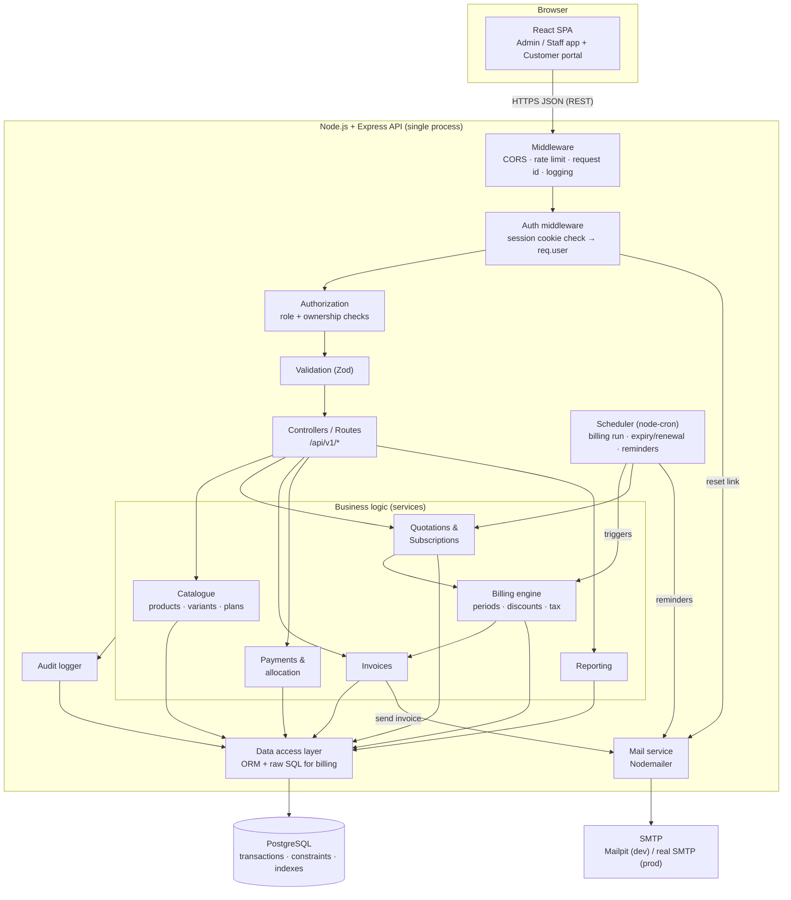

# System Architecture

> **Status:** Proposed architecture. **Nothing described here is implemented yet.** Items marked **[Official]** come from the problem statement; **[Proposed]** are our engineering decisions; `OPEN QUESTION` needs a team decision.
> Related: [Database Design](../database/database-design.md) · [Data Flows](data-flows.md) · [State Machines](state-machines.md) · [Billing Engine](billing-engine.md) · [Security & RBAC](security-and-rbac.md) · [API Spec](../api/api-specification.md) · [Roadmap](../development/development-roadmap.md)

---

## 1. Project overview

We are building a **Subscription Management System** for the Odoo x Make-A-Ton 9.0 Kochi Hackathon 2026. The fictional company, **Brightloop Software**, sells software on subscription (monthly or yearly, with add-ons and product variants). One web platform will cover the whole subscription life: set up products and plans → quote → subscribe → bill → collect payment → report.

## 2. Problem definition **[Official]**

Brightloop today runs on spreadsheets and manual work:

| Today | Consequence |
|---|---|
| Subscriptions tracked in a spreadsheet | nobody sees status at a glance |
| Renewals remembered by whoever notices | renewals are missed |
| Invoices typed by hand every month | wrong invoices, wasted time |
| Payments matched by scrolling bank statements | unclear what is paid/overdue |
| Revenue reports built by hand each quarter | nobody knows recurring revenue |

## 3. System objectives

1. **Automate billing**: invoices created from subscriptions when due — never twice, never skipped.
2. **Single source of truth** for customers, products, plans, subscriptions, invoices, payments.
3. **Self-service portal** so customers see their own subscriptions and invoices.
4. **Financial visibility**: active subscriptions, revenue, outstanding, overdue — in one dashboard.
5. **Correct money**: exact decimal arithmetic, historical invoices that never change by accident.
6. **Fast**: every page under 2 seconds with thousands of subscriptions **[Official]**.
7. **Buildable by four students** in a hackathon, runnable locally.

## 4. Main user roles **[Official]**

| Role | Who | Summary |
|---|---|---|
| **Admin** | Brightloop owner/manager | Full access. Sets up products, plans, taxes, discounts; the **only** role that creates staff accounts and discount rules. |
| **Staff** | Internal team, sales reps, finance lead | Day-to-day operations with restricted access: customers, quotations, subscriptions, invoices, payments, reports. |
| **Customer** | External client | Registers themselves; sees and manages **only their own** subscriptions and invoices through the portal. |

Full permission matrix: [Security & RBAC](security-and-rbac.md).

## 5. Functional requirements

### 5.1 Official requirements **[Official]**

| ID | Area | Requirement |
|---|---|---|
| F-AUTH-1 | Auth | Customer registration with email + password; one account per email |
| F-AUTH-2 | Auth | Password: length **> 8**, contains uppercase, lowercase and special character |
| F-AUTH-3 | Auth | Password reset via emailed link |
| F-AUTH-4 | Auth | Role-based access: Admin full, Staff restricted, Customer own data only |
| F-AUTH-5 | Auth | Only Admin creates staff accounts |
| F-PRD-1 | Products | Admin manages products: name, type, sales price, cost price, notes |
| F-PRD-2 | Products | Variants with price adjustment (e.g. brand Odoo adds 560) |
| F-PLN-1 | Plans | Price, billing frequency (daily/weekly/monthly/yearly), minimum quantity, availability start/end |
| F-PLN-2 | Plans | Automatic closure when plan ends; per-plan permissions for early closure, pause, renewal (set by Admin) |
| F-QUO-1 | Quotations | Reusable quotation templates with preconfigured plan and product lines |
| F-QUO-2 | Quotations | Validity period; customer; lines with quantity, unit price, taxes; total |
| F-SUB-1 | Subscriptions | Unique number, customer, plan, start date, expiry date, payment terms |
| F-SUB-2 | Subscriptions | Lines: product, quantity, unit price, tax, amount |
| F-SUB-3 | Subscriptions | Lifecycle Draft → Quotation → Confirmed → Active → Closed; visible to staff/admin |
| F-INV-1 | Invoices | Generated automatically from subscriptions when billing is due, pre-filled with customer, lines, taxes, totals |
| F-INV-2 | Invoices | Confirm, cancel, send, print; lifecycle Draft → Confirmed → Paid |
| F-INV-3 | Invoices | **Nothing billed twice or skipped** |
| F-TAX-1 | Tax | Admin-configured tax rules; automatic calculation on invoice lines |
| F-DSC-1 | Discounts | Admin-only; fixed or percentage; min purchase/quantity; start/end dates; max usage |
| F-DSC-2 | Discounts | Apply to specific products or whole subscription; applied automatically to future invoices; stop at expiry/limit |
| F-PAY-1 | Payments | Record method, amount, date, note against an invoice; methods and dates vary |
| F-PAY-2 | Payments | Show paid and outstanding invoices; identify overdue |
| F-RPT-1 | Reporting | Finance lead sees active subscriptions, revenue, payments, overdue invoices, outstanding amounts, with filters and summary view |

### 5.2 Proposed additions **[Proposed]**

| ID | Addition | Reason |
|---|---|---|
| P-1 | `cancelled` invoice status | Official text says "cancel" an invoice but lists only Draft/Confirmed/Paid |
| P-2 | Pause as a flag (not a new state), renewal as an operation | Keeps the required 5-state lifecycle intact ([State Machines](state-machines.md)) |
| P-3 | Payment terms table | Needed for due dates and "payment terms" field |
| P-4 | Audit log | Financial auditability |
| P-5 | Void (not delete) payments | Correct mistakes without destroying history |
| P-6 | Billing run log + admin "Run billing now" | Visibility and recovery |
| P-7 | Email notifications (reset, invoice sent, optional renewal reminder) | Reset link and "send invoice" are official; reminders are optional |

### 5.3 Explicitly out of scope unless the team decides otherwise
Payment gateway integration (manual payment recording is the official requirement), multi-currency, proration, credit notes/refunds, customer credit balances, multi-tenant support, mobile apps.

## 6. Non-functional requirements

| Area | Requirement | How we address it |
|---|---|---|
| **Performance** **[Official]** | Pages < 2 s with thousands of subscriptions | Indexes, pagination, aggregate SQL for dashboards, no N+1 ([DB §8](../database/database-design.md)) |
| **Correctness** | Exact money; no duplicate/skipped invoices | `NUMERIC`, decimal library, unique indexes, transactions ([Billing Engine](billing-engine.md)) |
| **Security** | Hashed passwords, backend-enforced RBAC, customer isolation | [Security & RBAC](security-and-rbac.md) |
| **Usability** | Responsive, clean, consistent UI, intuitive navigation | Shared component set, one layout, role-based menus |
| **Validation** | Robust input validation | Zod schemas on the API + matching UI hints; DB constraints |
| **Reliability** | Survive restarts and missed jobs | Cursor-based, idempotent billing with catch-up |
| **Maintainability** | Four people can work in parallel | Modular monolith, clear module boundaries, API contract first |
| **Local-first** | Runs fully offline on a laptop | Docker Compose: Postgres + Mailpit; no cloud dependency |
| **Dynamic data** | No hard-coded JSON | Every screen reads from the API → database |
| **Auditability** | Who changed what | `audit_logs` |

---

## 7. High-level architecture

**Style: modular monolith.** One React single-page app, one Node/Express API process (organized into feature modules), one PostgreSQL database. We deliberately **avoid microservices**: with four students and a short deadline, network boundaries add failure modes and deployment work without benefit. Module boundaries inside the monolith keep the option open later.



**Request path (typical):** browser → Express middleware → authentication (who are you?) → authorization (may you?) → validation (is the input valid?) → controller → service (business rules, transaction) → repository → PostgreSQL → JSON response.

---

## 8. Frontend architecture **[Proposed]**

| Aspect | Recommendation | Reason |
|---|---|---|
| Framework | **React** with **Vite** | Team knows JS/React; fast dev server; no SSR needed |
| Language | JavaScript or TypeScript — OPEN QUESTION | TS catches contract mistakes between four developers; JS is quicker for beginners. Recommendation: TS if at least two members are comfortable, otherwise JS with JSDoc + Zod |
| Routing | React Router | standard |
| Server state | TanStack Query | caching, loading/error states, pagination; avoids hand-written fetch state |
| Forms/validation | React Hook Form + Zod | same schemas style as backend |
| Styling | One design system: Tailwind CSS **or** a component library (e.g. MUI) — OPEN QUESTION | consistent colors and layouts; pick one, not both |
| HTTP | `fetch`/axios wrapper in one `api/` module | single place for base URL, error mapping, 401 handling |

**Two areas in one app** (route groups, shared components):
- **Back-office** (`/app/*`) for Admin and Staff: dashboard, customers, products, plans, templates, quotations, subscriptions, invoices, payments, taxes, discounts, staff, reports. Menu items are hidden by role, **but the backend enforces access** — hiding is only for usability.
- **Customer portal** (`/portal/*`): my subscriptions, my invoices (view/print/pay-status), profile, pause/renew/close where the plan allows.

Proposed structure (**PLANNED – not created yet**; the authoritative, detailed version with naming and import rules is [Directory Guidelines §A.4](../development/directory-guidelines.md)):

```
frontend/
  src/
    api/            # client.js + one file per backend module (customers.js, invoices.js …)
    components/ui/  # domain-free shared UI: DataTable, Pagination, FormField, StatusBadge, Money …
    features/       # one folder per module (same names as backend modules); pages/, components/, hooks/, schemas.js
    hooks/          # generic hooks used by 2+ features
    layouts/        # BackOfficeLayout, PortalLayout, AuthLayout
    routes/         # route table, role guards, menu config
    lib/            # money formatting, date helpers, constants
    config/  styles/  assets/  test/
```

UX rules: responsive layout (table → cards on small screens); every list has search, filters, sorting, pagination; status shown with consistent colored badges; money displayed from API strings (no float math in the UI); inline validation messages from the same rules as the backend; loading/empty/error states everywhere; a single consistent primary color and spacing scale.

## 9. Backend architecture **[Proposed]**

**Node.js + Express**, organized by feature module, three layers each:

Directory layout (**PLANNED – not created yet**; authoritative details: [Directory Guidelines §A.3](../development/directory-guidelines.md)):

```
backend/
  db/               # schema (if the ORM needs one), migrations/, seeds/
  src/
    routes.js       # the one place that mounts every module router under /api/v1
    modules/        # 16 modules: auth users customers products plans quotation-templates subscriptions
                    # taxes payment-terms discounts invoices billing-runs payments portal reports audit-logs
                    #   each: <module>.routes.js → .controller.js → .service.js → .repository.js (+ .schemas.js, index.js)
                    #   (quotation endpoints are a second router inside `subscriptions`; a quotation is a subscription)
    billing/        # billing ENGINE, no HTTP: calculators/ (pure), invoice-builder.js, run-billing.js
    jobs/           # index.js – the schedule registry (job functions live in <module>.jobs.js)
    middleware/     # authenticate, require-role, permissions, validate, error-handler, rate-limit
    lib/            # money, dates, db, mailer, audit, scheduler, state-machine, pagination, responses, errors
    config/         # env.js – the only place that reads process.env
  tests/            # integration/, factories/, helpers/  (unit tests sit next to the code)
```

| Layer | Responsibility | Must not |
|---|---|---|
| Route/Controller | HTTP in/out, call validation, call one service | contain business rules |
| Service | Business rules, state machines, transactions, authorization-sensitive logic | know about HTTP |
| Repository | SQL/ORM queries | decide business rules |
| Billing module | Pure calculators (period dates, discount, tax, totals) that are **unit-testable without a database**, plus the orchestrating run | be called from controllers directly except via the invoice/subscription services |

Conventions: API versioned under `/api/v1`; JSON; one consistent error format ([API Spec §1](../api/api-specification.md)); money as strings; ISO dates; central error handler; request-id logging; all multi-step writes in a transaction; every state change goes through one state-machine function ([State Machines](state-machines.md)).

### 9.1 Technology evaluation

| Concern | Recommendation | Alternatives considered | Trade-off |
|---|---|---|---|
| Database | **PostgreSQL 16** | MySQL, SQLite, MongoDB | Strong transactions, `NUMERIC`, partial/unique indexes, `SKIP LOCKED`. Document DBs are a poor fit for relational financial data. SQLite lacks concurrency features for billing. |
| ORM / queries | **Prisma** for ordinary CRUD, **raw SQL** for the billing engine and reports | Knex, Drizzle, Sequelize, TypeORM | Prisma is readable for beginners and typed, but cannot express partial unique indexes/CHECKs/`SKIP LOCKED`; those live in hand-edited SQL migrations and `$queryRaw`. Knex/Drizzle give more SQL control but have a steeper learning curve. OPEN QUESTION: team vote. |
| Validation | **Zod** | Joi, express-validator | Same library on frontend and backend. |
| Authentication | **Session-style cookie**: signed JWT in an `httpOnly`, `SameSite=Lax`, `Secure` (prod) cookie, short expiry (e.g. 8 h), password hash with **argon2id** (or bcrypt) | Server-side sessions in Postgres; JWT in localStorage | `httpOnly` cookie keeps tokens away from JavaScript (XSS-resistant). Server-side sessions allow instant revocation but need a table; start with cookie-JWT, upgrade if needed. Never store tokens in `localStorage`. |
| Background jobs | **`node-cron` inside the API** triggering an idempotent, DB-driven billing run + catch-up on startup | pg-boss, BullMQ (needs Redis), OS cron | No extra infrastructure; correct because billing never depends on the scheduler having run exactly once. `pg-boss` is the upgrade path (Postgres-backed queue) if we need workers/retries. |
| Email | **Nodemailer** → **Mailpit** locally | SendGrid, SES | Mailpit catches mail offline; swap SMTP credentials for production. |
| PDF/print invoice | Browser print stylesheet (`window.print()`) first; server PDF (e.g. `pdfkit`/Puppeteer) only if time allows | — | Print CSS satisfies "print invoice" cheaply. OPEN QUESTION |
| Testing | Vitest/Jest + Supertest; a Postgres test database | — | Billing math and state machines are unit-testable. |
| API docs | This repo's [API Spec](../api/api-specification.md); optionally OpenAPI later | Swagger | keep the contract in one place |

## 10. Database architecture

PostgreSQL, ~25 normalized tables, `BIGINT` identity keys, `NUMERIC(12,2)` money, `CHECK` constraints for statuses, partial indexes for the billing and overdue queries, append-only audit log. Full design: [Database Design](../database/database-design.md). Key ideas:

- A quotation **is** a subscription in `quotation` status.
- Plan **policies** live in `plans`; subscription **state** lives in `subscriptions`.
- Invoices **snapshot** product names, prices, tax rates and customer details.
- `UNIQUE (subscription_id, period_start) WHERE status <> 'cancelled'` prevents duplicate invoices.
- Payments are allocated to invoices through `payment_allocations`; "overdue" and "outstanding" are derived.

## 11. Background processing architecture

| Job | Schedule | What it does | Idempotent? |
|---|---|---|---|
| **Billing run** | daily (e.g. 00:30) + at server start + admin "Run now" | Generates invoices for all subscriptions with `next_billing_date ≤ today` ([Billing Engine](billing-engine.md)) | yes (cursor + unique index) |
| **Activation** | daily, before billing | `confirmed → active` when `start_date` reached | yes (conditional update) |
| **Expiry / renewal** | daily, after billing | auto-renew or auto-close subscriptions past expiry | yes |
| **Quote expiry** | daily | close quotations past `quotation_valid_until` | yes |
| **Reminders (optional)** | daily | email upcoming renewals / overdue invoices | de-duplicate via a "last reminded" marker. OPEN QUESTION |
| **Unsent-invoice retry (optional)** | hourly | resend confirmed invoices with `sent_at IS NULL` | yes |

Order within the daily job: activation → billing → expiry/renewal → reminders. Jobs are plain functions; the scheduler only calls them, so they can also be triggered by admin endpoints and by tests. If the API is later run on several instances, row locks + `SKIP LOCKED` keep the jobs safe, and a Postgres advisory lock can ensure only one instance schedules.

## 12. External integrations

| Integration | Status | Notes |
|---|---|---|
| **Email (SMTP)** | needed: password reset, send invoice | Mailpit in dev; any SMTP in prod; behind a `mailer` interface so it is replaceable |
| **Payment gateway** (Razorpay/Stripe…) | **optional, not required** | Official requirement is *recording* payments. A gateway would add rows into the same `payments` table (`source = 'gateway'`) via a webhook — kept separate from manual recording. Not planned for the first version. OPEN QUESTION |
| **PDF generation** | optional | see §9.1 |
| **Error tracking/metrics** | optional | structured logs are enough for the hackathon |

No other third-party services. Everything works offline.

## 13. Security architecture (summary)

Details in [Security & RBAC](security-and-rbac.md).

- Passwords hashed (argon2id/bcrypt); policy enforced on server (length > 8, upper, lower, special).
- Authentication via `httpOnly` cookie; every request authenticated and **authorized on the backend** (role check + ownership check). Frontend hiding is cosmetic only.
- Customer isolation: customer endpoints always filter by the authenticated user's `customer_id`, taken from the session — never from request parameters.
- Parameterized queries only (ORM / bound parameters); input validation with Zod; output escaping by React.
- Rate limiting on login/reset endpoints; CORS restricted; security headers (`helmet`); secrets in environment variables, `.env` git-ignored, `.env.example` committed.
- Audit log for sensitive actions.

## 14. Deployment considerations

**Local development (primary):** `docker compose up` starts PostgreSQL and Mailpit; frontend (`vite`) and backend (`node --watch`) run on the host. Config via `.env` files created from `.env.example`. Requires only Docker (or a local Postgres install) and Node.js LTS. Planned ports: frontend 5173, API 4000, Postgres 5432, Mailpit UI 8025/SMTP 1025 (OPEN QUESTION: confirm).

**Demo/production (optional, for the hackathon demo):**

| Option | Notes |
|---|---|
| Single VM / laptop demo with Docker Compose | simplest, fully under our control; works offline for the demo |
| Free-tier PaaS (e.g. Render/Railway) for API + managed Postgres, static host for frontend | easy URLs; beware cold starts killing the in-process scheduler — keep "Run billing now" and startup catch-up for demos |

Rules: one Node process per environment initially; `NODE_ENV=production` enables `Secure` cookies and strict CORS; run DB migrations as a deliberate step, not on every start; database backups for any shared environment; **the hackathon requires the submitted code in a single branch** (see [Git Workflow](../development/git-workflow.md)).

---

## 15. Assumptions (collected)

1. Single currency; prices tax-exclusive; no proration; billing in advance.
2. Staff create subscriptions for customers; customers view and — where the plan permits — pause/renew/close their own.
3. One discount per invoice; discounts must be granted to a subscription; discounts apply before tax.
4. Overdue = confirmed, unpaid balance, past due date (no grace period).
5. Paused subscriptions are not billed; expiry is extended by the paused time.
6. Generated invoices start as `draft` and are confirmed by staff.

## 16. OPEN QUESTIONs (collected — need team decisions)

| # | Question | Default if undecided |
|---|---|---|
| 1 | JavaScript vs TypeScript | JavaScript + Zod |
| 2 | Prisma vs Knex/Drizzle | Prisma + SQL migrations for constraints |
| 3 | Tailwind vs component library | Tailwind |
| 4 | Auto-confirm generated invoices? | No (draft, bulk-confirm) |
| 5 | Overdue grace days | 0 |
| 6 | Payment-terms list | Due on receipt, Net 15, Net 30 |
| 7 | Plan `price` vs line prices (is there a separate plan-fee line?) | Plan price is informational/default; invoice uses lines |
| 8 | Does `available_to` stop renewals or only new sales? | Only new sales |
| 9 | Gateway integration | No |
| 10 | Time zone | Asia/Kolkata |
| 11 | Server-generated PDF vs print CSS | Print CSS |
| 12 | Customer self-service subscribing (checkout from portal)? | No; staff-created, customer manages |
| 13 | Discount stacking / auto-apply without grant | No / No |
| 14 | Staff may grant discounts to subscriptions? | Yes (Admin creates rules; Staff attaches) |

## 17. Major risks

| Risk | Impact | Mitigation |
|---|---|---|
| Billing logic bugs (duplicates/skips/rounding) | loss of trust, failing the key requirement | design reviewed here; unit tests on calculators; DB constraints; test scenarios in [Billing Engine §11](billing-engine.md) |
| Scope too large for the time | incomplete demo | phased roadmap with a "must-have" cut line ([Roadmap](../development/development-roadmap.md)) |
| Uneven experience in the team | bottlenecks | independent module ownership, API contract first, pairing |
| Merge conflicts / branch confusion | lost work | [Git Workflow](../development/git-workflow.md), small PRs |
| Performance at thousands of rows | fail the 2-second criterion | indexes, pagination, seed 5,000+ subscriptions early and measure |
| Scheduler dependency on the API process | missed billing in demo | idempotent catch-up on startup + manual run button |
