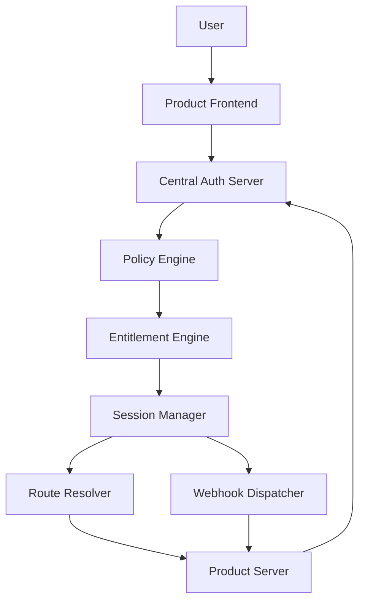
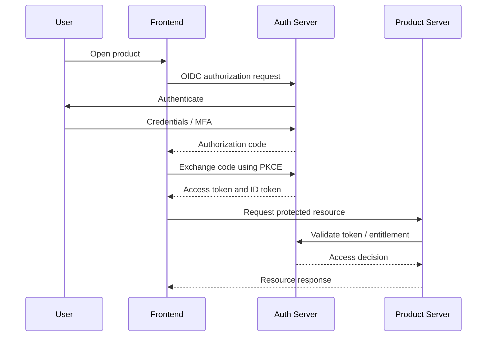
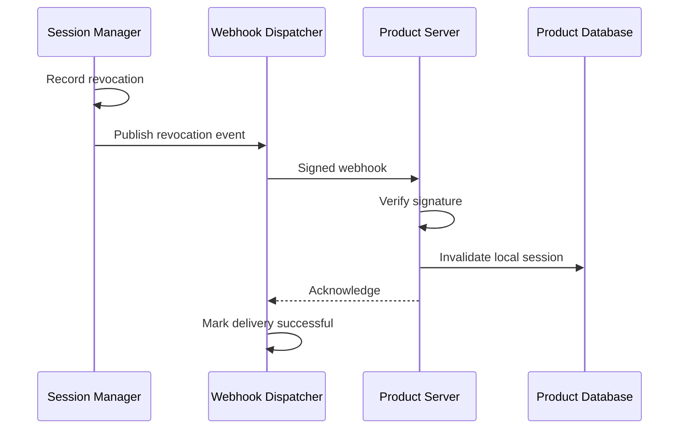

# User Access and Authorization Specification

**Document type:** Technical Specification  
**Version:** 1.0  
**Status:** Proposed implementation baseline  
**Audience:** Senior software engineers, security engineers, and product integration developers  
**Implementation language:** TypeScript (Node.js)  
**Primary database:** PostgreSQL

---

# 1. Purpose

This document specifies the user access subsystem for a centralized product access, subscription, and billing platform.

The subsystem provides a consistent authentication and authorization interface for multiple independently deployed products.

A user must be able to authenticate once and access any product for which they have valid permissions, regardless of their physical location or the product's deployment location.

The system must support:

- Individual users and organization members.
- Authentication across multiple products.
- Product-specific access policies.
- Individual and bundled subscriptions.
- Multiple simultaneous subscriptions.
- Subscription-dependent permissions and usage limits.
- Product-specific routing and session management.
- Centralized session revocation.
- Remote session termination through authenticated webhooks.
- Arbitrary frontend implementations.
- Independent product-server deployments.

# 2. Terminology

| Term | Definition |
|---|---|
| User | An authenticated human identity |
| Customer | An individual or organization responsible for a subscription |
| Product | An independently deployed application or service |
| Subscription | A commercial agreement granting potential access |
| Entitlement | A permission or capability granted to a user |
| Policy | A versioned rule determining whether access is permitted |
| Session | An authenticated interaction with a specific product |
| Product Client | A registered application or server authorized to integrate with the platform |
| Access Token | A short-lived credential representing authenticated authorization |
| Session Revocation | Termination of the authority associated with a session |

# 3. Architectural overview



The central platform is authoritative for identity, product access, entitlements, and session state.

Product servers enforce the platform's decisions and retain responsibility for product-specific business authorization.

# 4. Identity and customer relationships

## 4.1. User identity

A user represents an authenticated human identity.

A user may:

- Own an individual customer account.
- Belong to multiple organizations.
- Have different permissions in different organizations.
- Access multiple products.
- Hold multiple active product sessions.

The user identity must remain independent of subscription ownership.

## 4.2. Customer ownership

Subscriptions belong to customers, not directly to product sessions.

A customer may be:

- An individual.
- An organization.

Organization membership grants access to the organization's resources only according to its membership permissions.

A user's access to a subscription must be evaluated using the customer's ownership, membership, and billing permissions.

## 4.3. Access delegation

The platform should support delegated permissions such as:

- Organization administrator.
- Billing administrator.
- Product administrator.
- Product member.
- Read-only auditor.

Billing permissions and product usage permissions must remain separate.

For example, a billing administrator may manage invoices without automatically receiving access to every subscribed product.

# 5. Authentication

## 5.1. Authentication protocol

Use OpenID Connect (OIDC) and OAuth 2.0.

Public frontend applications use Authorization Code with PKCE.

Confidential backend clients use mTLS or private-key JWT authentication.

The authentication server must support:

- Login.
- Logout.
- Token refresh.
- Credential revocation.
- Multi-factor authentication.
- Identity-provider integration.
- Account recovery.
- Product-specific client registration.

## 5.2. Authentication flow



The ID token establishes identity for the frontend.

The access token authorizes requests to a specific resource server.

An ID token must never be accepted as an API access token.

# 6. Product registration

Each product must be registered before it can participate in the platform.

A product registration includes:

```json
{
  "product_id": "product_a",
  "name": "Product A",
  "status": "active",
  "client_id": "client_a",
  "allowed_redirect_uris": [
    "https://product-a.example.com/callback"
  ],
  "allowed_origins": [
    "https://product-a.example.com"
  ],
  "access_policy_id": "policy_a",
  "session_policy_id": "session_policy_a"
}
```

A product registration must define:

- Product identifier.
- Authorized client identifiers.
- Redirect URIs.
- Allowed origins.
- Registered product-server endpoints.
- Required entitlements.
- Session policy.
- Supported authentication methods.
- Webhook endpoint configuration.

Redirect URIs must be validated using exact registered matching. Wildcard redirect URIs should not be allowed for production clients.

# 7. Authorization model

## 7.1. Authorization decision

Every protected product operation must be evaluated against:

- Authenticated user.
- Requested product.
- Requested action.
- Customer or organization context.
- Effective entitlements.
- Applicable access policy.
- Session validity.
- Relevant usage limits.

The authorization engine returns one of:

```text
ALLOW
DENY
CHALLENGE
```

`CHALLENGE` indicates that an additional requirement must be satisfied, such as authentication, MFA, or account verification.

## 7.2. Access requirements

A user may access a product when:

1. The user is authenticated.
2. The product is active and registered.
3. The user's account is eligible.
4. The user has the required entitlement.
5. The applicable subscription conditions are satisfied.
6. No applicable restriction or revocation exists.
7. The requested action is permitted by the product's policy.

Authentication alone does not grant product access.

An active subscription alone does not necessarily grant access to every product.

# 8. Subscription-dependent access

## 8.1. Entitlement generation

Subscriptions provide commercial eligibility.

The Entitlement Engine converts that eligibility into product-specific permissions.

For example:

```text
Subscription: Enterprise Bundle
  |
  +-- Product A
  |     +-- feature.analytics
  |     +-- feature.export
  |
  +-- Product B
        +-- feature.automation
        +-- feature.api_access
```

A subscription may grant entitlements to multiple products.

A product may require entitlements from multiple subscriptions.

## 8.2. Multiple subscription rules

The platform must support:

| Rule | Behaviour |
|---|---|
| ANY | Any qualifying subscription grants access |
| ALL | Every specified subscription is required |
| AT_LEAST | A configured number of qualifying subscriptions is required |
| EXCLUSIVE | Only one subscription from a defined group may be active |
| MAX | Select the highest applicable entitlement value |
| SUM | Combine numeric entitlement values |
| PRIORITY | Select the highest-priority applicable entitlement |

The effective result must be computed server-side.

A frontend cannot override the policy result.

## 8.3. Entitlement representation

```json
{
  "subject_id": "user_123",
  "product_id": "product_a",
  "entitlements": [
    {
      "key": "feature.analytics",
      "value": true
    },
    {
      "key": "resource.storage_bytes",
      "value": 107374182400
    },
    {
      "key": "resource.concurrent_sessions",
      "value": 5
    }
  ],
  "policy_version": 3,
  "entitlement_version": 12,
  "expires_at": "2026-10-31T10:00:00Z"
}
```

Entitlements may represent boolean capabilities, numeric limits, enumerated values, or structured permissions.

# 9. Access evaluation API

## 9.1. Evaluate access

```http
POST /internal/v1/access/evaluate
```

Request:

```json
{
  "subject_id": "user_123",
  "product_id": "product_a",
  "action": "feature.analytics",
  "customer_id": "customer_123",
  "session_id": "sess_123"
}
```

Response:

```json
{
  "decision": "ALLOW",
  "reason": "ACTIVE_ENTITLEMENT",
  "subject_id": "user_123",
  "product_id": "product_a",
  "entitlement_version": 12,
  "policy_version": 3,
  "expires_at": "2026-10-31T10:00:00Z"
}
```

This endpoint is for authenticated product-server integration.

The product server must not expose arbitrary access evaluation to unauthenticated clients.

# 10. Session management

## 10.1. Session ownership

A session belongs to:

- One user.
- One product.
- One client.
- An optional customer or organization context.

A user may hold multiple simultaneous sessions across different products.

Session limits may be configured per user, product, customer, or subscription.

## 10.2. Session lifecycle

```text
CREATED
   |
   v
ACTIVE
   |
   +----> EXPIRED
   |
   +----> REVOKED
   |
   +----> CLOSED
```

Sessions must have a defined expiry time.

The Session Manager must support:

- Session creation.
- Session validation.
- Session heartbeat.
- Session closure.
- Session revocation.
- Session listing.
- Session reconciliation.

## 10.3. Session creation API

```http
POST /internal/v1/sessions
```

Request:

```json
{
  "subject_id": "user_123",
  "product_id": "product_a",
  "client_id": "client_a",
  "customer_id": "customer_123",
  "device_id": "device_123"
}
```

Response:

```json
{
  "session_id": "sess_123",
  "status": "ACTIVE",
  "expires_at": "2026-10-31T10:00:00Z",
  "entitlement_version": 12
}
```

Session creation must verify that the user is authenticated and currently authorized for the requested product.

# 11. Session revocation

## 11.1. Revocation conditions

A session may be revoked because of:

- Subscription expiration.
- Subscription cancellation.
- Payment-related access suspension.
- User logout.
- Account suspension.
- Administrative revocation.
- Product access policy changes.
- Organization membership removal.
- Security incidents.

## 11.2. Revocation workflow



The central Session Manager remains authoritative even if a product server is temporarily unavailable.

Product servers must maintain a local revocation record and periodically reconcile it with the central platform.

# 12. Webhook specification

## 12.1. Event format

```json
{
  "event_id": "evt_123",
  "event_type": "session.revoked",
  "schema_version": 1,
  "occurred_at": "2026-10-31T09:35:00Z",
  "data": {
    "session_id": "sess_123",
    "product_id": "product_a",
    "reason": "entitlement_expired",
    "revocation_version": 13
  }
}
```

## 12.2. Webhook requirements

Each webhook must include:

- Unique event ID.
- Event type.
- Schema version.
- Event timestamp.
- Product identifier.
- Event payload.
- Cryptographic signature.

The receiver must:

1. Verify the signature.
2. Validate the event schema.
3. Reject duplicate event IDs.
4. Reject stale state transitions.
5. Apply the change transactionally.
6. Acknowledge successful processing.

The dispatcher must retry failed deliveries and provide a dead-letter queue.

# 13. Product-server responsibilities

Each product server must:

- Validate access tokens.
- Validate token issuer and audience.
- Enforce product-specific authorization.
- Request entitlement evaluation where necessary.
- Maintain local session state.
- Process session revocation events.
- Reconcile missed events.
- Enforce usage limits.
- Deny unauthorized access.

A product server must not:

- Generate subscriptions.
- Modify invoice state.
- Grant paid entitlements independently.
- Trust frontend-supplied subscription status.
- Accept tokens intended for another product.
- Treat a successful payment redirect as proof of payment.

# 14. Frontend access management APIs

The platform must expose stable public APIs so any frontend can manage user access.

| Method | Endpoint | Purpose |
|---|---|---|
| GET | `/v1/users/me` | Retrieve authenticated user |
| GET | `/v1/users/me/products` | List accessible products |
| GET | `/v1/users/me/entitlements` | Retrieve effective entitlements |
| GET | `/v1/users/me/sessions` | List active sessions |
| POST | `/v1/users/me/sessions/{id}/revoke` | Revoke a session |
| GET | `/v1/customers/{id}/subscriptions` | List customer subscriptions |
| POST | `/v1/customers/{id}/subscriptions` | Create subscription |
| POST | `/v1/subscriptions/{id}/cancel` | Cancel subscription |
| POST | `/v1/subscriptions/{id}/resume` | Resume subscription |
| GET | `/v1/subscriptions/{id}/entitlements` | Retrieve subscription access |

The frontend may display the returned access state and initiate authorized changes.

It must not independently determine whether a user is entitled to a product.

# 15. Routing and product discovery

The Route Resolver maps product identifiers to registered product endpoints.

Routing must support:

- Product-specific frontend URLs.
- Product-server API endpoints.
- Regional deployments.
- Versioned product APIs.
- Product-specific authentication requirements.
- Health and availability status.

A routing decision must never grant access by itself.

The platform must authorize the requested product before returning protected routing information.

# 16. Data model

Core tables:

```text
users
customers
customer_members
products
product_clients
product_routes
subscriptions
subscription_items
entitlement_grants
effective_entitlements
access_policies
policy_versions
sessions
session_revocations
webhook_endpoints
webhook_deliveries
audit_logs
```

Important constraints:

- Product identifiers must be unique.
- Session identifiers must be globally unique.
- A session must reference a valid user and product.
- Every entitlement grant must have an identifiable source.
- Every policy evaluation must identify its policy version.
- Session revocations must be append-only.
- Product clients must not access another product's sessions without explicit authorization.

# 17. Security requirements

The subsystem must implement:

- TLS for all network communication.
- Short-lived access tokens.
- Refresh token rotation.
- Secure credential storage.
- Server-to-server authentication.
- Product-specific token audiences.
- Webhook signature verification.
- Rate limiting.
- Audit logging.
- Key rotation.
- Least-privilege permissions.
- Protection against replay attacks.
- Protection against session fixation.
- Explicit authorization for administrative operations.

Sensitive operations must require fresh authorization.

# 18. Availability and failure handling

The system must define behaviour for failures in authentication, entitlement evaluation, session management, and webhook delivery.

| Failure | Required behaviour |
|---|---|
| Authentication server unavailable | Reject new authentication |
| Entitlement engine unavailable | Use bounded, previously validated authorization data only where policy permits |
| Session Manager unavailable | Reject new sessions |
| Webhook delivery fails | Retry and reconcile |
| Product server unavailable | Preserve central session state |
| Subscription expires | Recalculate entitlements and revoke affected access |
| Policy changes | Re-evaluate affected entitlements |
| User loses organization membership | Revoke access derived from that membership |

Cached authorization must have a bounded lifetime and must not override a known revocation.

# 19. Implementation structure

```text
access-platform/
├── src/
│   ├── index.ts
│   ├── app.ts
│   ├── config.ts
│   ├── workers/
│   │   ├── webhook.ts
│   │   └── reconciliation.ts
│   ├── features/
│   │   ├── identity/
│   │   ├── customers/
│   │   ├── products/
│   │   ├── policies/
│   │   ├── entitlements/
│   │   ├── sessions/
│   │   ├── routing/
│   │   ├── webhooks/
│   │   └── audit/
│   ├── middleware/
│   └── lib/
│
├── packages/
│   ├── access-sdk/
│   ├── api-contracts/
│   └── event-contracts/
│
├── api/
│   ├── openapi/
│   └── asyncapi/
│
├── migrations/
├── tests/
│   ├── integration/
│   ├── contract/
│   ├── security/
│   └── concurrency/
└── docs/
    ├── architecture.md
    ├── api-spec.md
    ├── policy-spec.md
    └── product-integration.md
```

# 20. Acceptance criteria

The subsystem is ready for production when:

1. A user can authenticate once and access multiple authorized products.
2. Product access is determined by centrally evaluated entitlements.
3. Multiple simultaneous subscriptions are evaluated according to explicit policies.
4. Any compliant frontend can manage subscriptions using the public API.
5. Product servers can validate sessions and enforce entitlements.
6. Session revocation propagates through signed webhooks.
7. Missed webhook events can be recovered through reconciliation.
8. Product servers cannot independently grant paid access.
9. All authorization decisions are auditable and versioned.
10. Critical authorization and session operations have automated integration tests.

---

# Final architectural rule

**The identity service authenticates the user. The entitlement engine determines what the user may access. The session manager controls the validity of access sessions. The product server enforces the decision.**

These responsibilities must remain separate, even if they are initially implemented within the same Node.js application.

This boundary is essential for supporting arbitrary frontends, multiple products, independently deployed servers, and evolving subscription rules without coupling authentication to individual product implementations.
