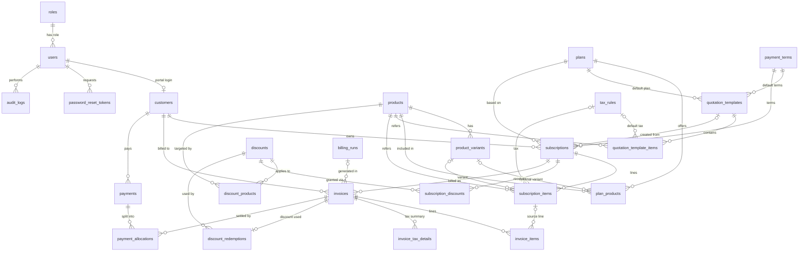

# Database Design

> **Status:** Proposed design (nothing is implemented yet). Database: **PostgreSQL 16**.
> Related: [System Architecture](../architecture/system-architecture.md) · [State Machines](../architecture/state-machines.md) · [Billing Engine](../architecture/billing-engine.md) · [API Spec](../api/api-specification.md)

## 1. Design principles

| Principle | What it means here |
|---|---|
| **Money is exact** | Every money column is `NUMERIC(12,2)`. Rates are `NUMERIC(6,3)`. Never `FLOAT`/`REAL`. |
| **Snapshots for history** | Anything printed on an invoice (names, prices, tax rates, customer address) is *copied* onto the invoice when it is created. Changing a product or tax rule later never changes an issued invoice. |
| **Constraints do the policing** | Foreign keys, `UNIQUE`, and `CHECK` constraints are the last line of defence even if application code has a bug. |
| **Derive, don't duplicate** | "Overdue" and "outstanding" are *derived* from invoice data, not stored as statuses. |
| **Few tables, justified** | 25 tables. Each one exists for a requirement in the problem statement (see §3). |
| **Simple keys** | `BIGINT GENERATED ALWAYS AS IDENTITY` primary keys. Human-facing numbers (`SUB-000123`, `INV-000456`) are separate unique columns fed by DB sequences. Customer isolation is enforced by scoping queries, not by hiding IDs. |

**Conventions:** table names are plural `snake_case`; every table has `created_at TIMESTAMPTZ NOT NULL DEFAULT now()`; mutable tables also have `updated_at`. "Enum" columns are `TEXT` with a `CHECK (col IN (...))`, which is easier to change than native Postgres enums.

**Assumptions** (marked `OPEN QUESTION` where the team should confirm):
- A single currency (INR) is used throughout, so there is no currency column. OPEN QUESTION: confirm.
- Prices are **tax-exclusive**; tax is added on top. OPEN QUESTION: tax-inclusive pricing is not supported.
- Billing is **in advance**: a period is billed on its first day.
- No proration when a subscription starts or ends mid-period.

---

## 2. ER diagram



---

## 3. Table overview

| # | Table | Purpose | Requirement |
|---|---|---|---|
| 1 | `roles` | Admin / staff / customer | RBAC |
| 2 | `users` | Login accounts | Auth |
| 3 | `password_reset_tokens` | Emailed reset links | Auth |
| 4 | `customers` | Customer profile (billing details) | Customers |
| 5 | `products` | Sellable products | Products |
| 6 | `product_variants` | Variants with price adjustment (+560 for Odoo) | Variants |
| 7 | `payment_terms` | "Net 15", "Due on receipt"… drives invoice due date | Subscription payment terms |
| 8 | `plans` | Price, frequency, availability, policies | Plans |
| 9 | `plan_products` | Which products/variants a plan offers | Plan–product association |
| 10 | `quotation_templates` | Reusable quote starting points | Templates |
| 11 | `quotation_template_items` | Template product lines | Templates |
| 12 | `tax_rules` | Admin-configured taxes | Tax |
| 13 | `subscriptions` | Subscription header **and** quotation (same row, different status) | Subscriptions |
| 14 | `subscription_items` | Subscription lines | Subscriptions |
| 15 | `discounts` | Discount rules | Discounts |
| 16 | `discount_products` | Product scope of a discount | Applicability |
| 17 | `subscription_discounts` | Discount granted to a subscription | Discounts |
| 18 | `discount_redemptions` | One row per discount use (usage tracking) | Usage limits |
| 19 | `invoices` | Invoice header with snapshots | Invoicing |
| 20 | `invoice_items` | Invoice lines with snapshots | Invoicing |
| 21 | `invoice_tax_details` | Per-tax totals on an invoice | Tax snapshot |
| 22 | `payments` | A received payment | Payments |
| 23 | `payment_allocations` | How a payment is split across invoices | Payments |
| 24 | `billing_runs` | One row per scheduler/manual billing run (observability) | Reliability |
| 25 | `audit_logs` | Who changed what | Auditability |

**Merges and additions versus the suggested entity list**
- **No separate `quotations` table.** The problem statement says a subscription itself moves *Draft → Quotation → Confirmed*. A quotation is a subscription whose status is `quotation`, so a separate table would duplicate lines and need a copy step.
- **Added** `payment_terms` (needed for due dates), `password_reset_tokens` (password reset requirement), `billing_runs` (lets the admin see whether billing ran, and what failed).
- `Roles` is a table (not a column) so permissions can later be extended. If the team prefers, it can be a `CHECK` column on `users`. OPEN QUESTION (low priority).

---

## 4. Table specifications

Legend: **PK** primary key · **FK** foreign key · **UQ** unique · **NN** NOT NULL.

### 4.1 Identity and access

#### `roles`
Purpose: the three roles. Seeded with `admin`, `staff`, `customer`.

| Column | Type | Null | Notes |
|---|---|---|---|
| id | SMALLINT identity | NN | PK |
| name | TEXT | NN | UQ; `CHECK (name IN ('admin','staff','customer'))` |

#### `users`
Purpose: anyone who can log in.

| Column | Type | Null | Notes |
|---|---|---|---|
| id | BIGINT identity | NN | PK |
| role_id | SMALLINT | NN | FK → roles.id |
| email | CITEXT | NN | UQ (case-insensitive; one account per email) |
| password_hash | TEXT | NN | argon2id/bcrypt hash only |
| full_name | TEXT | NN | |
| is_active | BOOLEAN | NN | default true; false blocks login |
| last_login_at | TIMESTAMPTZ | null | |
| created_by | BIGINT | null | FK → users.id (the admin who created a staff account) |
| created_at / updated_at | TIMESTAMPTZ | NN | |

Indexes: UQ(email) (also the login lookup), `(role_id)`.
Note: requires the `citext` extension (`CREATE EXTENSION citext`). Fallback: UQ on `lower(email)`.

#### `password_reset_tokens`

| Column | Type | Null | Notes |
|---|---|---|---|
| id | BIGINT identity | NN | PK |
| user_id | BIGINT | NN | FK → users.id ON DELETE CASCADE |
| token_hash | TEXT | NN | UQ; store a SHA-256 of the emailed token, never the token |
| expires_at | TIMESTAMPTZ | NN | e.g. now() + 1 hour |
| used_at | TIMESTAMPTZ | null | set when consumed; a used token is rejected |

Indexes: UQ(token_hash), `(user_id)`.

#### `customers`
Purpose: the billing profile. A customer *may* have a portal login (`user_id`), but staff can also create a customer who has none yet.

| Column | Type | Null | Notes |
|---|---|---|---|
| id | BIGINT identity | NN | PK |
| user_id | BIGINT | null | FK → users.id; **UQ** (one customer per login) |
| name | TEXT | NN | |
| company_name | TEXT | null | |
| email | CITEXT | NN | contact/billing email |
| phone | TEXT | null | |
| address_line1, address_line2, city, state, postal_code, country | TEXT | null | billing address |
| tax_id | TEXT | null | e.g. GSTIN |
| notes | TEXT | null | |
| is_active | BOOLEAN | NN | default true |

Indexes: UQ(user_id), `(email)`, `(name)` (+ `pg_trgm` GIN on `name` if search is slow; OPEN QUESTION, optional).

### 4.2 Catalogue

#### `products`

| Column | Type | Null | Notes |
|---|---|---|---|
| id | BIGINT identity | NN | PK |
| name | TEXT | NN | UQ |
| product_type | TEXT | NN | `CHECK IN ('service','software','addon','physical')` — OPEN QUESTION: final list |
| sales_price | NUMERIC(12,2) | NN | `CHECK >= 0` |
| cost_price | NUMERIC(12,2) | NN | `CHECK >= 0`; default 0 |
| notes | TEXT | null | |
| is_active | BOOLEAN | NN | default true (soft-disable instead of delete) |

Indexes: UQ(name), `(is_active)`.

#### `product_variants`
Purpose: choices such as *Brand = Odoo*. **Effective price = `products.sales_price + price_adjustment`.** Example: base 1000, brand Odoo adjustment +560 → 1560.

| Column | Type | Null | Notes |
|---|---|---|---|
| id | BIGINT identity | NN | PK |
| product_id | BIGINT | NN | FK → products.id ON DELETE CASCADE |
| attribute_name | TEXT | NN | e.g. `Brand` |
| attribute_value | TEXT | NN | e.g. `Odoo` |
| price_adjustment | NUMERIC(12,2) | NN | default 0; may be negative |
| is_active | BOOLEAN | NN | default true |

Constraints: UQ(product_id, attribute_name, attribute_value).
Why one row per attribute value (not a full option matrix): it covers the stated requirement with one simple table. A product needing two attributes at once (Brand + Size) is an OPEN QUESTION, handled later by a `variant_attributes` child table if needed.
Check: effective price must stay `>= 0` (validated in the service layer, because it spans two tables).

### 4.3 Plans, terms and taxes

#### `payment_terms`

| Column | Type | Null | Notes |
|---|---|---|---|
| id | SMALLINT identity | NN | PK |
| name | TEXT | NN | UQ — "Due on receipt", "Net 15", "Net 30" |
| due_days | INT | NN | `CHECK (due_days >= 0)`; invoice `due_date = issue_date + due_days` |
| is_active | BOOLEAN | NN | |

#### `plans`
Purpose: pricing, frequency, availability window, and **plan-level policies** (what *may* happen to subscriptions on this plan). These are rules, not states.

| Column | Type | Null | Notes |
|---|---|---|---|
| id | BIGINT identity | NN | PK |
| name | TEXT | NN | UQ |
| price | NUMERIC(12,2) | NN | `CHECK >= 0`. OPEN QUESTION: headline price vs separate plan-fee line. Assumed: default price shown to customers; invoice lines come from `subscription_items`. |
| billing_frequency | TEXT | NN | `CHECK IN ('daily','weekly','monthly','yearly')` |
| min_quantity | INT | NN | default 1, `CHECK >= 1` |
| available_from | DATE | NN | |
| available_to | DATE | null | null = open-ended; `CHECK (available_to IS NULL OR available_to >= available_from)` |
| auto_close_on_end | BOOLEAN | NN | default true — close subscriptions automatically at expiry |
| allow_early_close | BOOLEAN | NN | default false |
| allow_pause | BOOLEAN | NN | default false |
| allow_renewal | BOOLEAN | NN | default true |
| notes | TEXT | null | |
| is_active | BOOLEAN | NN | default true |

Indexes: UQ(name), `(is_active, available_from, available_to)`.

#### `plan_products`
Purpose: which products (and optionally a variant) a plan includes, with default quantity/price used to pre-fill subscription lines.

| Column | Type | Null | Notes |
|---|---|---|---|
| id | BIGINT identity | NN | PK |
| plan_id | BIGINT | NN | FK → plans.id ON DELETE CASCADE |
| product_id | BIGINT | NN | FK → products.id |
| variant_id | BIGINT | null | FK → product_variants.id |
| default_quantity | INT | NN | default 1 |
| unit_price_override | NUMERIC(12,2) | null | null = use product price + variant adjustment |

Constraints: UQ(plan_id, product_id, variant_id) — note Postgres treats NULLs as distinct; use `UNIQUE NULLS NOT DISTINCT` (PG15+) or `COALESCE(variant_id,0)` in a unique index.
Indexes: `(plan_id)`, `(product_id)`.

#### `tax_rules`

| Column | Type | Null | Notes |
|---|---|---|---|
| id | BIGINT identity | NN | PK |
| name | TEXT | NN | UQ — "GST 18%" |
| rate | NUMERIC(6,3) | NN | percentage, `CHECK (rate >= 0 AND rate <= 100)` |
| is_active | BOOLEAN | NN | inactive rules cannot be newly chosen; old invoices unaffected |

A line can carry **one** tax rule. A combined tax such as CGST+SGST is modelled as two rules applied through a "compound" rule, or simply as one 18% rule. OPEN QUESTION: is multiple taxes *per line* required? Design supports many *rules* (admin can create any number); per-line multi-tax can be added by turning `subscription_items.tax_rule_id` into a join table without touching invoices (invoice snapshots already allow it via `invoice_tax_details`).

### 4.4 Quotation templates

#### `quotation_templates`

| Column | Type | Null | Notes |
|---|---|---|---|
| id | BIGINT identity | NN | PK |
| name | TEXT | NN | UQ |
| plan_id | BIGINT | NN | FK → plans.id |
| validity_days | INT | NN | `CHECK > 0`; quote `valid_until = created date + validity_days` |
| payment_term_id | SMALLINT | null | FK → payment_terms.id |
| notes | TEXT | null | |
| is_active | BOOLEAN | NN | |

#### `quotation_template_items`

| Column | Type | Null | Notes |
|---|---|---|---|
| id | BIGINT identity | NN | PK |
| template_id | BIGINT | NN | FK → quotation_templates.id ON DELETE CASCADE |
| product_id | BIGINT | NN | FK → products.id |
| variant_id | BIGINT | null | FK → product_variants.id |
| quantity | INT | NN | `CHECK > 0` |
| unit_price_override | NUMERIC(12,2) | null | |
| tax_rule_id | BIGINT | null | FK → tax_rules.id |
| sort_order | INT | NN | default 0 |

Indexes: `(template_id)`.
A template is only a *starting point*: creating a quotation **copies** its lines into `subscription_items`. Editing a template later never changes existing quotations.

### 4.5 Subscriptions

#### `subscriptions`
Purpose: one row for the whole life: Draft → Quotation → Confirmed → Active → Closed. The plan holds *policies*; this row holds *state*.

| Column | Type | Null | Notes |
|---|---|---|---|
| id | BIGINT identity | NN | PK |
| number | TEXT | NN | UQ, e.g. `SUB-000123` from sequence `subscription_number_seq`, assigned at creation |
| customer_id | BIGINT | NN | FK → customers.id (ON DELETE RESTRICT) |
| plan_id | BIGINT | NN | FK → plans.id (RESTRICT) |
| template_id | BIGINT | null | FK → quotation_templates.id (informational) |
| payment_term_id | SMALLINT | NN | FK → payment_terms.id |
| status | TEXT | NN | `CHECK IN ('draft','quotation','confirmed','active','closed')`, default `draft` |
| start_date | DATE | NN | |
| expiry_date | DATE | NN | `CHECK (expiry_date >= start_date)` |
| quotation_valid_until | DATE | null | quote validity; set when moving to `quotation` |
| auto_renew | BOOLEAN | NN | default false; used only if `plans.allow_renewal` |
| billing_anchor_date | DATE | null | date from which billing periods are counted; set on activation (= start_date) and reset on resume |
| period_index | INT | NN | default 0; number of periods billed since the anchor |
| next_billing_date | DATE | null | start of the next unbilled period; null if not active or finished |
| paused_at | TIMESTAMPTZ | null | **non-null = currently paused** (Active only) |
| pause_reason | TEXT | null | |
| closed_at | TIMESTAMPTZ | null | |
| closed_reason | TEXT | null | `CHECK IN ('expired','early_closure','cancelled','non_payment','other')` |
| confirmed_at, activated_at | TIMESTAMPTZ | null | |
| last_billing_attempt_at | TIMESTAMPTZ | null | |
| last_billing_error | TEXT | null | cleared on success; shown to staff |
| created_by | BIGINT | null | FK → users.id |
| created_at / updated_at | TIMESTAMPTZ | NN | |

Cross-column checks (all `CHECK`s):
- `status <> 'closed' OR closed_at IS NOT NULL`
- `paused_at IS NULL OR status = 'active'` (only active subscriptions can be paused)
- `next_billing_date IS NULL OR status = 'active'`

Indexes:
- UQ(number)
- **`(next_billing_date) WHERE status = 'active' AND paused_at IS NULL`** — partial index; the billing scheduler's "what is due?" query.
- `(customer_id, status)` — customer portal and customer detail page.
- `(status, expiry_date)` — expiry/renewal job and status filters.
- `(plan_id)`.

#### `subscription_items`

| Column | Type | Null | Notes |
|---|---|---|---|
| id | BIGINT identity | NN | PK |
| subscription_id | BIGINT | NN | FK → subscriptions.id ON DELETE CASCADE |
| product_id | BIGINT | NN | FK → products.id |
| variant_id | BIGINT | null | FK → product_variants.id |
| description | TEXT | NN | **snapshot** of product name + variant label when the line is added |
| quantity | INT | NN | `CHECK > 0`; also `>= plans.min_quantity` (service-layer check) |
| unit_price | NUMERIC(12,2) | NN | **snapshot**: product price + variant adjustment (or override) at the time the line was added/edited |
| tax_rule_id | BIGINT | null | FK → tax_rules.id (live link; used to pick the rate when invoicing) |
| line_amount | NUMERIC(12,2) | NN | `GENERATED ALWAYS AS (quantity * unit_price) STORED` (pre-discount, pre-tax) |
| sort_order | INT | NN | default 0 |

Indexes: `(subscription_id)`, `(product_id)`.
Why snapshot `unit_price` here: a subscription is a contract. If the product price changes next month, an existing subscription keeps its agreed price unless staff edit it deliberately.

### 4.6 Discounts

#### `discounts`

| Column | Type | Null | Notes |
|---|---|---|---|
| id | BIGINT identity | NN | PK |
| name | TEXT | NN | |
| discount_type | TEXT | NN | `CHECK IN ('fixed','percentage')` |
| value | NUMERIC(12,2) | NN | `CHECK > 0`; percentage also `<= 100` |
| scope | TEXT | NN | `CHECK IN ('products','subscription')` — specific products vs whole subscription |
| min_purchase_amount | NUMERIC(12,2) | null | minimum eligible subtotal |
| min_quantity | INT | null | minimum eligible quantity |
| start_date | DATE | NN | |
| end_date | DATE | null | null = no end; `CHECK (end_date IS NULL OR end_date >= start_date)` |
| max_uses | INT | null | null = unlimited; `CHECK (max_uses > 0)` |
| used_count | INT | NN | default 0; `CHECK (max_uses IS NULL OR used_count <= max_uses)` |
| is_active | BOOLEAN | NN | |
| created_by | BIGINT | NN | FK → users.id (admin) |

Indexes: `(is_active, start_date, end_date)`.

#### `discount_products`
Applicability for `scope = 'products'`.

| Column | Type | Null | Notes |
|---|---|---|---|
| discount_id | BIGINT | NN | FK → discounts.id ON DELETE CASCADE |
| product_id | BIGINT | NN | FK → products.id |

PK: (discount_id, product_id). Index: `(product_id)`.
Rule (service layer): a `products`-scope discount needs ≥ 1 row; a `subscription`-scope discount must have none.

#### `subscription_discounts`
Purpose: grants a discount to a subscription so it is applied automatically to its future invoices.

| Column | Type | Null | Notes |
|---|---|---|---|
| id | BIGINT identity | NN | PK |
| subscription_id | BIGINT | NN | FK → subscriptions.id ON DELETE CASCADE |
| discount_id | BIGINT | NN | FK → discounts.id |
| granted_by | BIGINT | NN | FK → users.id |

Constraints: UQ(subscription_id, discount_id). Indexes: `(subscription_id)`, `(discount_id)`.
OPEN QUESTION: should an eligible discount apply to *every* subscription automatically without being granted? This design requires an explicit grant, which matches "a customer asks for a better price" and avoids surprise discounts.

#### `discount_redemptions`
Purpose: records each use so the usage limit is auditable and reversible.

| Column | Type | Null | Notes |
|---|---|---|---|
| id | BIGINT identity | NN | PK |
| discount_id | BIGINT | NN | FK → discounts.id |
| invoice_id | BIGINT | NN | FK → invoices.id ON DELETE CASCADE |
| subscription_id | BIGINT | NN | FK → subscriptions.id |
| amount | NUMERIC(12,2) | NN | discount amount given on that invoice |

Constraints: **UQ(invoice_id)** (at most one discount per invoice — assumption, see Billing Engine §6) and UQ(discount_id, invoice_id).
Indexes: `(discount_id)`, `(subscription_id)`.

### 4.7 Invoices

#### `invoices`
Purpose: a bill for one subscription for one billing period. All printable details are snapshots.

| Column | Type | Null | Notes |
|---|---|---|---|
| id | BIGINT identity | NN | PK |
| number | TEXT | NN | UQ, `INV-000456` from `invoice_number_seq` (gaps after cancellation are acceptable) |
| subscription_id | BIGINT | NN | FK → subscriptions.id (RESTRICT) |
| customer_id | BIGINT | NN | FK → customers.id (RESTRICT) |
| billing_run_id | BIGINT | null | FK → billing_runs.id (null for manually created invoices) |
| status | TEXT | NN | `CHECK IN ('draft','confirmed','paid','cancelled')` |
| period_start | DATE | NN | first day billed |
| period_end | DATE | NN | last day billed, `CHECK (period_end >= period_start)` |
| issue_date | DATE | NN | |
| due_date | DATE | NN | `issue_date + payment term days`, `CHECK (due_date >= issue_date)` |
| customer_name, customer_email, customer_tax_id | TEXT | NN / NN / null | **snapshot** |
| billing_address | JSONB | null | **snapshot** of the address |
| payment_term_name | TEXT | NN | **snapshot** |
| subtotal | NUMERIC(12,2) | NN | sum of line `quantity × unit_price` |
| discount_total | NUMERIC(12,2) | NN | default 0 |
| tax_total | NUMERIC(12,2) | NN | |
| total | NUMERIC(12,2) | NN | `subtotal − discount_total + tax_total` (`CHECK` enforces it) |
| amount_paid | NUMERIC(12,2) | NN | default 0; maintained in the same transaction as every allocation; `CHECK (amount_paid BETWEEN 0 AND total)` |
| amount_due | NUMERIC(12,2) | NN | `GENERATED ALWAYS AS (total - amount_paid) STORED` |
| confirmed_at, paid_at, cancelled_at, sent_at | TIMESTAMPTZ | null | |
| cancel_reason | TEXT | null | required when cancelled |
| created_by | BIGINT | null | FK → users.id (null = system/scheduler) |
| created_at / updated_at | TIMESTAMPTZ | NN | |

**Duplicate-invoice guard:**
```sql
-- one live invoice per subscription per billing period
CREATE UNIQUE INDEX uq_invoice_period
  ON invoices (subscription_id, period_start)
  WHERE status <> 'cancelled';
```
A cancelled invoice frees its period so staff can deliberately re-issue it, but an accidental second run (scheduler retry, double click) hits the constraint and is rejected. Details: [Billing Engine §9](../architecture/billing-engine.md).

Other constraints: `CHECK (status <> 'paid' OR amount_due = 0)`; `CHECK (status <> 'cancelled' OR cancel_reason IS NOT NULL)`.

Indexes:
- UQ(number)
- `(customer_id, status)` — customer portal
- **`(due_date) WHERE status = 'confirmed' AND amount_due > 0`** — overdue/outstanding lists and dashboard
- `(status, issue_date DESC)` — default list view
- `(subscription_id, period_start DESC)` — billing history
- `(billing_run_id)`

#### `invoice_items`

| Column | Type | Null | Notes |
|---|---|---|---|
| id | BIGINT identity | NN | PK |
| invoice_id | BIGINT | NN | FK → invoices.id ON DELETE CASCADE |
| subscription_item_id | BIGINT | null | FK → subscription_items.id ON DELETE SET NULL (traceability only) |
| product_id | BIGINT | null | FK → products.id ON DELETE SET NULL (traceability only) |
| description | TEXT | NN | **snapshot** (product + variant) |
| quantity | INT | NN | **snapshot** |
| unit_price | NUMERIC(12,2) | NN | **snapshot** |
| line_subtotal | NUMERIC(12,2) | NN | `quantity × unit_price` |
| discount_amount | NUMERIC(12,2) | NN | default 0; this line's share of the invoice discount |
| taxable_amount | NUMERIC(12,2) | NN | `line_subtotal − discount_amount` |
| tax_name | TEXT | null | **snapshot** of the rule name |
| tax_rate | NUMERIC(6,3) | NN | **snapshot**; 0 if untaxed |
| tax_amount | NUMERIC(12,2) | NN | `ROUND(taxable_amount × tax_rate / 100, 2)` |
| line_total | NUMERIC(12,2) | NN | `taxable_amount + tax_amount` |

Indexes: `(invoice_id)`.
Note there is **no foreign key to `tax_rules`**: the snapshot is the truth. (Optionally keep a nullable `tax_rule_id` for reporting.)

#### `invoice_tax_details`
Purpose: per-tax summary printed at the bottom of the invoice, and used by tax reports.

| Column | Type | Null | Notes |
|---|---|---|---|
| id | BIGINT identity | NN | PK |
| invoice_id | BIGINT | NN | FK → invoices.id ON DELETE CASCADE |
| tax_name | TEXT | NN | snapshot |
| tax_rate | NUMERIC(6,3) | NN | snapshot |
| taxable_amount | NUMERIC(12,2) | NN | sum over lines using this tax |
| tax_amount | NUMERIC(12,2) | NN | sum over lines (equals the sum of `invoice_items.tax_amount`, so rounding stays consistent) |

Constraints: UQ(invoice_id, tax_name, tax_rate). Index: `(invoice_id)`.

### 4.8 Payments

#### `payments`
Purpose: money received. Recorded manually (baseline requirement). A payment gateway is an *optional* future source of rows in this same table.

| Column | Type | Null | Notes |
|---|---|---|---|
| id | BIGINT identity | NN | PK |
| customer_id | BIGINT | NN | FK → customers.id |
| method | TEXT | NN | `CHECK IN ('cash','bank_transfer','card','upi','cheque','other')` |
| amount | NUMERIC(12,2) | NN | `CHECK > 0` |
| payment_date | DATE | NN | `CHECK (payment_date <= CURRENT_DATE)` enforced in the service layer (a DB check with `CURRENT_DATE` is not immutable) |
| note | TEXT | null | |
| reference_number | TEXT | null | cheque no., bank transaction id, gateway id |
| source | TEXT | NN | default `manual`; `CHECK IN ('manual','gateway')` |
| voided_at | TIMESTAMPTZ | null | wrongly entered payments are **voided, not deleted** |
| void_reason | TEXT | null | required when voided |
| recorded_by | BIGINT | null | FK → users.id |

Constraints: **UQ(method, reference_number) WHERE reference_number IS NOT NULL AND voided_at IS NULL** — blocks the same bank/cheque reference being entered twice.
Indexes: `(customer_id, payment_date DESC)`, `(payment_date)`.

#### `payment_allocations`
Purpose: links a payment to the invoice(s) it settles. One payment can pay several invoices; one invoice can be paid by several payments (partial payments).

| Column | Type | Null | Notes |
|---|---|---|---|
| id | BIGINT identity | NN | PK |
| payment_id | BIGINT | NN | FK → payments.id ON DELETE CASCADE |
| invoice_id | BIGINT | NN | FK → invoices.id (RESTRICT) |
| amount | NUMERIC(12,2) | NN | `CHECK > 0` |

Constraints: UQ(payment_id, invoice_id).
Indexes: `(invoice_id)` (balance calculation), `(payment_id)`.
Service-layer invariants, all inside one transaction with the invoice row locked (`SELECT … FOR UPDATE`):
1. `SUM(allocations of a payment) ≤ payments.amount`.
2. `allocation.amount ≤ invoice.amount_due` (no over-payment in v1; OPEN QUESTION: customer credit).
3. Invoice must be `confirmed`.
4. After insert: `invoices.amount_paid += amount`; if `amount_due = 0` set status `paid` and `paid_at`.

### 4.9 Operations

#### `billing_runs`

| Column | Type | Null | Notes |
|---|---|---|---|
| id | BIGINT identity | NN | PK |
| trigger | TEXT | NN | `CHECK IN ('scheduler','manual','startup_catchup')` |
| run_date | DATE | NN | the "as of" date |
| started_at | TIMESTAMPTZ | NN | |
| finished_at | TIMESTAMPTZ | null | null + old `started_at` = crashed run |
| status | TEXT | NN | `CHECK IN ('running','completed','completed_with_errors','failed')` |
| subscriptions_scanned, invoices_created, invoices_skipped, errors_count | INT | NN | default 0 |
| triggered_by | BIGINT | null | FK → users.id |

Index: `(started_at DESC)`.
This is a *log*, not a lock: correctness never depends on it (the unique index and row locks do).

#### `audit_logs`
Append-only. The application role has `INSERT` and `SELECT` only.

| Column | Type | Null | Notes |
|---|---|---|---|
| id | BIGINT identity | NN | PK |
| actor_user_id | BIGINT | null | FK → users.id; null = system |
| action | TEXT | NN | e.g. `subscription.activate`, `invoice.cancel`, `payment.void`, `discount.create` |
| entity_type | TEXT | NN | |
| entity_id | BIGINT | NN | |
| old_values, new_values | JSONB | null | changed fields only |
| ip_address | INET | null | |
| created_at | TIMESTAMPTZ | NN | |

Indexes: `(entity_type, entity_id, created_at DESC)`, `(actor_user_id, created_at DESC)`.
What is audited: staff creation, product/plan/tax/discount changes, every subscription status change, invoice confirm/cancel, payment record/void, manual billing runs, login failures (optional).

---

## 5. Where snapshots are used (and why)

| Data | Source (live) | Snapshot copied to | When copied | Reason |
|---|---|---|---|---|
| Product name, variant label | `products`, `product_variants` | `subscription_items.description`, `invoice_items.description` | line added / invoice generated | renames must not alter old documents |
| Unit price | product price + variant adjustment | `subscription_items.unit_price` → `invoice_items.unit_price` | line added; then invoice generated | price changes must not rewrite history; contract price is stable |
| Tax rate and name | `tax_rules` | `invoice_items.tax_rate/tax_name`, `invoice_tax_details` | invoice generated | admin editing a tax rule must not change issued invoices |
| Customer name/address/tax id | `customers` | `invoices.customer_*`, `billing_address` | invoice generated | customer moves; old invoice must still show the original address |
| Payment term name and due date | `payment_terms` | `invoices.payment_term_name`, `due_date` | invoice generated | |
| Discount given | `discounts` | `invoice_items.discount_amount`, `discount_redemptions.amount` | invoice generated | editing a discount later must not change the amount already given |

**What is intentionally *not* snapshotted:** `subscription_items.tax_rule_id` stays a live link, so if the admin changes the tax rule's rate, **future** invoices use the new rate while **issued** invoices keep the old one. That is the desired behaviour.

---

## 6. Calculation rules (stored results)

Per invoice line, in this exact order (full detail and examples in [Billing Engine §7](../architecture/billing-engine.md)):

```
line_subtotal  = quantity × unit_price
discount_amount (allocated) ≤ line_subtotal
taxable_amount = line_subtotal − discount_amount
tax_amount     = ROUND_HALF_UP(taxable_amount × tax_rate / 100, 2)
line_total     = taxable_amount + tax_amount
invoice.subtotal       = Σ line_subtotal
invoice.discount_total = Σ discount_amount
invoice.tax_total      = Σ tax_amount
invoice.total          = subtotal − discount_total + tax_total
```
Rounding is applied **per line**, and invoice totals are sums of already-rounded line values, so a printed invoice always adds up.

---

## 7. Integrity checklist

| Concern | Mechanism |
|---|---|
| One account per email | UQ on `users.email` (CITEXT) |
| No duplicate invoice for a period | partial UQ `(subscription_id, period_start) WHERE status <> 'cancelled'` + row lock + transaction |
| Unique numbers | UQ on `subscriptions.number`, `invoices.number` + DB sequences |
| Discount usage limit | `CHECK (used_count <= max_uses)` + guarded `UPDATE … WHERE used_count < max_uses` + UQ(invoice_id) on redemptions |
| No over-payment | `CHECK (amount_paid BETWEEN 0 AND total)` + row lock on the invoice |
| Duplicate payment entry | UQ(method, reference_number) for non-void payments |
| Invoice math is consistent | `CHECK (total = subtotal − discount_total + tax_total)` |
| Paid means fully paid | `CHECK (status <> 'paid' OR amount_due = 0)` |
| No orphaned data | FKs; `RESTRICT` on customers/plans/products used by history; `CASCADE` only for owned child rows |
| Nothing financial is hard-deleted | products/plans/customers are deactivated (`is_active`), payments are voided, invoices are cancelled |
| Auditability | `audit_logs` written in the same transaction as the change |

## 8. Performance notes (target: pages < 2 s with thousands of subscriptions)

- Every list endpoint is **paginated** (default 20, max 100) with a deterministic `ORDER BY`. For the biggest tables (`invoices`, `payments`, `audit_logs`) prefer keyset pagination (`WHERE (issue_date, id) < (…) LIMIT n`).
- Partial indexes above keep the scheduler's due query and the overdue query fast even as history grows.
- `invoices.amount_paid`/`amount_due` are stored, so dashboard totals are single `SUM` queries without joining allocations.
- Dashboard numbers come from a few aggregate queries (`COUNT`, `SUM … GROUP BY`) — never from loading rows into Node.js.
- List endpoints join only what the screen displays (customer name, plan name); the invoice list never loads lines.
- Avoid N+1 queries: fetch children with one `IN (…)`/join query. With Prisma, use `include`/`select` deliberately and check the query log during Phase 8.
- Check slow pages with `EXPLAIN ANALYZE`; load-test using a seed script generating ~5,000 subscriptions and ~60,000 invoices (Phase 8).

## 9. Seed data (for development, later)

Roles; one admin; sample payment terms (Due on receipt, Net 15, Net 30); a few tax rules (GST 5/12/18%); the *Odoo* brand variant (+560) example; plans for each frequency. A separate script generates bulk data for performance testing. **No migrations or seed scripts are created at this stage.**
