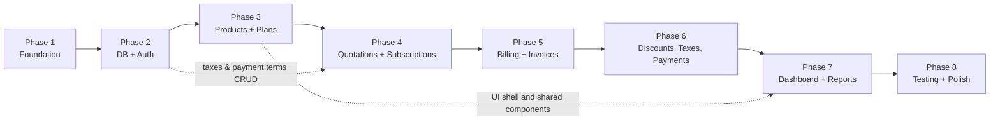

# Development Roadmap

> **Status:** Proposed plan. Nothing has been built. We do not yet know the exact hackathon time budget — **OPEN QUESTION: total hours/days available and the submission deadline.** Effort is therefore given as **S** (≈ half day), **M** (≈ 1 day), **L** (≈ 2 days) for one developer, to be re-scaled when the deadline is known.
> Related: [System Architecture](../architecture/system-architecture.md) · [Database Design](../database/database-design.md) · [API Spec](../api/api-specification.md) · [Git Workflow](git-workflow.md) · [Directory Guidelines](directory-guidelines.md) · [Feature Breakdown](../implementation/feature-breakdown.md)

## 1. How the team works

Team of four: Abdul Basith P V (Team Leader), Evan Iwin Biju, Ashin Chacko, Harijith T S. Experience levels differ, so work is split into **streams** that are independent enough to be owned by one person, and the team decides who takes which stream in the kickoff meeting. A stream owner may pair with someone who wants to learn it.

| Stream | Focus | Skill profile | Typical modules |
|---|---|---|---|
| **A – Platform & Billing core** | DB schema, auth/RBAC, billing engine, payments transactions | strongest backend/SQL | auth, subscriptions state machine, billing, payments |
| **B – Backend CRUD** | straightforward REST modules following a template module | backend beginner → intermediate | customers, products, variants, plans, taxes, discounts, templates |
| **C – Back-office UI** | admin/staff screens, shared components | frontend intermediate | layouts, tables, forms, dashboards |
| **D – Portal UI & polish** | customer portal, auth screens, responsive design, print invoice | frontend beginner → intermediate | register/login/reset pages, portal, invoice print view, docs, demo data |

> **Note – assignment model:** the team has chosen **feature-based ownership** (one person builds a whole feature across database, backend and frontend) — see the [Feature Breakdown](../implementation/feature-breakdown.md). Use the streams above only as a *skill-mix guide*, not as a frontend/backend split; the phases and critical path below still apply. Module and folder boundaries are defined in the [Directory Guidelines](directory-guidelines.md). Where rule 2 below says one stream builds the reference module, the Feature Breakdown instead builds a reference slice together (F00.5) and starts beginners on F05.

Rules that keep people unblocked:
1. **Contract first.** The [API Spec](../api/api-specification.md) is the agreement. Frontend developers code against it using a temporary mock *only for the first days of a screen*; the final app reads from the real API ("no static JSON" is an evaluation criterion).
2. **A reference module first.** Stream A builds one complete vertical slice (e.g. `taxes`: route → validation → service → repository → test) in Phase 2/3. Stream B copies the pattern for the other CRUD modules.
3. **Small pull requests** (< 300 changed lines where possible), merged at least daily ([Git Workflow](git-workflow.md)).
4. **Every phase ends with a working, demoable increment on `main`.**
5. **Seed data early**, so everyone develops against realistic data.

## 2. Overview and critical path

**Critical path:** Database schema → Authentication/RBAC → Plans & Products → Subscriptions (state machine) → **Billing engine** → Payments → Dashboard. Anything on this path that slips delays the demo. The **billing engine (Phase 5)** is the riskiest and the most important evaluated feature, so it starts design review in Phase 2 and its pure calculators (dates, discount, tax) can be written and unit-tested **in parallel from Phase 3**, before subscriptions exist.

**Must-have vs nice-to-have (cut line if time runs short):**

| Must-have (core of the problem statement) | Nice-to-have (cut first, in this order) |
|---|---|
| Auth + roles + customer portal view | Server-generated PDF (print CSS is enough) |
| Products/variants/plans/policies | Email reminders for renewal/overdue |
| Quotation templates → subscription lifecycle | Reports beyond the dashboard summary |
| Automatic invoice generation, no duplicates, no skips | CSV export |
| Tax and discount calculation | Audit log UI |
| Invoice confirm/cancel/send/print, payments, outstanding/overdue | Advanced charts |
| Finance dashboard with filters, < 2 s | Performance polish beyond indexes + pagination |

---

## Phase 1: Foundation and project setup

**Objectives:** a runnable skeleton that everyone can start locally in under 15 minutes; shared conventions.
**Dependencies:** this documentation reviewed and open questions decided (stack, JS vs TS, ORM, UI library).

**Deliverables**
- Repo structure `frontend/`, `backend/`, `docs/` as defined in the [Directory Guidelines](directory-guidelines.md); root `README` with setup steps.
- `docker-compose.yml` (PostgreSQL + Mailpit), `.env.example`, `.gitignore`.
- Backend skeleton: Express app, config validation, error handler, health endpoint, request logging.
- Frontend skeleton: Vite + React, router, layout shell, API client, UI library chosen.
- Lint/format config (ESLint, Prettier), basic CI check (optional), test runner configured.
- Git: branches created, `main` protected, PR template ([Git Workflow](git-workflow.md)).

**Suggested tasks**
| Task | Stream | Effort |
|---|---|---|
| Team decisions on open questions (stack, TS/JS, UI kit, ORM) | all | S |
| Repo structure, docker-compose, env handling | A | S |
| Express skeleton + error format + health route | A | S |
| Vite/React skeleton + routing + base layout + API client | C | M |
| Lint/format/test tooling; PR template | D | S |
| Everyone: clone, run, push a trivial change via PR (practice Git) | all | S |

**Completion criteria:** `docker compose up` + two commands start frontend and backend; `GET /api/v1/health` returns OK from the browser; each member has merged one small PR.

---

## Phase 2: Database and authentication

**Objectives:** the schema exists and is trustworthy; people can register, log in, and are authorized by role.
**Dependencies:** Phase 1.

**Deliverables**
- Database migrations for all tables in [Database Design](../database/database-design.md) (including constraints, partial indexes, sequences), plus a seed script (roles, admin, payment terms, sample taxes).
- Auth endpoints: register, login, logout, me, forgot/reset password, change password.
- RBAC middleware + central permission map; ownership-scoping helper.
- Staff creation (Admin only).
- UI: register, login, forgot/reset password, role-based redirect and menu skeleton.

**Suggested tasks**
| Task | Stream | Effort |
|---|---|---|
| Review and finalize schema in a team session (open questions) | all | S |
| Write migrations (core tables first: users, customers, products, plans, tax, payment terms; then subscriptions, invoices, payments, discounts) | A | L |
| Seed script | B | S |
| Password policy + hashing + register/login/me/logout | A | M |
| Forgot/reset password with Mailpit email | B | M |
| RBAC middleware and permission map; authorization tests | A | M |
| Staff creation endpoint | B | S |
| Auth screens + auth context + route guards | D | M |
| Back-office shell with role-based menu | C | M |

**Completion criteria:** all schema constraints verified by a quick SQL test (duplicate email rejected, duplicate period rejected, etc.); password rules rejected/accepted per spec; reset email visible in Mailpit; Staff token gets 403 on `POST /users/staff`; Customer cannot open back-office routes (UI and API).

---

## Phase 3: Product and plan management

**Objectives:** Admin can build the catalogue; billing calculators exist as tested pure code.
**Dependencies:** Phase 2 (auth, schema).

**Deliverables**
- CRUD (API + UI): products, variants (price adjustment, effective price), plans with policies and availability, plan–product association, taxes, payment terms.
- Pure-function calculators with unit tests: period dates (daily/weekly/monthly/yearly, month-end clamping), money/rounding helpers, tax, discount (no DB).
- List screens with pagination, search, sorting, filters (reusable table component).

**Suggested tasks**
| Task | Stream | Effort |
|---|---|---|
| Reference module `taxes` end-to-end (pattern for others) | A | S |
| `products` + `variants` API | B | M |
| `plans` + `plan_products` API with policy flags + validation | B | M |
| `payment_terms`, `tax_rules` UI | C | S |
| Product/variant screens | C | M |
| Plan screens (policy toggles, date range) | C | M |
| Shared `DataTable`, `Pagination`, `FormField`, `Money`, `StatusBadge` components | D | M |
| Billing calculators + unit tests (dates, rounding, tax, discount) | A | L |

**Completion criteria:** Admin creates a product with an "Odoo +560" variant and sees effective price 1,560; a plan with each frequency saves with policies; Staff sees these as read-only; calculator tests pass including the month-end and rounding cases in [Billing Engine §11](../architecture/billing-engine.md).

---

## Phase 4: Quotations and subscriptions

**Objectives:** the full subscription lifecycle works up to `active`, with plan policies and ownership rules.
**Dependencies:** Phase 3 (plans, products, taxes); customers module.

**Deliverables**
- Customers module (API + UI).
- Quotation templates (API + UI).
- Quotations/subscriptions: create from template, lines with snapshot prices, issue, confirm, activate, cancel; `SUB-` numbers; status visible in lists and detail.
- Pause/resume/renew/early-close operations enforcing plan policies.
- State-machine function (single place) with tests for every allowed and forbidden transition.
- Scheduler wiring (`node-cron`) with the **activation** and **quote expiry** jobs.
- Customer portal: "My subscriptions" (read + permitted actions).

**Suggested tasks**
| Task | Stream | Effort |
|---|---|---|
| Customers API + UI | B + C | M |
| Quotation templates API + UI | B + C | M |
| Subscription service: create/lines/snapshots/validation | A | L |
| State machine + transition endpoints + tests | A | M |
| Pause/resume/renew/close with policy checks | A | M |
| Subscription list/detail/create screens (filters, status badges) | C | L |
| Portal: my subscriptions | D | M |
| Scheduler skeleton + activation/expiry jobs | A | S |

**Completion criteria:** a rep builds a quotation from a template, issues, confirms, and it becomes active on the start date; invalid transitions return 409; closing early is refused when the plan disallows it; a customer sees only their own subscriptions.

---

## Phase 5: Billing and invoice generation

**Objectives:** automatic, idempotent, catch-up-capable invoice generation — the heart of the product.
**Dependencies:** Phase 4 (active subscriptions), Phase 3 calculators, taxes.

**Deliverables**
- Billing run orchestration (`FOR UPDATE SKIP LOCKED`, per-subscription transaction, cursor advance, `billing_runs` log) per [Billing Engine](../architecture/billing-engine.md).
- Invoice creation with snapshots, tax lines, tax summary; numbering sequence.
- Invoice endpoints: list/detail, confirm, bulk-confirm, cancel, send (Mailpit), print view.
- Admin "Run billing now" + billing run list.
- UI: invoice list/detail, run billing, print stylesheet; portal "My invoices".

**Suggested tasks**
| Task | Stream | Effort |
|---|---|---|
| Billing run orchestration + locking + error handling | A | L |
| Invoice persistence (header, lines, tax details) | A | M |
| Invoice state endpoints + email send | B | M |
| Idempotency/concurrency/catch-up tests (see §11 of billing doc) | A | M |
| Invoice list/detail/print UI | C | L |
| Billing runs screen + "Run now" | C | S |
| Portal: my invoices + print | D | M |

**Completion criteria:** running billing twice yields the same invoices; simulated downtime produces consecutive periods with no gaps; invoice totals match hand calculation (§7 example = 8,283.60); a cancelled invoice period can be re-issued; confirmed invoices appear on the portal.

---

## Phase 6: Discounts, taxes and payments

**Objectives:** pricing rules apply automatically; money collection is tracked.
**Dependencies:** Phase 5 (invoices).

**Deliverables**
- Discounts (Admin-only create): API + UI, product scope, usage limits, grants to subscriptions, redemptions view.
- Discount integration in the billing engine (eligibility, usage reservation, line allocation).
- Tax edge cases verified (rounding, inactive rule).
- Payments: record with allocations, partial payments, duplicate protection, void; invoice `paid`/`outstanding`/`overdue` states and filters.
- UI: payment form (from invoice page), payments list, outstanding/overdue filters.

**Suggested tasks**
| Task | Stream | Effort |
|---|---|---|
| Discount CRUD API + validation (Admin only) | B | M |
| Discount UI + grant to subscription | C | M |
| Discount eligibility/usage in billing engine + concurrency test | A | L |
| Payments API: record, allocate, void, duplicate protection | A | L |
| Payment screens, invoice payment panel, `payment_state` badges | C | M |
| Portal payment history view | D | S |

**Completion criteria:** a discount applies on the next invoice, stops after its end date or last use; partial payments keep an invoice outstanding; final payment marks it `paid`; duplicate reference rejected; Staff cannot create discounts.

---

## Phase 7: Dashboard and reporting

**Objectives:** the finance lead's one-stop view, fast with thousands of rows.
**Dependencies:** Phases 5–6 (data to report on).

**Deliverables**
- `/dashboard/summary` and the reports in the [API Spec §13](../api/api-specification.md).
- Dashboard UI: KPI cards (active subscriptions, revenue received, outstanding, overdue), filters (date range, plan, customer, status), tables for overdue invoices and recent payments.
- Bulk seed script (~5,000 subscriptions, ~60,000 invoices) and first performance measurements; indexes confirmed with `EXPLAIN ANALYZE`.

**Suggested tasks**
| Task | Stream | Effort |
|---|---|---|
| Aggregate SQL queries + endpoints | A | M |
| Bulk data generator | B | M |
| Dashboard layout, KPI cards, filters | C | L |
| Report tables (overdue, outstanding by customer, payments) | D | M |
| Performance pass on list endpoints | A | M |

**Completion criteria:** with seeded bulk data, dashboard and list pages respond in < 2 s locally (measured and noted in the README); numbers reconcile with direct SQL checks.

---

## Phase 8: Testing, integration and final polish

**Objectives:** reliable, consistent, demo-ready product.
**Dependencies:** all earlier phases.

**Deliverables**
- Automated tests: billing scenarios, state machines, authorization matrix (each endpoint × role), validation cases, payment edge cases.
- UI polish: consistent colors/spacing, responsive layouts checked at mobile/tablet/desktop, empty/loading/error states, meaningful validation messages, intuitive menu structure.
- Documentation sync: update these docs where implementation differs; setup guide; demo script and seed data; mark implemented vs planned.
- Security review against [Security & RBAC](../architecture/security-and-rbac.md); `npm audit`.
- Final merge to **a single branch** (`main`) for submission; demo video script ([Git Workflow](git-workflow.md)).

**Suggested tasks**
| Task | Stream | Effort |
|---|---|---|
| Authorization test suite + IDOR tests | A | M |
| Billing/payment regression tests | A | M |
| Responsive/UX review across all screens | C + D | L |
| Demo data + demo script + video rehearsal | D | M |
| Doc updates, README setup instructions | B | M |
| Bug bash (everyone tests another person's module) | all | M |

**Completion criteria:** demo script runs end to end from a clean database in under 10 minutes; no known data-integrity bugs; docs match behaviour; `main` builds and starts from a fresh clone following only the README.

---

## 3. Parallelism map (who can work at the same time)

| While this happens… | …these can proceed |
|---|---|
| Phase 2 migrations (A) | Auth screens against the documented contract (D), layout shell (C), seed data planning (B) |
| Phase 3 CRUD APIs (B) | UI screens (C) using the shared components (D); billing calculators (A) |
| Phase 4 subscription service (A) | customers/templates (B+C), portal shell (D) |
| Phase 5 billing run (A) | invoice endpoints (B), invoice UI (C), print view (D) |
| Phase 6 discount engine (A) | discount CRUD (B), payments UI (C) |

## 4. Risks to the plan

| Risk | Mitigation |
|---|---|
| Billing engine overruns | start calculators in Phase 3; reserve extra time; cut nice-to-haves first |
| Stream A becomes a bottleneck | reference modules and templates; B takes CRUD; pair-review A's critical code |
| Frontend waits for backend | contract-first, short-lived mocks, daily integration on `main` |
| Late integration surprises | demo increment at the end of every phase |
| Unknown deadline | confirm early; re-scope using the must-have cut line |
