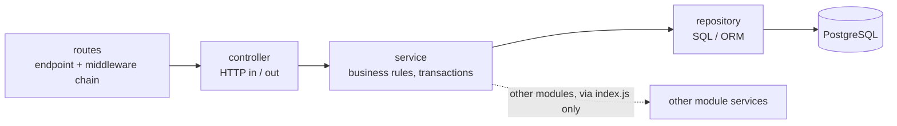
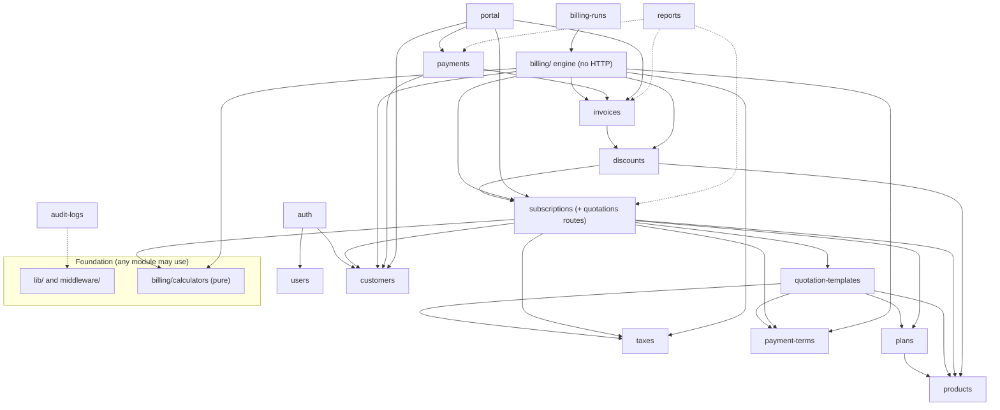
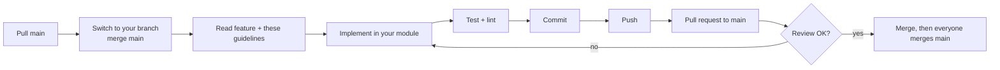

# Directory and Development Guidelines

> **Purpose:** one agreed place for *where code lives* and *how we name, import, validate, test, and share it*, so four people can work in parallel without creating duplicate files, duplicate components, or merge conflicts.
> **Audience:** every team member, especially anyone touching a module they did not write.
> Related: [System Architecture](../architecture/system-architecture.md) · [Database Design](../database/database-design.md) · [API Spec](../api/api-specification.md) · [Feature Breakdown](../implementation/feature-breakdown.md) · [Git Workflow](git-workflow.md) · [Security & RBAC](../architecture/security-and-rbac.md) · [Roadmap](development-roadmap.md)

## 0. Status — read this first

| Label | Meaning in this document |
|---|---|
| **CURRENT** | Exists in the repository today. |
| **TARGET** | The agreed-to-be structure/convention. It is a *recommendation until the team confirms it at the F00 kickoff* (see OQ-1); after that it is binding. Nothing in the repository violates it yet because there is no code. |
| **PLANNED** | A path that does **not exist yet**. It is created by the feature named next to it. We do not create empty folders ahead of time. |
| `OPEN QUESTION` | Not decided. The default used here is stated; do not "just pick one" in your own branch. |

### 0.1 Current repository state (inspected)

```
subscription-management-system/        CURRENT
├── README.md
└── docs/
    ├── README.md
    ├── api/            api-specification.md
    ├── architecture/   system-architecture.md · data-flows.md · state-machines.md · billing-engine.md
    │                   security-and-rbac.md · user-access-and-authorization.md (does not apply, see below)
    ├── database/       database-design.md
    ├── development/    development-roadmap.md · git-workflow.md · directory-guidelines.md (this file)
    └── implementation/ feature-breakdown.md
```
There is **no** `backend/`, `frontend/`, `package.json`, lockfile, `.gitignore`, `.env.example`, `docker-compose.yml`, migration, test, or dependency. All technology choices in the docs are **proposals**; the open ones are tracked as `D-xx` in the [Feature Breakdown §11](../implementation/feature-breakdown.md#11-pending-decisions-register).
`docs/architecture/user-access-and-authorization.md` describes a different (Go, multi-product) platform and **does not apply** to this structure ([D-01](../implementation/feature-breakdown.md#11-pending-decisions-register)).

### 0.2 The ten golden rules (details in §L)

1. Look in the **reuse registry (§N)** and search the repo before creating a file.
2. Code for a module lives **only** in that module's folder.
3. Other modules use your module **only through its `index.js`**.
4. HTTP goes in routes/controllers, **rules go in services**, SQL goes in repositories.
5. The API contract is [api-specification.md](../api/api-specification.md); the schema is [database-design.md](../database/database-design.md). Change the document **first**, in a PR, before changing code.
6. Shared files (§L.2) are changed only after telling the team.
7. Never commit `.env`, `node_modules`, build output, or secrets.
8. Money is a string / `NUMERIC`, never a JavaScript float.
9. The backend enforces permissions and validation; the frontend only helps.
10. Small PRs, merged often, from your own branch.

### 0.3 "Where do I put it?" cheat sheet

| I need to add… | Put it in |
|---|---|
| A new API endpoint for module `plans` | `backend/src/modules/plans/` → route in `plans.routes.js`, handler in `plans.controller.js`, rule in `plans.service.js`, SQL in `plans.repository.js`, input schema in `plans.schemas.js` |
| A business rule (e.g. "pause needs `allow_pause`") | the owning module's `*.service.js` — **never** in a controller, route, repository, or React component |
| A database query | the owning module's `*.repository.js` |
| A database table/column/constraint | change [database-design.md](../database/database-design.md) first, then a migration in `backend/db/migrations/` (§7) |
| Something used by many backend modules (money math, dates, mailer) | `backend/src/lib/` (check the registry first) |
| Express middleware (auth, roles, validation) | `backend/src/middleware/` |
| A page | `frontend/src/features/<feature>/pages/` |
| A component used only by one feature | `frontend/src/features/<feature>/components/` |
| A generic UI piece with no business knowledge (table, modal, input) | `frontend/src/components/ui/` |
| Calling the API from React | `frontend/src/api/<module>.js` (one file per backend module) |
| A React Query hook for a module | `frontend/src/features/<feature>/hooks/` |
| Form validation | `frontend/src/features/<feature>/schemas.js` |
| A scheduled job | `<module>.jobs.js` in the owning module; scheduling is wired in `backend/src/jobs/index.js` |
| A unit test | next to the file: `x.test.js` |
| An API / DB integration test | `backend/tests/integration/<module>/` |

---

## A. Repository structure

### A.1 Top level — TARGET

```
subscription-management-system/
├── README.md                    CURRENT   project overview + links to docs
├── .gitignore                   PLANNED (F00)  node_modules, .env*, dist, build, coverage … (keeps .env.example)
├── .editorconfig                PLANNED (F00, optional)  indentation / line endings
├── .env.example                 PLANNED (F00)  only variables used by docker-compose.yml
├── docker-compose.yml           PLANNED (F00)  PostgreSQL 16 + Mailpit
├── .github/
│   └── pull_request_template.md PLANNED (F00)
├── docs/                        CURRENT   all documentation (see A.2)
├── backend/                     PLANNED (F00)  Node.js + Express API (own package.json)
├── frontend/                    PLANNED (F00)  React + Vite SPA (own package.json)
└── e2e/                         PLANNED, only if an end-to-end tool is adopted (D-07)
```

Rules for the top level:
- **No other top-level folders** without a team decision. In particular there is **no `shared/` package** and **no `common/` folder**: code is not shared between frontend and backend; they communicate only through the API contract (§F, §G). Constants the frontend needs are mirrored in `frontend/src/lib/constants.js` with a comment naming the backend source (OQ-8).
- **No root `package.json`, no npm workspaces** by default; `backend/` and `frontend/` are independent packages, each with its own lockfile and `npm` scripts (OQ-7).
- Documentation never lives next to code except short `README.md` files inside `backend/` and `frontend/` for setup.

### A.2 Documentation layout — CURRENT

| Folder | Contents | Rule |
|---|---|---|
| `docs/architecture/` | system architecture, data flows, state machines, billing engine, security & RBAC | design decisions |
| `docs/database/` | database design | the schema source of truth |
| `docs/api/` | API specification | the contract source of truth |
| `docs/development/` | roadmap, git workflow, this file | how we work |
| `docs/implementation/` | feature breakdown | who builds what, in what order |

### A.3 Backend — TARGET (PLANNED, created by F00 unless noted)

```
backend/
├── package.json
├── .env.example                  # documented variables, fake values (§I)
├── README.md                     # how to run the backend only
├── db/                           # everything about the database schema and data (§D)
│   ├── schema.prisma             # ONLY if Prisma is chosen (D-03); path configured in package.json
│   ├── migrations/               # one migration per feature, timestamp-named, never edited after merge
│   └── seeds/
│       ├── reference/            # required in every environment: roles, payment terms, taxes
│       ├── demo/                 # demo story data
│       └── bulk/                 # performance data (≈5,000 subscriptions)
├── src/
│   ├── server.js                 # starts HTTP listener + scheduler; nothing else
│   ├── app.js                    # builds the Express app (middleware order); no business logic
│   ├── routes.js                 # the ONE place that mounts every module router under /api/v1
│   ├── config/
│   │   └── env.js                # the ONLY file that reads process.env; validates and exports config
│   ├── middleware/               # authenticate.js · require-role.js · permissions.js · validate.js
│   │                             # error-handler.js · rate-limit.js · request-id.js
│   ├── lib/                      # small, domain-free helpers shared by all modules (§N)
│   │   ├── db.js                 # database client + withTransaction + DB-error mapping
│   │   ├── money.js  dates.js  pagination.js  responses.js  errors.js  error-codes.js
│   │   ├── mailer.js  audit.js  scheduler.js  state-machine.js  logger.js  constants.js
│   ├── billing/                  # the billing ENGINE (no HTTP) — see C.5
│   │   ├── calculators/          # PURE functions, import nothing from modules/: pricing.js periods.js tax.js discounts.js
│   │   ├── invoice-builder.js    # assembles a draft invoice (snapshots, tax, discount)
│   │   ├── run-billing.js        # orchestration: lock → build → insert → advance cursor
│   │   └── billing.jobs.js       # scheduled entry points
│   ├── jobs/
│   │   └── index.js              # the one schedule registry: imports every <module>.jobs.js
│   └── modules/                  # one folder per business module (§B-map in section K)
│       └── <module>/
│           ├── index.js                  # PUBLIC API of the module (service functions only)
│           ├── <module>.routes.js        # endpoints + middleware chain
│           ├── <module>.controller.js    # HTTP in/out
│           ├── <module>.service.js       # business rules, transactions
│           ├── <module>.repository.js    # SQL / ORM access (private to the module)
│           ├── <module>.schemas.js       # Zod request schemas
│           ├── <module>.constants.js     # (optional) statuses, enums for this module
│           ├── <module>.state-machine.js # (only subscriptions, invoices)
│           ├── <module>.jobs.js          # (only if the module has scheduled jobs)
│           ├── <module>.emails.js        # (only if the module sends mail: templates live here)
│           └── <module>.service.test.js  # unit tests sit next to the code (§J)
└── tests/                        # tests that need a database or HTTP
    ├── integration/<module>/     # API and DB integration tests
    ├── factories/                # createCustomer(), createActiveSubscription() …
    ├── helpers/                  # loginAs(role), test DB reset, fake clock
    └── setup.js
```

Unused optional files are simply **not created** — do not add empty placeholders.

### A.4 Frontend — TARGET (PLANNED, created by F00 unless noted)

```
frontend/
├── package.json
├── index.html
├── vite.config.js                # includes the "@/" alias → src/ (OQ-9)
├── jsconfig.json                 # (or tsconfig.json if TypeScript, D-02)
├── .env.example                  # VITE_* variables only (§I)
├── README.md
├── public/                       # files served as-is, never imported: favicon, robots.txt
└── src/
    ├── main.jsx                  # entry: mounts <App/>
    ├── App.jsx                   # providers (Query, Auth, Toast) + router outlet
    ├── api/                      # ALL calls to the backend
    │   ├── client.js             # the single fetch wrapper (base URL, credentials, error mapping, 401 handling)
    │   └── <module>.js           # one file per backend module: plans.js, invoices.js …
    ├── components/
    │   └── ui/                   # domain-free reusable pieces: DataTable, Pagination, FormField, MoneyInput,
    │                             # Money, StatusBadge, Modal, ConfirmDialog, Toast, EmptyState, ErrorState …
    ├── features/                 # one folder per business module (same names as backend modules)
    │   └── <feature>/
    │       ├── index.js          # PUBLIC exports (select components, badges) — nothing else is imported from outside
    │       ├── pages/            # route-level screens: PlanListPage.jsx …
    │       ├── components/       # components used only inside this feature
    │       ├── hooks/            # React Query hooks for this feature: usePlans.js …
    │       ├── schemas.js        # Zod form schemas for this feature
    │       └── types.js          # JSDoc typedefs (types.ts if TypeScript)
    ├── hooks/                    # generic hooks used by 2+ features: useDebounce.js, useUrlFilters.js
    ├── layouts/                  # AuthLayout.jsx · BackOfficeLayout.jsx · PortalLayout.jsx
    ├── routes/                   # index.jsx (route table) · guards.jsx (RequireAuth/RequireRole) · menu.js
    ├── lib/                      # pure helpers: money.js dates.js format.js constants.js apply-server-errors.js
    ├── config/
    │   └── env.js                # the ONLY file that reads import.meta.env
    ├── styles/                   # global.css (tokens: colours, spacing, typography) · print.css
    ├── assets/                   # images/icons that code imports (bundled)
    └── test/                     # test setup and utilities (render helper, API mocks)
```

### A.5 What belongs where, in one sentence each

- `backend/db/` — the **shape** of the database (schema, migrations, seed data). Nothing else.
- `backend/src/modules/` — business modules; the only place for module-specific backend code.
- `backend/src/billing/` — the billing engine; **no HTTP**, because the engine is called by jobs, tests, and the `billing-runs` API.
- `backend/src/lib/` and `middleware/` — shared, domain-free infrastructure.
- `frontend/src/features/` — module-specific UI. `components/ui/` — module-free UI. `api/` — the only network code.

---

## B. Frontend directory conventions

### B.1 Where each thing goes

| Item | Location | Notes |
|---|---|---|
| **Pages** (route-level screens) | `features/<feature>/pages/` | one file per route; named `XxxPage.jsx`; thin: compose components and hooks |
| **Layouts** | `layouts/` | only `AuthLayout`, `BackOfficeLayout`, `PortalLayout`; a feature never defines its own layout |
| **Reusable components (domain-free)** | `components/ui/` | no imports from `features/`; no API calls |
| **Feature-specific components** | `features/<feature>/components/` | private to the feature unless exported in `index.js` |
| **Hooks** | feature hooks in `features/<feature>/hooks/`; generic hooks in `hooks/` | a hook that calls the API belongs to the feature, never `hooks/` |
| **API clients** | `api/<module>.js` + `api/client.js` | one function per endpoint, returns parsed `data`; **no JSX, no React** |
| **Services** | there is no frontend "services" folder: API calls live in `api/`, server-state in hooks. Business rules live in the backend | do not duplicate backend rules in React |
| **Context / state** | server state = TanStack Query (hooks). Auth context lives in `features/auth/` and is mounted in `App.jsx`. Local UI state = `useState` in the component. **No global store** (Redux/Zustand) unless the team decides | |
| **Form validation** | `features/<feature>/schemas.js` (Zod) used with React Hook Form | mirrors the backend rules for friendly messages; the backend remains authoritative |
| **Utilities** | `lib/` (pure functions: money display, dates, formatting) | no React, no API |
| **Types / interfaces** | JavaScript (default): JSDoc `@typedef` in `features/<feature>/types.js`. TypeScript (if D-02 chooses it): `types.ts` next to the code; global API types in `api/types.ts` | |
| **Assets** | imported images/icons → `src/assets/`; served-as-is files → `public/` | |
| **Styles** | global tokens and resets in `styles/global.css`; component styles per the chosen UI approach (D-06) next to the component; print rules in `styles/print.css` | no per-developer global CSS |
| **Constants** | feature-specific in the feature; cross-feature in `lib/constants.js` | mirror of backend enums (comment the source) |

### B.2 Reusable vs feature-private — the decision rule

Ask in this order:
1. **Does it know about a business concept** (customer, invoice, plan, tax…)? → it is **not** generic. Put it in the feature that owns that concept. If other features need it, export it from that feature's `index.js` (pickers and badges only — e.g. `CustomerSelect`, `PlanSelect`, `PaymentStateBadge`, `LineItemsEditor`).
2. **Is it generic** (no business words in its props or its code) **and used, or clearly about to be used, by two or more features?** → `components/ui/`.
3. **Used once, no known second use?** → keep it inside its feature. Move it to `components/ui/` the *second* time someone needs it — via a small PR that announces the move (§L.2).

How to avoid duplicates:
- **Search before creating**: `grep -ri "Money\|StatusBadge" frontend/src` and read the [reuse registry](#n-reuse-registry-check-before-you-create).
- **One component per concept.** There is exactly one `DataTable`, one `Money`, one `StatusBadge`, one `ConfirmDialog`. If it almost fits, extend it with a prop through a small PR; do not fork it.
- Feature code never imports another feature's internals: `import … from '@/features/customers'` is allowed (public API); `@/features/customers/components/CustomerCard` is not.
- Pages import `components/ui`, their own feature, `api/`, `lib/`, `hooks/`, and other features' public exports — never the reverse (`components/ui` never imports a feature).

### B.3 Routing and navigation
- The route table, guards, and sidebar menu config live in `routes/`. F00 declares **every route and menu entry up front** with placeholder pages; a feature replaces only its own placeholder component. Do not add routes in other places.
- Back-office URLs: `/app/<feature>…`; portal: `/portal/…`; auth: `/login`, `/register`, `/forgot-password`, `/reset-password`.

---

## C. Backend directory conventions

### C.1 Layer responsibilities



| Layer | File | Does | Must NOT |
|---|---|---|---|
| **Routes** | `<module>.routes.js` | declare method + path; attach `authenticate`, `requireRole(...)`, `validate({...})`, then the controller | contain logic; touch `req`/`res` bodies |
| **Controller** | `<module>.controller.js` | read validated `req.body/params/query` and `req.user`; call **one** service function; send the response with `lib/responses.js` | contain business rules; call repositories; call another module; build SQL |
| **Service** | `<module>.service.js` | business rules, state transitions, permission-by-policy checks, transactions (`withTransaction`), audit logging, calling other modules' services | know about Express (`req`, `res`); write SQL |
| **Repository** | `<module>.repository.js` | all SQL/ORM for the module's own tables; returns plain records; accepts the `tx` it is given | contain business rules; be imported from another module |
| **Schemas** | `<module>.schemas.js` | Zod schemas for body, params, query of this module | contain DB or business checks |
| **Middleware** | `middleware/` | cross-cutting request processing (auth, roles, validation, errors, rate limit) | contain module-specific rules |
| **Module index** | `index.js` | re-export the service functions other modules may call | export routes, controllers, repositories, or schemas |

**Where is authentication / authorization / config / errors / jobs / tests?**

| Topic | Location |
|---|---|
| Authentication (cookie → user) | `middleware/authenticate.js`; login/register logic in `modules/auth/` |
| Authorization (RBAC) | role gate: `middleware/require-role.js`; the permission map (single source for the RBAC matrix): `middleware/permissions.js`; customer scoping helper `scopeToCustomer` also in `middleware/`; plan-policy and ownership checks: **in the service** |
| Validation | `*.schemas.js` + `middleware/validate.js` (shape); services (business rules); DB constraints (integrity) — see §H |
| Config | `config/env.js` only |
| Errors | `lib/errors.js` (`AppError`), `lib/error-codes.js` (the list of codes), `middleware/error-handler.js` (the only place that turns errors into responses) |
| Background jobs | functions in `<module>.jobs.js`; wired in `jobs/index.js` using `lib/scheduler.js` |
| Tests | §J |

### C.2 The module public API (how modules talk to each other)
- A module may call another module **only** through `import { … } from '../<other>/index.js'`.
- `index.js` exports **service functions**, nothing else. Never export a repository.
- **Writes to a table go through the owning module's service** (table ownership: [Feature Breakdown §3.5](../implementation/feature-breakdown.md)). Example: the billing engine inserts an invoice via `invoices.createDraftInvoice(ctx, data)` and moves the subscription's billing cursor via `subscriptions.advanceBillingCursor(ctx, …)`; it never writes to those tables directly.
- **Reads of another module's data** also go through its service. The only exception is `reports` (§K), which may run read-only aggregate SQL across tables for speed.
- Service functions take a **context first**: `fn(ctx, input)` where `ctx = { actor, tx? }`. If `ctx.tx` exists the function joins that transaction; otherwise it opens its own with `withTransaction`. This is how the billing engine composes several modules in one transaction.

### C.3 Transactions and external effects
- Multi-table writes happen inside **one** `withTransaction` opened by the service that owns the use case.
- Never send email, call an external service, or wait on user input inside a transaction. Do it after commit.
- When locking several rows, lock in ascending `id` order (avoids deadlocks).

### C.4 State machines and jobs
- State changes go through `lib/state-machine.js` (shared helper) used by `subscriptions.state-machine.js` and `invoices.state-machine.js`. Never `UPDATE … SET status` anywhere else. (See [State Machines §4](../architecture/state-machines.md).)
- A job is a **plain exported function** `runXxx({ asOf })` in the owning module's `*.jobs.js`; it is idempotent. `jobs/index.js` (created by F00 with all imports already present) only schedules them. Tests and admin endpoints call the same function.

### C.5 The billing engine (`src/billing/`)
- `billing/calculators/` holds **pure functions** (period dates, pricing/line totals, tax, discount eligibility/allocation). They import only `lib/money.js` and each other — **never** a module, repository, or database client. Hence any module (e.g. `subscriptions` for totals) may import them without creating a dependency cycle, and they are unit-testable without a database.
- `invoice-builder.js` and `run-billing.js` orchestrate and **may** call module services.
- HTTP endpoints for billing runs live in the `billing-runs` module, which calls `run-billing.js`. (So: `billing/` = engine, `modules/billing-runs/` = API. Do not create a second `billing` folder.)
- Rules themselves are specified in [billing-engine.md](../architecture/billing-engine.md); code must match it.

---

## D. Database conventions

The schema is **[database-design.md](../database/database-design.md)**. Do not invent tables/columns/relations in your branch. To change the schema: (1) open a PR that edits `database-design.md` and labels it `schema`, (2) announce it (§L.2) and get approval from the owner of the table and one other person, (3) then write the migration.

| Topic | Convention |
|---|---|
| **Table names** | plural `snake_case` (`subscription_items`, `payment_allocations`) |
| **Column names** | `snake_case`; booleans `is_…`/`allow_…`; timestamps `…_at`; dates `…_date`; money `…_amount`/`price`/`total` as `NUMERIC(12,2)`; rates `NUMERIC(6,3)` |
| **Primary keys** | `id BIGINT GENERATED ALWAYS AS IDENTITY` (exceptions as in the design: `roles.id`, `payment_terms.id` are `SMALLINT`; `discount_products` has a composite key) |
| **Foreign keys** | column `<singular_table>_id` (`customer_id`, `plan_id`); role-named exceptions as in the design (`created_by`, `actor_user_id`, `recorded_by`) |
| **Statuses / enums** | `TEXT` + `CHECK (col IN (...))`, lowercase snake values (`'active'`) — not native enums |
| **Constraint & index names** | `pk_<table>`, `fk_<table>_<column>`, `uq_<table>_<columns-or-purpose>`, `ix_<table>_<columns>`, `ck_<table>_<rule>` — e.g. `uq_invoices_subscription_period_start`. Always name partial indexes explicitly |
| **Delete behaviour** | `RESTRICT` for history-bearing references; `CASCADE` only for rows owned by a parent (items, tokens). Master data is deactivated (`is_active`), not deleted; payments are voided; invoices cancelled |
| **Relationships** | exactly as in the ER diagram; no extra join tables |
| **Migrations** | location `backend/db/migrations/`; one migration per feature (a PR may add more only with a reason); file name `YYYYMMDDHHMMSS_<feature-id>_<what>` (e.g. `20261107093000_f06_products_and_variants`); **forward-only and never edited after reaching `main`** — fix with a new migration; each migration includes its `CHECK`s, partial indexes, and sequences (not only what the ORM can express) |
| **Migration order** | follows feature prerequisites ([Feature Breakdown §5](../implementation/feature-breakdown.md)); a migration never references a table whose owner feature is not yet merged |
| **Seed data** | `backend/db/seeds/reference` (roles, payment terms, taxes — safe for all environments), `demo` (story data), `bulk` (performance). Seeds are idempotent (re-runnable). Credentials for the first Admin come from environment variables (D-08), never from the repo |
| **Transactions** | every multi-statement write uses `withTransaction`; use `SELECT … FOR UPDATE` on rows whose balance/state you change (invoices in payments, subscriptions in billing); keep transactions short; email/network after commit |
| **Money in code** | strings or integer minor units via `lib/money.js`; never `Number`/float arithmetic |
| **Raw SQL** | allowed only inside repositories (and the billing engine's locked scan via `subscriptions.repository`); always parameterized; sort column names come from a whitelist |
| **Test DB** | a separate database (`TEST_DATABASE_URL`); tests never touch the development database |

---

## E. Naming conventions

Chosen for JavaScript + Express + React (if D-02 selects TypeScript, only the extensions change: `.ts`/`.tsx`).

| Thing | Convention | Correct | Incorrect |
|---|---|---|---|
| Folders | `kebab-case`, plural for modules | `quotation-templates/`, `payment-terms/` | `QuotationTemplates/`, `payment_term/` |
| Backend files | `<module>.<role>.js`, kebab-case module | `plans.service.js`, `quotation-templates.routes.js` | `PlanService.js`, `plansService.js`, `service.js` |
| Other backend files | `kebab-case.js` | `invoice-builder.js`, `run-billing.js`, `error-handler.js` | `invoiceBuilder.js` |
| React component files | `PascalCase.jsx`, file = component name, one exported component per file | `PlanListPage.jsx`, `Money.jsx` | `plan-list-page.jsx`, `index.jsx` |
| Hooks | `useXxx.js` | `usePlans.js`, `useDebounce.js` | `plansHook.js` |
| Other frontend files | `kebab-case.js` (api files named after the module) | `api/plans.js`, `lib/apply-server-errors.js` | `PlansAPI.js` |
| Tests | same name + `.test.js(x)` | `plans.service.test.js`, `PlanForm.test.jsx` | `test_plans.js`, `plans.spec.js` |
| React components | `PascalCase` | `RecordPaymentDialog` | `recordPaymentDialog` |
| Functions / variables | `camelCase`; functions start with a verb | `createPlan`, `nextBillingDate` | `plan_create`, `NextBillingDate` |
| Layer verbs | service: `create/get/list/update/deactivate/delete…`; repository: `insert/find/update…ById/delete…` | service `createPlan` → repo `insertPlan` | service `insertPlan` |
| Constants | `UPPER_SNAKE_CASE`; enum-like objects `SUBSCRIPTION_STATUS` with lowercase values equal to the DB | `SUBSCRIPTION_STATUS.ACTIVE = 'active'` | `ACTIVE_STATUS = 'Active'` |
| Zod schemas | `<verb><Thing>Schema`, `list<Things>QuerySchema` | `createPlanSchema`, `listPlansQuerySchema` | `planValidator` |
| Record/field names that mirror a DB column or API field (**see OQ-3**) | keep `snake_case` unchanged across DB → service → API → frontend | `subscription.next_billing_date` | `subscription.nextBillingDate` (adds mapping code) |
| Your own local variables and parameters | `camelCase` | `const nextBilling = sub.next_billing_date` | |
| API paths | `kebab-case`, plural nouns; actions as `POST /resource/:id/action` | `/quotation-templates`, `POST /subscriptions/:id/pause` | `/getPlans`, `/quotationTemplate` |
| Query parameters and JSON keys | `snake_case` (as in the API spec) | `page_size`, `date_from`, `payment_state` | `pageSize` |
| DB tables / columns | see §D | `payment_allocations.invoice_id` | `PaymentAllocation`, `invoiceId` |
| Environment variables | `UPPER_SNAKE_CASE`; frontend `VITE_` prefix; booleans `true`/`false` | `DATABASE_URL`, `VITE_API_BASE_URL` | `databaseUrl` |
| Branches / commits | see [Git Workflow §3](git-workflow.md) | `evan-iwin-biju` · `feat(plans): add policy toggles` | `fix stuff` |
| Test names | describe the behaviour | `returns 409 when the invoice is already paid` | `test1` |

Other rules: **named exports only** (no `export default`, except config files that a tool requires); no abbreviations other than `id`, `tx`, `ctx` (write `quantity`, not `qty`); one concept = one name across the stack (always "payment terms" — never "terms" in one place and "payment conditions" in another).

---

## F. Import and dependency conventions

| Topic | Convention |
|---|---|
| **Module system** | ES modules (`import`/`export`) in both apps; backend `package.json` has `"type": "module"` — so relative imports **include the `.js` extension**. `OPEN QUESTION OQ-2`: confirm ESM vs CommonJS at kickoff (the default here is ESM). |
| **Backend imports** | relative paths, **no aliases**. Same module: `./plans.service.js`. Shared: `../../lib/money.js`. Other modules: `../customers/index.js` only. Never reach into `../customers/customers.repository.js`. |
| **Frontend imports** | alias `@/` → `src/` (e.g. `@/components/ui/DataTable`, `@/api/plans`). Inside a feature use relative paths for its own files (`./components/PlanForm`). The alias does **not exist yet**; it is created once, in F00, in `vite.config.js` + `jsconfig.json` (OQ-9). Until then use relative paths. |
| **Import order** | 1) third-party, 2) `@/` / `lib` / shared, 3) other modules' public API, 4) same-module relative; blank line between groups; no unused imports (lint). |
| **Shared utilities** | exactly one location each: backend `src/lib/`, frontend `src/lib/` (pure) and `src/components/ui/` (UI). Importing a shared utility never means copying it. If it does not exist, add it to the shared location with a small PR (§L.2), do not create a local copy. |
| **Shared types & constants** | module-specific: `<module>.constants.js` / `features/<f>/types.js`. Cross-module backend: `src/lib/constants.js` (e.g. role names). Cross-feature frontend: `src/lib/constants.js`. Frontend never imports backend files. |
| **Circular dependencies** | forbidden. Prevention: (1) the arrows in §K.1 only point downward, (2) `index.js` exports services only, (3) pure helpers live in `lib/` or `billing/calculators/` where they cannot import modules, (4) if two modules need each other, extract the shared part or pass a function/argument. Detect them in code review; an automated check (e.g. `madge`) is optional and is **not** installed (OQ-12). |
| **New dependencies** | do not add a package without a note in the PR and agreement of the team (it changes `package.json` + lockfile, a shared file). Prefer what is already listed in [System Architecture §9.1](../architecture/system-architecture.md). |
| **Barrel files** | only `index.js` at module/feature root; no barrel files in `components/ui` subfolders unless they already exist (to keep tree-shaking and merge conflicts down) — import components by file path. |

---

## G. API response conventions

The contract is [API Spec §1](../api/api-specification.md) — this section only states **how code produces it**. Do not restate or change formats here; change the spec first.

| Concern | Rule | Code location |
|---|---|---|
| **Success (single)** | `200`/`201` with `{ "data": { … } }`; create returns `201` + `Location`; actions return `200` with the updated resource; delete `204` | `lib/responses.js`: `ok`, `created`, `noContent` |
| **Success (list)** | `{ "data": [ … ], "meta": { page, page_size, total, total_pages } }` | `lib/responses.js`: `list`; `lib/pagination.js` builds `LIMIT/OFFSET` and `meta` |
| **Validation error** | `422` `VALIDATION_ERROR` with `details: [{ field, message }]` | `middleware/validate.js` converts Zod issues |
| **Authentication error** | `401` `UNAUTHENTICATED` / `INVALID_CREDENTIALS` / `SESSION_EXPIRED` | `middleware/authenticate.js`, `auth` service |
| **Authorization error** | `403` `FORBIDDEN` / `PLAN_POLICY_FORBIDS` | `require-role.js`; policy checks in services |
| **Not found** | `404` `NOT_FOUND` — also for another customer's record | services (via repository returning `null`) |
| **Conflict / state** | `409` (`INVALID_STATE_TRANSITION`, `IN_USE`, duplicates…) | services, DB-error mapping in `lib/db.js` |
| **Business-rule violation** | `422` with a specific code (`PLAN_NOT_AVAILABLE`, …) | services |
| **Server error** | `500` `INTERNAL_ERROR`, generic message, details only in logs | `middleware/error-handler.js` |
| **Pagination** | query `page`, `page_size` (default 20, max 100) | `paginationSchema` (F00) |
| **Sorting** | `sort=-created_at,number`, whitelisted per module | the module's `list…QuerySchema` declares allowed fields |
| **Filtering / search** | named filters per endpoint; ranges `_from`/`_to`; `q` for text | the module's `list…QuerySchema`; unknown filter → `422` |
| **Money / dates** | money as strings `"1560.00"`, dates `YYYY-MM-DD`, timestamps ISO-8601 UTC | serialization in the controller or repository, never `Number()` |

Rules:
- Controllers **never** call `res.status().json()` directly — only `lib/responses.js`.
- Services signal failures by throwing `AppError(code, status, message, details?)`; codes come from `lib/error-codes.js`, which mirrors the API spec's code list (add a code to the spec first).
- Every endpoint implemented must appear in the API spec with the same path, method, role, and shape. If you need a different shape, edit the spec in the same PR and tell the frontend owner.
- Frontend: `api/client.js` is the only place that parses the envelope; hooks receive `data` (and `meta`) or a typed `ApiError { code, message, details, status }`.

---

## H. Error handling and validation

### H.1 Where each kind of validation lives

| Kind | Example | Where | Failure → |
|---|---|---|---|
| **Shape / format** of the request | email format, password policy, UUID/number, money string, date, enum value, page_size ≤ 100 | `<module>.schemas.js` (Zod) applied by `validate()` in the route; shared pieces (`passwordSchema`, `moneySchema`, `dateSchema`, `paginationSchema`) are defined once in `lib/` or `middleware/validate.js` | `422 VALIDATION_ERROR` |
| **Business rules** | quantity ≥ plan minimum, plan available on date, state transitions, payment ≤ amount due, discount eligibility | `<module>.service.js` (the *only* place) | `409`/`422` with a specific code |
| **Authorization by policy/ownership** | customer owns the record, plan allows pause | service (plus `scopeToCustomer` in queries) | `403`/`404` |
| **Data integrity** | uniqueness, FK, `CHECK`s, no duplicate invoice period | database constraints (last line of defence) | mapped by `lib/db.js` |
| **Frontend form validation** | required fields, live password rules | `features/<f>/schemas.js` (usability only) | inline message; the server result still wins |

### H.2 Database errors
- `lib/db.js` maps Postgres error codes once: `23505` unique → `409` (specific code when the constraint name is known, e.g. `EMAIL_ALREADY_EXISTS`, `PERIOD_ALREADY_INVOICED`, `DUPLICATE_PAYMENT_REFERENCE`); `23503` FK → `409 IN_USE` on delete or `422` on insert; `23514` check → `422`.
- Services may catch a specific constraint to translate it into a friendlier code; no other layer inspects DB error codes.
- Never return raw database messages to clients.

### H.3 Errors and messages
- Throw `AppError`; never `res.send` an error yourself; never swallow errors silently.
- Error `message` = short, user-safe English sentence ("An account with this email already exists"). `code` = stable machine-readable identifier. Do not put SQL, stack traces, or table names in messages.
- Frontend maps `code` → friendly text in one file (`lib/error-messages.js`, PLANNED) and shows field errors via `lib/apply-server-errors.js` (`details[].field` → form field). Other layers do not invent their own message formats.
- **Do not duplicate validation**: a rule is written once in the service. The frontend may repeat *format* checks for UX, but it must not implement business rules (e.g. availability, state transitions) — it asks the backend, using flags such as `can_pause`.

---

## I. Environment and configuration

| Topic | Convention |
|---|---|
| **Files** | `backend/.env`, `frontend/.env` (git-ignored, personal), `backend/.env.example`, `frontend/.env.example` (committed, fake values, one comment per variable), root `.env.example` only for `docker-compose.yml`. A real `.env` is created by copying `.env.example` |
| **Never committed** | `.env`, `.env.*` except `.env.example`; keys; passwords; tokens; database dumps with real data; `node_modules/`; `dist/`, `build/`, `coverage/`; ORM-generated clients. If a secret is committed by mistake: rotate it (deleting the commit is not enough) and tell the team |
| **Naming** | `UPPER_SNAKE_CASE`; grouped by prefix (`DB_`/`SMTP_`/`BILLING_`); frontend variables must start with `VITE_` and are **public** (never a secret) |
| **Reading config** | backend only in `src/config/env.js` (validated with Zod at startup; the app refuses to start if invalid); frontend only in `src/config/env.js`. No `process.env.X` / `import.meta.env.X` elsewhere |
| **Backend variables (from [Security §8](../architecture/security-and-rbac.md))** | `NODE_ENV`, `PORT`, `DATABASE_URL`, `TEST_DATABASE_URL` (PLANNED, tests), `JWT_SECRET`, `COOKIE_SECURE`, `CORS_ORIGIN`, `SMTP_HOST`, `SMTP_PORT`, `SMTP_USER`, `SMTP_PASS`, `MAIL_FROM`, `APP_BASE_URL`, `APP_TIMEZONE`, `BILLING_CRON`, `BILLING_AUTO_CONFIRM`, `LOG_LEVEL`; first-admin seed variables (names decided with D-08) |
| **Frontend variables** | `VITE_API_BASE_URL` (PLANNED) — the only API URL; read by `api/client.js` through `config/env.js` |
| **Docker variables** | PostgreSQL user/password/db for compose in the root `.env` (`POSTGRES_USER`, `POSTGRES_PASSWORD`, `POSTGRES_DB`) — PLANNED |
| **Local development** | Docker Compose runs PostgreSQL + Mailpit; backend and frontend run on the host. Default ports (OQ — see [System Architecture §14](../architecture/system-architecture.md)): frontend 5173, API 4000, PostgreSQL 5432, Mailpit UI 8025 / SMTP 1025 |
| **Database configuration** | a single `DATABASE_URL`; the DB client is created in `lib/db.js` only |
| **API base URL** | backend mounts everything under `/api/v1`; the frontend client prepends `VITE_API_BASE_URL` |
| **Secrets management** | each person keeps their own `.env`; shared secrets for the demo are exchanged privately (not in chat history of public channels, not in GitHub); different secrets for dev/test/demo |
| **Changing configuration** | adding/removing a variable = edit `config/env.js` + `.env.example` + the table above in the same PR and announce it (§L.2) |

---

## J. Testing conventions

The runner choices (Vitest or Jest, Supertest, React Testing Library) are proposals in [System Architecture §9.1](../architecture/system-architecture.md); the end-to-end tool is undecided (D-07). Nothing is installed yet; F00 installs the chosen set once. Do not add another test framework.

| Test type | Location | File name | Scope / rule |
|---|---|---|---|
| **Backend unit** (pure logic, services with fake repositories, calculators, schemas) | next to the code | `plans.service.test.js`, `periods.test.js` | no database, no network; fast |
| **API / integration** (HTTP through Supertest + real PostgreSQL test DB) | `backend/tests/integration/<module>/` | `plans.api.test.js` | covers role matrix, validation errors, state errors, pagination |
| **Database tests** (constraints, unique-period index, check constraints, concurrency) | `backend/tests/integration/db/` | `invoices.constraints.test.js`, `billing.concurrency.test.js` | prove DB-level guarantees independent of services |
| **Test helpers & factories** | `backend/tests/helpers/`, `backend/tests/factories/` | `login-as.js`, `customer.factory.js` | each table owner adds factories for their tables; use factories instead of other features' UI |
| **Frontend component tests** | next to the component | `PlanForm.test.jsx` | React Testing Library; mock `api/` or `fetch`, never the network |
| **Frontend hook / lib tests** | next to the file | `useUrlFilters.test.js`, `money.test.js` | |
| **Frontend test utilities** | `frontend/src/test/` | `render-with-providers.jsx`, `setup.js` | one shared render helper |
| **End-to-end** | `e2e/` (PLANNED, only if a tool is adopted) | `register-to-payment.e2e.js` | until D-07, E2E is a documented manual script in the PR |

Rules: tests are part of the feature's PR ([Feature Breakdown §3.3](../implementation/feature-breakdown.md)); every test is independent (own data, reset between files); the test database is separate; time-dependent code uses the injectable clock (`tests/helpers/clock.js`); test names describe behaviour; no skipped tests on `main` without an issue note; never commit snapshot files of large pages.

---

## K. Module ownership, boundaries and dependencies

The 11 business domains of the assignment map to **16 module folders**. The same folder name is used in `backend/src/modules/` and `frontend/src/features/` and matches the first segment of the API path wherever possible. Where the domain needs no frontend (or backend) folder it says so.

| Domain | Module folder (backend = frontend) | API prefix | Feature | Tables owned | Notes |
|---|---|---|---|---|---|
| 1 Authentication & users | `auth` | `/auth` | F01, F02 | `password_reset_tokens` | login, register, reset, `/auth/me` |
| 1 Authentication & users | `users` | `/users` | F03 | `users`, `roles` (F00 baseline) | staff accounts |
| 2 Customers | `customers` | `/customers`, `/me/profile` | F04 | `customers` (F00 baseline) | exports `CustomerSelect` |
| 3 Products | `products` | `/products`, `/variants` | F06 | `products`, `product_variants` | variants live here, not in a separate module |
| 4 Plans | `plans` | `/plans` | F07 | `plans`, `plan_products` | policies; `assertPlanAvailable` |
| 5 Quotations | `quotation-templates` | `/quotation-templates` | F08 | `quotation_templates`, `quotation_template_items` | the quotation *itself* is a subscription (see next row) |
| 5–6 Quotations & subscriptions | `subscriptions` | `/subscriptions`, `/quotations` | F09, F10 | `subscriptions`, `subscription_items` | **one module, two routers** (`subscriptions.routes.js`, `quotations.routes.js`) because a quotation *is* a subscription in `draft`/`quotation` status |
| 7 Tax | `taxes` | `/taxes` | F05 | `tax_rules` | |
| 7 Tax (terms) | `payment-terms` | `/payment-terms` | F05 | `payment_terms` | |
| 8 Discounts | `discounts` | `/discounts`, `/subscriptions/:id/discounts` | F15 | `discounts`, `discount_products`, `subscription_discounts`, `discount_redemptions` | the grant routes are declared in `discounts.routes.js` |
| 9 Invoicing | `invoices` | `/invoices`, `/subscriptions/:id/invoices` | F11 | `invoices`, `invoice_items`, `invoice_tax_details`, `billing_runs` | owns `payment_state` derivation |
| 9 Invoicing (billing) | `billing-runs` (+ engine in `src/billing/`) | `/billing` | F12 | – (uses `billing_runs`) | API only; the engine is not a module |
| 10 Payments | `payments` | `/payments`, `/invoices/:id/payments` | F13 | `payments`, `payment_allocations` | |
| – Customer portal | `portal` | `/me/subscriptions`, `/me/invoices` | F14 | – | composes `subscriptions`, `invoices`, `payments` with customer scoping; **no business rules of its own** |
| 11 Dashboard & reporting | `reports` | `/dashboard`, `/reports` | F16 | – | read-only aggregates |
| – Audit | `audit-logs` | `/audit-logs` | F17 | `audit_logs` (F00 baseline) | viewer only; writing is `lib/audit.js` |

Rule of thumb for the business rule examples you asked about: *a subscription rule (e.g. "can be paused only if the plan allows") exists once, in `subscriptions.service.js`; the invoice code, the portal, the controllers and React components all call it or display its result (`can_pause`).*

### K.1 Backend dependency diagram

Arrows mean "imports the other module's `index.js`". Dotted = read-only SQL. There must be **no cycles**; arrows point from higher-level modules to lower-level ones.



Dependency rules:
1. Only the arrows above are allowed. A new arrow needs a note in the PR; a new arrow that creates a cycle is not allowed — move the shared piece down into `lib/` or `billing/calculators/`, or use a small function parameter instead.
2. `invoices → discounts` exists only for `releaseDiscountRedemption`; `discounts` must never import `invoices` (its redemption list uses its own SQL join).
3. `payments → invoices` calls the invoice state machine entry points; `invoices` must never import `payments` (the `/invoices/:id/payments` route is declared in `payments.routes.js`).
4. `middleware/authenticate.js` may call `users`; `users` never imports a route or middleware at module-load time through its `index.js`.
5. `jobs/index.js` imports `*.jobs.js` files only.

### K.2 Frontend dependency rules
- Allowed: `features/* → components/ui, api, hooks, lib, config`, and `features/A → features/B/index.js` for pickers/badges (customers, products, plans, taxes, payment-terms, quotation-templates `LineItemsEditor`, invoices `PaymentStateBadge`/`InvoiceDocument`, subscriptions `SubscriptionStatusBadge`).
- `components/ui` and `lib` import from nothing in `features/`. `api/` imports only `api/client.js` and `lib/`.
- `portal` pages compose `subscriptions`/`invoices` public exports and call `/me/*` through `api/portal.js`.

---

## L. Rules to reduce Git conflicts

### L.1 The ten collaboration rules

1. **Do not create another folder for something that already exists.** Use §0.3, §K, and §N first.
2. **Check existing components and utilities before creating new ones** (search the repo; read the registry).
3. **Do not modify shared configuration files without informing the team** (§L.2).
4. **Do not independently change database schema definitions.** Document first (§D), then migrate.
5. **Avoid editing another developer's module without coordination.** Ask the owner ([Feature Breakdown §10](../implementation/feature-breakdown.md)); small agreed edits go in a separate PR.
6. **Keep module-specific code inside its module.**
7. **Shared utilities have exactly one location** (`lib/`, `components/ui/`).
8. **Keep API contracts identical to the API specification.**
9. **Communicate changes to shared interfaces *before* implementing them.**
10. **Never commit `.env` files or generated build artifacts.**

More habits that prevent conflicts: one concern per PR; don't reformat or reorder files you are not changing (format only the files you touch, with the shared formatter config); don't rename or move files without announcing it; don't mix refactoring with feature work; merge `main` into your branch every day; never `git push --force` on shared branches ([Git Workflow](git-workflow.md)).

### L.2 Shared files and how to change them

"Steward" = who reviews changes to that file. The default steward is the **Team Leader**, or whoever the team assigns in F00 (OQ-10). Change protocol for every file in the table:
1. **Announce first** in the team chat using the template below.
2. Make the change in **its own small PR** (nothing else in it), from your branch.
3. Get review from the steward + one other member; **merge the same day**.
4. Everyone merges `main` into their branch right away.

| Shared file / area | Location (PLANNED) | Special rule |
|---|---|---|
| Root package config | `backend/package.json`, `frontend/package.json` (no root one) | add dependencies in a dependency-only PR; announce package name + reason |
| Lockfiles | `package-lock.json` in each app | never edit by hand; on conflict take `main`'s version, then run the install and commit the result |
| Environment examples | `*/.env.example`, root `.env.example` | update together with `config/env.js` |
| Database schema | `docs/database/database-design.md`, `backend/db/schema.prisma` (if used) | schema PR label `schema`; owner of the table approves |
| Migrations | `backend/db/migrations/` | never edit merged ones; announce when you add one so order is agreed |
| API specification | `docs/api/api-specification.md` | edit only your module's section; contract changes announced to the frontend/backend consumers |
| Backend route registry | `backend/src/routes.js` | F00 pre-mounts every module; features do not edit it |
| Job registry | `backend/src/jobs/index.js` | F00 pre-imports every `*.jobs.js`; features do not edit it |
| Permission map | `backend/src/middleware/permissions.js` | must equal [Security & RBAC §2](../architecture/security-and-rbac.md); change the doc first |
| Common middleware & lib | `backend/src/middleware/`, `backend/src/lib/` | stewarded; add new helpers in a PR that updates the registry (§N) |
| Shared API client | `frontend/src/api/client.js` | stewarded; endpoint functions go in `api/<module>.js`, not here |
| Application routing & menu | `frontend/src/routes/` | F00 pre-declares all routes/menu items; features replace only their page component |
| Global styles & design tokens | `frontend/src/styles/` | no feature-specific rules here; tokens changed only by agreement |
| Shared UI components | `frontend/src/components/ui/` | extend through props; breaking changes announced |
| Shared types / constants | `frontend/src/lib/constants.js`, `backend/src/lib/constants.js` | additive changes only |
| CI / PR template / git config | `.github/`, `.gitignore`, `.editorconfig` | stewarded |

**Change-notice template** (post in the team chat before coding):
```
Shared change: <file or area>
Why: <one sentence>
What changes for others: <new function / renamed prop / new env var / new migration>
Branch/PR: <name or link>   Planned merge: <today / date>
```

### L.3 How to avoid overwriting each other's work
- Work only on **your own branch** (`basith`, `evan-iwin-biju`, `ashin-chacko`, `harijith-ts`); never commit directly to `main`.
- Start every session with `git fetch origin && git merge origin/main`; finish it with a push.
- Edit only files in the module you own plus the shared files you announced. If `git status` shows files you did not mean to touch, don't commit them.
- On a conflict: stop, read both sides, ask the other author, keep both intents. Never resolve by deleting someone else's change.

---

## M. Standard development workflow

The commands and the pull-request details are in [Git Workflow](git-workflow.md); this is the checklist every teammate follows.

1. **Pull the latest `main`**: `git switch main && git pull origin main`.
2. **Switch to your personal branch**: `git switch <your-branch>` (`basith` · `evan-iwin-biju` · `ashin-chacko` · `harijith-ts`), then `git merge main`.
3. **Understand your assigned feature/module**: read its section in the [Feature Breakdown](../implementation/feature-breakdown.md) and the linked design docs; list questions.
4. **Check these guidelines**: module folder, naming (§E), shared files (§L.2), reuse registry (§N).
5. **Implement inside the correct module** (migration → repository → service → controller/routes → API client → hook → page → tests).
6. **Test**: unit, integration, and the manual walkthrough of the user journey; run lint.
7. **Commit** small, logical changes with meaningful messages: `type(scope): summary` (e.g. `feat(plans): validate availability dates`). Stage specific files; review `git diff --staged`.
8. **Push** to your branch at least at the end of every session.
9. **Open a pull request** to `main` using the template: what/why, how to test, screenshots, checklist (docs/API updated, no secrets, understood the code).
10. **Review and integrate**: a teammate reviews ([review checklist](git-workflow.md)); resolve comments; merge via the PR; then everyone merges `main` into their branch.



---

## N. Reuse registry (check before you create)

If the thing you need is on this list, **use it** (or, if it is missing a capability, extend it through a small PR). If it is not on the list and could be shared, add a row in the PR that creates it. Everything below is **PLANNED**; the "Created by" column says which feature builds it first. Until it is merged, don't write your own version — ask the creator.

### Backend

| Need | Use | Location | Created by |
|---|---|---|---|
| Decimal money math, rounding | `money` | `src/lib/money.js` | F00 |
| "Today", timezone | `dates` | `src/lib/dates.js` | F00 |
| Transactions, DB client, DB-error mapping | `withTransaction`, `mapDbError` | `src/lib/db.js` | F00 |
| Success/list responses | `ok`, `created`, `list`, `noContent` | `src/lib/responses.js` | F00 |
| Errors | `AppError`, codes | `src/lib/errors.js`, `error-codes.js` | F00 |
| Pagination / sorting | `parsePagination`, `buildMeta` | `src/lib/pagination.js` | F00 |
| Request validation | `validate`, shared Zod schemas | `src/middleware/validate.js` | F00 |
| Login required / roles / permissions | `authenticate`, `requireRole`, `permissions`, `scopeToCustomer` | `src/middleware/` | F00 |
| Audit trail | `audit.log(tx, …)` | `src/lib/audit.js` | F00 |
| State transition helper | `transition(...)` | `src/lib/state-machine.js` | F00 |
| Sending email | `sendMail` | `src/lib/mailer.js` | F00 |
| Scheduling | `registerJob`, `runJobNow` | `src/lib/scheduler.js` | F00 |
| Unit price of product + variant | `computeEffectivePrice` | exported by `modules/products` | F06 |
| Plan availability check | `assertPlanAvailable` | exported by `modules/plans` | F07 |
| Line totals / tax per line | `computeLine`, `computeTotals` | `src/billing/calculators/pricing.js` | F09 |
| Billing periods | `periodStart`, `periodEnd` | `src/billing/calculators/periods.js` | F12 |
| Discount eligibility / allocation | `selectEligibleDiscount`, `allocateToLines` | `src/billing/calculators/discounts.js` | F15 |
| Derived invoice `payment_state` | `invoicePaymentState` | exported by `modules/invoices` | F11 |
| Test factories and login helper | `create…()`, `loginAs` | `backend/tests/factories/`, `helpers/` | F00 + each table owner |

### Frontend

| Need | Use | Location | Created by |
|---|---|---|---|
| Calling the backend | `apiRequest`, `api/<module>.js` | `src/api/` | F00 / each feature |
| Table, pagination, filters | `DataTable`, `Pagination`, `FilterBar` | `src/components/ui/` | F00 |
| Inputs and forms | `FormField`, `MoneyInput`, `Modal`, `ConfirmDialog` | `src/components/ui/` | F00 |
| Display money / status | `Money`, `StatusBadge` | `src/components/ui/` | F00 |
| Feedback states | `Toast`, `EmptyState`, `ErrorState`, `LoadingSkeleton` | `src/components/ui/` | F00 |
| Server errors in forms | `applyServerErrors` | `src/lib/apply-server-errors.js` | F00 |
| URL-bound filters | `useUrlFilters` | `src/hooks/` | F00 |
| Who is logged in / permissions | `useAuth`, `useCan`, `RequireAuth`, `RequireRole` | `features/auth/`, `routes/guards.jsx` | F00 / F01 / F03 |
| Pickers | `CustomerSelect`, `ProductSelect`, `VariantSelect`, `PlanSelect`, `TaxSelect`, `PaymentTermSelect`, `TemplateSelect` | exported by their features | F04, F06, F07, F05, F08 |
| Line editor for products/quantities/tax | `LineItemsEditor` | exported by `features/quotation-templates` | F08 |
| Subscription / invoice status badges | `SubscriptionStatusBadge`, `PaymentStateBadge` | `features/subscriptions`, `features/invoices` | F09, F11 |
| Printable invoice | `InvoiceDocument` | exported by `features/invoices` | F11 |
| Test rendering | `renderWithProviders` | `src/test/` | F00 |

---

## O. Open questions and reconciliation log

### O.1 Open questions (default used meanwhile)

| ID | Question | Default | Related |
|---|---|---|---|
| OQ-1 | Does the team confirm this structure at the F00 kickoff? Until then it is TARGET, not binding. | confirm at kickoff; record in the F00 PR | all |
| OQ-2 | ES modules or CommonJS for the backend? | ES modules | D-02 |
| OQ-3 | Keep `snake_case` for record fields end to end, or map to `camelCase` at the repository/controller boundary? | `snake_case` end to end (zero mapping code, matches the API spec exactly) | D-03 (Prisma defaults to camelCase) |
| OQ-4 | `backend/db/` for schema, migrations and seeds vs the ORM's default location (e.g. `prisma/`)? | `backend/db/` (tool-neutral; matches [System Architecture §9](../architecture/system-architecture.md)) | D-03 |
| OQ-5 | JavaScript or TypeScript? | JavaScript + Zod + JSDoc | D-02 |
| OQ-6 | Backend test runner: Vitest or Jest? | pick one in F00 and use it everywhere | D-07 |
| OQ-7 | Root `package.json` with convenience scripts / workspaces? | none | – |
| OQ-8 | A shared package for constants/types between frontend and backend? | none; mirror constants with a comment | – |
| OQ-9 | Create the `@/` import alias in the frontend? | yes, in F00 | – |
| OQ-10 | Who is the steward of shared files? | Team Leader | – |
| OQ-11 | Vite dev proxy to the API or direct CORS + cookie? | direct base URL (`VITE_API_BASE_URL`) with CORS | D-04 |
| OQ-12 | Automated import-boundary checks (lint rule / `madge`)? | not now; enforced in review | – |

### O.2 Inconsistencies found between documents and how they were handled

| # | Inconsistency | Documents | Resolution |
|---|---|---|---|
| R1 | Backend module list had 12 entries (incl. `quotations/`) while the API groups and the Feature Breakdown also need templates, payment terms, portal, billing runs, audit | System Architecture §9 · Feature Breakdown · API Spec | One list of **16 modules** (§K). `quotations/` is **not** a separate folder: quotation routes are a second router in `subscriptions`. System Architecture §9 updated |
| R2 | Two homes for billing: `src/billing/` (architecture) vs `modules/billing/` (feature breakdown) | System Architecture · Feature Breakdown F12 | `src/billing/` = engine (no HTTP), `modules/billing-runs/` = API. Feature Breakdown updated |
| R3 | File naming: `plans.service.js` (Git Workflow example) vs `invoiceBuilder.js`/`runBilling.js` (Feature Breakdown) | Git Workflow · Feature Breakdown | `kebab-case` with role suffix (§E); Feature Breakdown updated |
| R4 | Migration/seed location unspecified or "later" | System Architecture · Roadmap · DB design | `backend/db/{migrations,seeds}` (OQ-4); DB design and System Architecture updated |
| R5 | Index name `uq_invoice_period` did not follow a naming scheme | DB design | renamed `uq_invoices_subscription_period_start` per §D; DB design updated |
| R6 | Route registry: `routes/index` vs single file | Feature Breakdown | `src/routes.js`; Feature Breakdown updated |
| R7 | Permission map had no location | Security & RBAC | `src/middleware/permissions.js`; Security doc updated |
| R8 | "State machine function (single place)" had no location | State Machines · Roadmap | `lib/state-machine.js` + `<module>.state-machine.js`; State Machines updated |
| R9 | Roadmap splits work by skill streams (A–D) and has a stream build the reference module; the Feature Breakdown assigns whole features and builds the reference slice together (F00) | Roadmap · Feature Breakdown | feature-based ownership is the team's stated direction; a note was added to the Roadmap pointing to the Feature Breakdown. Phases and critical path are unchanged |
| R10 | Git Workflow said "each person owns modules (see roadmap streams)" and listed shared files loosely | Git Workflow | now points to the Feature Breakdown ownership and to §L.2 |
| R11 | `docs/README.md` did not list the Feature Breakdown or these guidelines | docs index | rows added |
| R12 | `user-access-and-authorization.md` proposes a Go layout (`cmd/`, `internal/`, `pkg/`) and tables not in the DB design | that document · all others | **not followed**; unchanged; decision D-01 stays open |
| R13 | Data field casing (snake_case API/DB vs camelCase JS/Prisma) was unaddressed | API Spec · DB design | OQ-3 |

---

## P. Validation checklist (for reviewers of changes to this document)

- [ ] Every path in §A is labelled CURRENT or PLANNED; nothing PLANNED exists in the repo yet.
- [ ] Module names in §K are identical in backend, frontend, API prefixes, and the Feature Breakdown.
- [ ] No frontend ↔ backend responsibility overlaps: business rules only in backend services; the frontend only displays and validates format.
- [ ] Tables in §K match the 25 tables of the DB design.
- [ ] Mermaid diagrams parse (checked by reading; no renderer is installed).
- [ ] No document still mentions a removed folder (`quotations/` module, `modules/billing/`, `routes/index`, `uq_invoice_period`).
