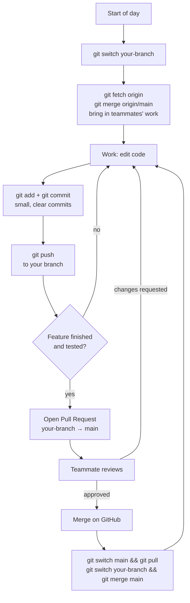

# Team Collaboration and Git Workflow

> **Status:** Proposed team process. Written so that someone new to Git can follow it step by step.
> Related: [Development Roadmap](development-roadmap.md) · [System Architecture](../architecture/system-architecture.md) · [Directory Guidelines](directory-guidelines.md)

## 1. Team

| Member | Role | Personal branch |
|---|---|---|
| Abdul Basith P V | Team Leader | `basith` |
| Evan Iwin Biju | Team Member | `evan-iwin-biju` |
| Ashin Chacko | Team Member | `ashin-chacko` |
| Harijith T S | Team Member | `harijith-ts` |

Evaluation criterion: *"Use Git and version control properly. Development must be collaborative, not dependent on one team member."* Commit history on GitHub will show who did what, so **everyone commits their own work under their own GitHub identity**.

## 2. Hackathon rules that affect Git

From the *Odoo Hackathon Participant Document*:
1. The Team Leader submits the GitHub repository link. **"Make sure that you have your code in a single branch of the repository only."** → The final, complete code **must be on `main`**. Personal branches are working branches; before submission, everything must be merged into `main`, and the submitted link must open `main`. Leftover personal branches should hold nothing that `main` lacks (delete them or leave them identical to `main`).
2. The assigned **mentor's GitHub id must be added as a collaborator** to the repository (Settings → Collaborators). OPEN QUESTION: team leader to confirm once the mentor is assigned.
3. All team members must log in to the hackathon portal with the GitHub id the leader registered.

## 3. Branches

| Branch | Purpose | Who pushes | Rules |
|---|---|---|---|
| `main` | Stable integration branch; always starts and runs; this is what we submit | **nobody directly** — only via pull request | protected (see §11) |
| `basith`, `evan-iwin-biju`, `ashin-chacko`, `harijith-ts` | Each person's daily working branch | only the owner | may be messy; must be synced from `main` often |

**Naming conventions**
- Personal branches: your name in lowercase with hyphens (as above).
- Later, short-lived feature branches (see §12): `<your-name>/<type>-<short-description>`, e.g. `evan-iwin-biju/feat-product-variants`, `harijith-ts/fix-invoice-total`. Types: `feat`, `fix`, `docs`, `refactor`, `test`, `chore`.
- Commit messages: `type(scope): short summary in present tense`, e.g. `feat(plans): add billing frequency validation`, `fix(invoices): round tax per line`, `docs(db): clarify snapshots`. Keep the first line ≤ 72 characters; add a body when the *why* is not obvious.

## 4. One-time setup (each member)

```bash
# 1. Tell Git who you are (use the same email as your GitHub account)
git config --global user.name  "Your Name"
git config --global user.email "you@example.com"

# 2. Clone the repository
git clone https://github.com/<ORG-OR-USER>/subscription-management-system.git
cd subscription-management-system

# 3. See branches that exist on GitHub
git branch -a
```
(Replace the URL with the real repository URL. Use HTTPS with a personal access token or SSH keys — whichever the team prefers.)

### 4.1 Creating the personal branches (done **once**, by the Team Leader)
```bash
git switch main
git pull origin main
git switch -c basith                 # create + switch
git push -u origin basith            # publish and link to GitHub

# repeat for the others (names from the table above)
git switch main
git switch -c evan-iwin-biju && git push -u origin evan-iwin-biju
git switch main
git switch -c ashin-chacko   && git push -u origin ashin-chacko
git switch main
git switch -c harijith-ts    && git push -u origin harijith-ts
```

### 4.2 Everyone else, first time
```bash
git fetch origin
git switch ashin-chacko            # your own branch; Git sets it up to track origin/ashin-chacko
git status                         # should say: On branch ashin-chacko
```

## 5. Switching branches
```bash
git branch                 # lists local branches; * marks the current one
git switch <branch-name>   # switch (commit or stash your work first)
git stash                  # park uncommitted changes temporarily
git stash pop              # bring them back
```
Before every working session check `git status` and make sure you are on **your own branch**.

## 6. The daily loop



### 6.1 Pulling the latest changes into your branch
```bash
git switch evan-iwin-biju
git fetch origin                 # download what's new, change nothing
git merge origin/main            # bring main's new work into your branch
```
Do this **at the start of every session and before opening a PR**. Merge (not rebase) is the beginner-safe option and does not rewrite history.

### 6.2 Making commits
```bash
git status                       # what changed?
git add backend/src/modules/plans/plans.service.js   # stage specific files (avoid 'git add .' blindly)
git diff --staged                # review what you're about to commit
git commit -m "feat(plans): validate availability dates"
```
Guidelines:
- Commit small, logical changes often (at least a few times a day). One commit = one idea.
- Never commit: `.env` files, passwords, API keys, `node_modules/`, build output, database dumps with real data. They belong in `.gitignore`.
- Never commit code you don't understand (AI-generated code included) — read it, run it, and be able to explain it in review.
- If the commit hook/linter complains, fix it rather than skipping it.

### 6.3 Pushing
```bash
git push                 # after the first 'git push -u origin <branch>', plain 'git push' is enough
```
Push at least at the end of every working session so work is backed up and visible. Never use `git push --force` on `main`; avoid it everywhere unless the leader says so.

## 7. Pull request (PR) process

1. Make sure your branch is up to date: `git fetch origin && git merge origin/main`, then run the app/tests locally.
2. `git push`.
3. On GitHub: **Pull requests → New pull request**, base `main`, compare `your-branch`.
4. Fill in the PR template: *what changed, why, how to test, screenshots (UI), related doc/API section, checklist*.
5. Request **at least one reviewer** (not yourself). Prefer someone who owns the area you touched.
6. Address review comments with new commits on your branch (the PR updates automatically).
7. When approved and checks pass, **the author merges** using **"Create a merge commit"** (see note below).
8. Update your branch: `git switch main && git pull && git switch your-branch && git merge main`.

> **Why "merge commit" and not "squash"?** Our personal branches live for a long time. If you squash-merge a long-lived branch, Git doesn't realize the branch's commits were merged and the next PR shows the same changes again and causes false conflicts. Squash is fine later for short-lived feature branches (§12).

PR size: aim for < 300 changed lines and one topic. Open PRs **at least daily** so integration problems appear early. Draft PRs ("Draft" button) are welcome for early feedback.

Suggested PR template (`.github/pull_request_template.md`, to be added in Phase 1):
```markdown
## What and why
## How to test
## Screenshots (if UI)
## Checklist
- [ ] I merged the latest main into my branch
- [ ] App starts; I ran the relevant tests / manual checks
- [ ] No secrets, .env, or node_modules committed
- [ ] Docs / API spec updated if behaviour or contract changed
- [ ] I understand all the code in this PR
```

## 8. Code review expectations

**For authors:** keep PRs small; describe how to test; self-review the diff first; respond to every comment (fix or explain); don't take comments personally.

**For reviewers:** respond within a few hours during the hackathon (a waiting PR blocks someone). Check:
1. Does it do what the PR says, and match the [API Spec](../api/api-specification.md) / [Database Design](../database/database-design.md)?
2. **Correctness of money, billing, and state transitions** (no floats; transactions; constraints) — these get extra attention.
3. **Authorization:** is the role check and customer scoping present on the backend?
4. Validation of input; sensible error messages.
5. No secrets or unrelated files; readable names; no commented-out code.
6. Does the app still start? (Pull the branch and run it when the change is risky.)

Comment tone: ask questions, suggest, explain why. Use "nit:" for minor style points that need not block. Approve when the code is safe to merge, even if you would have written it differently.
Review pairing is rotated, so everyone sees different parts of the code: e.g. A↔B, C↔D, then swap weekly. Beginners should review too — asking "why is this done this way?" is a valid and valuable review.

## 9. Handling merge conflicts

A conflict happens when two people changed the same lines. It is normal, not a disaster.

**Prevention**
- Each person owns whole features/modules ([Feature Breakdown](../implementation/feature-breakdown.md)) — avoid editing other people's files without telling them.
- Shared files (`package.json` and lockfiles, `.env.example`, database schema and migrations, API client, route registry, app routing/menu, global styles, common middleware, `lib/`) are conflict hotspots: announce first, change them in their own small PR, and merge the same day. The full list and the change-notice template are in [Directory Guidelines §L.2](directory-guidelines.md).
- Pull/merge `main` often.

**Resolving, step by step** (typically after `git merge origin/main`):
```bash
git status                         # lists files with conflicts ("both modified")
# open each file; look for the markers:
#   <<<<<<< HEAD            ← your version
#   ... your lines ...
#   =======
#   ... incoming lines ...
#   >>>>>>> origin/main     ← main's version
# edit to keep the correct final code, delete the three marker lines, save
git add <resolved-file>
git commit                         # completes the merge (a default message is provided)
```
Then run the app, run tests, and push.
- Not sure? Ask the author of the other change; do the resolution together. Never "fix" a conflict by deleting the other person's work.
- Panic button: `git merge --abort` returns to the state before the merge. Nothing is lost.
- Migrations conflict: never edit a migration that's already on `main`; add a new one. Two people adding migrations at once → agree on the order in chat; filenames have timestamps.

## 10. Useful safety habits
```bash
git log --oneline --graph --decorate -15    # see recent history
git diff                                     # unstaged changes
git restore <file>                           # discard local changes to a file (cannot be undone!)
git revert <commit>                          # undo a commit by creating a new commit (safe on shared branches)
```
Avoid on shared branches: `git push --force`, `git reset --hard`, `git rebase` (unless the leader walks you through it). If something went wrong, **stop and ask** — the reflog (`git reflog`) usually lets us recover.

## 11. Protecting `main`

On GitHub: **Settings → Branches → Add branch protection rule** (or **Rules → Rulesets**) for `main`:
- ✔ Require a pull request before merging
- ✔ Require at least **1 approval**
- ✔ Dismiss stale approvals when new commits are pushed (optional)
- ✔ Require status checks to pass (lint/tests) — once CI exists
- ✔ Require conversation resolution
- ✔ Block force pushes and deletion
- ☐ "Include administrators": **recommended** on, but the Team Leader may keep it off during the final hours to fix emergencies — if so, still use a PR.

Note: branch protection on **private** repositories may require a paid GitHub plan; if unavailable, the team follows the same rules by agreement (no direct pushes to `main`). OPEN QUESTION: repo visibility.

Also: enable "Automatically delete head branches" only for **feature** branches, not for personal branches.

## 12. Growing into feature branches

Personal branches are the starting point. When the team is comfortable (suggested: after Phase 2), move to short-lived feature branches:

| Stage | Practice |
|---|---|
| **Stage 1 (Phases 1–2)** | Work on your personal branch; PR to `main` at least daily. |
| **Stage 2 (from Phase 3)** | For each task, branch off your up-to-date personal branch (or `main`): `git switch main && git pull && git switch -c harijith-ts/feat-tax-rules`. One task = one branch = one PR. Delete the branch after merge. |
| **Stage 3 (Phases 5+)** | Risky work (billing engine) uses feature branches only, with two reviewers. Squash-merge short-lived branches to keep `main` readable. |

Personal branches then become a place to experiment; keep them synced with `main` (`git merge origin/main`) and never let them carry unmerged work for more than a day or two.

## 13. Before the final submission checklist (Team Leader)
- [ ] All PRs merged; `main` contains the final code.
- [ ] A fresh clone of `main` starts following only the README.
- [ ] No secrets in the repository or its history; `.env.example` present.
- [ ] Docs updated; planned vs implemented clearly marked.
- [ ] Mentor added as collaborator.
- [ ] Repository link submitted on the hackathon portal points to `main`; personal branches contain nothing unmerged.
