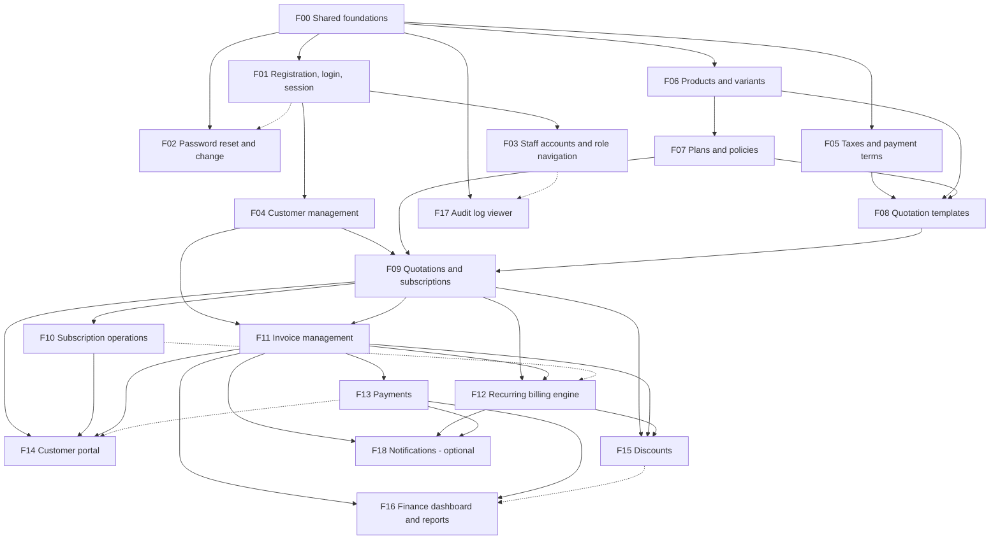

# Feature Implementation Breakdown

> **Status:** Planning handbook. **Nothing described here is implemented yet.**
> **Purpose:** split the Subscription Management System into end-to-end features that one developer can pick up and finish across database, backend, API, frontend, validation, and tests.
> **Source of truth:** [System Architecture](../architecture/system-architecture.md) · [Database Design](../database/database-design.md) · [Billing Engine](../architecture/billing-engine.md) · [Data Flows](../architecture/data-flows.md) · [State Machines](../architecture/state-machines.md) · [API Spec](../api/api-specification.md) · [Security & RBAC](../architecture/security-and-rbac.md)
>
> This document does not change those documents. Where they are silent, inconsistent, or need a team decision, the item is marked **PENDING DECISION `D-xx`** and listed in [§11](#11-pending-decisions-register) with the default this handbook assumes.

## Contents
1. [How to use this handbook](#1-how-to-use-this-handbook)
2. [What was inspected, and findings](#2-what-was-inspected-and-findings)
3. [Ownership model and working rules](#3-ownership-model-and-working-rules)
4. [Phase 0 – Shared foundations (F00)](#4-phase-0--shared-foundations-f00)
5. [Phases, dependency graph and waves](#5-phases-dependency-graph-and-waves)
6. [Phase 1 – Core functionality (F01–F07)](#6-phase-1--core-functionality)
7. [Phase 2 – Main business workflows (F08–F14)](#7-phase-2--main-business-workflows)
8. [Phase 3 – Advanced functionality (F15–F18)](#8-phase-3--advanced-functionality)
9. [Phase 4 – Integration, testing and stabilization](#9-phase-4--integration-testing-and-stabilization)
10. [Feature assignment table and allocation approach](#10-feature-assignment-table-and-allocation-approach)
11. [Pending decisions register](#11-pending-decisions-register)
12. [Coverage verification](#12-coverage-verification)
13. [Deliberately not included](#13-deliberately-not-included)

---

## 1. How to use this handbook

1. Read §3 (rules) and §4 (foundations) once.
2. Pick a feature whose **prerequisites are merged** (check the wave table in §5).
3. Read that feature's sections A–I, then the doc sections it links to.
4. Build it as a **vertical slice**: migration → backend → API → frontend → tests → walkthrough → PR.
5. Update the [API Spec](../api/api-specification.md) in the same PR if the contract changed.

**Legend**
- `D-xx` – pending decision (see §11). Do not invent an answer; use the stated default and note it in your PR.
- **Official** = in the problem statement; **Proposed** = our design (as in the other docs).
- Role letters follow the API Spec: **A** Admin · **S** Staff · **C** Customer (own data) · **P** Public · **Any** logged in.
- Paths such as `backend/src/modules/plans/` are the **proposed** layout from [System Architecture §9](../architecture/system-architecture.md); the folders do not exist yet.
- Complexity: Low (≈ ½–1 day) · Medium (≈ 1–2 days) · High (≈ 2–4 days) for one developer. These are relative estimates; the hackathon time budget is still unknown (see the [Roadmap](../development/development-roadmap.md)).

---

## 2. What was inspected, and findings

**Inspected:** the repository tree, `README.md`, all documents under `docs/`, the git history, and the two PDFs the project is based on (problem statement and participant guide).

**Findings that shape this handbook**

| # | Finding | How it is handled |
|---|---|---|
| 1 | **There is no application source code yet** (no `backend/`, `frontend/`, `package.json`, migrations). The repository contains documentation only. | The breakdown is derived from the documents. Every file path is a proposal. Nothing is described as existing. |
| 2 | `docs/architecture/user-access-and-authorization.md` (added after the architecture set) describes a **different product**: a central OIDC/OAuth identity platform in **Go** with multi-product registration, entitlement engine, policy versions, per-product sessions, signed webhooks, MFA, and organization membership. It is not linked from any other document. | **No feature here is derived from it.** It conflicts with the problem statement (single company, three roles, no multi-product access), with the chosen stack (Node/Express, not Go), and with the data model (it lists tables such as `customer_members`, `entitlement_grants`, `product_clients` that the database design does not have). Recorded as **D-01** so the team can retire it, relabel it as future research, or deliberately adopt it (which would require redesigning the other documents first). |
| 3 | The roadmap assigns *streams* by skill (platform / CRUD / back-office UI / portal UI). | This handbook replaces that split **for assignment purposes**: one person owns a whole feature. The roadmap's phase order and critical path still apply. The roadmap file is not modified. |
| 4 | `subscriptions.template_id` has no `ON DELETE` rule in the DB design, but `DELETE /quotation-templates/:id` says existing quotations are unaffected. | **D-10.** Default: templates are deactivated (`is_active=false`), not deleted. |
| 5 | The API spec has no endpoint for a customer's **payment history**, although [Data Flow 8](../architecture/data-flows.md) says the portal shows it. | **D-17.** Default: embed `payments[]` in `GET /me/invoices/:id`. |
| 6 | The billing doc mentions an optional `Idempotency-Key` header for payments, but the schema has no table to store keys. | **D-15.** Default: not implemented in v1; rely on the unique `(method, reference_number)` index, the invoice row lock, and the UI disabling the submit button. |
| 7 | The billing doc says an email is "queued after commit" in a billing run, yet generated invoices are `draft`, and drafts must not be emailed. | **D-12.** Default: a billing run emails nothing; emails are sent by `POST /invoices/:id/send` (or after auto-confirm if enabled). |
| 8 | Password reset should end existing sessions, but a stateless cookie-JWT cannot be revoked and `users` has no `password_changed_at` column. | **D-04.** Default: sessions are re-validated against `users.is_active` on every request; revocation after reset is *not* promised until the team picks session storage or adds the column (a DB doc change). |
| 9 | Reminders (renewal, overdue) need a "last reminded" marker that the schema does not have. | **D-19.** F18 is optional and flagged as needing a schema change. |

---

## 3. Ownership model and working rules

### 3.1 One owner per feature, full stack
The **feature owner** implements everything in sections B–F of their feature: the migration (if the feature owns tables), backend, API, frontend pages, validation, and tests. A second person (the **reviewer**) is named in the PR. Pairing is allowed and encouraged for High-complexity features, but ownership stays with one person.

### 3.2 Vertical-slice workflow (the same for every feature)
1. **Read** the feature section and linked docs; list any questions as PR comments or in team chat.
2. **Migration** for the tables this feature owns (see §3.4). Apply on a clean database.
3. **Repository + service** with unit tests (business rules, state checks, money math).
4. **Routes + Zod schemas + role guards**; integration tests with Supertest against a test database.
5. **Frontend API module** (`frontend/src/api/<module>.js`) and query hooks.
6. **Pages and components**, including loading / empty / error / success states.
7. **Walkthrough**: perform the whole journey in the browser as each role involved, on a fresh seeded database.
8. **PR** with the checklist from §3.3, reviewed by someone else, merged into `main` ([Git Workflow](../development/git-workflow.md)).

### 3.3 Common Definition of Done (applies to **every** feature)
Each feature's section I adds feature-specific items on top of this list.

- [ ] Migration(s) apply cleanly on an empty database and on top of current `main`; constraints from the DB design are present (not just in application code).
- [ ] Every endpoint: Zod validation of body/params/query, role guard declared in the route table, error envelope and codes per [API Spec §1](../api/api-specification.md), pagination/sort/filter whitelisting for lists.
- [ ] Customer-facing endpoints derive `customer_id` from the session, never from input; another customer's record returns **404**.
- [ ] Money is a string end to end (DB `NUMERIC`, API string, UI display); no floating-point arithmetic anywhere.
- [ ] State changes go through the single state-machine function and write `audit_logs` in the same transaction.
- [ ] No hard-coded data in the UI: every screen reads from the real API.
- [ ] Frontend: loading, empty, error, and success feedback; server-side field errors shown next to inputs; usable at ~360 px, ~768 px, and ~1280 px widths; shared components only; menu entry visible only for permitted roles (while the backend still enforces permissions).
- [ ] Tests listed in the feature's section H are written and passing; lint passes.
- [ ] The full user journey was walked through manually (section B) and noted in the PR description.
- [ ] A reviewer other than the author approved; the API Spec / other docs updated if the contract or behaviour changed.
- [ ] No secrets, `.env`, or generated files committed. Seed data extended if other features need it.

### 3.4 Database ownership and migration rules
- **Each feature owns the tables it first needs** (table in §3.5). The DDL comes **verbatim from [Database Design §4](../database/database-design.md)**, including `CHECK`s, partial indexes, sequences, and FKs. Do not change a table owned by another feature without telling its owner; if the design must change, change the design doc in the same PR.
- Migrations are timestamp-named and **never edited after merging to `main`**; fix forward with a new migration.
- Migration order follows the prerequisite order in §5, so FK targets always exist.
- If Prisma is chosen (**D-03**), `schema.prisma` is a single shared file and a guaranteed conflict hotspot: use a multi-file schema if the chosen Prisma version supports it (verify), otherwise edit it in small PRs and announce in chat. Constraints Prisma cannot express (partial unique indexes, `CHECK`s, sequences) live in hand-written SQL inside the same migration.
- Test data uses **factory helpers** (`createCustomer()`, `createActiveSubscription()`, `createConfirmedInvoice()`…) so a feature can be tested without the UI of features that are still in progress. Each owner adds the factories for their tables.

### 3.5 Table ownership

| Feature | Tables created by that feature |
|---|---|
| F00 | `roles`, `users`, `customers`, `audit_logs` |
| F02 | `password_reset_tokens` |
| F05 | `tax_rules`, `payment_terms` |
| F06 | `products`, `product_variants` |
| F07 | `plans`, `plan_products` |
| F08 | `quotation_templates`, `quotation_template_items` |
| F09 | `subscriptions`, `subscription_items`, sequence `subscription_number_seq` |
| F11 | `invoices`, `invoice_items`, `invoice_tax_details`, `billing_runs` (created here because `invoices.billing_run_id` references it), sequence `invoice_number_seq` |
| F13 | `payments`, `payment_allocations` |
| F15 | `discounts`, `discount_products`, `subscription_discounts`, `discount_redemptions` |
| F10, F12, F14, F16, F17 | none (they read/write tables created above) |
| F18 | none by default; reminders need a schema change (**D-19**) |

Count: 4 + 1 + 2 + 2 + 2 + 2 + 2 + 4 + 2 + 4 = **25**, i.e. every table in the DB design has exactly one owner.

### 3.6 Shared-file hotspots and how to avoid conflicts
These files are touched by many features. **F00 pre-creates them with placeholders for every module/menu entry so that features only fill in their own part** and never edit a shared registry.

| Hotspot | Mitigation |
|---|---|
| Backend route registry (`routes/index`) | F00 mounts all 12 module routers up front (empty routers). |
| Backend permission map (`permissions`) | F00 lists every permission key from the RBAC matrix; features reference keys, they do not add new ones without a PR to the map. |
| Frontend route table and sidebar menu config | F00 declares all routes and menu items (with a "coming soon" page). Features replace the placeholder component only. |
| Scheduler job registry | F00 provides `registerJob(name, schedule, fn)`; each feature registers its own job in its own module. |
| `package.json` / lockfile | Add dependencies in a tiny separate PR and announce it. |
| Migrations | One migration per feature; timestamps avoid file-name clashes; never edit merged migrations. |
| API Spec document | Edit only the section for your module. |
| `app.js`, error handler, API client | Owned by F00; change through a PR that all owners review. |

Feature-specific overlap risks are listed in each feature under **Shared files / conflicts**.

---

## 4. Phase 0 – Shared foundations (F00)

**F00 is built collaboratively, by all developers, before anyone starts a feature.** It is the contract that keeps independently written features consistent. Split the checklist among whoever is available, but **every item must be reviewed by at least two people**, and the whole team agrees on the conventions (a 30–45 minute meeting). F00 is *not* a place for one person to hide behind: each item below contains both backend and frontend work, so split it so everyone touches both sides.

**Prerequisite:** decisions D-02 – D-08 (§11) are made.

### F00.1 Repository, tooling and environment
- Folders `backend/`, `frontend/`, `docs/`; root README setup steps.
- `docker-compose.yml` (PostgreSQL 16, Mailpit), `.env.example` for both apps, `.gitignore`.
- Lint/format config, test runners (backend: Vitest/Jest + Supertest; frontend: Vitest + React Testing Library), npm scripts (`dev`, `test`, `lint`, `db:migrate`, `db:seed`, `db:reset`).
- Config loader validating environment variables at startup; the app refuses to start on bad config.
- PR template and branch protection ([Git Workflow](../development/git-workflow.md)).

### F00.2 Database foundation
- DB connection / ORM client, `withTransaction(fn)` helper (all multi-step writes use it), test database setup with `reset` between test files.
- **Baseline migration:** `roles`, `users`, `customers`, `audit_logs` (+ `citext` extension) per DB design §4.1/§4.9.
- Seed: three roles, one Admin (**D-08**: how the first admin is created; default = seed script reading credentials from env, never hard-coded in the repo).

### F00.3 Backend conventions
- Express app skeleton, central error handler, request-id logging, `helmet`, CORS (frontend origin, credentials), JSON body size limit, rate-limit middleware (strict variant for `/auth/*`).
- **Response helpers**: `ok(res, data)`, `created`, `list(res, rows, meta)`, error helpers producing the envelope/codes of [API Spec §1](../api/api-specification.md) (`AppError(code, status, message, details)`).
- **Validation**: `validate({ body, params, query })` middleware using Zod; shared schemas: `passwordSchema` (length > 8, upper, lower, special), `moneySchema` (`^\d{1,10}(\.\d{1,2})?$`), `dateSchema`, `paginationSchema` (`page`, `page_size ≤ 100`, `sort` whitelist helper, `q`).
- **Pagination helper**: builds `LIMIT/OFFSET`, `meta` with `total`/`total_pages`, whitelisted sort parsing (`-field`).
- **Money library** (`lib/money`): decimal-safe add/sub/mul, `ROUND_HALF_UP` to 2 decimals, string in/out. Unit-tested. (Library choice, e.g. `decimal.js`, is part of D-02/F00 decision.)
- **Date helper** (`lib/dates`): "today" in `APP_TIMEZONE` (**D-22**), `addMonthsClamped` placeholder is **not** here – it belongs to F12.
- **Auth plumbing**: token/session signing util, `authenticate` middleware (loads the user from DB each request, rejects inactive users, sets `req.user = { id, role, customerId? }`), `requireRole(...roles)`, permission map (`permissions`) matching [Security & RBAC §2](../architecture/security-and-rbac.md), and the **customer-scope helper** (`scopeToCustomer(req)` returns the session `customer_id` or throws 403).
- **Audit logger**: `audit.log(tx, { actor, action, entityType, entityId, old, new })`, always called inside the caller's transaction.
- **State-machine helper pattern**: a small function shape `transition(entity, from[], to, { actorRole, guard })` doing `UPDATE … WHERE id=$1 AND status=$expected` and failing with `INVALID_STATE_TRANSITION` (409) on 0 rows. Subscription and invoice machines are built on it (F09, F11).
- **Mailer** (`lib/mailer`): Nodemailer → SMTP from env (Mailpit locally), HTML+text template helper, failure returns a result object (never throws into a transaction).
- **Scheduler**: `node-cron` wrapper with `registerJob`, "run on startup" option, and a `runJobNow(name)` function for tests and admin endpoints. Jobs must be plain exported functions.
- **Test helpers**: `loginAs(role)` returning an authenticated Supertest agent, factory base, clock injection (`now()` overridable in tests – required by billing tests).
- Health endpoint `GET /api/v1/health`.

### F00.4 Frontend foundation
- Vite + React, router with **all routes pre-declared** (back-office `/app/*`, portal `/portal/*`, auth pages) using placeholders.
- **API client** (`api/client`): base URL from env, `credentials: include`, JSON handling, error mapping to `{ code, message, details }`, central 401 handling (redirect to login with return path), request-id passthrough.
- **Auth context** (`useAuth`) reading `/auth/me`, route guards `RequireAuth` / `RequireRole`, 403 and 404 pages.
- **Layouts**: `AuthLayout`, `BackOfficeLayout` (sidebar + header), `PortalLayout`; menu config declaring every item with `roles: [...]`.
- **Server-state setup** (TanStack Query provider, query-key convention `[module, 'list'|'detail', params]`, default retry/stale settings), form helper (React Hook Form + Zod resolver) that maps API `details[]` to field errors.
- **Shared components** (build once, reuse): `DataTable` (sorting, loading skeleton, empty state), `Pagination`, `FilterBar` (search + select filters bound to the URL query string), `FormField`, `MoneyInput`, `Money` (display), `StatusBadge`, `ConfirmDialog`, `Modal`, `Toast`, `PageHeader`, `EmptyState`, `ErrorState`, `LoadingSkeleton`.
- Design tokens: one primary colour, spacing scale, typography; UI library decision **D-06**.

### F00.5 Reference vertical slice
One tiny end-to-end slice, built by the whole team together, proves every convention works before features start: **`payment_terms` list + create** (route → validation → service → repository → test → API module → DataTable + form → test). It is then replaced/extended by F05. This is the template everyone copies.

### F00 Definition of Done
- [ ] A new developer clones the repo, follows only the README, and has frontend, backend, Postgres and Mailpit running.
- [ ] `GET /api/v1/health` works from the browser; migrations + seed run from scratch with one command.
- [ ] The reference slice works end to end, with backend tests and a frontend test.
- [ ] A seeded Admin can call a protected route; a missing/invalid cookie gets 401; a wrong role gets 403 (tested).
- [ ] The conventions above are written down in a short `CONTRIBUTING`-style section of the root README or `docs/` (error format, pagination, naming, folder layout) and agreed by everyone.
- [ ] Every developer has merged at least one PR touching **both** `backend/` and `frontend/`.

**Can be developed independently:** No — collaborative by design. **Complexity:** High (as a whole), Low–Medium per item.

---

## 5. Phases, dependency graph and waves

| Phase | Features | Goal |
|---|---|---|
| **0 – Shared foundations** | F00 | Conventions, tooling, baseline DB, shared components |
| **1 – Core functionality** | F01 Auth · F02 Password reset · F03 Staff & navigation · F04 Customers · F05 Taxes & payment terms · F06 Products & variants · F07 Plans & policies | Identity, master data |
| **2 – Main business workflows** | F08 Quotation templates · F09 Quotations & subscriptions · F10 Subscription operations · F11 Invoice management · F12 Recurring billing engine · F13 Payments · F14 Customer portal | The money-making flow: quote → subscribe → bill → collect |
| **3 – Advanced functionality** | F15 Discounts · F16 Finance dashboard & reports · F17 Audit log viewer · F18 Notifications (optional) | Pricing rules, visibility |
| **4 – Integration & stabilization** | S1–S5 work packages | Security tests, performance, demo, polish |

### 5.1 Dependency graph

Solid arrows are **hard** prerequisites (the earlier feature must be merged first). Dotted arrows are **soft** (can start in parallel; final integration needs the earlier feature).

### 5.2 Implementation waves (parallelism)

Features in the same wave have no hard dependency on each other, so they can be developed in parallel by different people. Start a wave when its prerequisites are **merged to `main`**.

| Wave | Features that can run in parallel | Needs merged first | Notes |
|---|---|---|---|
| W0 | F00 | – | whole team |
| W1 | F01, F02, F05, F06 | F00 | four independent starters; F05 is the simplest copy of the pattern |
| W2 | F03, F04, F07 | F01 (F03, F04), F06 (F07) | |
| W3 | F08 → F09 | F05, F06, F07 (+ F04 for F09) | F09 can start its pricing/state-machine work in parallel with F08 and must wait for the F08 migration to merge |
| W4 | F10, F11 | F09 | independent of each other |
| W5 | F12, F13, F14 | F11 (F12, F13); F09–F11 (F14) | F12 is the critical path: start it first |
| W6 | F15, F16, F17, (F18) | see graph | F15 touches F11 and F12 code: coordinate with their owners |
| W7 | S1–S5 | everything | cross-testing: nobody tests only their own feature |

**Critical path:** F00 → F06 → F07 → F08 → F09 → F11 → F12 → F13 → F16. Slips on this chain delay the demo; F12 (billing) is the highest-risk feature.

---

## 6. Phase 1 – Core functionality

### F01 – Customer registration, login and session

| Field | Value |
|---|---|
| **Prerequisites** | F00 |
| **Shared components used** | `authenticate`, `passwordSchema`, mailer not needed, `AuthLayout`, `FormField`, `useAuth`, API client |
| **Can be developed independently** | Yes, after F00 |
| **Expected order** | First wave (W1) |
| **Integration points** | Every feature relies on the session this feature creates; F02 adds links on the login page; F14 portal is the post-login landing for customers |
| **Shared files / conflicts** | `AuthLayout`, auth routes in the frontend route table (pre-declared by F00); `users`/`customers` tables belong to F00's baseline migration, so no migration here |
| **Complexity** | Medium |

**A. Overview.** Lets a visitor create a customer account (email + password) and lets every user log in and out. *Why:* the portal and all role-based access depend on it. *Who:* visitors (register), all roles (login/logout). *Outcome:* a user holds a valid `httpOnly` session cookie, the UI knows their role, and registration creates both a `users` row (role `customer`) and a linked `customers` profile.

**B. User flow** ([Data Flow 1](../architecture/data-flows.md#flow-1-customer-registration))
1. Visitor opens `/register`, enters name, email, password, (optional company, phone).
2. Frontend validates (email format, password rules shown live: > 8 chars, upper, lower, special) and disables submit while pending.
3. `POST /auth/register` → backend validates again, normalizes email, hashes the password, inserts user + customer in one transaction, sets the cookie.
4. Frontend stores nothing in `localStorage`; `useAuth` refetches `/auth/me`, then redirects customers to `/portal`.
5. Later, user opens `/login`, submits credentials → cookie set → redirect by role (`customer → /portal`, `admin|staff → /app`) or to the originally requested page.
6. Logout calls `POST /auth/logout`, clears cached queries, returns to `/login`.

*Alternate/failure flows:* duplicate email → inline error "An account with this email already exists" (409); weak password → per-rule messages (422); wrong credentials → one generic message (401); disabled account → 403 message; too many attempts → 429 with retry hint; session expires while browsing → 401 → redirect to login, return to the same page after login.

**C. Database implementation**
- Tables (from F00 baseline): `roles`, `users`, `customers`. No new tables or columns.
- Writes: `INSERT users` (role = `customer` looked up from `roles`) and `INSERT customers (user_id, name, email, …)` in **one transaction**; `UPDATE users SET last_login_at` on login; optional `audit_logs` rows for registration.
- Reads: `SELECT users WHERE email = $1` (unique CITEXT index); `/auth/me` joins `customers` by `user_id`.
- Constraints used: `UNIQUE(users.email)`, `UNIQUE(customers.user_id)`. Race on duplicate email is resolved by catching the unique violation (not by pre-check alone).

**D. Backend implementation**
- Module `backend/src/modules/auth/` (routes, controller, service, repository, schemas).
- Service: `register`, `login`, `logout`, `getMe`. Password hashing with the library chosen in **D-05** (argon2id preferred); constant-time compare; identical error for unknown email and wrong password.
- Cookie: `httpOnly`, `SameSite=Lax`, `Secure` when `NODE_ENV=production`, ~8 h expiry (**D-04** for JWT vs session table).
- Authorization: register/login public; logout/me any logged-in user. Strict rate limit on register/login (e.g. 10 / 15 min per IP + email).
- Errors: `EMAIL_ALREADY_EXISTS` 409, `INVALID_CREDENTIALS` 401, `FORBIDDEN` 403 (disabled), `RATE_LIMITED` 429, `VALIDATION_ERROR` 422.
- No background jobs.

**E. Frontend implementation**
- Pages: `RegisterPage`, `LoginPage`. Components: `PasswordField` with live rule checklist, `AuthCard`.
- Forms: React Hook Form + Zod schema mirroring `passwordSchema`; server errors mapped to fields; submit disabled during request.
- State: `useAuth` (query on `/auth/me`), login/register mutations invalidate it; `RequireAuth`/`RequireRole` guards use it; remember the attempted URL for post-login redirect.
- States: loading spinner on submit; field-level + form-level errors; success redirect (no toast needed); 429 shows a "try again later" message.
- Responsive: single-column card centred at all widths.

**F. API contract** (full definitions: [API Spec §2](../api/api-specification.md))

| Method | Path | Auth | Request | Success | Errors |
|---|---|---|---|---|---|
| POST | `/auth/register` | P | `{full_name, email, password, company_name?, phone?}` | 201 `{data:{user:{id,email,full_name,role},customer_id}}` + cookie | 409 `EMAIL_ALREADY_EXISTS`, 422, 429 |
| POST | `/auth/login` | P | `{email, password}` | 200 user + cookie | 401 `INVALID_CREDENTIALS`, 403, 429 |
| POST | `/auth/logout` | Any | – | 204, cookie cleared | – |
| GET | `/auth/me` | Any | – | 200 `{id,email,full_name,role,customer_id?}` | 401 |

**G. Edge cases**
- Two simultaneous registrations with the same email (only one succeeds, no orphaned `users` row without a `customers` row).
- Email differing only by case or surrounding spaces.
- Password of exactly 8 characters (must fail: "more than eight").
- Inactive user with a still-valid cookie (must be rejected on the next request, because `authenticate` reads the DB).
- Tampered/expired cookie; cookie from a deleted user.
- Customer user missing a `customers` row (should not occur; `/auth/me` returns a clear 403).
- Browser back button after logout must not show cached private pages.
- Cookie not sent because frontend and API origins/CORS are misconfigured (document the local setup).

**H. Testing requirements**
- *Backend unit:* password policy schema (table of valid/invalid passwords), email normalization, service register/login with a stub repository.
- *API integration:* register success creates both rows; duplicate email 409 (including parallel requests); login success/failure/disabled; `/me` with and without cookie; rate limit returns 429; cookie flags.
- *Frontend:* register form shows each rule violation; submit disabled while pending; server 409 displayed on the email field; login redirects by role (mock `useAuth`).
- *End-to-end:* register → lands in portal → logout → login again (E2E tool pending **D-07**; until then a documented manual script).

**I. Definition of Done** — Common DoD (§3.3) plus:
- [ ] A new customer can register, is auto-logged-in, sees the portal shell, logs out and logs in again.
- [ ] Seeded Admin and Staff log in and land in the back-office; a customer typing a `/app/*` URL is redirected/blocked, and the API also refuses (403).
- [ ] Passwords never appear in logs, responses, or the database in plain text.
- [ ] Rate limiting verified manually.

---

### F02 – Password reset and password change

| Field | Value |
|---|---|
| **Prerequisites** | F00 (mailer, `passwordSchema`); F01 recommended for the login page link |
| **Can be developed independently** | Yes |
| **Order** | W1 |
| **Integration points** | Login page link (F01); profile menu "Change password" (any layout); email links use `APP_BASE_URL` |
| **Shared files / conflicts** | Login page (F01) – only adds a link; do it after F01 merges or via a tiny follow-up PR |
| **Complexity** | Medium |

**A. Overview.** Official requirement: a reset link is emailed to the registered address. Also lets a logged-in user change their password. *Who:* anyone with an account. *Outcome:* a user who forgot their password regains access via a single-use, expiring link.

**B. User flow** ([Data Flow 1](../architecture/data-flows.md#flow-1-customer-registration), related notes)
1. User clicks "Forgot password?" on login, enters email.
2. `POST /auth/forgot-password` → always the same success message (no account enumeration).
3. If the account exists: random token generated, **only its SHA-256 hash** stored with 1-hour expiry; email with `APP_BASE_URL/reset-password?token=…` is sent (visible in Mailpit locally).
4. User opens the link; page asks for a new password (rule checklist shown).
5. `POST /auth/reset-password` validates token (exists, unexpired, unused) and password rules, updates the hash, marks token used, invalidates the user's other unused tokens.
6. Frontend shows success and links to login.
- *Change password (logged in):* profile → "Change password" → current + new → `POST /auth/change-password`.
- *Failures:* expired/used/unknown token → "link is invalid or expired" with a button to request a new one; mail server down → user still sees the generic success, error is logged server-side.

**C. Database implementation**
- Table owned: `password_reset_tokens` (DB design §4.1): `user_id` FK (cascade), `token_hash` unique, `expires_at`, `used_at`.
- Writes: insert token; on reset, `UPDATE users SET password_hash`, `UPDATE password_reset_tokens SET used_at` — **one transaction**, with the token row locked (`FOR UPDATE`) so a token cannot be used twice concurrently.
- Index: unique `(token_hash)`, `(user_id)`. Optional cleanup of expired tokens (can be a small job; not required).
- Session invalidation after reset depends on **D-04**.

**D. Backend implementation**
- Extends `modules/auth/` (new service functions; separate files to avoid conflicts with F01): `forgotPassword`, `resetPassword`, `changePassword`.
- Token: 32 random bytes (`crypto.randomBytes`), hex/base64url in the email; store SHA-256.
- Mail: uses `lib/mailer` with a reset template; never throws into the caller (log failure).
- Authorization: forgot/reset public (strict rate limit), change-password requires login.
- Validation: email format; `new_password` via `passwordSchema`; change requires correct current password and `new ≠ current`.
- Errors: `INVALID_OR_EXPIRED_TOKEN` 400, `INVALID_CREDENTIALS` 401 (wrong current password), 422, 429.

**E. Frontend implementation**
- Pages: `ForgotPasswordPage`, `ResetPasswordPage` (reads `token` from the query string), `ChangePasswordForm` (in a profile/account page reachable from both layouts' user menu).
- Behaviour: forgot page always shows the same confirmation; reset page handles missing token; success redirects to login with a flash message; submit disabled while pending; password rule checklist reused from F01 (`PasswordField`).
- States: loading, invalid-link error with "request a new link", success.

**F. API contract** ([API Spec §2](../api/api-specification.md))

| Method | Path | Auth | Request | Success | Errors |
|---|---|---|---|---|---|
| POST | `/auth/forgot-password` | P | `{email}` | 200 generic message | 422, 429 |
| POST | `/auth/reset-password` | P | `{token, new_password}` | 200 | 400 `INVALID_OR_EXPIRED_TOKEN`, 422 |
| POST | `/auth/change-password` | Any | `{current_password, new_password}` | 200 | 401, 422 |

**G. Edge cases**
- Unknown email (same response and similar response time).
- Token used twice; token used after a newer token was issued; two parallel reset submissions.
- Expired token at the exact boundary.
- Account disabled between request and reset.
- New password equals old one; weak password.
- Email delivery failure; link opened on a different device.
- Rapid repeated "forgot password" clicks (rate limit; do not spam mail).

**H. Testing requirements**
- *Unit:* token generation/hashing, expiry check, password policy.
- *Integration:* happy path reading the token from a mail stub; used/expired/unknown token; concurrent double-use; generic response for unknown email; change-password with wrong current password; rate limiting.
- *Frontend:* reset page with and without token; mismatch/weak password messages; success redirect.
- *E2E/manual:* full flow using Mailpit.

**I. Definition of Done** — Common DoD plus:
- [ ] A real reset email arrives in Mailpit, the link works exactly once, and the old password stops working.
- [ ] No response or log reveals whether an email exists or contains a raw token (apart from the email itself).
- [ ] Behaviour for existing sessions after reset is documented per **D-04**.

---

### F03 – Staff accounts and role-aware navigation

| Field | Value |
|---|---|
| **Prerequisites** | F00, F01 (needs login to test) |
| **Can be developed independently** | Yes |
| **Order** | W2 |
| **Integration points** | The menu config and `/auth/me` role drive every back-office screen; Admin-only visibility for configuration screens |
| **Shared files / conflicts** | `BackOfficeLayout` and the menu config (F00-owned): this feature finalizes menu visibility rules; coordinate with anyone editing the layout |
| **Complexity** | Low |

**A. Overview.** Official: *only Admin can add staff*. Provides the Admin screen to create, list, and deactivate staff accounts, and makes the back-office navigation reflect the logged-in role (Admin sees everything; Staff sees operational screens; configuration screens are read-only or hidden per the RBAC matrix). *Outcome:* the RBAC model is visible and testable end to end.

**B. User flow**
1. Admin opens **Settings → Staff**; sees a paginated list (name, email, role, active, last login).
2. Clicks "Add staff", enters name, email, temporary password (**or** invite email – pending in API Spec §3; default: password set by Admin), submits.
3. Backend creates the user with role `staff` and logs the action; the list refreshes with a success toast.
4. Admin can deactivate/reactivate a staff user; deactivated users cannot log in or use an existing cookie.
5. Staff logs in and sees a reduced menu; opening an Admin-only URL shows a 403 page, and the API also returns 403.
- *Failures:* duplicate email 409; weak password 422; Staff calling the endpoint gets 403; deactivating yourself or the last active Admin is rejected (409).

**C. Database implementation**
- Tables: `users`, `roles` (existing). `created_by` stores the creating Admin. No new columns.
- Writes: `INSERT users (role=staff, created_by)`, `UPDATE users SET is_active`, `audit_logs` (staff.create, user.deactivate) in the same transaction.
- Reads: list with `role` and `is_active` filters, search by name/email. Index `(role_id)` exists.
- Consistency: "last active admin" check must run inside the transaction with a lock (`SELECT … FOR UPDATE` on admin rows).

**D. Backend implementation**
- Module `modules/users/`: `createStaff`, `listUsers`, `getUser`, `updateUser`.
- Authorization: all endpoints Admin-only (permission `staff:create` etc. from the permission map). No endpoint changes roles (**no role promotion in v1**).
- Validation: email unique & normalized, `passwordSchema`, name 1–120 chars.
- Errors: 403, 409 `EMAIL_ALREADY_EXISTS`, 409 for the last-admin/self-deactivation rule, 404.

**E. Frontend implementation**
- Pages: `StaffListPage` (DataTable + filters `role`, `is_active`, search), `StaffFormModal`.
- Navigation: finalize `menu` visibility using `roles` on each item; a `Can` helper/hook (`useCan('staff:create')`) used for buttons; `ForbiddenPage` for direct URL access.
- States: empty state ("No staff yet"), confirm dialog for deactivation, success toasts, inline errors.
- Responsive: table becomes stacked cards under ~640 px.

**F. API contract** ([API Spec §3](../api/api-specification.md))

| Method | Path | Auth | Request | Success | Errors |
|---|---|---|---|---|---|
| POST | `/users/staff` | A | `{full_name,email,password}` | 201 user (no hash) | 403, 409, 422 |
| GET | `/users` | A | `role,is_active,q,page,…` | 200 list | 403 |
| GET | `/users/:id` | A | – | 200 user | 403, 404 |
| PATCH | `/users/:id` | A | `{full_name?, is_active?}` | 200 user | 403, 404, 409 |

**G. Edge cases**
- Staff or Customer calls `POST /users/staff` (403, even with a crafted request).
- Deactivating the last active Admin or oneself.
- Deactivated user with an open session.
- Email already used by a customer account.
- Double-clicking "Create".
- Menu shows an item the API would reject (must never happen – test the matrix).

**H. Testing requirements**
- *Unit:* last-admin rule; permission map lookups.
- *Integration:* role matrix for each endpoint (A allowed; S, C, anonymous denied); creation then login as the new staff; deactivation blocks login.
- *Frontend:* menu items per role (snapshot of visible labels), forbidden page, form errors.
- *E2E/manual:* Admin creates staff → staff logs in → sees limited menu → cannot open Admin pages.

**I. Definition of Done** — Common DoD plus:
- [ ] RBAC matrix rows for "Create staff" verified in an automated test.
- [ ] Sidebar differs correctly for Admin / Staff / Customer; every hidden item is also blocked by the API.
- [ ] Audit rows exist for create/deactivate.

---

### F04 – Customer management (staff screens and own profile)

| Field | Value |
|---|---|
| **Prerequisites** | F00, F01 |
| **Can be developed independently** | Yes |
| **Order** | W2 |
| **Integration points** | Customer picker used by F09 (quotations) and F13 (payments); customer detail later shows subscription/invoice summaries (added by F09/F13); portal profile page used by F14 |
| **Shared files / conflicts** | Reusable `CustomerSelect` component (this feature builds it; F09 uses it); customer detail page gets sections added by F09/F11/F13 – leave clearly separated section components |
| **Complexity** | Low |

**A. Overview.** Staff create and maintain customer records day to day; customers maintain their own contact details. *Why:* subscriptions, invoices, and payments all hang off a customer. *Outcome:* searchable customer list, detail page, and a self-service profile.

**B. User flow**
1. Staff opens **Customers**; list with search (name/email/company) and active filter.
2. "New customer": form (name, company, email, phone, address, tax id, notes) → save → detail page.
3. Customer detail shows profile and (once available) subscriptions, invoices, outstanding amounts.
4. Edit and save; Admin can deactivate/reactivate.
5. Customer opens **Profile** in the portal, edits contact/address (not email, not active flag).
- *Failures:* validation errors inline; unknown id 404; Staff attempting to deactivate → 403.

**C. Database implementation**
- Table: `customers` (existing from F00). Reads/writes as above; `audit_logs` on create/update/deactivate.
- Indexes: `(email)`, `(name)`; add trigram search index only if search is slow (**not** required initially).
- Constraint notes: `customers.email` is **not unique** in the DB design; whether to warn on duplicates and how a staff-created customer is later linked to a self-registered user are **D-09** (default: warn on duplicate email, no automatic linking, `user_id` stays null).

**D. Backend implementation**
- Module `modules/customers/` (+ `/me/profile` handlers).
- Service: `list`, `create`, `get`, `update`, `setActive`, `getOwnProfile`, `updateOwnProfile`. Staff and Admin may create/edit; only Admin may deactivate; customers can only call `/me/profile`.
- Own-profile update uses a **separate Zod schema** that omits `email`, `is_active`, `notes` (mass-assignment protection).
- Detail response: profile only for now; `subscriptions_count`, `outstanding_amount`, `overdue_amount` are added by F09 and F13 respectively (the API spec lists them; they must be absent or `null` until those features exist).
- Errors: 404, 403, 422, 409 (if a duplicate is blocked after **D-09**).

**E. Frontend implementation**
- Pages: `CustomerListPage`, `CustomerFormPage`/modal, `CustomerDetailPage` (tabs: Overview – more tabs added by other features), portal `ProfilePage`.
- Component: `CustomerSelect` (async search select with debounce, returns id + name), reused elsewhere.
- Behaviour: URL-bound filters and page number; optimistic list refresh after edit; address as a structured group of fields.
- States: empty ("No customers match"), error with retry, success toast, dirty-form warning on leaving.

**F. API contract** ([API Spec §4](../api/api-specification.md))

| Method | Path | Auth | Request | Success | Errors |
|---|---|---|---|---|---|
| GET | `/customers` | A,S | `q,is_active,sort,page` | 200 list | – |
| POST | `/customers` | A,S | name, email, … | 201 customer | 422 |
| GET | `/customers/:id` | A,S | – | 200 customer | 404 |
| PATCH | `/customers/:id` | A,S (`is_active`: A) | subset | 200 customer | 403, 404, 422 |
| GET | `/me/profile` | C | – | 200 customer | 403 |
| PATCH | `/me/profile` | C | `{name?,company_name?,phone?,address?}` | 200 customer | 422 |

**G. Edge cases**
- Customer tries `PATCH /me/profile` with `email` or `is_active` (ignored/rejected).
- Staff edits a customer while the customer edits their own profile (last write wins; show `updated_at` conflicts only if the team decides – otherwise note it).
- Deactivating a customer who has active subscriptions (allowed? **pending** – default: allowed, shown with a warning, existing subscriptions unaffected).
- Very long names/addresses; unicode.
- Changing the address must **not** change already-issued invoices (snapshots) – verify later in F12.

**H. Testing requirements**
- *Unit:* schemas (own-profile schema rejects forbidden fields).
- *Integration:* role matrix (S create ok, S deactivate 403, C only `/me/profile`); search/sort/pagination; customer cannot read `/customers`.
- *Frontend:* list filters bound to URL; form validation; `CustomerSelect` debounced search.
- *E2E/manual:* staff creates customer → edits → admin deactivates; customer edits own profile.

**I. Definition of Done** — Common DoD plus:
- [ ] `CustomerSelect` is documented and used by at least one other screen (stub page acceptable until F09).
- [ ] Mass-assignment cases tested.
- [ ] Customer detail page layout leaves clearly named slots for later sections.

---

### F05 – Tax rules and payment terms (reference module)

| Field | Value |
|---|---|
| **Prerequisites** | F00 |
| **Can be developed independently** | Yes |
| **Order** | W1 (**recommended first feature for the least experienced member**; it is the simplest complete CRUD and becomes the pattern for F06/F07) |
| **Integration points** | Tax select in F08/F09 lines; payment terms select in F08/F09; used by F12 for rates and due dates |
| **Shared files / conflicts** | Replaces the F00 reference slice for `payment_terms`; keep file names stable |
| **Complexity** | Low |

**A. Overview.** Official: admin-configurable tax rules. Plus payment terms (Proposed) that drive invoice due dates. *Who:* Admin writes, Staff reads. *Outcome:* a catalogue of selectable taxes and terms that other features reference.

**B. User flow**
1. Admin opens **Settings → Taxes**: list (name, rate, active). "New tax": name + rate (percentage) → save.
2. Admin edits a rate or deactivates a rule; UI warns that **existing invoices keep their old rate; only future invoices use the new one**.
3. Same flow under **Settings → Payment terms** (name, due days, active).
4. Staff opens the same pages read-only.
- *Failures:* duplicate name 409; rate outside 0–100 → 422; delete of a used rule → 409 `IN_USE` with the message "deactivate it instead".

**C. Database implementation**
- Tables owned: `tax_rules` (`rate NUMERIC(6,3)`, `CHECK 0–100`, unique `name`), `payment_terms` (`due_days ≥ 0`, unique `name`). Seed: GST 5/12/18 %, "Due on receipt", "Net 15", "Net 30".
- `IN_USE` detection: catch the Postgres FK violation (`23503`) on delete so the feature works before referencing tables exist.
- No transactions beyond single-row writes plus audit.

**D. Backend implementation**
- Modules `modules/taxes/` and `modules/payment-terms/` (or one module with two routers).
- Authorization: write = Admin; read = Admin, Staff.
- Validation: rate as string `^\d{1,3}(\.\d{1,3})?$` within 0–100; `due_days` integer ≥ 0.
- Audit: create/update/deactivate.
- Errors: 409 duplicate / `IN_USE`, 403, 404, 422.

**E. Frontend implementation**
- Pages: `TaxListPage`, `TaxForm`, `PaymentTermListPage`, `PaymentTermForm` (modal forms are fine).
- Components: `TaxSelect`, `PaymentTermSelect` (active items only; shows rate) – reused by F08/F09.
- Behaviour: rate shown as `18.000 %`; deactivate via toggle with confirm; read-only mode for Staff (no buttons, via `useCan`).
- States: empty state with "Add your first tax" for Admin; error/retry; toasts.

**F. API contract** ([API Spec §9](../api/api-specification.md))

| Method | Path | Auth | Request | Success | Errors |
|---|---|---|---|---|---|
| GET | `/taxes` | A,S | `is_active` | 200 list | – |
| POST | `/taxes` | A | `{name, rate}` | 201 | 409, 422 |
| PATCH | `/taxes/:id` | A | subset incl. `is_active` | 200 | 404, 409, 422 |
| DELETE | `/taxes/:id` | A | – | 204 | 409 `IN_USE` |
| GET | `/payment-terms` | A,S | – | 200 list | – |
| POST | `/payment-terms` | A | `{name, due_days}` | 201 | 409, 422 |
| PATCH | `/payment-terms/:id` | A | subset | 200 | 404, 409, 422 |

**G. Edge cases**
- Rate with more than 3 decimals; negative; > 100; string vs number input.
- Editing a rate while billing runs (new rate applies to invoices created after commit; no retroactive change).
- Deactivating a tax still referenced by active subscription lines (**D-24**/billing doc: existing lines keep using it, UI warns).
- Concurrent edits of the same rule.

**H. Testing requirements**
- *Unit:* rate/due-days schemas.
- *Integration:* role matrix; duplicate names; delete in use (create a referencing row via raw SQL in the test once tables exist, otherwise use a test-only FK table); decimal round-trip (`"18.000"` stays exact).
- *Frontend:* form validation; read-only rendering for Staff; selects list active items only.
- *E2E/manual:* admin creates tax → staff sees it read-only.

**I. Definition of Done** — Common DoD plus:
- [ ] The module's folder structure is written up as the **template** the others copy (short comment in the PR).
- [ ] `TaxSelect` and `PaymentTermSelect` are reusable components with tests.
- [ ] Seed data present.

---

### F06 – Product and variant management

| Field | Value |
|---|---|
| **Prerequisites** | F00 |
| **Can be developed independently** | Yes |
| **Order** | W1 |
| **Integration points** | Plans (F07), templates (F08), subscription lines (F09), discount product scope (F15) |
| **Shared files / conflicts** | `ProductSelect` / `VariantSelect` components (built here, used by F07/F08/F09); effective-price logic must be **one function** reused by F07–F09 |
| **Complexity** | Medium |

**A. Overview.** Official: Admin creates products (name, type, sales price, cost price, notes) with variants that adjust the price (e.g. brand *Odoo* adds 560). *Outcome:* a catalogue with exact effective prices.

**B. User flow**
1. Admin opens **Catalogue → Products**; list with search, type, active filters.
2. "New product": fill fields → save → redirected to the product page.
3. On the product page, the **Variants** panel: add `Brand = Odoo`, adjustment `560.00`; the panel shows effective price `base + adjustment` (e.g. 1,000.00 + 560.00 = 1,560.00).
4. Edit/deactivate product or variants; delete only if never used.
5. Staff can view products and variants (cost price visible, read-only – see **D-23**/Security open question 2).
- *Failures:* duplicate product name; duplicate variant `(attribute, value)`; adjustment making the effective price negative → 422; delete of used product/variant → 409 `IN_USE`.

**C. Database implementation**
- Tables owned: `products` (unique `name`; `sales_price`, `cost_price` ≥ 0), `product_variants` (unique `(product_id, attribute_name, attribute_value)`, signed `price_adjustment`).
- Effective price = `sales_price + price_adjustment`, computed in the service (and returned as `effective_price`); the cross-table `≥ 0` rule is validated in the service on both product price edits and variant edits.
- Deactivate (`is_active`) instead of delete. FK deletion rules: variants cascade with product.
- Product type values: **D-23** (default list `service, software, addon, physical`, stored as a `CHECK`).

**D. Backend implementation**
- Modules `modules/products/` (+ variants handlers).
- Service functions: `listProducts`, `createProduct`, `getProduct(withVariants)`, `updateProduct`, `deleteProduct`, `addVariant`, `updateVariant`, `deleteVariant`; shared `computeEffectivePrice(product, variant)` exported for F07/F08/F09 (string math via `lib/money`).
- Authorization: write Admin; read Admin, Staff.
- When a product's `sales_price` is edited: validate that no *active* variant makes the price negative.
- Errors: 409 duplicate / `IN_USE`, 422, 403, 404.

**E. Frontend implementation**
- Pages: `ProductListPage`, `ProductFormPage`, `ProductDetailPage` with `VariantsPanel`.
- Components: `MoneyInput` (string-safe), `EffectivePrice` display, `ProductSelect`, `VariantSelect` (filtered by product).
- Behaviour: live effective price preview using the shared money helper (display only; backend is authoritative); inline edit of a variant row.
- States: empty variants ("No variants – the base price applies"); delete confirm with `IN_USE` message.

**F. API contract** ([API Spec §5 and §5.1](../api/api-specification.md))

| Method | Path | Auth | Request | Success | Errors |
|---|---|---|---|---|---|
| GET | `/products` | A,S | `q,product_type,is_active,sort` | 200 list | – |
| POST | `/products` | A | `{name,product_type,sales_price,cost_price,notes?}` | 201 | 409, 422 |
| GET | `/products/:id` | A,S | – | 200 with `variants[]` | 404 |
| PATCH | `/products/:id` | A | subset | 200 | 409, 422 |
| DELETE | `/products/:id` | A | – | 204 | 409 `IN_USE` |
| GET | `/products/:productId/variants` | A,S | – | 200 list with `effective_price` | 404 |
| POST | `/products/:productId/variants` | A | `{attribute_name,attribute_value,price_adjustment}` | 201 | 409, 422 |
| PATCH | `/variants/:id` | A | subset | 200 | 404, 422 |
| DELETE | `/variants/:id` | A | – | 204 | 409 `IN_USE` |

**G. Edge cases**
- Negative adjustment larger than the base price.
- Price with 3 decimals or exponent notation; leading zeros.
- Deactivating a product used by plans/templates/active subscriptions (history unaffected; new lines cannot pick it).
- Changing the price after subscriptions exist (must not change existing `subscription_items.unit_price`).
- Two admins adding the same variant simultaneously (unique constraint → 409).

**H. Testing requirements**
- *Unit:* `computeEffectivePrice` (1,000 + 560 = 1,560; negative adjustment; rounding-free).
- *Integration:* CRUD + role matrix, duplicate handling, `IN_USE`, effective price in responses.
- *Frontend:* money input accepts/rejects formats; effective price preview; variants panel add/edit/remove.
- *E2E/manual:* create product, add Odoo +560 variant, see 1,560.00.

**I. Definition of Done** — Common DoD plus:
- [ ] The "Odoo brand adds 560" example from the problem statement works in the UI and API.
- [ ] `computeEffectivePrice` is the only place this arithmetic is implemented.
- [ ] Select components are reusable and tested.

---

### F07 – Subscription plan management and policies

| Field | Value |
|---|---|
| **Prerequisites** | F06 (and F00) |
| **Can be developed independently** | Yes after F06's migration is merged |
| **Order** | W2 |
| **Integration points** | Templates (F08), subscription creation validates plan availability and minimum quantity (F09), policies read by F10, billing frequency read by F12, auto-close flag used by F10's expiry job |
| **Shared files / conflicts** | `PlanSelect` component; the `plan.policies` shape is consumed by F09/F10/F14 – agree on the response fields before F09 starts |
| **Complexity** | Medium |

**A. Overview.** Official: plans have price, billing frequency (daily/weekly/monthly/yearly), minimum quantity, availability dates, automatic closure at plan end, and Admin-controlled permissions for early closure, pause, and renewal — **plan by plan**. *Outcome:* plan rules that later actions check at the moment of the action (plan **policy** ≠ subscription **state**, see [State Machines §1](../architecture/state-machines.md)).

**B. User flow**
1. Admin opens **Catalogue → Plans**; list with filters (frequency, active, "available on" date).
2. "New plan": name, price, frequency, minimum quantity, available from/to, policy toggles (auto-close on end, allow early close, allow pause, allow renewal), notes.
3. In the **Products** section of the plan, add product rows (product, optional variant, default quantity, optional price override) and save the list.
4. Edit a plan later; a banner states that policy changes apply to future actions and do not alter existing subscriptions' states.
5. Staff can view plans (read-only).
- *Failures:* `available_to` before `available_from` → 422; duplicate plan name 409; variant not belonging to the selected product → 422; delete of a used plan 409.

**C. Database implementation**
- Tables owned: `plans` (frequency `CHECK`, `min_quantity ≥ 1`, availability `CHECK`, four policy booleans), `plan_products` (unique `(plan_id, product_id, variant_id)` with NULL-aware uniqueness — `NULLS NOT DISTINCT` on PG15+ or `COALESCE` unique index).
- `PUT /plans/:id/products` replaces the child list in **one transaction** (delete + insert).
- Index: `(is_active, available_from, available_to)` for the "available on" filter.
- `plans.price` semantics: **D-11** (default: informational/default price; invoice amounts come from subscription lines).

**D. Backend implementation**
- Module `modules/plans/`: `listPlans` (with `available_on`), `createPlan`, `getPlan`, `updatePlan`, `replacePlanProducts`, `deletePlan`, and an exported `assertPlanAvailable(plan, startDate)` used by F09.
- Authorization: write Admin; read Admin, Staff. Customers see plan info only through their own subscription (F14).
- Validation: frequency in set, booleans required, dates, quantity ≥ 1, products active, variant belongs to product, no duplicate rows.
- Errors: 409, 422 (`PLAN_NOT_AVAILABLE` is raised by F09 using this helper), 404, 403.
- Background: none here (auto-closure at plan end is executed by F10; the flag lives here).

**E. Frontend implementation**
- Pages: `PlanListPage`, `PlanFormPage`, `PlanDetailPage`.
- Components: `PolicyToggles` (each with plain-language help text, e.g. "Customers may pause this subscription"), `PlanProductsEditor` (row editor using `ProductSelect`/`VariantSelect`/`MoneyInput`), `PlanSelect` (active plans, optionally "available on date").
- Behaviour: frequency shown as readable labels; date range validation; unsaved-changes guard for the product editor.
- States: empty plan products ("No products attached"); success/error toasts.

**F. API contract** ([API Spec §6](../api/api-specification.md))

| Method | Path | Auth | Request | Success | Errors |
|---|---|---|---|---|---|
| GET | `/plans` | A,S | `q,billing_frequency,is_active,available_on` | 200 list | – |
| POST | `/plans` | A | plan fields + policy flags | 201 | 409, 422 |
| GET | `/plans/:id` | A,S | – | 200 with `products[]` | 404 |
| PATCH | `/plans/:id` | A | subset | 200 | 404, 422 |
| PUT | `/plans/:id/products` | A | `{products:[{product_id,variant_id?,default_quantity,unit_price_override?}]}` | 200 list | 422 |
| DELETE | `/plans/:id` | A | – | 204 | 409 `IN_USE` |

**G. Edge cases**
- Plan edited to `available_to` in the past while subscriptions exist (existing subscriptions keep running; no new sales).
- Policy flipped from allow → disallow while a customer is mid-action (policy is checked at action time).
- `min_quantity` raised after subscriptions exist (applies to new/edited lines only).
- Duplicate product rows with `variant_id` null.
- Deactivated product still attached to a plan.

**H. Testing requirements**
- *Unit:* availability helper (boundaries: start = available_from, end = available_to, open-ended).
- *Integration:* role matrix; replace-products transaction rollback on a bad row; filter `available_on`; uniqueness with null variant.
- *Frontend:* policy toggles send correct booleans; product editor add/remove; date validation.
- *E2E/manual:* admin builds a monthly plan with pause allowed → visible to staff read-only.

**I. Definition of Done** — Common DoD plus:
- [ ] All four frequencies and all four policies can be saved and read back.
- [ ] `assertPlanAvailable` has unit tests and is used by F09 (or documented for it).
- [ ] The plan policy fields are documented in the API spec response for F09/F10/F14.

---

<!-- PART3 -->
