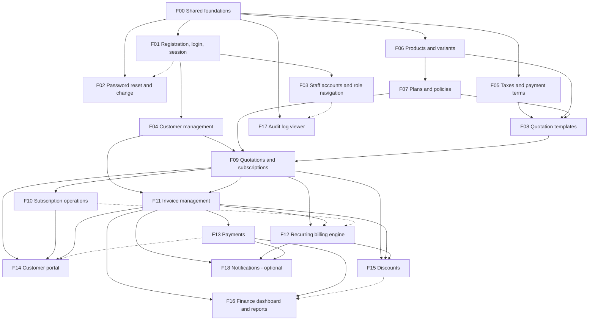

# Feature Implementation Breakdown

> **Status:** Planning handbook. **Nothing described here is implemented yet.**
> **Purpose:** split the Subscription Management System into end-to-end features that one developer can pick up and finish across database, backend, API, frontend, validation, and tests.
> **Source of truth:** [Directory Guidelines](../development/directory-guidelines.md) (folders, naming) · [System Architecture](../architecture/system-architecture.md) · [Database Design](../database/database-design.md) · [Billing Engine](../architecture/billing-engine.md) · [Data Flows](../architecture/data-flows.md) · [State Machines](../architecture/state-machines.md) · [API Spec](../api/api-specification.md) · [Security & RBAC](../architecture/security-and-rbac.md)
>
> This document does not change those documents. Where they are silent, inconsistent, or need a team decision, the item is marked **PENDING DECISION `D-xx`** and listed in [§11](#11-pending-decisions-register) with the default this handbook assumes.

## Contents
1. [How to use this handbook](#1-how-to-use-this-handbook)
2. [What was inspected, and findings](#2-what-was-inspected-and-findings)
3. [Ownership model and working rules](#3-ownership-model-and-working-rules)
4. [Phase 0 – Shared foundations (F00)](#4-phase-0--shared-foundations-f00)
5. [Phases, dependency graph and waves](#5-phases-dependency-graph-and-waves)
6. [Phase 1 – Core functionality (F01–F07)](#6-phase-1--core-functionality)
7. [Phase 2 – Main business workflows (F08–F14)](#7-phase-2--main-business-workflows)
8. [Phase 3 – Advanced functionality (F15–F18)](#8-phase-3--advanced-functionality)
9. [Phase 4 – Integration, testing and stabilization](#9-phase-4--integration-testing-and-stabilization)
10. [Feature assignment table and allocation approach](#10-feature-assignment-table-and-allocation-approach)
11. [Pending decisions register](#11-pending-decisions-register)
12. [Coverage verification](#12-coverage-verification)
13. [Deliberately not included](#13-deliberately-not-included)

---

## 1. How to use this handbook

1. Read §3 (rules) and §4 (foundations) once.
2. Pick a feature whose **prerequisites are merged** (check the wave table in §5).
3. Read that feature's sections A–I, then the doc sections it links to.
4. Build it as a **vertical slice**: migration → backend → API → frontend → tests → walkthrough → PR.
5. Update the [API Spec](../api/api-specification.md) in the same PR if the contract changed.

**Legend**
- `D-xx` – pending decision (see §11). Do not invent an answer; use the stated default and note it in your PR.
- **Official** = in the problem statement; **Proposed** = our design (as in the other docs).
- Role letters follow the API Spec: **A** Admin · **S** Staff · **C** Customer (own data) · **P** Public · **Any** logged in.
- Paths such as `backend/src/modules/plans/` follow the [Directory Guidelines](../development/directory-guidelines.md) (authoritative for folder layout, file naming and imports); the folders do not exist yet.
- Complexity: Low (≈ ½–1 day) · Medium (≈ 1–2 days) · High (≈ 2–4 days) for one developer. These are relative estimates; the hackathon time budget is still unknown (see the [Roadmap](../development/development-roadmap.md)).

---

## 2. What was inspected, and findings

**Inspected:** the repository tree, `README.md`, all documents under `docs/`, the git history, and the two PDFs the project is based on (problem statement and participant guide).

**Findings that shape this handbook**

| # | Finding | How it is handled |
|---|---|---|
| 1 | **There is no application source code yet** (no `backend/`, `frontend/`, `package.json`, migrations). The repository contains documentation only. | The breakdown is derived from the documents. Every file path is a proposal. Nothing is described as existing. |
| 2 | `docs/architecture/user-access-and-authorization.md` (added after the architecture set) describes a **different product**: a central OIDC/OAuth identity platform with multi-product registration, entitlement engine, policy versions, per-product sessions, signed webhooks, MFA, and organization membership. It is not linked from any other document. | **No feature here is derived from it.** It conflicts with the problem statement (single company, three roles, no multi-product access) and with the data model (it lists tables such as `customer_members`, `entitlement_grants`, `product_clients` that the database design does not have). Its implementation language has been aligned to Node/TypeScript, but the scope conflict remains. Recorded as **D-01** so the team can retire it, relabel it as future research, or deliberately adopt it (which would require redesigning the other documents first). |
| 3 | The roadmap assigns *streams* by skill (platform / CRUD / back-office UI / portal UI). | This handbook replaces that split **for assignment purposes**: one person owns a whole feature. The roadmap's phase order and critical path still apply. The roadmap file is not modified. |
| 4 | `subscriptions.template_id` has no `ON DELETE` rule in the DB design, but `DELETE /quotation-templates/:id` says existing quotations are unaffected. | **D-10.** Default: templates are deactivated (`is_active=false`), not deleted. |
| 5 | The API spec has no endpoint for a customer's **payment history**, although [Data Flow 8](../architecture/data-flows.md) says the portal shows it. | **D-17.** Default: embed `payments[]` in `GET /me/invoices/:id`. |
| 6 | The billing doc mentions an optional `Idempotency-Key` header for payments, but the schema has no table to store keys. | **D-15.** Default: not implemented in v1; rely on the unique `(method, reference_number)` index, the invoice row lock, and the UI disabling the submit button. |
| 7 | The billing doc says an email is "queued after commit" in a billing run, yet generated invoices are `draft`, and drafts must not be emailed. | **D-12.** Default: a billing run emails nothing; emails are sent by `POST /invoices/:id/send` (or after auto-confirm if enabled). |
| 8 | Password reset should end existing sessions, but a stateless cookie-JWT cannot be revoked and `users` has no `password_changed_at` column. | **D-04.** Default: sessions are re-validated against `users.is_active` on every request; revocation after reset is *not* promised until the team picks session storage or adds the column (a DB doc change). |
| 9 | Reminders (renewal, overdue) need a "last reminded" marker that the schema does not have. | **D-19.** F18 is optional and flagged as needing a schema change. |

---

## 3. Ownership model and working rules

### 3.1 One owner per feature, full stack
The **feature owner** implements everything in sections B–F of their feature: the migration (if the feature owns tables), backend, API, frontend pages, validation, and tests. A second person (the **reviewer**) is named in the PR. Pairing is allowed and encouraged for High-complexity features, but ownership stays with one person.

### 3.2 Vertical-slice workflow (the same for every feature)
1. **Read** the feature section and linked docs; list any questions as PR comments or in team chat.
2. **Migration** for the tables this feature owns (see §3.4). Apply on a clean database.
3. **Repository + service** with unit tests (business rules, state checks, money math).
4. **Routes + Zod schemas + role guards**; integration tests with Supertest against a test database.
5. **Frontend API module** (`frontend/src/api/<module>.js`) and query hooks.
6. **Pages and components**, including loading / empty / error / success states.
7. **Walkthrough**: perform the whole journey in the browser as each role involved, on a fresh seeded database.
8. **PR** with the checklist from §3.3, reviewed by someone else, merged into `main` ([Git Workflow](../development/git-workflow.md)).

### 3.3 Common Definition of Done (applies to **every** feature)
Each feature's section I adds feature-specific items on top of this list.

- [ ] Migration(s) apply cleanly on an empty database and on top of current `main`; constraints from the DB design are present (not just in application code).
- [ ] Every endpoint: Zod validation of body/params/query, role guard declared in the route table, error envelope and codes per [API Spec §1](../api/api-specification.md), pagination/sort/filter whitelisting for lists.
- [ ] Customer-facing endpoints derive `customer_id` from the session, never from input; another customer's record returns **404**.
- [ ] Money is a string end to end (DB `NUMERIC`, API string, UI display); no floating-point arithmetic anywhere.
- [ ] State changes go through the single state-machine function and write `audit_logs` in the same transaction.
- [ ] No hard-coded data in the UI: every screen reads from the real API.
- [ ] Frontend: loading, empty, error, and success feedback; server-side field errors shown next to inputs; usable at ~360 px, ~768 px, and ~1280 px widths; shared components only; menu entry visible only for permitted roles (while the backend still enforces permissions).
- [ ] Tests listed in the feature's section H are written and passing; lint passes.
- [ ] The full user journey was walked through manually (section B) and noted in the PR description.
- [ ] A reviewer other than the author approved; the API Spec / other docs updated if the contract or behaviour changed.
- [ ] No secrets, `.env`, or generated files committed. Seed data extended if other features need it.

### 3.4 Database ownership and migration rules
- **Each feature owns the tables it first needs** (table in §3.5). The DDL comes **verbatim from [Database Design §4](../database/database-design.md)**, including `CHECK`s, partial indexes, sequences, and FKs. Do not change a table owned by another feature without telling its owner; if the design must change, change the design doc in the same PR.
- Migrations are timestamp-named and **never edited after merging to `main`**; fix forward with a new migration.
- Migration order follows the prerequisite order in §5, so FK targets always exist.
- If Prisma is chosen (**D-03**), `schema.prisma` is a single shared file and a guaranteed conflict hotspot: use a multi-file schema if the chosen Prisma version supports it (verify), otherwise edit it in small PRs and announce in chat. Constraints Prisma cannot express (partial unique indexes, `CHECK`s, sequences) live in hand-written SQL inside the same migration.
- Test data uses **factory helpers** (`createCustomer()`, `createActiveSubscription()`, `createConfirmedInvoice()`…) so a feature can be tested without the UI of features that are still in progress. Each owner adds the factories for their tables.

### 3.5 Table ownership

| Feature | Tables created by that feature |
|---|---|
| F00 | `roles`, `users`, `customers`, `audit_logs` |
| F02 | `password_reset_tokens` |
| F05 | `tax_rules`, `payment_terms` |
| F06 | `products`, `product_variants` |
| F07 | `plans`, `plan_products` |
| F08 | `quotation_templates`, `quotation_template_items` |
| F09 | `subscriptions`, `subscription_items`, sequence `subscription_number_seq` |
| F11 | `invoices`, `invoice_items`, `invoice_tax_details`, `billing_runs` (created here because `invoices.billing_run_id` references it), sequence `invoice_number_seq` |
| F13 | `payments`, `payment_allocations` |
| F15 | `discounts`, `discount_products`, `subscription_discounts`, `discount_redemptions` |
| F10, F12, F14, F16, F17 | none (they read/write tables created above) |
| F18 | none by default; reminders need a schema change (**D-19**) |

Count: 4 + 1 + 2 + 2 + 2 + 2 + 2 + 4 + 2 + 4 = **25**, i.e. every table in the DB design has exactly one owner.

### 3.6 Shared-file hotspots and how to avoid conflicts
These files are touched by many features. **F00 pre-creates them with placeholders for every module/menu entry so that features only fill in their own part** and never edit a shared registry.

| Hotspot | Mitigation |
|---|---|
| Backend route registry (`src/routes.js`) | F00 mounts all 16 module routers up front (empty routers). |
| Backend permission map (`permissions`) | F00 lists every permission key from the RBAC matrix; features reference keys, they do not add new ones without a PR to the map. |
| Frontend route table and sidebar menu config | F00 declares all routes and menu items (with a "coming soon" page). Features replace the placeholder component only. |
| Scheduler job registry | F00 provides `registerJob(name, schedule, fn)`; each feature registers its own job in its own module. |
| `package.json` / lockfile | Add dependencies in a tiny separate PR and announce it. |
| Migrations | One migration per feature; timestamps avoid file-name clashes; never edit merged migrations. |
| API Spec document | Edit only the section for your module. |
| `app.js`, error handler, API client | Owned by F00; change through a PR that all owners review. |

Feature-specific overlap risks are listed in each feature under **Shared files / conflicts**.

---

## 4. Phase 0 – Shared foundations (F00)

**F00 is built collaboratively, by all developers, before anyone starts a feature.** It is the contract that keeps independently written features consistent. Split the checklist among whoever is available, but **every item must be reviewed by at least two people**, and the whole team agrees on the conventions (a 30–45 minute meeting). F00 is *not* a place for one person to hide behind: each item below contains both backend and frontend work, so split it so everyone touches both sides.

**Prerequisite:** decisions D-02 – D-08 (§11) are made.

### F00.1 Repository, tooling and environment
- Folders `backend/`, `frontend/`, `docs/`; root README setup steps.
- `docker-compose.yml` (PostgreSQL 16, Mailpit), `.env.example` for both apps, `.gitignore`.
- Lint/format config, test runners (backend: Vitest/Jest + Supertest; frontend: Vitest + React Testing Library), npm scripts (`dev`, `test`, `lint`, `db:migrate`, `db:seed`, `db:reset`).
- Config loader validating environment variables at startup; the app refuses to start on bad config.
- PR template and branch protection ([Git Workflow](../development/git-workflow.md)).

### F00.2 Database foundation
- DB connection / ORM client, `withTransaction(fn)` helper (all multi-step writes use it), test database setup with `reset` between test files.
- **Baseline migration:** `roles`, `users`, `customers`, `audit_logs` (+ `citext` extension) per DB design §4.1/§4.9.
- Seed: three roles, one Admin (**D-08**: how the first admin is created; default = seed script reading credentials from env, never hard-coded in the repo).

### F00.3 Backend conventions
- Express app skeleton, central error handler, request-id logging, `helmet`, CORS (frontend origin, credentials), JSON body size limit, rate-limit middleware (strict variant for `/auth/*`).
- **Response helpers**: `ok(res, data)`, `created`, `list(res, rows, meta)`, error helpers producing the envelope/codes of [API Spec §1](../api/api-specification.md) (`AppError(code, status, message, details)`).
- **Validation**: `validate({ body, params, query })` middleware using Zod; shared schemas: `passwordSchema` (length > 8, upper, lower, special), `moneySchema` (`^\d{1,10}(\.\d{1,2})?$`), `dateSchema`, `paginationSchema` (`page`, `page_size ≤ 100`, `sort` whitelist helper, `q`).
- **Pagination helper**: builds `LIMIT/OFFSET`, `meta` with `total`/`total_pages`, whitelisted sort parsing (`-field`).
- **Money library** (`lib/money`): decimal-safe add/sub/mul, `ROUND_HALF_UP` to 2 decimals, string in/out. Unit-tested. (Library choice, e.g. `decimal.js`, is part of D-02/F00 decision.)
- **Date helper** (`lib/dates`): "today" in `APP_TIMEZONE` (**D-22**), `addMonthsClamped` placeholder is **not** here – it belongs to F12.
- **Auth plumbing**: token/session signing util, `authenticate` middleware (loads the user from DB each request, rejects inactive users, sets `req.user = { id, role, customerId? }`), `requireRole(...roles)`, permission map (`permissions`) matching [Security & RBAC §2](../architecture/security-and-rbac.md), and the **customer-scope helper** (`scopeToCustomer(req)` returns the session `customer_id` or throws 403).
- **Audit logger**: `audit.log(tx, { actor, action, entityType, entityId, old, new })`, always called inside the caller's transaction.
- **State-machine helper pattern**: a small function shape `transition(entity, from[], to, { actorRole, guard })` doing `UPDATE … WHERE id=$1 AND status=$expected` and failing with `INVALID_STATE_TRANSITION` (409) on 0 rows. Subscription and invoice machines are built on it (F09, F11).
- **Mailer** (`lib/mailer`): Nodemailer → SMTP from env (Mailpit locally), HTML+text template helper, failure returns a result object (never throws into a transaction).
- **Scheduler**: `node-cron` wrapper with `registerJob`, "run on startup" option, and a `runJobNow(name)` function for tests and admin endpoints. Jobs must be plain exported functions.
- **Test helpers**: `loginAs(role)` returning an authenticated Supertest agent, factory base, clock injection (`now()` overridable in tests – required by billing tests).
- Health endpoint `GET /api/v1/health`.

### F00.4 Frontend foundation
- Vite + React, router with **all routes pre-declared** (back-office `/app/*`, portal `/portal/*`, auth pages) using placeholders.
- **API client** (`api/client`): base URL from env, `credentials: include`, JSON handling, error mapping to `{ code, message, details }`, central 401 handling (redirect to login with return path), request-id passthrough.
- **Auth context** (`useAuth`) reading `/auth/me`, route guards `RequireAuth` / `RequireRole`, 403 and 404 pages.
- **Layouts**: `AuthLayout`, `BackOfficeLayout` (sidebar + header), `PortalLayout`; menu config declaring every item with `roles: [...]`.
- **Server-state setup** (TanStack Query provider, query-key convention `[module, 'list'|'detail', params]`, default retry/stale settings), form helper (React Hook Form + Zod resolver) that maps API `details[]` to field errors.
- **Shared components** (build once, reuse): `DataTable` (sorting, loading skeleton, empty state), `Pagination`, `FilterBar` (search + select filters bound to the URL query string), `FormField`, `MoneyInput`, `Money` (display), `StatusBadge`, `ConfirmDialog`, `Modal`, `Toast`, `PageHeader`, `EmptyState`, `ErrorState`, `LoadingSkeleton`.
- Design tokens: one primary colour, spacing scale, typography; UI library decision **D-06**.

### F00.5 Reference vertical slice
One tiny end-to-end slice, built by the whole team together, proves every convention works before features start: **`payment_terms` list + create** (route → validation → service → repository → test → API module → DataTable + form → test). It is then replaced/extended by F05. This is the template everyone copies.

### F00 Definition of Done
- [ ] A new developer clones the repo, follows only the README, and has frontend, backend, Postgres and Mailpit running.
- [ ] `GET /api/v1/health` works from the browser; migrations + seed run from scratch with one command.
- [ ] The reference slice works end to end, with backend tests and a frontend test.
- [ ] A seeded Admin can call a protected route; a missing/invalid cookie gets 401; a wrong role gets 403 (tested).
- [ ] The conventions above are written down in a short `CONTRIBUTING`-style section of the root README or `docs/` (error format, pagination, naming, folder layout) and agreed by everyone.
- [ ] Every developer has merged at least one PR touching **both** `backend/` and `frontend/`.

**Can be developed independently:** No — collaborative by design. **Complexity:** High (as a whole), Low–Medium per item.

---

## 5. Phases, dependency graph and waves

| Phase | Features | Goal |
|---|---|---|
| **0 – Shared foundations** | F00 | Conventions, tooling, baseline DB, shared components |
| **1 – Core functionality** | F01 Auth · F02 Password reset · F03 Staff & navigation · F04 Customers · F05 Taxes & payment terms · F06 Products & variants · F07 Plans & policies | Identity, master data |
| **2 – Main business workflows** | F08 Quotation templates · F09 Quotations & subscriptions · F10 Subscription operations · F11 Invoice management · F12 Recurring billing engine · F13 Payments · F14 Customer portal | The money-making flow: quote → subscribe → bill → collect |
| **3 – Advanced functionality** | F15 Discounts · F16 Finance dashboard & reports · F17 Audit log viewer · F18 Notifications (optional) | Pricing rules, visibility |
| **4 – Integration & stabilization** | S1–S5 work packages | Security tests, performance, demo, polish |

### 5.1 Dependency graph

Solid arrows are **hard** prerequisites (the earlier feature must be merged first). Dotted arrows are **soft** (can start in parallel; final integration needs the earlier feature).

### 5.2 Implementation waves (parallelism)

Features in the same wave have no hard dependency on each other, so they can be developed in parallel by different people. Start a wave when its prerequisites are **merged to `main`**.

| Wave | Features that can run in parallel | Needs merged first | Notes |
|---|---|---|---|
| W0 | F00 | – | whole team |
| W1 | F01, F02, F05, F06 | F00 | four independent starters; F05 is the simplest copy of the pattern |
| W2 | F03, F04, F07 | F01 (F03, F04), F06 (F07) | |
| W3 | F08 → F09 | F05, F06, F07 (+ F04 for F09) | F09 can start its pricing/state-machine work in parallel with F08 and must wait for the F08 migration to merge |
| W4 | F10, F11 | F09 | independent of each other |
| W5 | F12, F13, F14 | F11 (F12, F13); F09–F11 (F14) | F12 is the critical path: start it first |
| W6 | F15, F16, F17, (F18) | see graph | F15 touches F11 and F12 code: coordinate with their owners |
| W7 | S1–S5 | everything | cross-testing: nobody tests only their own feature |

**Critical path:** F00 → F06 → F07 → F08 → F09 → F11 → F12 → F13 → F16. Slips on this chain delay the demo; F12 (billing) is the highest-risk feature.

---

## 6. Phase 1 – Core functionality

### F01 – Customer registration, login and session

| Field | Value |
|---|---|
| **Prerequisites** | F00 |
| **Shared components used** | `authenticate`, `passwordSchema`, mailer not needed, `AuthLayout`, `FormField`, `useAuth`, API client |
| **Can be developed independently** | Yes, after F00 |
| **Expected order** | First wave (W1) |
| **Integration points** | Every feature relies on the session this feature creates; F02 adds links on the login page; F14 portal is the post-login landing for customers |
| **Shared files / conflicts** | `AuthLayout`, auth routes in the frontend route table (pre-declared by F00); `users`/`customers` tables belong to F00's baseline migration, so no migration here |
| **Complexity** | Medium |

**A. Overview.** Lets a visitor create a customer account (email + password) and lets every user log in and out. *Why:* the portal and all role-based access depend on it. *Who:* visitors (register), all roles (login/logout). *Outcome:* a user holds a valid `httpOnly` session cookie, the UI knows their role, and registration creates both a `users` row (role `customer`) and a linked `customers` profile.

**B. User flow** ([Data Flow 1](../architecture/data-flows.md#flow-1-customer-registration))
1. Visitor opens `/register`, enters name, email, password, (optional company, phone).
2. Frontend validates (email format, password rules shown live: > 8 chars, upper, lower, special) and disables submit while pending.
3. `POST /auth/register` → backend validates again, normalizes email, hashes the password, inserts user + customer in one transaction, sets the cookie.
4. Frontend stores nothing in `localStorage`; `useAuth` refetches `/auth/me`, then redirects customers to `/portal`.
5. Later, user opens `/login`, submits credentials → cookie set → redirect by role (`customer → /portal`, `admin|staff → /app`) or to the originally requested page.
6. Logout calls `POST /auth/logout`, clears cached queries, returns to `/login`.

*Alternate/failure flows:* duplicate email → inline error "An account with this email already exists" (409); weak password → per-rule messages (422); wrong credentials → one generic message (401); disabled account → 403 message; too many attempts → 429 with retry hint; session expires while browsing → 401 → redirect to login, return to the same page after login.

**C. Database implementation**
- Tables (from F00 baseline): `roles`, `users`, `customers`. No new tables or columns.
- Writes: `INSERT users` (role = `customer` looked up from `roles`) and `INSERT customers (user_id, name, email, …)` in **one transaction**; `UPDATE users SET last_login_at` on login; optional `audit_logs` rows for registration.
- Reads: `SELECT users WHERE email = $1` (unique CITEXT index); `/auth/me` joins `customers` by `user_id`.
- Constraints used: `UNIQUE(users.email)`, `UNIQUE(customers.user_id)`. Race on duplicate email is resolved by catching the unique violation (not by pre-check alone).

**D. Backend implementation**
- Module `backend/src/modules/auth/` (routes, controller, service, repository, schemas).
- Service: `register`, `login`, `logout`, `getMe`. Password hashing with the library chosen in **D-05** (argon2id preferred); constant-time compare; identical error for unknown email and wrong password.
- Cookie: `httpOnly`, `SameSite=Lax`, `Secure` when `NODE_ENV=production`, ~8 h expiry (**D-04** for JWT vs session table).
- Authorization: register/login public; logout/me any logged-in user. Strict rate limit on register/login (e.g. 10 / 15 min per IP + email).
- Errors: `EMAIL_ALREADY_EXISTS` 409, `INVALID_CREDENTIALS` 401, `FORBIDDEN` 403 (disabled), `RATE_LIMITED` 429, `VALIDATION_ERROR` 422.
- No background jobs.

**E. Frontend implementation**
- Pages: `RegisterPage`, `LoginPage`. Components: `PasswordField` with live rule checklist, `AuthCard`.
- Forms: React Hook Form + Zod schema mirroring `passwordSchema`; server errors mapped to fields; submit disabled during request.
- State: `useAuth` (query on `/auth/me`), login/register mutations invalidate it; `RequireAuth`/`RequireRole` guards use it; remember the attempted URL for post-login redirect.
- States: loading spinner on submit; field-level + form-level errors; success redirect (no toast needed); 429 shows a "try again later" message.
- Responsive: single-column card centred at all widths.

**F. API contract** (full definitions: [API Spec §2](../api/api-specification.md))

| Method | Path | Auth | Request | Success | Errors |
|---|---|---|---|---|---|
| POST | `/auth/register` | P | `{full_name, email, password, company_name?, phone?}` | 201 `{data:{user:{id,email,full_name,role},customer_id}}` + cookie | 409 `EMAIL_ALREADY_EXISTS`, 422, 429 |
| POST | `/auth/login` | P | `{email, password}` | 200 user + cookie | 401 `INVALID_CREDENTIALS`, 403, 429 |
| POST | `/auth/logout` | Any | – | 204, cookie cleared | – |
| GET | `/auth/me` | Any | – | 200 `{id,email,full_name,role,customer_id?}` | 401 |

**G. Edge cases**
- Two simultaneous registrations with the same email (only one succeeds, no orphaned `users` row without a `customers` row).
- Email differing only by case or surrounding spaces.
- Password of exactly 8 characters (must fail: "more than eight").
- Inactive user with a still-valid cookie (must be rejected on the next request, because `authenticate` reads the DB).
- Tampered/expired cookie; cookie from a deleted user.
- Customer user missing a `customers` row (should not occur; `/auth/me` returns a clear 403).
- Browser back button after logout must not show cached private pages.
- Cookie not sent because frontend and API origins/CORS are misconfigured (document the local setup).

**H. Testing requirements**
- *Backend unit:* password policy schema (table of valid/invalid passwords), email normalization, service register/login with a stub repository.
- *API integration:* register success creates both rows; duplicate email 409 (including parallel requests); login success/failure/disabled; `/me` with and without cookie; rate limit returns 429; cookie flags.
- *Frontend:* register form shows each rule violation; submit disabled while pending; server 409 displayed on the email field; login redirects by role (mock `useAuth`).
- *End-to-end:* register → lands in portal → logout → login again (E2E tool pending **D-07**; until then a documented manual script).

**I. Definition of Done** — Common DoD (§3.3) plus:
- [ ] A new customer can register, is auto-logged-in, sees the portal shell, logs out and logs in again.
- [ ] Seeded Admin and Staff log in and land in the back-office; a customer typing a `/app/*` URL is redirected/blocked, and the API also refuses (403).
- [ ] Passwords never appear in logs, responses, or the database in plain text.
- [ ] Rate limiting verified manually.

---

### F02 – Password reset and password change

| Field | Value |
|---|---|
| **Prerequisites** | F00 (mailer, `passwordSchema`); F01 recommended for the login page link |
| **Can be developed independently** | Yes |
| **Order** | W1 |
| **Integration points** | Login page link (F01); profile menu "Change password" (any layout); email links use `APP_BASE_URL` |
| **Shared files / conflicts** | Login page (F01) – only adds a link; do it after F01 merges or via a tiny follow-up PR |
| **Complexity** | Medium |

**A. Overview.** Official requirement: a reset link is emailed to the registered address. Also lets a logged-in user change their password. *Who:* anyone with an account. *Outcome:* a user who forgot their password regains access via a single-use, expiring link.

**B. User flow** ([Data Flow 1](../architecture/data-flows.md#flow-1-customer-registration), related notes)
1. User clicks "Forgot password?" on login, enters email.
2. `POST /auth/forgot-password` → always the same success message (no account enumeration).
3. If the account exists: random token generated, **only its SHA-256 hash** stored with 1-hour expiry; email with `APP_BASE_URL/reset-password?token=…` is sent (visible in Mailpit locally).
4. User opens the link; page asks for a new password (rule checklist shown).
5. `POST /auth/reset-password` validates token (exists, unexpired, unused) and password rules, updates the hash, marks token used, invalidates the user's other unused tokens.
6. Frontend shows success and links to login.
- *Change password (logged in):* profile → "Change password" → current + new → `POST /auth/change-password`.
- *Failures:* expired/used/unknown token → "link is invalid or expired" with a button to request a new one; mail server down → user still sees the generic success, error is logged server-side.

**C. Database implementation**
- Table owned: `password_reset_tokens` (DB design §4.1): `user_id` FK (cascade), `token_hash` unique, `expires_at`, `used_at`.
- Writes: insert token; on reset, `UPDATE users SET password_hash`, `UPDATE password_reset_tokens SET used_at` — **one transaction**, with the token row locked (`FOR UPDATE`) so a token cannot be used twice concurrently.
- Index: unique `(token_hash)`, `(user_id)`. Optional cleanup of expired tokens (can be a small job; not required).
- Session invalidation after reset depends on **D-04**.

**D. Backend implementation**
- Extends `modules/auth/` (new service functions; separate files to avoid conflicts with F01): `forgotPassword`, `resetPassword`, `changePassword`.
- Token: 32 random bytes (`crypto.randomBytes`), hex/base64url in the email; store SHA-256.
- Mail: uses `lib/mailer` with a reset template; never throws into the caller (log failure).
- Authorization: forgot/reset public (strict rate limit), change-password requires login.
- Validation: email format; `new_password` via `passwordSchema`; change requires correct current password and `new ≠ current`.
- Errors: `INVALID_OR_EXPIRED_TOKEN` 400, `INVALID_CREDENTIALS` 401 (wrong current password), 422, 429.

**E. Frontend implementation**
- Pages: `ForgotPasswordPage`, `ResetPasswordPage` (reads `token` from the query string), `ChangePasswordForm` (in a profile/account page reachable from both layouts' user menu).
- Behaviour: forgot page always shows the same confirmation; reset page handles missing token; success redirects to login with a flash message; submit disabled while pending; password rule checklist reused from F01 (`PasswordField`).
- States: loading, invalid-link error with "request a new link", success.

**F. API contract** ([API Spec §2](../api/api-specification.md))

| Method | Path | Auth | Request | Success | Errors |
|---|---|---|---|---|---|
| POST | `/auth/forgot-password` | P | `{email}` | 200 generic message | 422, 429 |
| POST | `/auth/reset-password` | P | `{token, new_password}` | 200 | 400 `INVALID_OR_EXPIRED_TOKEN`, 422 |
| POST | `/auth/change-password` | Any | `{current_password, new_password}` | 200 | 401, 422 |

**G. Edge cases**
- Unknown email (same response and similar response time).
- Token used twice; token used after a newer token was issued; two parallel reset submissions.
- Expired token at the exact boundary.
- Account disabled between request and reset.
- New password equals old one; weak password.
- Email delivery failure; link opened on a different device.
- Rapid repeated "forgot password" clicks (rate limit; do not spam mail).

**H. Testing requirements**
- *Unit:* token generation/hashing, expiry check, password policy.
- *Integration:* happy path reading the token from a mail stub; used/expired/unknown token; concurrent double-use; generic response for unknown email; change-password with wrong current password; rate limiting.
- *Frontend:* reset page with and without token; mismatch/weak password messages; success redirect.
- *E2E/manual:* full flow using Mailpit.

**I. Definition of Done** — Common DoD plus:
- [ ] A real reset email arrives in Mailpit, the link works exactly once, and the old password stops working.
- [ ] No response or log reveals whether an email exists or contains a raw token (apart from the email itself).
- [ ] Behaviour for existing sessions after reset is documented per **D-04**.

---

### F03 – Staff accounts and role-aware navigation

| Field | Value |
|---|---|
| **Prerequisites** | F00, F01 (needs login to test) |
| **Can be developed independently** | Yes |
| **Order** | W2 |
| **Integration points** | The menu config and `/auth/me` role drive every back-office screen; Admin-only visibility for configuration screens |
| **Shared files / conflicts** | `BackOfficeLayout` and the menu config (F00-owned): this feature finalizes menu visibility rules; coordinate with anyone editing the layout |
| **Complexity** | Low |

**A. Overview.** Official: *only Admin can add staff*. Provides the Admin screen to create, list, and deactivate staff accounts, and makes the back-office navigation reflect the logged-in role (Admin sees everything; Staff sees operational screens; configuration screens are read-only or hidden per the RBAC matrix). *Outcome:* the RBAC model is visible and testable end to end.

**B. User flow**
1. Admin opens **Settings → Staff**; sees a paginated list (name, email, role, active, last login).
2. Clicks "Add staff", enters name, email, temporary password (**or** invite email – pending in API Spec §3; default: password set by Admin), submits.
3. Backend creates the user with role `staff` and logs the action; the list refreshes with a success toast.
4. Admin can deactivate/reactivate a staff user; deactivated users cannot log in or use an existing cookie.
5. Staff logs in and sees a reduced menu; opening an Admin-only URL shows a 403 page, and the API also returns 403.
- *Failures:* duplicate email 409; weak password 422; Staff calling the endpoint gets 403; deactivating yourself or the last active Admin is rejected (409).

**C. Database implementation**
- Tables: `users`, `roles` (existing). `created_by` stores the creating Admin. No new columns.
- Writes: `INSERT users (role=staff, created_by)`, `UPDATE users SET is_active`, `audit_logs` (staff.create, user.deactivate) in the same transaction.
- Reads: list with `role` and `is_active` filters, search by name/email. Index `(role_id)` exists.
- Consistency: "last active admin" check must run inside the transaction with a lock (`SELECT … FOR UPDATE` on admin rows).

**D. Backend implementation**
- Module `modules/users/`: `createStaff`, `listUsers`, `getUser`, `updateUser`.
- Authorization: all endpoints Admin-only (permission `staff:create` etc. from the permission map). No endpoint changes roles (**no role promotion in v1**).
- Validation: email unique & normalized, `passwordSchema`, name 1–120 chars.
- Errors: 403, 409 `EMAIL_ALREADY_EXISTS`, 409 for the last-admin/self-deactivation rule, 404.

**E. Frontend implementation**
- Pages: `StaffListPage` (DataTable + filters `role`, `is_active`, search), `StaffFormModal`.
- Navigation: finalize `menu` visibility using `roles` on each item; a `Can` helper/hook (`useCan('staff:create')`) used for buttons; `ForbiddenPage` for direct URL access.
- States: empty state ("No staff yet"), confirm dialog for deactivation, success toasts, inline errors.
- Responsive: table becomes stacked cards under ~640 px.

**F. API contract** ([API Spec §3](../api/api-specification.md))

| Method | Path | Auth | Request | Success | Errors |
|---|---|---|---|---|---|
| POST | `/users/staff` | A | `{full_name,email,password}` | 201 user (no hash) | 403, 409, 422 |
| GET | `/users` | A | `role,is_active,q,page,…` | 200 list | 403 |
| GET | `/users/:id` | A | – | 200 user | 403, 404 |
| PATCH | `/users/:id` | A | `{full_name?, is_active?}` | 200 user | 403, 404, 409 |

**G. Edge cases**
- Staff or Customer calls `POST /users/staff` (403, even with a crafted request).
- Deactivating the last active Admin or oneself.
- Deactivated user with an open session.
- Email already used by a customer account.
- Double-clicking "Create".
- Menu shows an item the API would reject (must never happen – test the matrix).

**H. Testing requirements**
- *Unit:* last-admin rule; permission map lookups.
- *Integration:* role matrix for each endpoint (A allowed; S, C, anonymous denied); creation then login as the new staff; deactivation blocks login.
- *Frontend:* menu items per role (snapshot of visible labels), forbidden page, form errors.
- *E2E/manual:* Admin creates staff → staff logs in → sees limited menu → cannot open Admin pages.

**I. Definition of Done** — Common DoD plus:
- [ ] RBAC matrix rows for "Create staff" verified in an automated test.
- [ ] Sidebar differs correctly for Admin / Staff / Customer; every hidden item is also blocked by the API.
- [ ] Audit rows exist for create/deactivate.

---

### F04 – Customer management (staff screens and own profile)

| Field | Value |
|---|---|
| **Prerequisites** | F00, F01 |
| **Can be developed independently** | Yes |
| **Order** | W2 |
| **Integration points** | Customer picker used by F09 (quotations) and F13 (payments); customer detail later shows subscription/invoice summaries (added by F09/F13); portal profile page used by F14 |
| **Shared files / conflicts** | Reusable `CustomerSelect` component (this feature builds it; F09 uses it); customer detail page gets sections added by F09/F11/F13 – leave clearly separated section components |
| **Complexity** | Low |

**A. Overview.** Staff create and maintain customer records day to day; customers maintain their own contact details. *Why:* subscriptions, invoices, and payments all hang off a customer. *Outcome:* searchable customer list, detail page, and a self-service profile.

**B. User flow**
1. Staff opens **Customers**; list with search (name/email/company) and active filter.
2. "New customer": form (name, company, email, phone, address, tax id, notes) → save → detail page.
3. Customer detail shows profile and (once available) subscriptions, invoices, outstanding amounts.
4. Edit and save; Admin can deactivate/reactivate.
5. Customer opens **Profile** in the portal, edits contact/address (not email, not active flag).
- *Failures:* validation errors inline; unknown id 404; Staff attempting to deactivate → 403.

**C. Database implementation**
- Table: `customers` (existing from F00). Reads/writes as above; `audit_logs` on create/update/deactivate.
- Indexes: `(email)`, `(name)`; add trigram search index only if search is slow (**not** required initially).
- Constraint notes: `customers.email` is **not unique** in the DB design; whether to warn on duplicates and how a staff-created customer is later linked to a self-registered user are **D-09** (default: warn on duplicate email, no automatic linking, `user_id` stays null).

**D. Backend implementation**
- Module `modules/customers/` (+ `/me/profile` handlers).
- Service: `list`, `create`, `get`, `update`, `setActive`, `getOwnProfile`, `updateOwnProfile`. Staff and Admin may create/edit; only Admin may deactivate; customers can only call `/me/profile`.
- Own-profile update uses a **separate Zod schema** that omits `email`, `is_active`, `notes` (mass-assignment protection).
- Detail response: profile only for now; `subscriptions_count`, `outstanding_amount`, `overdue_amount` are added by F09 and F13 respectively (the API spec lists them; they must be absent or `null` until those features exist).
- Errors: 404, 403, 422, 409 (if a duplicate is blocked after **D-09**).

**E. Frontend implementation**
- Pages: `CustomerListPage`, `CustomerFormPage`/modal, `CustomerDetailPage` (tabs: Overview – more tabs added by other features), portal `ProfilePage`.
- Component: `CustomerSelect` (async search select with debounce, returns id + name), reused elsewhere.
- Behaviour: URL-bound filters and page number; optimistic list refresh after edit; address as a structured group of fields.
- States: empty ("No customers match"), error with retry, success toast, dirty-form warning on leaving.

**F. API contract** ([API Spec §4](../api/api-specification.md))

| Method | Path | Auth | Request | Success | Errors |
|---|---|---|---|---|---|
| GET | `/customers` | A,S | `q,is_active,sort,page` | 200 list | – |
| POST | `/customers` | A,S | name, email, … | 201 customer | 422 |
| GET | `/customers/:id` | A,S | – | 200 customer | 404 |
| PATCH | `/customers/:id` | A,S (`is_active`: A) | subset | 200 customer | 403, 404, 422 |
| GET | `/me/profile` | C | – | 200 customer | 403 |
| PATCH | `/me/profile` | C | `{name?,company_name?,phone?,address?}` | 200 customer | 422 |

**G. Edge cases**
- Customer tries `PATCH /me/profile` with `email` or `is_active` (ignored/rejected).
- Staff edits a customer while the customer edits their own profile (last write wins; show `updated_at` conflicts only if the team decides – otherwise note it).
- Deactivating a customer who has active subscriptions (allowed? **pending** – default: allowed, shown with a warning, existing subscriptions unaffected).
- Very long names/addresses; unicode.
- Changing the address must **not** change already-issued invoices (snapshots) – verify later in F12.

**H. Testing requirements**
- *Unit:* schemas (own-profile schema rejects forbidden fields).
- *Integration:* role matrix (S create ok, S deactivate 403, C only `/me/profile`); search/sort/pagination; customer cannot read `/customers`.
- *Frontend:* list filters bound to URL; form validation; `CustomerSelect` debounced search.
- *E2E/manual:* staff creates customer → edits → admin deactivates; customer edits own profile.

**I. Definition of Done** — Common DoD plus:
- [ ] `CustomerSelect` is documented and used by at least one other screen (stub page acceptable until F09).
- [ ] Mass-assignment cases tested.
- [ ] Customer detail page layout leaves clearly named slots for later sections.

---

### F05 – Tax rules and payment terms (reference module)

| Field | Value |
|---|---|
| **Prerequisites** | F00 |
| **Can be developed independently** | Yes |
| **Order** | W1 (**recommended first feature for the least experienced member**; it is the simplest complete CRUD and becomes the pattern for F06/F07) |
| **Integration points** | Tax select in F08/F09 lines; payment terms select in F08/F09; used by F12 for rates and due dates |
| **Shared files / conflicts** | Replaces the F00 reference slice for `payment_terms`; keep file names stable |
| **Complexity** | Low |

**A. Overview.** Official: admin-configurable tax rules. Plus payment terms (Proposed) that drive invoice due dates. *Who:* Admin writes, Staff reads. *Outcome:* a catalogue of selectable taxes and terms that other features reference.

**B. User flow**
1. Admin opens **Settings → Taxes**: list (name, rate, active). "New tax": name + rate (percentage) → save.
2. Admin edits a rate or deactivates a rule; UI warns that **existing invoices keep their old rate; only future invoices use the new one**.
3. Same flow under **Settings → Payment terms** (name, due days, active).
4. Staff opens the same pages read-only.
- *Failures:* duplicate name 409; rate outside 0–100 → 422; delete of a used rule → 409 `IN_USE` with the message "deactivate it instead".

**C. Database implementation**
- Tables owned: `tax_rules` (`rate NUMERIC(6,3)`, `CHECK 0–100`, unique `name`), `payment_terms` (`due_days ≥ 0`, unique `name`). Seed: GST 5/12/18 %, "Due on receipt", "Net 15", "Net 30".
- `IN_USE` detection: catch the Postgres FK violation (`23503`) on delete so the feature works before referencing tables exist.
- No transactions beyond single-row writes plus audit.

**D. Backend implementation**
- Modules `modules/taxes/` and `modules/payment-terms/` (or one module with two routers).
- Authorization: write = Admin; read = Admin, Staff.
- Validation: rate as string `^\d{1,3}(\.\d{1,3})?$` within 0–100; `due_days` integer ≥ 0.
- Audit: create/update/deactivate.
- Errors: 409 duplicate / `IN_USE`, 403, 404, 422.

**E. Frontend implementation**
- Pages: `TaxListPage`, `TaxForm`, `PaymentTermListPage`, `PaymentTermForm` (modal forms are fine).
- Components: `TaxSelect`, `PaymentTermSelect` (active items only; shows rate) – reused by F08/F09.
- Behaviour: rate shown as `18.000 %`; deactivate via toggle with confirm; read-only mode for Staff (no buttons, via `useCan`).
- States: empty state with "Add your first tax" for Admin; error/retry; toasts.

**F. API contract** ([API Spec §9](../api/api-specification.md))

| Method | Path | Auth | Request | Success | Errors |
|---|---|---|---|---|---|
| GET | `/taxes` | A,S | `is_active` | 200 list | – |
| POST | `/taxes` | A | `{name, rate}` | 201 | 409, 422 |
| PATCH | `/taxes/:id` | A | subset incl. `is_active` | 200 | 404, 409, 422 |
| DELETE | `/taxes/:id` | A | – | 204 | 409 `IN_USE` |
| GET | `/payment-terms` | A,S | – | 200 list | – |
| POST | `/payment-terms` | A | `{name, due_days}` | 201 | 409, 422 |
| PATCH | `/payment-terms/:id` | A | subset | 200 | 404, 409, 422 |

**G. Edge cases**
- Rate with more than 3 decimals; negative; > 100; string vs number input.
- Editing a rate while billing runs (new rate applies to invoices created after commit; no retroactive change).
- Deactivating a tax still referenced by active subscription lines (**D-24**: existing lines keep using it, UI warns).
- Concurrent edits of the same rule.

**H. Testing requirements**
- *Unit:* rate/due-days schemas.
- *Integration:* role matrix; duplicate names; delete in use (create a referencing row via raw SQL in the test once tables exist, otherwise use a test-only FK table); decimal round-trip (`"18.000"` stays exact).
- *Frontend:* form validation; read-only rendering for Staff; selects list active items only.
- *E2E/manual:* admin creates tax → staff sees it read-only.

**I. Definition of Done** — Common DoD plus:
- [ ] The module's folder structure is written up as the **template** the others copy (short comment in the PR).
- [ ] `TaxSelect` and `PaymentTermSelect` are reusable components with tests.
- [ ] Seed data present.

---

### F06 – Product and variant management

| Field | Value |
|---|---|
| **Status** | ✅ **Implemented** |
| **Status** | ✅ **Implemented** |
| **Prerequisites** | F00 |
| **Can be developed independently** | Yes |
| **Order** | W1 |
| **Integration points** | Plans (F07), templates (F08), subscription lines (F09), discount product scope (F15) |
| **Shared files / conflicts** | `ProductSelect` / `VariantSelect` components (built here, used by F07/F08/F09); effective-price logic must be **one function** reused by F07–F09 |
| **Complexity** | Medium |

**A. Overview.** Official: Admin creates products (name, type, sales price, cost price, notes) with variants that adjust the price (e.g. brand *Odoo* adds 560). *Outcome:* a catalogue with exact effective prices.

**B. User flow**
1. Admin opens **Catalogue → Products**; list with search, type, active filters.
2. "New product": fill fields → save → redirected to the product page.
3. On the product page, the **Variants** panel: add `Brand = Odoo`, adjustment `560.00`; the panel shows effective price `base + adjustment` (e.g. 1,000.00 + 560.00 = 1,560.00).
4. Edit/deactivate product or variants; delete only if never used.
5. Staff can view products and variants (cost price visible, read-only – see **D-26**).
- *Failures:* duplicate product name; duplicate variant `(attribute, value)`; adjustment making the effective price negative → 422; delete of used product/variant → 409 `IN_USE`.

**C. Database implementation**
- Tables owned: `products` (unique `name`; `sales_price`, `cost_price` ≥ 0), `product_variants` (unique `(product_id, attribute_name, attribute_value)`, signed `price_adjustment`).
- Effective price = `sales_price + price_adjustment`, computed in the service (and returned as `effective_price`); the cross-table `≥ 0` rule is validated in the service on both product price edits and variant edits.
- Deactivate (`is_active`) instead of delete. FK deletion rules: variants cascade with product.
- Product type values: **D-23** (default list `service, software, addon, physical`, stored as a `CHECK`).

**D. Backend implementation**
- Modules `modules/products/` (+ variants handlers).
- Service functions: `listProducts`, `createProduct`, `getProduct(withVariants)`, `updateProduct`, `deleteProduct`, `addVariant`, `updateVariant`, `deleteVariant`; shared `computeEffectivePrice(product, variant)` exported for F07/F08/F09 (string math via `lib/money`).
- Authorization: write Admin; read Admin, Staff.
- When a product's `sales_price` is edited: validate that no *active* variant makes the price negative.
- Errors: 409 duplicate / `IN_USE`, 422, 403, 404.

**E. Frontend implementation**
- Pages: `ProductListPage`, `ProductFormPage`, `ProductDetailPage` with `VariantsPanel`.
- Components: `MoneyInput` (string-safe), `EffectivePrice` display, `ProductSelect`, `VariantSelect` (filtered by product).
- Behaviour: live effective price preview using the shared money helper (display only; backend is authoritative); inline edit of a variant row.
- States: empty variants ("No variants – the base price applies"); delete confirm with `IN_USE` message.

**F. API contract** ([API Spec §5 and §5.1](../api/api-specification.md))

| Method | Path | Auth | Request | Success | Errors |
|---|---|---|---|---|---|
| GET | `/products` | A,S | `q,product_type,is_active,sort` | 200 list | – |
| POST | `/products` | A | `{name,product_type,sales_price,cost_price,notes?}` | 201 | 409, 422 |
| GET | `/products/:id` | A,S | – | 200 with `variants[]` | 404 |
| PATCH | `/products/:id` | A | subset | 200 | 409, 422 |
| DELETE | `/products/:id` | A | – | 204 | 409 `IN_USE` |
| GET | `/products/:productId/variants` | A,S | – | 200 list with `effective_price` | 404 |
| POST | `/products/:productId/variants` | A | `{attribute_name,attribute_value,price_adjustment}` | 201 | 409, 422 |
| PATCH | `/variants/:id` | A | subset | 200 | 404, 422 |
| DELETE | `/variants/:id` | A | – | 204 | 409 `IN_USE` |

**G. Edge cases**
- Negative adjustment larger than the base price.
- Price with 3 decimals or exponent notation; leading zeros.
- Deactivating a product used by plans/templates/active subscriptions (history unaffected; new lines cannot pick it).
- Changing the price after subscriptions exist (must not change existing `subscription_items.unit_price`).
- Two admins adding the same variant simultaneously (unique constraint → 409).

**H. Testing requirements**
- *Unit:* `computeEffectivePrice` (1,000 + 560 = 1,560; negative adjustment; rounding-free).
- *Integration:* CRUD + role matrix, duplicate handling, `IN_USE`, effective price in responses.
- *Frontend:* money input accepts/rejects formats; effective price preview; variants panel add/edit/remove.
- *E2E/manual:* create product, add Odoo +560 variant, see 1,560.00.

**I. Definition of Done** — Common DoD plus:
- [ ] The "Odoo brand adds 560" example from the problem statement works in the UI and API.
- [ ] `computeEffectivePrice` is the only place this arithmetic is implemented.
- [ ] Select components are reusable and tested.

---

### F07 – Subscription plan management and policies

| Field | Value |
|---|---|
| **Prerequisites** | F06 (and F00) |
| **Can be developed independently** | Yes after F06's migration is merged |
| **Order** | W2 |
| **Integration points** | Templates (F08), subscription creation validates plan availability and minimum quantity (F09), policies read by F10, billing frequency read by F12, auto-close flag used by F10's expiry job |
| **Shared files / conflicts** | `PlanSelect` component; the `plan.policies` shape is consumed by F09/F10/F14 – agree on the response fields before F09 starts |
| **Complexity** | Medium |

**A. Overview.** Official: plans have price, billing frequency (daily/weekly/monthly/yearly), minimum quantity, availability dates, automatic closure at plan end, and Admin-controlled permissions for early closure, pause, and renewal — **plan by plan**. *Outcome:* plan rules that later actions check at the moment of the action (plan **policy** ≠ subscription **state**, see [State Machines §1](../architecture/state-machines.md)).

**B. User flow**
1. Admin opens **Catalogue → Plans**; list with filters (frequency, active, "available on" date).
2. "New plan": name, price, frequency, minimum quantity, available from/to, policy toggles (auto-close on end, allow early close, allow pause, allow renewal), notes.
3. In the **Products** section of the plan, add product rows (product, optional variant, default quantity, optional price override) and save the list.
4. Edit a plan later; a banner states that policy changes apply to future actions and do not alter existing subscriptions' states.
5. Staff can view plans (read-only).
- *Failures:* `available_to` before `available_from` → 422; duplicate plan name 409; variant not belonging to the selected product → 422; delete of a used plan 409.

**C. Database implementation**
- Tables owned: `plans` (frequency `CHECK`, `min_quantity ≥ 1`, availability `CHECK`, four policy booleans), `plan_products` (unique `(plan_id, product_id, variant_id)` with NULL-aware uniqueness — `NULLS NOT DISTINCT` on PG15+ or `COALESCE` unique index).
- `PUT /plans/:id/products` replaces the child list in **one transaction** (delete + insert).
- Index: `(is_active, available_from, available_to)` for the "available on" filter.
- `plans.price` semantics: **D-11** (default: informational/default price; invoice amounts come from subscription lines).

**D. Backend implementation**
- Module `modules/plans/`: `listPlans` (with `available_on`), `createPlan`, `getPlan`, `updatePlan`, `replacePlanProducts`, `deletePlan`, and an exported `assertPlanAvailable(plan, startDate)` used by F09.
- Authorization: write Admin; read Admin, Staff. Customers see plan info only through their own subscription (F14).
- Validation: frequency in set, booleans required, dates, quantity ≥ 1, products active, variant belongs to product, no duplicate rows.
- Errors: 409, 422 (`PLAN_NOT_AVAILABLE` is raised by F09 using this helper), 404, 403.
- Background: none here (auto-closure at plan end is executed by F10; the flag lives here).

**E. Frontend implementation**
- Pages: `PlanListPage`, `PlanFormPage`, `PlanDetailPage`.
- Components: `PolicyToggles` (each with plain-language help text, e.g. "Customers may pause this subscription"), `PlanProductsEditor` (row editor using `ProductSelect`/`VariantSelect`/`MoneyInput`), `PlanSelect` (active plans, optionally "available on date").
- Behaviour: frequency shown as readable labels; date range validation; unsaved-changes guard for the product editor.
- States: empty plan products ("No products attached"); success/error toasts.

**F. API contract** ([API Spec §6](../api/api-specification.md))

| Method | Path | Auth | Request | Success | Errors |
|---|---|---|---|---|---|
| GET | `/plans` | A,S | `q,billing_frequency,is_active,available_on` | 200 list | – |
| POST | `/plans` | A | plan fields + policy flags | 201 | 409, 422 |
| GET | `/plans/:id` | A,S | – | 200 with `products[]` | 404 |
| PATCH | `/plans/:id` | A | subset | 200 | 404, 422 |
| PUT | `/plans/:id/products` | A | `{products:[{product_id,variant_id?,default_quantity,unit_price_override?}]}` | 200 list | 422 |
| DELETE | `/plans/:id` | A | – | 204 | 409 `IN_USE` |

**G. Edge cases**
- Plan edited to `available_to` in the past while subscriptions exist (existing subscriptions keep running; no new sales).
- Policy flipped from allow → disallow while a customer is mid-action (policy is checked at action time).
- `min_quantity` raised after subscriptions exist (applies to new/edited lines only).
- Duplicate product rows with `variant_id` null.
- Deactivated product still attached to a plan.

**H. Testing requirements**
- *Unit:* availability helper (boundaries: start = available_from, end = available_to, open-ended).
- *Integration:* role matrix; replace-products transaction rollback on a bad row; filter `available_on`; uniqueness with null variant.
- *Frontend:* policy toggles send correct booleans; product editor add/remove; date validation.
- *E2E/manual:* admin builds a monthly plan with pause allowed → visible to staff read-only.

**I. Definition of Done** — Common DoD plus:
- [ ] All four frequencies and all four policies can be saved and read back.
- [ ] `assertPlanAvailable` has unit tests and is used by F09 (or documented for it).
- [ ] The plan policy fields are documented in the API spec response for F09/F10/F14.

---

## 7. Phase 2 – Main business workflows

### F08 – Quotation templates

| Field | Value |
|---|---|
| **Prerequisites** | F05 (taxes, payment terms), F06 (products), F07 (plans) |
| **Can be developed independently** | Yes (small) |
| **Order** | W3, **first** – F09 needs its tables |
| **Integration points** | F09 creates quotations from a template (copies lines, sets validity) |
| **Shared files / conflicts** | Builds the shared **`LineItemsEditor`** component (product, variant, quantity, unit price, tax) that F09 reuses; agree on its props with the F09 owner before starting |
| **Complexity** | Medium |

**A. Overview.** Official: a sales rep starts from a reusable template with the right plan and product lines that stays valid for a set number of days. This feature lets Admin define templates. *Outcome:* preconfigured starting points that speed up quotation creation.

**B. User flow**
1. Admin opens **Catalogue → Quotation templates**, clicks "New template".
2. Enters name, selects a plan, validity in days, default payment term, notes.
3. Adds lines in the `LineItemsEditor`: product → optional variant → quantity → unit price (pre-filled with effective price, overridable) → tax rule.
4. Saves; the template appears in the list. Staff can view templates and see them in the quotation wizard (F09).
5. Edit/deactivate later (existing quotations are unaffected because lines were copied).
- *Failures:* inactive plan/product at save → 422; no lines → 422; duplicate name → 409.

**C. Database implementation**
- Tables owned: `quotation_templates` (unique `name`, `validity_days > 0`, FK plan, FK payment term), `quotation_template_items` (FK template cascade, product, optional variant, quantity > 0, optional price override, optional tax rule, `sort_order`).
- Items are replaced as a set inside one transaction when `items` is sent on PATCH.
- Deletion semantics: **D-10** (default: deactivate; hard delete allowed only when no subscription references it).

**D. Backend implementation**
- Module `modules/quotation-templates/`: `list`, `create`, `get`, `update` (replace items), `deactivate/delete`.
- Validation: plan active; each product active and variant belongs to product; quantity integer > 0; unit price override ≥ 0; tax rule active; `validity_days` positive integer.
- Authorization: write Admin, read Admin + Staff.
- Exposes `getTemplateForUse(id)` used by F09 (returns plan, term, validity, items with resolved effective prices).
- Errors: 409 duplicate, 422, 404, 403.

**E. Frontend implementation**
- Pages: `TemplateListPage`, `TemplateFormPage`.
- Components: **`LineItemsEditor`** (add/remove/reorder rows, per-row validation, computed line amount using money helper, optional totals footer), `TemplateSelect` (active templates; shows plan name).
- Behaviour: selecting a product loads variants; effective price auto-fills until the user overrides it; tax select defaults empty (no tax).
- States: empty ("No lines yet"), save errors per row, success toast.
- Responsive: line rows collapse into stacked cards on narrow screens.

**F. API contract** ([API Spec §7.1](../api/api-specification.md))

| Method | Path | Auth | Request | Success | Errors |
|---|---|---|---|---|---|
| GET | `/quotation-templates` | A,S | `q,is_active` | 200 list | – |
| POST | `/quotation-templates` | A | `{name,plan_id,validity_days,payment_term_id?,notes?,items[]}` | 201 | 409, 422 |
| GET | `/quotation-templates/:id` | A,S | – | 200 with `items[]` | 404 |
| PATCH | `/quotation-templates/:id` | A | subset; `items` replaces all | 200 | 404, 422 |
| DELETE | `/quotation-templates/:id` | A | – | 204 | 409 (if **D-10** blocks) |

**G. Edge cases**
- Template line references a product/variant/tax that is later deactivated (F09 must reject or warn at use time; here: show a warning badge in the editor).
- Two admins editing the same template.
- Zero or negative quantities; huge quantities.
- A plan whose `min_quantity` exceeds a line's quantity (warn in the editor; hard validation happens in F09).

**H. Testing requirements**
- *Unit:* item validation; effective-price defaulting.
- *Integration:* create with items, replace items atomically (rollback on bad row), role matrix, `getTemplateForUse`.
- *Frontend:* `LineItemsEditor` add/remove/validation/totals; template form submit payload.
- *E2E/manual:* admin builds "Standard SaaS yearly" template with two lines.

**I. Definition of Done** — Common DoD plus:
- [ ] `LineItemsEditor` is documented, tested, and consumed by the F09 owner without modification (or with an agreed PR).
- [ ] Editing a template does not alter any existing quotation (verified once F09 exists).

---

### F09 – Quotations and subscription creation (Draft → Quotation → Confirmed)

| Field | Value |
|---|---|
| **Prerequisites** | F04 (customers), F05, F06, F07, F08 |
| **Can be developed independently** | Yes, with factories for catalogue data |
| **Order** | W3 (after F08 migration merges) – **on the critical path** |
| **Integration points** | F10 extends the same state machine (activate/pause/renew/close); F11 and F12 reference subscriptions; F14 shows them to customers; F15 grants discounts to subscriptions |
| **Shared files / conflicts** | **Subscription state-machine module** (this feature creates it, F10 adds transitions – merge F09's module first); the subscription detail page (F10, F12, F15 add panels – leave panel slots); `billing/calculators/pricing.js` (owned here, reused by F12) |
| **Complexity** | High |

**A. Overview.** Official: sales reps build a quotation from a template; each subscription has a unique number, customer, plan, start and expiry date, payment terms, and lines (product, quantity, unit price, tax, amount); it moves Draft → Quotation → Confirmed → Active → Closed and the team can always see where it stands. This feature delivers creation, editing, lines and totals, numbering, the first three transitions (plus cancellation), and the staff list/detail screens. *Key design fact:* **a quotation is a subscription whose status is `draft` or `quotation`** — there is no separate table ([Database Design §3](../database/database-design.md)).

**B. User flow** ([Data Flow 3](../architecture/data-flows.md#flow-3-quotation-to-subscription), [State Machines §2](../architecture/state-machines.md))
1. Sales rep opens **Quotations → New**, picks a customer (`CustomerSelect`) and either a **template** or a plan.
2. The form pre-fills plan, payment term, lines (copied from the template) and a suggested validity; rep sets start and expiry dates and adjusts quantities, prices, tax per line. A **totals panel** shows subtotal, tax, total.
3. Save → subscription created as `draft` with a unique number (`SUB-000123`).
4. "Issue quotation" → status `quotation`, `quotation_valid_until` set. (Optionally "email to customer" is a later enhancement.)
5. The customer (portal, F14) or staff "Confirms" → `confirmed`. Activation happens in F10.
6. "Cancel" is available while draft/quotation/confirmed → `closed` (reason `cancelled`).
7. Staff open **Subscriptions** to list and filter all subscriptions by status, customer, plan, expiry; the detail page shows header, lines, status badge, and a **status history** timeline.
- *Alternate:* create directly from a plan with no template; edit lines while in `draft`/`quotation`.
- *Failures:* plan not available on the start date (`PLAN_NOT_AVAILABLE` 422); quantity below plan minimum (`QUANTITY_BELOW_MINIMUM` 422); confirming after validity (`QUOTATION_EXPIRED` 409); two people confirming at once (second gets `INVALID_STATE_TRANSITION` 409).

**C. Database implementation**
- Tables owned: `subscriptions` and `subscription_items` (exact columns, `CHECK`s and indexes in [DB design §4.5](../database/database-design.md)), sequence `subscription_number_seq`.
- Writes on create (one transaction): `INSERT subscriptions` (number from the sequence, status `draft`), `INSERT subscription_items` with **snapshotted** `description` and `unit_price` (product price + variant adjustment, or the template/override), `audit_logs`.
- Transitions: `UPDATE subscriptions SET status=… WHERE id=$1 AND status=$expected` (+ timestamps `confirmed_at`, `closed_at`, `closed_reason`), then audit — one transaction.
- Reads: list with joins to customer and plan names only (never loading lines); detail loads lines; history reads `audit_logs`.
- Indexes to verify: UQ `number`, `(customer_id, status)`, `(status, expiry_date)`, `(plan_id)`, partial `next_billing_date` index (used by F12).
- Edits of lines in `draft`/`quotation` replace the item set in one transaction; `line_amount` is a generated column.

**D. Backend implementation**
- Module `modules/subscriptions/` (service shared by `/quotations` and `/subscriptions` routes) and `billing/calculators/pricing.js` (`resolveUnitPrice`, `computeLine`, `computeTotals` using `lib/money`; F12 reuses these).
- Service functions: `createFromTemplate`, `createFromPlan`, `update`, `issueQuotation`, `confirm`, `cancel`, `list`, `get`, `getHistory`, plus validators: customer exists and active, plan active and `assertPlanAvailable` on `start_date` (F07), `quantity ≥ plan.min_quantity`, `expiry_date ≥ start_date`, tax rule active, `payment_term` default from the template/plan.
- **State machine** (using the F00 helper): allowed transitions `draft→quotation`, `quotation→confirmed`, `draft|quotation|confirmed→closed`; everything else 409. Guards: `confirm` requires today ≤ `quotation_valid_until`; customers may confirm only their own quotation.
- Authorization: create/edit/issue/cancel Admin + Staff; confirm Admin + Staff + owning Customer; lists Admin + Staff.
- Computed API fields: `display_status`, `days_to_expiry`, `totals`, and `can_*` flags (some completed in F10).
- Response for totals: subtotal, estimated tax, total (strings). These are **estimates before discounts**; invoices are authoritative.
- Errors: 404, 409 (`INVALID_STATE_TRANSITION`, `QUOTATION_EXPIRED`), 422, 403.
- Background: the **quote-expiry job** is registered by F10.

**E. Frontend implementation**
- Pages: `QuotationListPage`, `QuotationCreatePage` (stepper or single form), `QuotationDetailPage` with action bar (Issue / Confirm / Cancel), `SubscriptionListPage`, `SubscriptionDetailPage` (header, lines, status timeline; panel slots for F10 operations, F12 billing history, F15 discounts).
- Components: `LineItemsEditor` (from F08), `TotalsPanel`, `SubscriptionStatusBadge` (incl. paused/expired variants), `StatusTimeline`, `CustomerSelect` (F04), `TemplateSelect` (F08), `PlanSelect` (F07).
- Behaviour: choosing a template fills the form but everything stays editable; changing the plan re-validates min quantity and availability; action buttons are shown from `can_*`/status but errors from the server are still handled; confirm dialogs for Cancel.
- Filters bound to URL: status, customer, plan, expiry range, text search (number/customer).
- States: empty list message with "Create quotation"; skeleton on detail; 409/422 shown as banners with the server message.

**F. API contract** ([API Spec §7.2 and §8](../api/api-specification.md))

| Method | Path | Auth | Request | Success | Errors |
|---|---|---|---|---|---|
| GET | `/quotations` | A,S | `status,customer_id,q,valid_until_to` | 200 list | – |
| POST | `/quotations` | A,S | `{customer_id,template_id?\|plan_id,start_date,expiry_date,payment_term_id?,items?}` | 201 with `totals` | 422 `PLAN_NOT_AVAILABLE`, `QUANTITY_BELOW_MINIMUM` |
| GET | `/quotations/:id` | A,S | – | 200 | 404 |
| PATCH | `/quotations/:id` | A,S | subset; `items` replaces lines | 200 | 409 |
| POST | `/quotations/:id/issue` | A,S | `{valid_until?}` | 200 | 409, 422 |
| POST | `/quotations/:id/confirm` | A,S,C(own) | – | 200 | 409 `QUOTATION_EXPIRED`, 404 |
| POST | `/quotations/:id/cancel` | A,S | `{reason?}` | 200 | 409 |
| GET | `/subscriptions` | A,S | `status,customer_id,plan_id,paused,billing_frequency,expiry_*,q,sort,page` | 200 list | – |
| GET | `/subscriptions/:id` | A,S | – | 200 | 404 |
| POST | `/subscriptions` | A,S | same as quotation create | 201 | 422 |
| PATCH | `/subscriptions/:id` | A,S | subset | 200 | 409 |
| GET | `/subscriptions/:id/history` | A,S | – | 200 list | 404 |

(Operations `activate/pause/resume/renew/close` are in F10; invoices of a subscription in F12; discounts in F15; `/me/*` in F14.)

**G. Edge cases**
- Backdated `start_date` (allowed for Admin only? **D-18**; default: rejected for Staff).
- Plan becomes unavailable or inactive between draft and confirm (re-validate at confirm).
- Product price changes after the quotation was saved (price stays as snapshotted; show a hint if it differs from the catalogue).
- Template deactivated/edited after use (no effect).
- Tax rule deactivated between save and confirm.
- Duplicate submit of "Create" (idempotent UI; sequence gaps acceptable).
- Concurrent edit by two reps (last write wins unless the team adds version checks – note, not required).
- Customer attempts to confirm someone else's quotation (404); confirms a `draft` (409).
- Editing a `confirmed` subscription's lines (draft/quotation lines are editable; for `active` subscriptions see **D-28**).
- Large number of lines; zero lines when issuing (422).

**H. Testing requirements**
- *Unit:* `resolveUnitPrice`, `computeLine/Totals` with rounding (33.33 × 5 % → 1.67), state-transition table (every allowed and forbidden pair), date validations.
- *API integration:* create from template copies lines and snapshots prices; later catalogue price change does not change the subscription line; each transition success + forbidden; concurrent confirm; role matrix; customer ownership on confirm; list filters/sort/pagination; `PLAN_NOT_AVAILABLE`/`QUANTITY_BELOW_MINIMUM`.
- *Frontend:* wizard validation; template pre-fill; action buttons per status; filter-to-URL binding; error banners.
- *E2E/manual:* template → quotation → issue → confirm → appears in subscription list with history.

**I. Definition of Done** — Common DoD plus:
- [ ] A rep can complete Draft → Quotation → Confirmed in the UI; each step writes an audit row visible in the history timeline.
- [ ] Unique, sequential-style numbers; no two subscriptions share a number even under parallel creation.
- [ ] Price snapshot behaviour demonstrated by a test (catalogue price change after creation).
- [ ] The state machine module has the full transition table covered by tests and is documented for F10.

---

### F10 – Subscription operations and scheduled lifecycle (activate, pause, resume, renew, close, expiry)

| Field | Value |
|---|---|
| **Prerequisites** | F09 |
| **Can be developed independently** | Yes (uses factories to create `confirmed`/`active` subscriptions) |
| **Order** | W4 |
| **Integration points** | F12 consumes the billing cursor fields set here (`billing_anchor_date`, `period_index`, `next_billing_date`); F14 exposes the customer-initiated actions; F18 may send renewal reminders |
| **Shared files / conflicts** | State-machine module and subscription service (extends F09 – coordinate); subscription detail page action bar |
| **Complexity** | High |

**A. Overview.** Implements the rest of the lifecycle: Confirmed → Active → Closed, plus the plan-controlled **pause, renewal, early closure, and automatic closure**. *Why:* the plan policies set in F07 only matter once actions enforce them. *Rules:* **pause is a flag on an Active subscription, not a new state**; renewal extends `expiry_date`; early closure is a transition to Closed ([State Machines §2.3](../architecture/state-machines.md)).

**B. User flow** ([Data Flow 7](../architecture/data-flows.md#flow-7-subscription-renewal))
1. A `confirmed` subscription becomes `active` when its start date arrives (daily job) or when staff click "Activate" (earlier than the start date: Admin only). Billing fields are initialized.
2. On an active subscription staff see only the actions that the plan allows (`can_pause`, `can_renew`, `can_close`): **Pause** (reason), **Resume**, **Renew**, **Close early** (reason).
3. Each action opens a confirm dialog; on success the detail page refreshes and the history timeline shows the new entry.
4. Each night the expiry job renews (if `auto_renew` and allowed), auto-closes (`closed_reason=expired`, if the plan has `auto_close_on_end`) or flags "Expired – action needed".
5. Stale quotations (past `quotation_valid_until`) are closed by the quote-expiry job.
- *Admin override:* closing early when the plan disallows it requires `override: true` and is audited.
- *Failures:* `PLAN_POLICY_FORBIDS` 403; invalid state 409; pausing an already paused subscription 409.

**C. Database implementation**
- Table: `subscriptions` (columns `status`, `paused_at`, `pause_reason`, `closed_at`, `closed_reason`, `expiry_date`, `billing_anchor_date`, `period_index`, `next_billing_date`, `auto_renew`, `activated_at`). No new tables.
- Writes (each in one transaction with a conditional status check and an audit row):
  - *Activate:* `status='active'`, `activated_at`, `billing_anchor_date=start_date`, `period_index=0`, `next_billing_date=start_date`.
  - *Pause:* `paused_at=now()`, `pause_reason`.
  - *Resume:* `paused_at=NULL`; `billing_anchor_date=resume date`, `period_index=0`, `next_billing_date=resume date`; `expiry_date += days paused` (assumptions from the state-machine doc; **D-21**).
  - *Renew:* `expiry_date += one term`; if `next_billing_date IS NULL` recompute it from `period_index` when the new expiry covers it.
  - *Close:* `status='closed'`, `closed_at`, `closed_reason`, `next_billing_date=NULL`.
- DB `CHECK`s already enforce: paused only if active; `next_billing_date` only if active; closed ⇒ `closed_at`.
- Reads for jobs use the indexes `(status, expiry_date)` and the partial billing index.

**D. Backend implementation**
- Extends `modules/subscriptions/` with `activate`, `pause`, `resume`, `renew`, `close` service functions. Policy checks read the plan **at action time**; Customers may act only on their own subscription and only where the policy allows.
- Jobs (registered with the F00 scheduler; plain exported functions, idempotent, safe to run twice):
  1. `activateDueSubscriptions(asOf)` – confirmed with `start_date ≤ today`.
  2. `closeExpiredQuotations(asOf)`.
  3. `processExpiry(asOf)` – renew / auto-close / flag as described in [State Machines §2.4](../architecture/state-machines.md). Runs after billing in the daily order *activation → billing → expiry*.
  4. Startup catch-up: all three run once at server start.
- API computed flags `can_pause`, `can_renew`, `can_close`, `display_status`, `days_to_expiry` implemented here and tested.
- Errors: 403 `PLAN_POLICY_FORBIDS`, 409 `INVALID_STATE_TRANSITION`, 404, 422.

**E. Frontend implementation**
- On `SubscriptionDetailPage`: **`SubscriptionActions`** panel (buttons derived from `can_*` and status), dialogs with reason fields (`PauseDialog`, `CloseDialog`, `RenewDialog`), "Admin override" checkbox visible to Admin only, paused/expired badges, countdown (`days_to_expiry`), "Expired – action needed" banner.
- List page additions: filter `paused`, "expiring soon" quick filter, expiry column colouring.
- Behaviour: actions disable while pending; after success invalidate detail + list queries; policy errors displayed as plain text ("This plan does not allow pausing").
- States: confirmation dialogs, toasts, error banners.

**F. API contract** ([API Spec §8](../api/api-specification.md))

| Method | Path | Auth | Request | Success | Errors |
|---|---|---|---|---|---|
| POST | `/subscriptions/:id/activate` | A,S | `{force?}` (A only) | 200 | 409, 422 |
| POST | `/subscriptions/:id/pause` | A,S,C(own) | `{reason?}` | 200 | 403 `PLAN_POLICY_FORBIDS`, 409 |
| POST | `/subscriptions/:id/resume` | A,S,C(own) | – | 200 | 409 |
| POST | `/subscriptions/:id/renew` | A,S,C(own) | `{terms?:1}` | 200 | 403, 409 |
| POST | `/subscriptions/:id/close` | A,S,C(own) | `{reason?,effective_date?,override?}` | 200 | 403, 409 |

(`effective_date` semantics are **D-16**; default: ignored / immediate.)

**G. Edge cases**
- Pause on the day billing is due; resume then immediately due.
- Renew when billing already stopped at the old expiry (cursor recompute).
- Plan policy changed between page load and click.
- Customer clicks twice or from two tabs (conditional update → second gets 409).
- Closing a subscription with outstanding/draft invoices (allowed; invoices remain – **D-29**).
- Job runs twice, job crashes mid-way (each subscription handled in its own transaction).
- Expiry job and billing job racing on the same subscription (both lock the row).
- Timezone boundary at midnight (**D-22**).

**H. Testing requirements**
- *Unit:* policy matrix (each plan flag × action × role), renewal date math, resume extension math, `can_*` calculation.
- *Integration:* every operation success + forbidden state/policy; Admin override audited; jobs with an injected clock (activation on start date, quote expiry, auto-close, auto-renew, flag-only); idempotent job re-run; role/ownership matrix.
- *Frontend:* action buttons shown/hidden per `can_*`; dialogs submit correct payload; error messages for 403/409.
- *E2E/manual:* confirmed → activate → pause → resume → renew → close early.

**I. Definition of Done** — Common DoD plus:
- [ ] The complete lifecycle through `closed` works in the UI, including plan-policy refusals.
- [ ] Jobs are registered, run at startup, can be triggered in tests with a fake clock, and are idempotent.
- [ ] After activation, the billing fields satisfy what F12 expects (documented, with a factory `createActiveSubscription`).

---

### F11 – Invoice management (view, confirm, cancel, send, print)

| Field | Value |
|---|---|
| **Prerequisites** | F04, F09 |
| **Can be developed independently** | Yes – invoices are created by test factories until F12 lands |
| **Order** | W4 |
| **Integration points** | F12 creates invoices (drafts); F13 changes `amount_paid`/status and adds the payments panel; F14 shows invoices to customers; F15 hooks discount release on cancel; F16 aggregates invoices |
| **Shared files / conflicts** | Invoice detail page (F13 and F15 add panels – leave slots); `payment_state` helper (owned here, used everywhere) |
| **Complexity** | Medium |

**A. Overview.** Official: staff can confirm, cancel, send, and print any invoice; lifecycle Draft → Confirmed → Paid. This feature owns invoice **storage, listing, detail, state transitions, email sending, and print view**. Invoices are *created* by the billing engine (F12). *Outcome:* a complete invoice screen that is correct for drafts, confirmed, paid, and cancelled invoices, and a trustworthy `payment_state`.

**B. User flow** ([State Machines §3](../architecture/state-machines.md))
1. Staff open **Invoices**: tabs/filters for All, Draft, Outstanding, Overdue, Paid, Cancelled; search by number/customer; date filters; summary totals for the current filter.
2. Open an invoice: header (customer snapshot, period, dates, terms), lines, tax summary, totals, `amount_paid`/`amount_due`, status and `payment_state` badges.
3. **Confirm** a draft (or bulk-confirm several drafts, e.g. from a billing run) → status `confirmed`, lines become read-only.
4. **Send**: dialog with recipient (defaults to the customer email) and message → email with the invoice (HTML; PDF is out of scope unless decided) → `sent_at` set.
5. **Print**: opens a print-optimized page (print stylesheet) of the invoice.
6. **Cancel**: reason required; allowed for draft, and for confirmed invoices with no payments; paid invoices cannot be cancelled.
7. Drafts can be adjusted (due date, notes, removing a line) before confirming.
- *Failures:* wrong state → 409; email failure → 502 `EMAIL_FAILED` with the invoice unchanged; cancelling an invoice with payments → 409 with the hint "void the payment first".

**C. Database implementation**
- Tables owned: `invoices`, `invoice_items`, `invoice_tax_details`, `billing_runs` (+ sequence `invoice_number_seq`), per [DB design §4.7/§4.9](../database/database-design.md), including the **partial unique index** `(subscription_id, period_start) WHERE status <> 'cancelled'`, the total/paid `CHECK`s, generated `amount_due`, and the list/overdue indexes.
- Writes: status transitions with conditional updates; `sent_at`; cancel stores `cancel_reason`, `cancelled_at`; `audit_logs` in the same transaction.
- Reads: list joins only customer name; detail loads items and tax details; list `meta.summary` via one aggregate query on the same filter.
- `payment_state` derivation (not stored): draft / not_due / outstanding / partially_paid / overdue / paid / cancelled — implemented once as SQL expression + JS helper (**D-13** for grace days, default 0).
- Consistency: invoice rows are immutable once confirmed except payment-related fields owned by F13.

**D. Backend implementation**
- Module `modules/invoices/`: `list`, `get`, `updateDraft`, `confirm`, `bulkConfirm`, `cancel`, `send`, `renderPrint`.
- `invoiceStateMachine` built on the F00 helper: `draft→confirmed`, `draft→cancelled`, `confirmed→cancelled` (no payments), `confirmed→paid` (**only** callable from the payment service, F13), `paid→confirmed` (void, F13).
- `send` uses `lib/mailer`; recipient validated; email failure never rolls back existing data and returns 502; `sent_at` set only on success.
- Print: server returns HTML (same template used for email body); every field HTML-escaped.
- Authorization: Admin + Staff; Staff may not cancel an invoice that has any payment (Admin must void first, then cancel).
- Errors: 404, 409 (`INVALID_STATE_TRANSITION`), 502, 422, 403.
- Cancel calls a hook `releaseDiscountRedemption(tx, invoiceId)` which is a no-op until F15 implements it.

**E. Frontend implementation**
- Pages: `InvoiceListPage` (filters in URL, summary strip), `InvoiceDetailPage` (action bar, lines table, tax summary, slots for "Payments" and "Discount"), `InvoicePrintPage` (print CSS, no app chrome), `SendInvoiceDialog`, `CancelInvoiceDialog`, bulk-select with "Confirm selected".
- Components: `PaymentStateBadge`, `Money`, `InvoiceTotals`, `InvoiceDocument` (the printable layout reused by the portal in F14).
- Behaviour: actions appear per status; confirm/cancel require dialogs; send shows a progress state and a success toast with the recipient; print opens in a new tab and triggers `window.print()`.
- States: empty list per filter; error banner on 409; skeleton on detail.
- Responsive: list collapses to cards; the printable view is fixed-width A4-like.

**F. API contract** ([API Spec §11](../api/api-specification.md))

| Method | Path | Auth | Request | Success | Errors |
|---|---|---|---|---|---|
| GET | `/invoices` | A,S | `status,payment_state,customer_id,subscription_id,issue_*,due_*,q,min_total,max_total,sort,page` | 200 list + `meta.summary` | – |
| GET | `/invoices/:id` | A,S | – | 200 | 404 |
| PATCH | `/invoices/:id` | A,S | draft-only subset | 200 | 409 |
| POST | `/invoices/:id/confirm` | A,S | – | 200 | 409 |
| POST | `/invoices/bulk-confirm` | A,S | `{invoice_ids?\|billing_run_id?}` | 200 `{confirmed, failed[]}` | 422 (> 500 ids) |
| POST | `/invoices/:id/cancel` | A,S | `{reason}` | 200 | 409, 422 |
| POST | `/invoices/:id/send` | A,S | `{to?,message?}` | 200 with `sent_at` | 409, 422, 502 |
| GET | `/invoices/:id/print` | A,S | `format=html` | HTML | 404 |

(`POST /invoices` manual creation and billing endpoints: F12. `GET /invoices/:id/payments`: F13. `/me/invoices*`: F14.)

**G. Edge cases**
- Confirm twice / confirm while another user cancels (conditional update).
- Cancel a partially paid invoice (must fail).
- Sending a draft or cancelled invoice (409); invalid recipient address; mail server down.
- Bulk confirm with mixed states (partial success is reported per invoice).
- Totals that do not add up in test data (the DB `CHECK` rejects them).
- Printing very long descriptions/many lines (page breaks).
- Overdue calculation at midnight/time zone (**D-22**).
- Viewing an invoice for a customer whose profile later changed (snapshot must be shown).

**H. Testing requirements**
- *Unit:* `payment_state` derivation table (every status × paid/due/date combination), state machine pairs.
- *Integration:* all transitions; cancel rules; send success/failure with a mail stub; bulk-confirm partial results; list filters and `meta.summary` equal to direct SQL; DB constraint tests (duplicate period, bad totals, paid ⇒ `amount_due=0`).
- *Frontend:* actions per status; send dialog validation; filters bound to URL; printable view renders snapshot data.
- *E2E/manual:* factory-created draft → confirm → send (Mailpit) → print → cancel another.

**I. Definition of Done** — Common DoD plus:
- [ ] Confirm / cancel / send / print all work from the UI for the right statuses and roles.
- [ ] `payment_state` is computed in exactly one place and covered by tests, including *overdue is never treated as paid or cancelled*.
- [ ] The partial unique index for duplicate periods is verified by an automated test.
- [ ] Sent email visible in Mailpit with correct totals.

---

### F12 – Recurring billing engine and billing runs

| Field | Value |
|---|---|
| **Prerequisites** | F09, F11 (F10 recommended: activation sets the cursor) |
| **Can be developed independently** | Yes – uses factories for active subscriptions; the pure calculators can start earlier |
| **Order** | W5 – **start immediately when F11's migration merges; critical path and highest risk** |
| **Integration points** | Creates drafts consumed by F11/F13/F14; F15 plugs discounts into the invoice builder; F10 provides pause/resume/expiry behaviour; scheduler from F00 |
| **Shared files / conflicts** | `billing/` folder (F09 owns `calculators/pricing.js`; this feature owns `calculators/periods.js`, `invoice-builder.js`, `run-billing.js`); subscription detail page "Billing" panel; F15 later edits the invoice builder (agree on an extension point: `applyDiscount(ctx)` hook) |
| **Complexity** | High (assign a strong owner; **pair-review every PR**) |

**A. Overview.** Official: invoices are generated automatically when billing is due, pre-filled with customer, lines, taxes and totals; **nothing is billed twice or skipped**. This feature implements the whole [Billing Engine](../architecture/billing-engine.md): period calculation, due-subscription scan with locking, invoice builder with snapshots and tax, cursor advance, catch-up, run bookkeeping, the manual creation endpoint, and the admin Billing screen. *Outcome:* the scheduler, or an Admin click, produces correct draft invoices exactly once per period.

**B. User flow** ([Data Flow 4](../architecture/data-flows.md#flow-4-recurring-billing))
1. Daily (and at startup) the scheduler calls `runBilling(asOf=today)`.
2. For each due subscription (`active`, not paused, `next_billing_date ≤ asOf`) one transaction: compute period → snapshot lines/customer/terms/tax → build draft invoice → advance the cursor.
3. Admin opens **Billing**: sees "Upcoming (next N days)", the **Run now** button, and run history (counts: scanned, created, skipped, errors).
4. Admin opens a run: sees errors per subscription (`last_billing_error`) and a link to the invoices created, with **Confirm all drafts of this run**.
5. On a subscription's detail page, the **Billing** panel lists its invoices by period and shows the next billing date and any last error.
6. Staff can create a missing/re-issued invoice for a given period manually (`POST /invoices`), e.g. after cancelling one.
- *Failures:* one bad subscription does not stop the run; the run ends `completed_with_errors`; a second click on Run now while one is running returns 409.

**C. Database implementation**
- Tables used (all created earlier): `subscriptions` (cursor fields), `subscription_items`, `customers`, `payment_terms`, `tax_rules`, `invoices`, `invoice_items`, `invoice_tax_details`, `billing_runs`, `audit_logs`. **No new tables.** (If a column is missing, change the DB design doc in the same PR.)
- Per-subscription transaction: `SELECT … FOR UPDATE SKIP LOCKED` on the next due subscription (served by the partial index), inserts of invoice + items + tax details, `UPDATE subscriptions` (`period_index+1`, `next_billing_date` or `NULL` after expiry, `last_billing_error=NULL`), audit row.
- Duplicate guard: partial unique index `(subscription_id, period_start) WHERE status <> 'cancelled'`; a unique violation = "already billed" (skip, not error).
- Failure bookkeeping in a **separate small transaction**: `last_billing_attempt_at`, `last_billing_error`.
- `billing_runs`: insert at start, update counters/status at the end (informational only).

**D. Backend implementation**
- Files: `billing/calculators/periods.js` (`periodStart(anchor, n, freq)`, `periodEnd`, month-end clamping), `billing/invoice-builder.js` (snapshots, per-line tax with `ROUND_HALF_UP`, `invoice_tax_details` from rounded line taxes), `billing/run-billing.js` (orchestration, catch-up loop, `MAX_CATCHUP_PERIODS` guard), `modules/billing-runs/` (routes for `/billing/*`, calling `run-billing.js`), job registration (`node-cron` daily + `runOnStartup`).
- Rules implemented exactly as in the billing doc: periods always computed **from the anchor** (31 Jan → 28 Feb → 31 Mar), billing in advance, period only if `period_start ≤ expiry_date`, no proration, paused subscriptions skipped, invoice `issue_date = asOf`, `due_date = issue_date + term.due_days`, invoice number from the sequence, status `draft`, `billing_run_id` set.
- Extension point for F15: `applyDiscount(ctx)` called between line subtotal and tax (returns no-op until F15).
- Manual creation `POST /invoices {subscription_id, period_start}`: uses the same builder for a valid period boundary; refuses an already invoiced period (`PERIOD_ALREADY_INVOICED`).
- Authorization: run now = Admin; list/detail runs, upcoming, manual create = Admin + Staff (matrix: Staff may view runs; **D-27**: Staff cannot run billing).
- Emails: none sent by a run (**D-12**). Auto-confirm option `BILLING_AUTO_CONFIRM` default off.
- Clock is injectable (`asOf` parameter) so tests control time.
- Errors: 409 (`PERIOD_ALREADY_INVOICED`, run already running), 422 (`as_of` in the future), 404, 403.

**E. Frontend implementation**
- Pages: `BillingPage` (tabs: *Upcoming*, *Runs*), `BillingRunDetailPage`, subscription detail **Billing panel**, a "Create invoice for period" dialog (period dropdown computed by the backend or entered as `period_start`).
- Components: `RunBillingButton` (Admin only, confirm dialog, shows running state and polls `/billing/runs/:id` until finished), `RunSummaryCard`, `UpcomingTable`, `ErrorList` (per-subscription errors with link).
- Behaviour: polling stops on completion; "Confirm all drafts of this run" calls `bulk-confirm` with `billing_run_id`; success toast with counts.
- States: empty ("Nothing due"), running spinner, failed run banner, `completed_with_errors` highlighted.

**F. API contract** ([API Spec §11.1](../api/api-specification.md), manual create in §11)

| Method | Path | Auth | Request | Success | Errors |
|---|---|---|---|---|---|
| POST | `/billing/runs` | A | `{as_of?}` (≤ today) | 202 `{run_id,status}` | 409 already running, 422 |
| GET | `/billing/runs` | A,S | paging | 200 list | – |
| GET | `/billing/runs/:id` | A,S | – | 200 run + `errors[]` | 404 |
| GET | `/billing/upcoming` | A,S | `days` (1–90) | 200 list | 422 |
| POST | `/invoices` | A,S | `{subscription_id, period_start}` | 201 draft invoice | 409 `PERIOD_ALREADY_INVOICED`, 422 |
| GET | `/subscriptions/:id/invoices` | A,S | paging, `status` | 200 list | 404 |

**G. Edge cases** (from [Billing Engine §9](../architecture/billing-engine.md))
- Run twice the same day; two runs in parallel; two app instances.
- Crash after the invoice insert but before commit (nothing persisted, cursor not advanced).
- Server down for several periods (catch-up creates one invoice per missed period, none skipped, capped by `MAX_CATCHUP_PERIODS`).
- Month-end anchors (31 Jan; 29 Feb in leap years), yearly on 29 Feb.
- Subscription expiring mid-run; last period billed in full; nothing after expiry.
- Customer/product/tax changed after activation (snapshot used; tax rate looked up at invoicing).
- Inactive tax rule still on a line; missing tax rule.
- Zero-amount or negative-total lines (rejected before insert).
- One subscription failing repeatedly (error shown; not retried endlessly within a run).
- Cancelled invoice period: scheduler does **not** recreate it; manual re-issue is allowed.
- Very many due subscriptions (loop of short transactions; no long locks).

**H. Testing requirements** (the 12 scenarios of [Billing Engine §11](../architecture/billing-engine.md) are mandatory)
- *Unit (no DB):* period calculator (all four frequencies, clamping, leap years), totals/tax/rounding including the documented example (5 × 1,560.00, 10 %, GST 18 % ⇒ 8,283.60 once F15 exists; before that, tax-only variant), catch-up loop with a fake repository.
- *Integration (real Postgres):* idempotency (run twice), concurrency (parallel runs), crash/rollback, downtime catch-up, paused/expired handling, unique-index violation treated as skip, failure isolation, `billing_runs` counters, manual create + `PERIOD_ALREADY_INVOICED`, reconciliation (`invoice.total = Σ lines`).
- *Frontend:* run button flow with polling (mock timers), upcoming table, error list rendering, billing panel on subscription detail.
- *End-to-end:* seeded active subscriptions → Run now → drafts appear → bulk confirm → open one invoice.

**I. Definition of Done** — Common DoD plus:
- [ ] All scenarios in Billing Engine §11 (except discount ones, finished in F15) pass in CI.
- [ ] Running billing twice produces identical invoice sets; parallel runs prove no duplicates.
- [ ] An Admin can run billing from the UI and understand the result (counts, errors, links).
- [ ] The first invoice of a newly activated subscription is produced by a run (single creation path).
- [ ] Documentation updated for any deviation from the billing doc.

---

### F13 – Payments (record, allocate, void) and outstanding / overdue tracking

| Field | Value |
|---|---|
| **Prerequisites** | F11 (invoices), F04 (customers) |
| **Can be developed independently** | Yes (uses confirmed-invoice factories) |
| **Order** | W5 |
| **Integration points** | Updates invoice `amount_paid`/status (F11 tables); powers outstanding/overdue lists and totals used by F16; payment history shown in the portal (F14); customer detail outstanding amounts (F04 page) |
| **Shared files / conflicts** | Invoice detail page ("Payments" panel + "Record payment" button – coordinate with F11/F15 owners); customer detail page (adds an Outstanding section) |
| **Complexity** | High |

**A. Overview.** Official: payments arrive by different methods on different days and are recorded with method, amount, date and a note against the right invoice; the team must see paid, outstanding and overdue invoices. *Manual recording is the baseline; a payment gateway is optional and out of scope* ([System Architecture §12](../architecture/system-architecture.md)). *Outcome:* money received is traceable to invoices, balances are always correct, and mistakes can be corrected without deleting history.

**B. User flow** ([Data Flow 5](../architecture/data-flows.md#flow-5-payment-processing))
1. Staff open a **confirmed** invoice and click **Record payment**.
2. Dialog: method, amount (default = `amount_due`), payment date (default today, not in the future), reference number, note. Optional: allocate one payment over several invoices of the same customer.
3. Submit → payment and allocation(s) stored; invoice shows updated `amount_paid`/`amount_due`; a partial payment leaves it outstanding (or overdue); full payment makes it **Paid**.
4. **Payments** page lists all payments with filters (method, customer, date range, voided).
5. **Outstanding / overdue**: the invoice list filters (from F11) show outstanding and overdue; the customer detail page shows outstanding totals.
6. Admin can **void** a mistaken payment (reason required) → balances recomputed; a `paid` invoice returns to `confirmed`.
- *Failures:* over-payment 422; invoice not confirmed 409; duplicate reference 409; wrong customer mix 422.

**C. Database implementation**
- Tables owned: `payments` (method `CHECK`, `amount > 0`, `payment_date`, `reference_number`, `source`, `voided_at/void_reason`, `recorded_by`, partial unique index `(method, reference_number)` for non-void rows with a reference) and `payment_allocations` (unique `(payment_id, invoice_id)`, `amount > 0`), per [DB design §4.8](../database/database-design.md).
- Transaction for "record payment": lock the invoice rows `FOR UPDATE` → validate invariants → insert `payments` + `payment_allocations` → `UPDATE invoices SET amount_paid = amount_paid + x` and, when `amount_due = 0`, `status='paid', paid_at=now()` → audit. All-or-nothing.
- Void transaction: mark the payment, remove or neutralize its allocations, recompute `amount_paid` from the remaining allocations, set `paid→confirmed` if needed, audit.
- Reconciliation query for tests/health: `invoices.amount_paid = Σ active allocations`.
- Indexes: `(invoice_id)` on allocations, `(customer_id, payment_date DESC)` and `(payment_date)` on payments.

**D. Backend implementation**
- Module `modules/payments/`: `record`, `get`, `list`, `void`, `listForInvoice`; invariants: invoice `confirmed`, `Σ allocations ≤ payment.amount`, each allocation `≤ invoice.amount_due`, all invoices belong to the **same customer**, date not in the future, amount with ≤ 2 decimals (via `moneySchema` + `lib/money`).
- Uses the F11 state machine's `confirmed→paid` and `paid→confirmed` entry points (the only legal callers).
- Duplicate protection (v1): unique reference index, invoice row lock, optional 60-second heuristic on identical `(customer, invoice, amount, date, method)` returning 409 unless `confirm_duplicate: true` (**D-15** for Idempotency-Key).
- Authorization: record = Admin + Staff; void = Admin; customers have no payment endpoints.
- Errors: 409 (`DUPLICATE_PAYMENT_REFERENCE`, `INVALID_STATE_TRANSITION`), 422 (`ALLOCATION_EXCEEDS_AMOUNT_DUE`), 404, 403.
- Adds `outstanding_amount`/`overdue_amount` to the customer detail query (F04 contract).

**E. Frontend implementation**
- Pages: `PaymentListPage`, "Payments" panel + `RecordPaymentDialog` on invoice detail, `VoidPaymentDialog`, customer detail "Outstanding" section.
- Components: `MethodSelect`, `AllocationEditor` (multi-invoice allocation with remaining-balance hints and live validation), `PaymentStateBadge` (from F11).
- Behaviour: amount defaults and caps to `amount_due`; submit disabled while pending (duplicate-click protection); after success invalidate invoice, invoice list, payments, dashboard queries; show new `payment_state`.
- States: empty payment list, 409/422 messages next to the relevant field, success toast naming the invoice number.

**F. API contract** ([API Spec §12](../api/api-specification.md))

| Method | Path | Auth | Request | Success | Errors |
|---|---|---|---|---|---|
| GET | `/payments` | A,S | `method,customer_id,invoice_id,date_*,voided,q,sort,page` | 200 list with allocations | – |
| POST | `/payments` | A,S | `{method,amount,payment_date,note?,reference_number?,allocations:[{invoice_id,amount}]}` | 201 payment + updated invoices | 409, 422 |
| GET | `/payments/:id` | A,S | – | 200 | 404 |
| POST | `/payments/:id/void` | A | `{reason}` | 200 | 409, 403 |
| GET | `/invoices/:id/payments` | A,S | – | 200 list | 404 |

**G. Edge cases**
- Partial payments over several days; final payment exactly equal to `amount_due`.
- Over-payment; payment on draft/cancelled/paid invoice.
- Two staff paying the last amount at once (second fails cleanly).
- Same bank/cheque reference entered twice; double-click on submit.
- Allocation across invoices of different customers.
- Voiding a payment that completed an invoice; voiding twice; voiding after the invoice's customer changed (snapshots unaffected).
- Future-dated payment; timezone near midnight.
- Rounding of decimals in allocations (`"0.1" + "0.2"` must equal `"0.30"`).

**H. Testing requirements**
- *Unit:* allocation validation, balance math with decimals, state decisions after a payment/void.
- *Integration:* partial → full → `paid`; over-payment rejected; duplicate reference; concurrency on the last amount (parallel requests → exactly one success); multi-invoice allocation atomicity (rollback if one allocation fails); void restores state; reconciliation query holds; role matrix.
- *Frontend:* record dialog defaults/validation, allocation editor totals, duplicate-click guard, panel refresh after success.
- *E2E/manual:* confirmed invoice → partial payment → still outstanding → final payment → Paid → void → back to outstanding.

**I. Definition of Done** — Common DoD plus:
- [ ] Paid, outstanding, partially paid and overdue invoices are all visible and filterable in the UI with correct counts.
- [ ] `amount_paid` always equals the sum of non-void allocations (reconciliation test).
- [ ] No endpoint deletes or edits a payment amount; corrections only via void.
- [ ] Overdue invoices are never shown as paid or cancelled.

---

### F14 – Customer portal (my subscriptions, my invoices, actions)

| Field | Value |
|---|---|
| **Prerequisites** | F01, F04 (profile), F09, F10, F11; F13 recommended (payment history) |
| **Can be developed independently** | Yes after F11, using factories |
| **Order** | W5 |
| **Integration points** | Calls the action endpoints of F09/F10 (confirm, pause, resume, renew, close); renders invoices with F11's `InvoiceDocument`; profile from F04 |
| **Shared files / conflicts** | `PortalLayout` (F00), reuse of F11 print component; no changes to back-office pages |
| **Complexity** | Medium |

**A. Overview.** Official: customers see and manage **only their own** subscriptions and invoices through a self-service portal, without emailing anyone. *Outcome:* a customer can follow subscription status, confirm quotations, use plan-permitted actions, and view/print invoices and payment status. This feature is the main test of **customer data isolation**.

**B. User flow** ([Data Flow 8](../architecture/data-flows.md#flow-8-customer-portal))
1. Customer logs in → lands on **Portal home**: active subscriptions, next billing dates, outstanding/overdue summary, recent invoices.
2. **My subscriptions**: list (number, plan, status, next billing, expiry); open one → lines, status, plan info, and only the actions their plan permits (Confirm quotation, Pause/Resume, Renew, Close).
3. **My invoices**: list with `payment_state` badges and filters; open one → full invoice and its payments (**D-17**), with Print.
4. **Profile** (F04) and Change password (F02) are linked from the portal menu.
- *Failures:* another customer's id in the URL → "Not found" page (404); session expired → login; action refused by plan → message; no subscriptions/invoices → friendly empty state.

**C. Database implementation**
- No new tables. Read-only queries on `subscriptions`, `subscription_items`, `plans`, `invoices`, `invoice_items`, `invoice_tax_details`, `payment_allocations`/`payments`, always filtered by the session `customer_id`.
- Invoice visibility: `status <> 'draft'` (**D-17** default). Quotation visibility: `quotation` and later statuses; `draft` hidden (default).
- Indexes already available: `(customer_id, status)` on subscriptions and invoices.

**D. Backend implementation**
- Module `modules/portal/` (routes under `/me/*`) using the F00 `scopeToCustomer` helper for **every** query; detail lookups are `WHERE id=$1 AND customer_id=$2` and return **404** on mismatch.
- Response shaping: omit internal notes, cost prices, audit data, billing errors, other customers' data.
- Actions are not duplicated: the portal frontend calls the existing action endpoints from F09/F10; those already enforce ownership and plan policy.
- Authorization: role `customer` only on `/me/*` (Admin/Staff receive 403 to avoid confusion).
- Errors: 401, 403, 404, 422.

**E. Frontend implementation**
- Pages: `PortalHomePage`, `MySubscriptionsPage`, `MySubscriptionDetailPage`, `MyInvoicesPage`, `MyInvoiceDetailPage` (+ print), links to profile/password pages.
- Components: `OutstandingSummary`, `SubscriptionCard` (mobile-first cards), `CustomerActionPanel` (buttons from `can_*`, using dialogs shared with F10 where possible), reuse `InvoiceDocument` and `PaymentStateBadge`.
- Behaviour: queries keyed by `['me', …]`; after any action invalidate related queries; 404 responses render a neutral not-found page (no hints about existence).
- States: empty states ("You have no subscriptions yet"), skeletons, error with retry.
- Responsive: designed mobile-first (customers are the likeliest mobile users).

**F. API contract** ([API Spec §8, §11](../api/api-specification.md))

| Method | Path | Auth | Request | Success | Errors |
|---|---|---|---|---|---|
| GET | `/me/subscriptions` | C | `status,page` | 200 list | 403 |
| GET | `/me/subscriptions/:id` | C | – | 200 (no costs/internal notes) | 404 |
| GET | `/me/invoices` | C | `payment_state,status,page` | 200 list (never drafts) | 403 |
| GET | `/me/invoices/:id` | C | – | 200 (+ `payments[]`, **D-17**) | 404 |
| GET | `/me/invoices/:id/print` | C | – | HTML | 404 |

Actions reused from F09/F10: `POST /quotations/:id/confirm`, `/subscriptions/:id/{pause,resume,renew,close}` (role C, own only).

**G. Edge cases**
- **IDOR:** every `:id` endpoint with another customer's id returns 404 (tested for each).
- Admin/Staff token on `/me/*` → 403.
- Customer user without a linked customer profile.
- Plan policy changes while the page is open.
- Invoice for a subscription that was closed; cancelled invoices (show as cancelled, exclude from "amount owed").
- Customer cannot see draft invoices or quotations still in `draft`.
- Print of someone else's invoice; deep link while logged out (redirect to login and back).

**H. Testing requirements**
- *Unit:* response mappers (no leaked fields).
- *Integration:* two customers with data: customer A can never read B's subscription, invoice, print, or trigger actions on B's records; drafts hidden; role matrix; pagination.
- *Frontend:* empty/loading/error states; action buttons per `can_*`; not-found page on 404.
- *End-to-end:* customer registers → staff creates + confirms quotation for them → customer sees it, confirms (if quotation), views invoice later.

**I. Definition of Done** — Common DoD plus:
- [ ] Automated cross-customer isolation tests cover **every** `/me/*` endpoint and every action endpoint reachable from the portal.
- [ ] The portal works well at ~360 px width.
- [ ] A customer can complete the journey: sign up → see subscription → view invoice → print it.

---

## 8. Phase 3 – Advanced functionality

### F15 – Discounts (rules, grants and automatic application)

| Field | Value |
|---|---|
| **Prerequisites** | F06 (product scope), F09 (grants to subscriptions), F11 (invoices, cancel hook), F12 (invoice builder) |
| **Can be developed independently** | Rule CRUD and grants: yes. Billing application needs F12 merged |
| **Order** | W6 (rule CRUD may start as soon as F09 is merged) |
| **Integration points** | Modifies the F12 invoice builder (`applyDiscount` hook) and F11 cancel (`releaseDiscountRedemption` hook); invoice detail shows the discount; subscription detail gets a "Discounts" panel |
| **Shared files / conflicts** | `billing/invoice-builder.js` (F12 owner reviews); invoice detail page; subscription detail page |
| **Complexity** | High |

**A. Overview.** Official: **only Admin** creates discount rules — fixed amount or percentage, with minimum purchase and/or quantity, start/end dates and a usage limit — applicable to specific products or whole subscriptions; once it applies it appears on the next invoice on its own and stops when it expires or runs out. *Outcome:* eligible future invoices are discounted automatically, usage is tracked exactly, and the limit cannot be exceeded under concurrency.

**B. User flow** ([Data Flow 6](../architecture/data-flows.md#flow-6-discount-application))
1. Admin opens **Pricing → Discounts**, clicks "New discount".
2. Chooses type (fixed/percentage) and value; scope (specific products → product multi-select; or whole subscription); minimum purchase amount and/or minimum quantity; start and end dates; max uses.
3. Saves; the list shows status chips (*upcoming, current, expired, exhausted*) and `used_count / max_uses`.
4. Admin or Staff opens a **subscription**, "Discounts" panel → **Grant** an existing discount (or revoke it). *(Granting is required for a discount to apply: D-14.)*
5. The next billing run evaluates the granted discounts; the best eligible one is applied before tax; the invoice shows the discount line/amounts; usage count increases.
6. When a discount expires or reaches its limit, later invoices simply do not get it.
7. If a discounted invoice is cancelled, its use is returned.
- *Failures:* Staff trying to create/edit a rule → 403; invalid combinations → 422; granting a discount twice → 409.

**C. Database implementation**
- Tables owned: `discounts` (type/scope `CHECK`s, `value > 0`, percentage ≤ 100, `used_count ≤ max_uses` check), `discount_products`, `subscription_discounts` (unique `(subscription_id, discount_id)`), `discount_redemptions` (unique `invoice_id`, unique `(discount_id, invoice_id)`), per [DB design §4.6](../database/database-design.md).
- Application inside the invoice transaction: guarded `UPDATE discounts SET used_count = used_count + 1 WHERE id=$1 AND is_active AND (max_uses IS NULL OR used_count < max_uses)`; 0 rows ⇒ the invoice is generated without the discount; then `INSERT discount_redemptions`; line `discount_amount` is stored on `invoice_items`; `invoices.discount_total` updated.
- Cancel: delete the redemption row and decrement `used_count` in the cancel transaction.
- Indexes: `(is_active, start_date, end_date)`, `(subscription_id)`, `(discount_id)`.

**D. Backend implementation**
- Module `modules/discounts/`: CRUD (Admin write; Admin + Staff read), `listRedemptions`, `grant/revoke` handlers (mounted under `/subscriptions/:id/discounts`, Admin + Staff — **D-14**).
- `billing/calculators/discounts.js`: `selectEligibleDiscount(ctx)` and `allocateToLines(amount, lines)` implementing [Billing Engine §4](../architecture/billing-engine.md): eligibility on `period_start` (active, dates, usage, scope, min purchase, min quantity); fixed = `MIN(value, eligible base)`, percentage = `ROUND_HALF_UP(base × value / 100, 2)`; **one discount per invoice**, largest amount wins (ties: lowest id); proportional allocation with cents remainder on the last eligible line.
- Plugs into F12 via `applyDiscount(ctx)`; plugs into F11 via `releaseDiscountRedemption(tx, invoiceId)`.
- Validation: `product_ids` required iff scope `products`; `max_uses ≥ used_count` on edit; past invoices are never altered by edits.
- Errors: 403, 404, 409, 422.

**E. Frontend implementation**
- Pages: `DiscountListPage` (status filter, search), `DiscountFormPage` (fields toggle with scope/type; percentage shows `%` suffix, fixed shows currency), `DiscountDetailPage` (usage meter, redemptions table).
- Components: `DiscountStatusChip`, `UsageMeter`, `ProductMultiSelect`, subscription-detail **`DiscountsPanel`** (grant/revoke), invoice-detail discount rows.
- Behaviour: Staff see read-only list and the grant panel; Admin-only create/edit controls via `useCan`; confirm on revoke; refresh invoice views after grant.
- States: empty list with a hint, form validation per field, success/error toasts.

**F. API contract** ([API Spec §10 and §8](../api/api-specification.md))

| Method | Path | Auth | Request | Success | Errors |
|---|---|---|---|---|---|
| GET | `/discounts` | A,S | `is_active,status,q` | 200 list with usage | – |
| POST | `/discounts` | A | rule fields (+ `product_ids`) | 201 | 403, 422 |
| GET | `/discounts/:id` | A,S | – | 200 | 404 |
| PATCH | `/discounts/:id` | A | subset | 200 | 403, 422 |
| GET | `/discounts/:id/redemptions` | A,S | paging | 200 list | 404 |
| POST | `/subscriptions/:id/discounts` | A,S | `{discount_id}` | 201 | 409, 422 |
| DELETE | `/subscriptions/:id/discounts/:discountId` | A,S | – | 204 | 404 |

**G. Edge cases**
- Last remaining use contended by two invoices (exactly one wins; the other has no discount and no error).
- Discount edited after use (past invoices unchanged).
- Product-scope discount where no line matches; minimums not reached.
- Fixed discount larger than the eligible base (capped).
- Discount expiring the day of billing (evaluated on `period_start`); catch-up periods use their own period date.
- Multiple eligible discounts (single best applied).
- Cancelling a discounted invoice returns the use; re-issuing consumes it again.
- Deactivating a granted discount; revoking after partial usage.
- Percentage rounding (half-up, per discount) and cents allocation across lines.

**H. Testing requirements**
- *Unit:* eligibility matrix, amount calculation, allocation with remainders (e.g. 100.00 over 3 equal lines), tie-breaking, worked example from the billing doc.
- *Integration:* discount appears on the next generated invoice; stops at `end_date` and at `max_uses`; **concurrency test** on the last use; cancel returns the use; Admin-only creation; grant/revoke permissions; edits don't alter past invoices.
- *Frontend:* form conditional fields, validation messages, usage meter, grant panel.
- *End-to-end:* admin creates 10 % discount (min quantity 5) → staff grants → billing run → invoice shows discount and correct tax.

**I. Definition of Done** — Common DoD plus:
- [ ] The billing-doc example (5 × 1,560.00, 10 % discount, GST 18 % ⇒ **8,283.60**) passes as an automated test and as a UI walkthrough.
- [ ] Usage limit is race-safe (proved by a concurrency test).
- [ ] Expired and exhausted discounts stop applying with no manual step.
- [ ] Staff cannot create or edit rules (API and UI).

---

### F16 – Finance dashboard and reports

| Field | Value |
|---|---|
| **Prerequisites** | F11, F13 (revenue and outstanding); F09 (subscription counts); F15 optional |
| **Can be developed independently** | Yes, with bulk factories |
| **Order** | W6 |
| **Integration points** | Reads from nearly everything; drill-down links to invoice, payment, subscription, and customer lists with filters pre-applied |
| **Shared files / conflicts** | Back-office home route; list pages receive deep-link filters (their owners must support URL-bound filters – already required in F00/F09/F11/F13) |
| **Complexity** | Medium |

**A. Overview.** Official: the finance lead wants one place to see active subscriptions, revenue received, outstanding amounts, overdue invoices, payments and subscription information, with **filters and a summary view**, and **every page must respond in under two seconds with thousands of subscriptions**. *Who:* Admin and Staff (the finance lead is a Staff account). *Outcome:* a fast dashboard whose numbers reconcile with the underlying lists.

**B. User flow**
1. Staff/Admin opens **Dashboard** (default: current month).
2. KPI cards: active subscriptions (and paused), revenue received, invoiced amount, outstanding, overdue (amount + count), upcoming billing next 7 days.
3. Changes the date range / filters (plan, status, customer, method); cards and tables refresh.
4. Tables: overdue invoices (oldest first), outstanding by customer, recent payments, subscriptions by status/plan.
5. Clicking a number or row drills down to the corresponding list with the same filters.
- *Failures:* a section failing shows an error card with retry while other sections still render; empty ranges show zeros, not errors.

**C. Database implementation**
- No new tables. All figures come from aggregate SQL (`COUNT`, `SUM … GROUP BY`) over `subscriptions`, `invoices`, `payments`/`payment_allocations`; nothing is aggregated in Node.
- Definitions (consistent with the billing doc): *Revenue received* = sum of non-void payment allocations by `payment_date`; *Outstanding* = `Σ amount_due` of `confirmed` invoices; *Overdue* = outstanding with `due_date < today`; drafts and cancelled invoices excluded. MRR/ARR definition is **D-20**.
- Indexes to confirm via `EXPLAIN ANALYZE`: partial `(due_date) WHERE status='confirmed' AND amount_due>0`, `(status, issue_date)`, `(payment_date)`, `(status, expiry_date)`. Add an index only with measured justification, through a new migration.
- Includes a **bulk-data seed script** (≈ 5,000 subscriptions, ≈ 60,000 invoices, payments) to prove the 2-second target.

**D. Backend implementation**
- Module `modules/reports/`: `summary(dateFrom, dateTo, filters)`, `revenue(groupBy)`, `subscriptionsBreakdown`, `invoicesBreakdown`, `overdue(page)`, `outstandingByCustomer(page)`, `payments(groupBy)`. SQL kept in a repository file with comments explaining each definition.
- Authorization: Admin + Staff. Each endpoint accepts `date_from/date_to` (default current month), validated (range ≤ e.g. 2 years).
- Performance rules: parameterized single queries per widget, no N+1, paginated tables, response sizes small; log slow queries (> 500 ms).
- Errors: 422 invalid range/filter, 403.

**E. Frontend implementation**
- Pages: `DashboardPage`, optional `ReportsPage` tabs (Revenue, Subscriptions, Invoices, Overdue, Outstanding, Payments).
- Components: `KpiCard` (value, label, delta optional, link), `DateRangePicker`, `FilterBar` (shared), `SummaryTable`, `OverdueTable`, simple chart for revenue over time (library choice **pending**; a table is acceptable if no chart library is adopted).
- Behaviour: each widget fetches independently with its own loading/error state; filters stored in the URL; money from API strings; click-through links with query params.
- States: skeleton cards, empty tables, partial failures isolated; responsive grid (cards stack on mobile).

**F. API contract** ([API Spec §13](../api/api-specification.md))

| Method | Path | Auth | Request | Success | Errors |
|---|---|---|---|---|---|
| GET | `/dashboard/summary` | A,S | `date_from,date_to` | 200 KPI object | 422 |
| GET | `/reports/revenue` | A,S | `group_by,method,customer_id` | 200 series | 422 |
| GET | `/reports/subscriptions` | A,S | `status,plan_id,billing_frequency,group_by` | 200 rows | 422 |
| GET | `/reports/invoices` | A,S | `status,payment_state,customer_id` | 200 rows | 422 |
| GET | `/reports/overdue` | A,S | `min_days_overdue,customer_id,page` | 200 list + summary | 422 |
| GET | `/reports/outstanding-by-customer` | A,S | `page,sort` | 200 list | – |
| GET | `/reports/payments` | A,S | `method,group_by` | 200 rows | 422 |

**G. Edge cases**
- Empty database; date range with no data; very large ranges.
- Voided payments excluded; cancelled/draft invoices excluded.
- Timezone boundaries on month start/end (**D-22**).
- Partially paid invoices counted once in outstanding.
- Dashboard open while a billing run or payment changes the numbers (manual refresh; optional auto-refresh).
- Staff vs Admin identical numbers; customers receive 403.

**H. Testing requirements**
- *Unit:* date-range parsing/defaults.
- *Integration:* seeded fixtures with known totals compare every KPI with an independent SQL query; payment void changes revenue; filters; role matrix; **performance test** on the bulk dataset asserting each endpoint < 2 s (record timings in the PR).
- *Frontend:* KPI rendering from a mocked response, filter-to-URL binding, per-widget error isolation.
- *E2E/manual:* run billing, record a payment, see numbers move.

**I. Definition of Done** — Common DoD plus:
- [ ] Every number on the dashboard reconciles with the corresponding list page (same filters) on the bulk dataset.
- [ ] Measured: all dashboard/report endpoints and the main list pages respond in < 2 s locally with ≥ 5,000 subscriptions (numbers recorded).
- [ ] Drill-down links land on correctly pre-filtered lists.

---

### F17 – Audit log viewer

| Field | Value |
|---|---|
| **Prerequisites** | F00 (table + logger); more useful after F09–F13 produce entries |
| **Can be developed independently** | Yes |
| **Order** | W6 (small; good for a developer who finished early) |
| **Integration points** | Entity "history" tabs link here; subscription history (F09) uses the same data |
| **Shared files / conflicts** | none significant |
| **Complexity** | Low |

**A. Overview.** Proposed (P-4): auditability of who changed what. Admins can search the append-only `audit_logs`. *Outcome:* traceability for staff creation, catalogue/tax/discount changes, state transitions, payments, voids, and manual billing runs.

**B. User flow**
1. Admin opens **Settings → Audit log**.
2. Filters: entity type, entity id, actor, action, date range; paginated newest-first list.
3. Opens a row → side panel with old/new values (changed fields), actor, IP, timestamp.
4. Links on entity pages ("View history") open the log pre-filtered.
- *Failures:* Staff/Customer → 403.

**C. Database implementation**
- Table `audit_logs` (F00). Read-only here. Indexes `(entity_type, entity_id, created_at DESC)` and `(actor_user_id, created_at DESC)`. Application DB role has insert/select only on this table.
- Large table: keyset or offset pagination with a capped `page_size`; filters must use indexed columns.

**D. Backend implementation**
- Module `modules/audit-logs/`: `list(filters)`. Admin only. No write endpoints (writes happen via the F00 logger inside each feature's transaction).
- Mask nothing secret: ensure loggers never write password hashes/tokens into `old_values/new_values` (reviewed and tested here).
- Errors: 403, 422.

**E. Frontend implementation**
- Page `AuditLogPage` with `FilterBar`, `DataTable`, `AuditDetailDrawer` (JSON diff view of changed fields); reusable `EntityHistoryLink`.
- States: empty result, loading skeleton, error retry; responsive drawer becomes full screen on mobile.

**F. API contract** ([API Spec §13](../api/api-specification.md))

| Method | Path | Auth | Request | Success | Errors |
|---|---|---|---|---|---|
| GET | `/audit-logs` | A | `entity_type,entity_id,actor_user_id,action,date_from,date_to,page` | 200 list | 403, 422 |

**G. Edge cases** — unfiltered query over a huge table (require a date range or cap pagination); JSON values containing sensitive fields (verify none); system actor (`actor_user_id` null) rendering; deleted users.

**H. Testing requirements** — *Unit:* filter schema. *Integration:* Admin-only; filters; no hash/token present in entries created by auth flows. *Frontend:* filters, drawer rendering, empty state.

**I. Definition of Done** — Common DoD plus: [ ] audit entries produced by at least subscription transitions, payments, and staff creation are visible and filterable; [ ] a test asserts no sensitive data in log payloads.

---

### F18 – Notifications and reminders (OPTIONAL – needs a team decision)

| Field | Value |
|---|---|
| **Status** | **Not scheduled** until **D-19** is decided. Nothing in the problem statement requires reminders; sending an invoice and password reset are covered by F11 and F02. |
| **Prerequisites** | F11, F12, F13 |
| **Can be developed independently** | Yes |
| **Complexity** | Medium |

**A. Overview.** Optional (P-7): renewal reminders before expiry, overdue-invoice reminders, and retrying unsent confirmed invoices. *Outcome (if adopted):* fewer missed renewals and late payments.

**B. User flow (if adopted).** A daily job finds subscriptions expiring within N days and confirmed overdue invoices; sends one email per item per reminder window; staff see "last reminded" on the subscription/invoice and can trigger a manual reminder from the overdue list.

**C. Database implementation.** Requires a **schema change that the database design does not contain** (a "last reminded" marker or a notification log table). Per the rules in §3.4 the owner must first propose the change in the database design doc and have it approved. Reads: `subscriptions`, `invoices`, `customers`.

**D. Backend implementation.** Registered jobs `sendRenewalReminders`, `sendOverdueReminders`, `retryUnsentInvoices` (idempotent; de-duplicated by the marker; emails sent outside DB transactions through `lib/mailer`; failures logged, never block other items). A manual reminder endpoint is **not in the API Spec** and must be specified first.

**E. Frontend implementation.** "Last reminded" column/badge on overdue and expiring lists, "Send reminder" button with confirm dialog, success/error toasts. (Small by design: the value of this feature is mostly in the job.)

**F. API contract.** To be defined if adopted (not part of the current API Spec).

**G. Edge cases.** Duplicate reminders after a restart; customer without email; invoice paid between selection and send; very large batches; unsubscribe/consent (**pending**).

**H. Testing requirements.** Jobs with a fake clock and mail stub; de-duplication; failure isolation; frontend button states.

**I. Definition of Done.** Common DoD plus: [ ] schema change documented and approved; [ ] each reminder is sent at most once per window (tested).

---

## 9. Phase 4 – Integration, testing and stabilization

These are **work packages, not features**: they cut across features. To keep full-stack ownership, **every developer takes a slice of each package that touches both backend and frontend**, and nobody only tests their own feature.

| ID | Work package | Backend part | Frontend part | Exit criteria |
|---|---|---|---|---|
| **S1** | Authorization and isolation test suite | For every endpoint × role (Admin, Staff, Customer, anonymous) assert the matrix of [Security & RBAC §2](../architecture/security-and-rbac.md) and [API Spec §14](../api/api-specification.md); IDOR tests for all `:id` routes | Verify menus/routes match the matrix; 401/403/404 pages and redirects | Matrix test passes; no hidden-in-UI-only protection exists |
| **S2** | Performance and scale | Bulk seed (≈ 5,000 subscriptions, ≈ 60,000 invoices); `EXPLAIN ANALYZE` of list/report queries; fix N+1 and missing indexes (new migrations) | Check list/dashboard rendering and pagination at scale; skeleton behaviour | All main pages < 2 s locally; timings recorded |
| **S3** | End-to-end scenario and demo data | Seed script producing the demo story (customers, plans, variants, discounts, due subscriptions) | Scripted walkthrough through every role; E2E automation if **D-07** allows | Demo runs end to end from an empty database in < 10 minutes |
| **S4** | Responsive and UX consistency | Error messages and validation text review | Pass over every screen at 360/768/1280 px; consistent colours, spacing, empty/loading/error states, navigation placement | Checklist signed per screen by someone who didn't build it |
| **S5** | Documentation and setup sync | Update API spec/DB docs where implementation differs; mark implemented vs planned | README setup; screenshots optional | A fresh clone runs by following the README only; docs match behaviour |

**Cross-testing rule:** each person tests another person's feature end to end (bug-bash), filing issues instead of fixing silently.

**Integration checkpoints** (run at the end of each wave on `main`):
1. W2: register → login → create staff → create customer works as Admin/Staff/Customer.
2. W3: template → quotation → confirmed.
3. W4: activate/pause/renew/close; invoice confirm/cancel/send/print on factory data.
4. W5: **full loop** – active subscription → billing run → confirm invoice → record payment → Paid → customer sees it.
5. W6: discounts change the invoice; dashboard numbers match.

---

## 10. Feature assignment table and allocation approach

### 10.1 Consolidated table

| Feature ID | Feature | Scope | Dependencies | Parallelizable | Estimated Complexity |
|---|---|---|---|---|---|
| F00 | Shared foundations | Repo/tooling, DB baseline, backend conventions, frontend shell and shared components, reference slice | D-02…D-08 decided | Split among everyone, then reviewed together | High |
| F01 | Registration, login, session | Auth endpoints, password policy, login/register UI, route guards | F00 | Yes (W1) | Medium |
| F02 | Password reset and change | Token table, emails, 3 endpoints, 3 pages | F00 (F01 for the link) | Yes (W1) | Medium |
| F03 | Staff accounts and role navigation | Staff CRUD (Admin), menu visibility by role, forbidden page | F00, F01 | Yes (W2) | Low |
| F04 | Customer management | Customer CRUD, own profile, `CustomerSelect` | F00, F01 | Yes (W2) | Low |
| F05 | Taxes and payment terms | Two small CRUD modules, selects, seed | F00 | Yes (W1) | Low |
| F06 | Products and variants | Catalogue CRUD, price adjustment, effective price | F00 | Yes (W1) | Medium |
| F07 | Plans and policies | Plan CRUD, policies, plan products, availability helper | F06 | Yes (W2) | Medium |
| F08 | Quotation templates | Template CRUD, `LineItemsEditor` | F05, F06, F07 | Yes (W3, first) | Medium |
| F09 | Quotations and subscription creation | Subscription tables, numbering, lines/snapshots, Draft→Quotation→Confirmed, lists/detail | F04, F05, F06, F07, F08 | Partly (after F08 migration) | High |
| F10 | Subscription operations and scheduled lifecycle | Activate, pause, resume, renew, close, expiry/quote jobs, UI actions | F09 | Yes (W4) | High |
| F11 | Invoice management | Invoice tables, list/detail, confirm/cancel/send/print, `payment_state` | F04, F09 | Yes (W4) | Medium |
| F12 | Recurring billing engine and runs | Periods, run orchestration, builder, catch-up, billing UI, manual create | F09, F11 (F10) | Yes (W5; start first) | High |
| F13 | Payments | Payment tables, record/allocate/void, outstanding/overdue tracking | F11, F04 | Yes (W5) | High |
| F14 | Customer portal | `/me/*` endpoints, portal pages, customer actions | F01, F04, F09, F10, F11 (F13) | Yes (W5) | Medium |
| F15 | Discounts | Rule CRUD, grants, billing integration, usage limits | F06, F09, F11, F12 | Rule CRUD earlier; billing part after F12 | High |
| F16 | Finance dashboard and reports | Aggregate endpoints, dashboard UI, bulk seed, performance proof | F09, F11, F13 (F15) | Yes (W6) | Medium |
| F17 | Audit log viewer | One endpoint, filterable log UI | F00 (more useful later) | Yes (W6) | Low |
| F18 | Notifications and reminders (optional) | Reminder jobs, last-reminded UI | F11, F12, F13 + schema change | Yes, only if adopted | Medium |
| S1–S5 | Stabilization packages | Cross-cutting tests, performance, demo, UX, docs | all features | Split across everyone | Medium |

### 10.2 Suggested allocation approach (team size not assumed)

**Principles**
1. **One feature, one owner, full stack.** The owner does migration → backend → frontend → tests; a different person reviews.
2. **Everyone gets both sides early.** Give every developer their first feature from W1 and require a frontend **and** backend contribution in F00.
3. **Mix difficulty.** Over the project, give each developer roughly one High feature plus Low/Medium ones; avoid giving one person all High features.
4. **Experience-aware, not role-locked.** Beginners start with the lowest-risk, most pattern-like features (F05, then F03/F04), then move to F06/F07, and may take a High feature later with a pair partner. Strong developers take the critical-path features (F09, F12, F13) but still own their frontend.
5. **Critical path first.** F06 → F07 → F08 → F09 → F11 → F12 must never wait for an owner; assign them before optional work.
6. **Pairing rule for High features:** F09, F10, F12, F13, F15 are owned by one person with a named pair-reviewer who reviews every PR within hours.
7. **Rotate reviews** so each person reviews at least two features outside their own.
8. **Finish before starting:** a feature is "taken" only when its owner has no other unfinished feature on the board, except while blocked.

**Allocation algorithm (works for any team size N)**
1. After F00, give each of the first *N* available W1 features (F01, F05, F06, F02 — in that priority order) to different people.
2. As each owner finishes (merged and DoD met), they take the next feature whose prerequisites are merged, prioritizing the **critical path**, then the longest remaining chain, then optional features.
3. If N is smaller than the number of W1 features, defer F02 first (it is off the critical path).
4. If N is larger than the number of ready features, extra people **pair** on F09/F12 sub-parts or start S2/S3 packages early (seed scripts, test factories) — still inside a feature, not as a separate "frontend only" or "backend only" job.

**Illustration only** (a team of four; not a requirement, and the allocation should be adjusted to experience):

| Person | First feature | Then | Later |
|---|---|---|---|
| Dev 1 | F01 | F03 → F09 | F10 |
| Dev 2 | F05 | F04 → F11 | F13 |
| Dev 3 | F06 | F07 → F08 | F12 |
| Dev 4 | F02 | F14 (after F11) | F15 |
| Whoever frees up first | F16, F17 | S1–S5 split evenly | F18 only if approved |

In this illustration each person gets a mix of Low/Medium/High features and touches both frontend and backend in every one of them; the critical-path features (F09, F12, F13) are given to different people so that review capacity stays available.

---

## 11. Pending decisions register

None of these is invented as a requirement. Each row names the default assumed in this handbook so work can proceed; if the team decides otherwise, update this table and the affected feature.

| ID | Decision | Default used here | Features affected |
|---|---|---|---|
| **D-01** | `docs/architecture/user-access-and-authorization.md` describes a Go/OIDC multi-product access platform (entitlements, policy versions, per-product sessions, signed webhooks, organizations, MFA) that conflicts with the problem statement, the Node/Express stack, and the database design. Retire it, relabel it "future research", or adopt it (which would require redesigning the other documents). | **Out of scope.** No feature is derived from it. | all (none) |
| D-02 | JavaScript vs TypeScript (and the decimal library for money) | JavaScript + Zod + JSDoc; `decimal.js` or integer minor units | F00 |
| D-03 | ORM and migration tool (Prisma vs Knex/Drizzle); handling of the single `schema.prisma` file | Prisma + hand-written SQL for constraints | F00, all DB owners |
| D-04 | Session mechanism: cookie-JWT vs server-side session table; ending sessions after password reset (needs `password_changed_at` or a session table – a DB doc change) | Cookie-JWT, re-checked against `users.is_active` per request; no promise of revocation after reset | F01, F02, F03 |
| D-05 | Password hashing library | argon2id (bcrypt cost ≥ 12 as fallback) | F01, F02, F03 |
| D-06 | UI approach (Tailwind vs component library) | Tailwind | F00, all frontend |
| D-07 | End-to-end test tool | Undecided; Playwright suggested but **not** part of the architecture doc; until decided, a documented manual script | all (section H), S3 |
| D-08 | How the first Admin is created | Seed script reading credentials from env | F00 |
| D-09 | Duplicate customer emails; linking a staff-created customer to a later self-registered user | Warn on duplicates; no automatic linking | F01, F04 |
| D-10 | Quotation templates: delete vs deactivate (DB has no `ON DELETE` rule for `subscriptions.template_id`) | Deactivate; delete only if unreferenced | F08, F09 |
| D-11 | Meaning of `plans.price` next to line prices | Informational default; invoices use subscription lines | F07, F09 |
| D-12 | Billing emails and auto-confirm | Runs send nothing; drafts confirmed by staff; `BILLING_AUTO_CONFIRM` off | F11, F12 |
| D-13 | Overdue grace days | 0 | F11, F13, F16 |
| D-14 | Discounts: stacking, automatic application without a grant, who may grant | One per invoice, explicit grant required, Admin + Staff may grant | F15 |
| D-15 | Payment `Idempotency-Key` (no storage in the schema) | Not implemented; unique reference + invoice lock + UI guard | F13 |
| D-16 | Early-close `effective_date` semantics | Ignored (immediate) | F10 |
| D-17 | Customer visibility of quotations/drafts; endpoint for payment history | Drafts hidden; quotations visible; payments embedded in `GET /me/invoices/:id` | F09, F14 |
| D-18 | Backdated subscription start | Admin only | F09, F12 |
| D-19 | Reminder emails (needs a schema change) | Not included (F18 unscheduled) | F18 |
| D-20 | MRR/ARR definition and CSV export | Not included | F16 |
| D-21 | Pause effect on expiry date | Resume extends expiry by the paused days | F10, F12 |
| D-22 | Business time zone | `Asia/Kolkata` | F10, F11, F12, F16 |
| D-23 | List of `product_type` values | `service, software, addon, physical` | F06 |
| D-24 | Inactive tax rule still referenced by subscription lines | Existing lines keep using it; UI warns | F05, F12 |
| D-25 | More than one tax per line | One tax rule per line | F05, F08, F09, F12 |
| D-26 | Staff visibility of product cost price | Staff can view (read-only); customers never | F06, F14 |
| D-27 | May Staff trigger "Run billing now"? | No (Admin only; Staff may view runs) | F12 |
| D-28 | Editing lines of an `active` subscription | Allowed for Admin/Staff; affects **future** invoices only | F09, F12 |
| D-29 | Closing a subscription that has unpaid or draft invoices | Allowed; invoices remain; UI shows a notice | F10, F11 |

---

## 12. Coverage verification

### 12.1 Official requirements ([System Architecture §5.1](../architecture/system-architecture.md))

| Requirement | Feature(s) |
|---|---|
| F-AUTH-1 Registration, unique email | F01 |
| F-AUTH-2 Password policy (> 8, upper, lower, special) | F00 (`passwordSchema`), F01, F02, F03 |
| F-AUTH-3 Password reset by email link | F02 |
| F-AUTH-4 Role-based access (Admin/Staff/Customer) | F00 (middleware, permission map), F03, S1 |
| F-AUTH-5 Only Admin creates staff | F03 |
| F-PRD-1 Product attributes | F06 |
| F-PRD-2 Variants with price adjustment | F06 |
| F-PLN-1 Plan price, frequency, min quantity, availability | F07 |
| F-PLN-2 Auto-closure; early-close / pause / renew policies | F07 (policies), F10 (enforcement and jobs) |
| F-QUO-1 Quotation templates | F08 |
| F-QUO-2 Validity, customer, lines, tax, total | F09 |
| F-SUB-1 / F-SUB-2 Subscription number, dates, terms, lines | F09 |
| F-SUB-3 Lifecycle Draft → Quotation → Confirmed → Active → Closed, visible to staff | F09 (first three), F10 (Active/Closed) |
| F-INV-1 Automatic invoice generation | F12 |
| F-INV-2 Confirm / cancel / send / print; Draft → Confirmed → Paid | F11 (actions), F13 (Paid) |
| F-INV-3 Never billed twice or skipped | F12 (+ unique index from F11) |
| F-TAX-1 Admin tax rules, automatic calculation | F05 (rules), F09 (estimates), F12 (invoice calculation) |
| F-DSC-1 / F-DSC-2 Admin-only discounts, scope, limits, auto-apply | F15 |
| F-PAY-1 Record payments | F13 |
| F-PAY-2 Paid / outstanding / overdue visibility | F11 (`payment_state`), F13, F16 |
| F-RPT-1 Finance dashboard with filters, < 2 s | F16, S2 |

### 12.2 Proposed additions (P-1 … P-7)
P-1 cancelled invoice → F11 · P-2 pause flag / renewal → F10 · P-3 payment terms → F05 · P-4 audit log → F00 (logger), F17 (viewer) · P-5 void payments → F13 · P-6 billing run log and "Run now" → F12 · P-7 emails → F02 (reset), F11 (send invoice), F18 (reminders, optional).

### 12.3 Data flows and state machines
Flow 1 registration → F01 (+F02) · Flow 2 product/plan creation → F06, F07 · Flow 3 quotation to subscription → F08, F09, F10 · Flow 4 recurring billing → F12 (+F15 discounts) · Flow 5 payment processing → F13 · Flow 6 discount application → F15 · Flow 7 renewal → F10 · Flow 8 customer portal → F14.
Subscription state machine → F09 (to Confirmed/cancel) + F10 (Active/Closed, pause, renew) · Invoice state machine → F11 (draft/confirm/cancel) + F13 (paid/void).

### 12.4 Non-functional requirements
Performance < 2 s → F16, S2 · Security/RBAC → F00, F03, S1 · Validation → every feature (Common DoD) and F00 shared schemas · Responsiveness/consistency → F00 components, S4 · Dynamic data → Common DoD · Auditability → F00, F17 · Local/offline development → F00 · Reliability of billing → F12 · Data integrity → each migration owner.

### 12.5 Database coverage
All 25 tables have exactly one owner (§3.5). Entity list from the original assignment — Users, Roles, Customers, Products, Variants, Plans, Plan–Product, Quotation Templates and Items, Subscriptions and Items, Tax Rules, Invoice Tax Details, Discounts, Discount Applicability, Subscription Discounts, Invoices and Items, Payments, Payment Allocations, Audit Logs — maps to F00, F05, F06, F07, F08, F09, F11, F13, F15.

### 12.6 API coverage
Every endpoint group in [API Spec §2–§13](../api/api-specification.md) is assigned: Auth F01/F02 · Users F03 · Customers F04 (+`/me/profile`) · Products and variants F06 · Plans F07 · Templates F08 · Quotations F09 · Subscriptions list/create/edit/history F09, operations F10, invoices-of-subscription F12, discount grants F15, `/me/*` F14 · Taxes and payment terms F05 · Discounts F15 · Invoices F11 (manual create F12, payments-of-invoice F13, `/me/*` F14) · Billing runs F12 · Payments F13 · Dashboard and reports F16 · Audit logs F17.

---

## 13. Deliberately not included

These ideas appear in generic subscription products but are **not** in this project's requirements or architecture, so no feature was created for them. Adding any of them requires a team decision and design-doc updates first.

- Subscription **upgrades/downgrades** and proration (plan changes mid-term).
- **Refunds, credit notes, customer credit balances**, and over-payment handling.
- **Payment gateway** integration and payment-failure retry/dunning (payments are recorded manually; a gateway is optional per the architecture).
- Multi-currency, multi-tenant, mobile apps.
- The multi-product identity/entitlement/session platform described in `user-access-and-authorization.md` (see **D-01**).
- Analytics beyond the finance dashboard and reports in the API spec.

